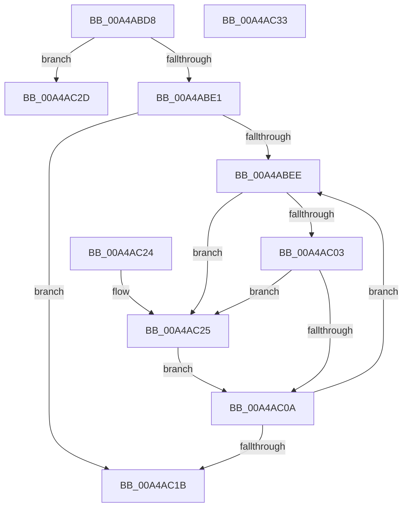

# IopReplaceSeperatorWithPound

- RVA: `0x00A4ABD8`–`0x00A4AC34` (길이 `92` bytes)
- VA: `0x0000000140A4ABD8`
- 실행 섹션: `PAGE`
- PDB 이름 있음: `예`; PDB Function 태그: `아니요`
- unwind 정보 RVA: `0x000DB714`
- 디코드: `29`개 명령, `92/92` bytes 표시
- 미해석 바이트: `0` (있으면 어셈블리에 `.byte`로 보존)

> 이 문서는 커널 이미지의 기계어와 PDB 기호를 분석해 생성했습니다. 4번과 5번은 함수 원형과 자료형을 바이너리 사용 방식에서 추정한 C 해석이며 원본 소스 복구 결과는 아닙니다.

## 1. Dependencies

- 직접 호출 지점: **0**; 고유 호출 대상: **0**
- 직접 호출자로 확인된 함수: **1**
- RIP 상대 이미지 참조: **0**

### Outgoing calls
- 직접 디코드된 call 명령이 없습니다.

### Direct callers
- [PiDevCfgConfigureDeviceLocation](../AA/PiDevCfgConfigureDeviceLocation_function_00AA88C0.md) at `0x00AA8A91`

### Static image references
- 디코드된 RIP-relative 메모리 참조가 없습니다.

## 2. Other-region calls and transfers

- 다른 실행 섹션으로 향하는 call: **0**
- 별도 외부 분기/꼬리 이동을 확인하지 못했습니다.

## 3. Assembly (complete function range)

```asm
00A4ABD8  0F B7 02                        movzx eax, word ptr [rdx]
00A4ABDB  66 3B 41 02                     cmp ax, word ptr [rcx + 2]
00A4ABDF  77 4C                           ja 0x140a4ac2d
00A4ABE1  66 D1 E8                        shr ax, 1
00A4ABE4  4C 8B 4A 08                     mov r9, qword ptr [rdx + 8]
00A4ABE8  4C 8B 51 08                     mov r10, qword ptr [rcx + 8]
00A4ABEC  74 2D                           je 0x140a4ac1b
00A4ABEE  41 B8 FF FF 00 00               mov r8d, 0xffff
00A4ABF4  66 41 03 C0                     add ax, r8w
00A4ABF8  45 0F B7 01                     movzx r8d, word ptr [r9]
00A4ABFC  66 41 83 F8 5C                  cmp r8w, 0x5c
00A4AC01  74 22                           je 0x140a4ac25
00A4AC03  66 41 83 F8 2F                  cmp r8w, 0x2f
00A4AC08  74 1B                           je 0x140a4ac25
00A4AC0A  66 45 89 02                     mov word ptr [r10], r8w
00A4AC0E  49 83 C1 02                     add r9, 2
00A4AC12  49 83 C2 02                     add r10, 2
00A4AC16  66 85 C0                        test ax, ax
00A4AC19  75 D3                           jne 0x140a4abee
00A4AC1B  0F B7 02                        movzx eax, word ptr [rdx]
00A4AC1E  66 89 01                        mov word ptr [rcx], ax
00A4AC21  33 C0                           xor eax, eax
00A4AC23  C3                              ret
00A4AC24  CC                              int3
00A4AC25  41 B8 23 00 00 00               mov r8d, 0x23
00A4AC2B  EB DD                           jmp 0x140a4ac0a
00A4AC2D  B8 23 00 00 C0                  mov eax, 0xc0000023
00A4AC32  C3                              ret
00A4AC33  CC                              int3
```

## 4. C-style interpretation (structured pseudocode)

```c
__int64 __fastcall IopReplaceSeperatorWithPound(__int64 a1, __int64 a2)
{
    __int64 result;
    __int64 v_r10;

    if (((unsigned __int16)(*(unsigned __int16 *)(a2))) > (*(unsigned __int16 *)(a1 + 2))) goto loc_00A4AC2D;
    result = (unsigned __int16)((*(unsigned __int16 *)(a2)) >> (1));
    if (condition_is_equal) goto loc_00A4AC1B;
loc_00A4ABEE:
    result = (unsigned __int16)((result) + ((unsigned __int16)((unsigned int)(0xFFFFULL))));
    if (((unsigned __int16)(*(unsigned __int16 *)(*(unsigned __int64 *)(a2 + 8)))) == 92) goto loc_00A4AC25;
    if (((unsigned __int16)(*(unsigned __int16 *)(*(unsigned __int64 *)(a2 + 8)))) == 47) goto loc_00A4AC25;
loc_00A4AC0A:
    *(unsigned __int16 *)(*(unsigned __int64 *)(a1 + 8)) = (unsigned __int16)(*(unsigned __int16 *)(*(unsigned __int64 *)(a2 + 8)));
    a4 = (*(unsigned __int64 *)(a2 + 8)) + (2);
    v_r10 = (*(unsigned __int64 *)(a1 + 8)) + (2);
    if ((unsigned __int16)(result) != 0) goto loc_00A4ABEE;
loc_00A4AC1B:
    *(unsigned __int16 *)(a1) = (unsigned __int16)(*(unsigned __int16 *)(a2));
    result = 0;
    return result;
loc_00A4AC25:
    goto loc_00A4AC0A;
loc_00A4AC2D:
    return (unsigned int)(0xC0000023ULL);
}
```

## 5. (Beta) C Style

```c
int64_t IopReplaceSeperatorWithPound(void *Arg1, void *Arg2)
{
    uint8_t *arg1 = (uint8_t *)Arg1;
    uint8_t *arg2 = (uint8_t *)Arg2;

    int64_t result;
    int64_t local_r10;

    if (((uint16_t)(*(uint16_t *)(arg2))) > (*(uint16_t *)(arg1 + 0x2))) goto loc_00A4AC2D;
    result = (uint16_t)((*(uint16_t *)(arg2)) >> (1));
    if (condition_is_equal) goto loc_00A4AC1B;
loc_00A4ABEE:
    result = (uint16_t)((result) + ((uint16_t)((uint32_t)(0xFFFFULL))));
    if (((uint16_t)(*(uint16_t *)(*(uint64_t *)(arg2 + 0x8)))) == 92) goto loc_00A4AC25;
    if (((uint16_t)(*(uint16_t *)(*(uint64_t *)(arg2 + 0x8)))) == 47) goto loc_00A4AC25;
loc_00A4AC0A:
    *(uint16_t *)(*(uint64_t *)(arg1 + 0x8)) = (uint16_t)(*(uint16_t *)(*(uint64_t *)(arg2 + 0x8)));
    a4 = (*(uint64_t *)(arg2 + 0x8)) + (2);
    local_r10 = (*(uint64_t *)(arg1 + 0x8)) + (2);
    if ((uint16_t)(result) != 0) goto loc_00A4ABEE;
loc_00A4AC1B:
    *(uint16_t *)(arg1) = (uint16_t)(*(uint16_t *)(arg2));
    result = 0;
    return result;
loc_00A4AC25:
    goto loc_00A4AC0A;
loc_00A4AC2D:
    return (uint32_t)(0xC0000023ULL);
}
```

### 관측된 메모리 오프셋

구조체 형식이 확인되지 않은 접근은 인자 기준의 오프셋으로만 기록했습니다.

| 기준 인자 | 오프셋 표현 | 폭 (bit) | 접근 |
|---|---:|---:|---|
| `Arg1` | `+ 0x0` | `16` | `W` |
| `Arg1` | `+ 0x2` | `16` | `R` |
| `Arg1` | `+ 0x8` | `64` | `R` |
| `Arg2` | `+ 0x0` | `16` | `R` |
| `Arg2` | `+ 0x8` | `64` | `R` |

## 6. Execution-region graph

[열기: 2D/3D 그래프와 함수 탐색 컨트롤 패널](../../../control-panel.html?section=page&rva=0x00A4ABD8&view=graph)

- 2D 그래프는 위에서 아래로 흐르고, 3D 그래프는 빈 공간을 드래그해 회전합니다. Shift+드래그는 이동, 휠은 확대·축소, 함수 노드 선택은 대상 보고서 이동입니다.

### Static fallback


