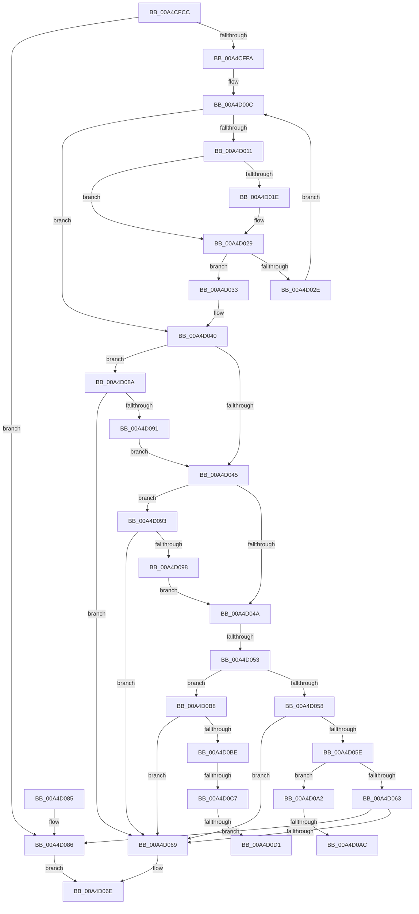

# IopSymlinkEnforceEnabledTypes

- RVA: `0x00A4CFCC`–`0x00A4D0DD` (길이 `273` bytes)
- VA: `0x0000000140A4CFCC`
- 실행 섹션: `PAGE`
- PDB 이름 있음: `예`; PDB Function 태그: `예`
- unwind 정보 RVA: `0x000B04F8`
- 디코드: `81`개 명령, `273/273` bytes 표시
- 미해석 바이트: `0` (있으면 어셈블리에 `.byte`로 보존)

> 이 문서는 커널 이미지의 기계어와 PDB 기호를 분석해 생성했습니다. 4번과 5번은 함수 원형과 자료형을 바이너리 사용 방식에서 추정한 C 해석이며 원본 소스 복구 결과는 아닙니다.

## 1. Dependencies

- 직접 호출 지점: **0**; 고유 호출 대상: **0**
- 직접 호출자로 확인된 함수: **1**
- RIP 상대 이미지 참조: **3**

### Outgoing calls
- 직접 디코드된 call 명령이 없습니다.

### Direct callers
- [IopParseDevice](../89/IopParseDevice_function_0089E510.md) at `0x008A0159`

### Static image references
- `0x00A4CFE2` → RVA `0x00E66130` (`.data`; read)
- `0x00A4D015` → RVA `0x0001A620` (`.rdata`; read)
- `0x00A4D022` → RVA `0x0001A628` (`.rdata`; read)

## 2. Other-region calls and transfers

- 다른 실행 섹션으로 향하는 call: **0**
- call이 아닌 외부 분기/꼬리 이동: **6**
  - `0x00A4D04D` → [sub_00B3BD22](../B3/Unknown_function_00B3BD22.md) (`tail-transfer`)
  - `0x00A4D0A6` → [sub_00B3BD22 + 0x64](../B3/Unknown_function_00B3BD22.md) (`tail-transfer`)
  - `0x00A4D0B3` → [sub_00B3BD22 + 0x64](../B3/Unknown_function_00B3BD22.md) (`tail-transfer`)
  - `0x00A4D0C1` → [sub_00B3BD22 + 0x80](../B3/Unknown_function_00B3BD22.md) (`tail-transfer`)
  - `0x00A4D0CB` → [sub_00B3BD22 + 0x6A](../B3/Unknown_function_00B3BD22.md) (`tail-transfer`)
  - `0x00A4D0D8` → [sub_00B3BD22 + 0x6A](../B3/Unknown_function_00B3BD22.md) (`tail-transfer`)

## 3. Assembly (complete function range)

```asm
00A4CFCC  48 89 5C 24 08                  mov qword ptr [rsp + 8], rbx
00A4CFD1  48 89 6C 24 10                  mov qword ptr [rsp + 0x10], rbp
00A4CFD6  56                              push rsi
00A4CFD7  57                              push rdi
00A4CFD8  41 55                           push r13
00A4CFDA  41 56                           push r14
00A4CFDC  41 57                           push r15
00A4CFDE  48 83 EC 30                     sub rsp, 0x30
00A4CFE2  8B 3D 48 91 41 00               mov edi, dword ptr [rip + 0x419148]
00A4CFE8  4D 8B F0                        mov r14, r8
00A4CFEB  40 8A EA                        mov bpl, dl
00A4CFEE  40 8A F1                        mov sil, cl
00A4CFF1  83 FF 0F                        cmp edi, 0xf
00A4CFF4  0F 84 8C 00 00 00               je 0x140a4d086
00A4CFFA  45 33 FF                        xor r15d, r15d
00A4CFFD  49 8D 50 08                     lea rdx, [r8 + 8]
00A4D001  48 8B 02                        mov rax, qword ptr [rdx]
00A4D004  41 8B DF                        mov ebx, r15d
00A4D007  48 89 5C 24 78                  mov qword ptr [rsp + 0x78], rbx
00A4D00C  48 3B C2                        cmp rax, rdx
00A4D00F  74 2F                           je 0x140a4d040
00A4D011  48 8B 48 10                     mov rcx, qword ptr [rax + 0x10]
00A4D015  48 2B 0D 04 D6 5C FF            sub rcx, qword ptr [rip - 0xa329fc]
00A4D01C  75 0B                           jne 0x140a4d029
00A4D01E  48 8B 48 18                     mov rcx, qword ptr [rax + 0x18]
00A4D022  48 2B 0D FF D5 5C FF            sub rcx, qword ptr [rip - 0xa32a01]
00A4D029  48 85 C9                        test rcx, rcx
00A4D02C  74 05                           je 0x140a4d033
00A4D02E  48 8B 00                        mov rax, qword ptr [rax]
00A4D031  EB D9                           jmp 0x140a4d00c
00A4D033  83 48 28 04                     or dword ptr [rax + 0x28], 4
00A4D037  48 8D 58 40                     lea rbx, [rax + 0x40]
00A4D03B  48 89 5C 24 78                  mov qword ptr [rsp + 0x78], rbx
00A4D040  48 85 DB                        test rbx, rbx
00A4D043  75 45                           jne 0x140a4d08a
00A4D045  40 84 F6                        test sil, sil
00A4D048  74 49                           je 0x140a4d093
00A4D04A  40 84 ED                        test bpl, bpl
00A4D04D  0F 84 CF EC 0E 00               je 0x140b3bd22
00A4D053  40 84 F6                        test sil, sil
00A4D056  74 60                           je 0x140a4d0b8
00A4D058  40 F6 C7 03                     test dil, 3
00A4D05C  74 0B                           je 0x140a4d069
00A4D05E  40 84 ED                        test bpl, bpl
00A4D061  74 3F                           je 0x140a4d0a2
00A4D063  40 F6 C7 01                     test dil, 1
00A4D067  75 1D                           jne 0x140a4d086
00A4D069  B8 15 07 00 C0                  mov eax, 0xc0000715
00A4D06E  48 8B 5C 24 60                  mov rbx, qword ptr [rsp + 0x60]
00A4D073  48 8B 6C 24 68                  mov rbp, qword ptr [rsp + 0x68]
00A4D078  48 83 C4 30                     add rsp, 0x30
00A4D07C  41 5F                           pop r15
00A4D07E  41 5E                           pop r14
00A4D080  41 5D                           pop r13
00A4D082  5F                              pop rdi
00A4D083  5E                              pop rsi
00A4D084  C3                              ret
00A4D085  CC                              int3
00A4D086  33 C0                           xor eax, eax
00A4D088  EB E4                           jmp 0x140a4d06e
00A4D08A  8B 43 E8                        mov eax, dword ptr [rbx - 0x18]
00A4D08D  A8 10                           test al, 0x10
00A4D08F  75 D8                           jne 0x140a4d069
00A4D091  EB B2                           jmp 0x140a4d045
00A4D093  48 85 DB                        test rbx, rbx
00A4D096  74 D1                           je 0x140a4d069
00A4D098  83 7B 10 02                     cmp dword ptr [rbx + 0x10], 2
00A4D09C  40 0F 94 C6                     sete sil
00A4D0A0  EB A8                           jmp 0x140a4d04a
00A4D0A2  40 F6 C7 02                     test dil, 2
00A4D0A6  0F 85 DA EC 0E 00               jne 0x140b3bd86
00A4D0AC  C7 43 04 02 00 00 00            mov dword ptr [rbx + 4], 2
00A4D0B3  E9 CE EC 0E 00                  jmp 0x140b3bd86
00A4D0B8  40 F6 C7 0C                     test dil, 0xc
00A4D0BC  74 AB                           je 0x140a4d069
00A4D0BE  40 84 ED                        test bpl, bpl
00A4D0C1  0F 85 DB EC 0E 00               jne 0x140b3bda2
00A4D0C7  40 F6 C7 08                     test dil, 8
00A4D0CB  0F 85 BB EC 0E 00               jne 0x140b3bd8c
00A4D0D1  C7 43 04 02 00 00 00            mov dword ptr [rbx + 4], 2
00A4D0D8  E9 AF EC 0E 00                  jmp 0x140b3bd8c
```

## 4. C-style interpretation (structured pseudocode)

```c
__int64 __fastcall IopSymlinkEnforceEnabledTypes(unsigned __int8 a1, unsigned __int8 a2, __int64 a3)
{
    __int64 result;
    __int64 v_r15;
    __int64 v_rsi;
    __int64 v_rsp;
    unsigned __int64 v_stack_p10;
    unsigned __int64 v_stack_p20;
    unsigned __int64 v_stack_p8;

    v_stack_p8 = v_rbx;
    v_stack_p10 = v_rbp;
    v_rsp = (v_rsp) - (48);
    if (((unsigned int)((unsigned int)(*(unsigned int *)(v_rip + 4297032)))) == 15) goto loc_00A4D086;
    v_r15 = 0;
    v_stack_p20 = 0;
loc_00A4D00C:
    if ((*(unsigned __int64 *)(a3 + 8)) == (a3 + 8)) goto loc_00A4D040;
    a1 = (*(unsigned __int64 *)(*(unsigned __int64 *)(a3 + 8) + 16)) - (*(unsigned __int64 *)(v_rip - 10693116));
    if (!(condition_is_not_equal)) {
        a1 = *(unsigned __int64 *)(*(unsigned __int64 *)(a3 + 8) + 24);
        a1 = (a1) - (*(unsigned __int64 *)(v_rip - 10693121));
    }
    if (a1 == 0) goto loc_00A4D033;
    goto loc_00A4D00C;
loc_00A4D033:
    v_stack_p20 = *(unsigned __int64 *)(*(unsigned __int64 *)(a3 + 8)) + 64;
loc_00A4D040:
    if (*(unsigned __int64 *)(*(unsigned __int64 *)(a3 + 8)) + 64 != 0) goto loc_00A4D08A;
loc_00A4D045:
    if (a1 == 0) goto loc_00A4D093;
loc_00A4D04A:
    if (a1 == 0) goto loc_00A4D0B8;
    if ((((unsigned __int8)((unsigned int)(*(unsigned int *)(v_rip + 4297032)))) & (3)) == 0) goto loc_00A4D069;
    if (a2 == 0) goto loc_00A4D0A2;
    if ((((unsigned __int8)((unsigned int)(*(unsigned int *)(v_rip + 4297032)))) & (1)) != 0) goto loc_00A4D086;
loc_00A4D069:
loc_00A4D06E:
    v_rsp = (v_rsp) + (48);
    return (unsigned int)(0xC0000715ULL);
loc_00A4D086:
    result = 0;
    goto loc_00A4D06E;
loc_00A4D08A:
    if ((((unsigned __int8)((unsigned int)(*(unsigned int *)(v_stack_p8 - 24)))) & (16)) != 0) goto loc_00A4D069;
    goto loc_00A4D045;
loc_00A4D093:
    if (v_stack_p8 == 0) goto loc_00A4D069;
    v_rsi = ((*(unsigned int *)(v_stack_p8 + 16)) == 2) ? 1 : 0;
    goto loc_00A4D04A;
loc_00A4D0A2:
    *(unsigned int *)(v_stack_p8 + 4) = 2;
loc_00A4D0B8:
    if ((((unsigned __int8)((unsigned int)(*(unsigned int *)(v_rip + 4297032)))) & (12)) == 0) goto loc_00A4D069;
    *(unsigned int *)(v_stack_p8 + 4) = 2;
}
```

## 5. (Beta) C Style

```c
int64_t IopSymlinkEnforceEnabledTypes(uint8_t Arg1, uint8_t Arg2, void *Arg3)
{
    uint8_t *arg3 = (uint8_t *)Arg3;

    int64_t result;
    int64_t local_r15;
    int64_t local_rsi;
    int64_t local_rsp;
    uint64_t v_stack_p10;
    uint64_t v_stack_p20;
    uint64_t v_stack_p8;

    v_stack_p8 = local_rbx;
    v_stack_p10 = local_rbp;
    local_rsp = (local_rsp) - (48);
    if (((uint32_t)((uint32_t)(*(uint32_t *)(v_rip + 0x419148)))) == 15) goto loc_00A4D086;
    local_r15 = 0;
    v_stack_p20 = 0;
loc_00A4D00C:
    if ((*(uint64_t *)(arg3 + 0x8)) == (Arg3 + 8)) goto loc_00A4D040;
    Arg1 = (*(uint64_t *)(*(uint64_t *)(arg3 + 0x8) + 0x10)) - (*(uint64_t *)(v_rip - 0xA329FC));
    if (!(condition_is_not_equal)) {
        Arg1 = *(uint64_t *)(*(uint64_t *)(arg3 + 0x8) + 0x18);
        Arg1 = (Arg1) - (*(uint64_t *)(v_rip - 0xA32A01));
    }
    if (Arg1 == 0) goto loc_00A4D033;
    goto loc_00A4D00C;
loc_00A4D033:
    v_stack_p20 = *(uint64_t *)(*(uint64_t *)(arg3 + 0x8)) + 64;
loc_00A4D040:
    if (*(uint64_t *)(*(uint64_t *)(arg3 + 0x8)) + 64 != 0) goto loc_00A4D08A;
loc_00A4D045:
    if (Arg1 == 0) goto loc_00A4D093;
loc_00A4D04A:
    if (Arg1 == 0) goto loc_00A4D0B8;
    if ((((uint8_t)((uint32_t)(*(uint32_t *)(v_rip + 0x419148)))) & (3)) == 0) goto loc_00A4D069;
    if (Arg2 == 0) goto loc_00A4D0A2;
    if ((((uint8_t)((uint32_t)(*(uint32_t *)(v_rip + 0x419148)))) & (1)) != 0) goto loc_00A4D086;
loc_00A4D069:
loc_00A4D06E:
    local_rsp = (local_rsp) + (48);
    return (uint32_t)(0xC0000715ULL);
loc_00A4D086:
    result = 0;
    goto loc_00A4D06E;
loc_00A4D08A:
    if ((((uint8_t)((uint32_t)(*(uint32_t *)(v_stack_p8 - 0x18)))) & (16)) != 0) goto loc_00A4D069;
    goto loc_00A4D045;
loc_00A4D093:
    if (v_stack_p8 == 0) goto loc_00A4D069;
    local_rsi = ((*(uint32_t *)(v_stack_p8 + 0x10)) == 2) ? 1 : 0;
    goto loc_00A4D04A;
loc_00A4D0A2:
    *(uint32_t *)(v_stack_p8 + 0x4) = 2;
loc_00A4D0B8:
    if ((((uint8_t)((uint32_t)(*(uint32_t *)(v_rip + 0x419148)))) & (12)) == 0) goto loc_00A4D069;
    *(uint32_t *)(v_stack_p8 + 0x4) = 2;
}
```

### 관측된 메모리 오프셋

구조체 형식이 확인되지 않은 접근은 인자 기준의 오프셋으로만 기록했습니다.

| 기준 인자 | 오프셋 표현 | 폭 (bit) | 접근 |
|---|---:|---:|---|
| `Arg3` | `+ 0x0` | `64` | `R` |
| `Arg3` | `+ 0x8` | `64` | `R` |

## 6. Execution-region graph

[열기: 2D/3D 그래프와 함수 탐색 컨트롤 패널](../../../control-panel.html?section=page&rva=0x00A4CFCC&view=graph)

- 2D 그래프는 위에서 아래로 흐르고, 3D 그래프는 빈 공간을 드래그해 회전합니다. Shift+드래그는 이동, 휠은 확대·축소, 함수 노드 선택은 대상 보고서 이동입니다.

### Static fallback


