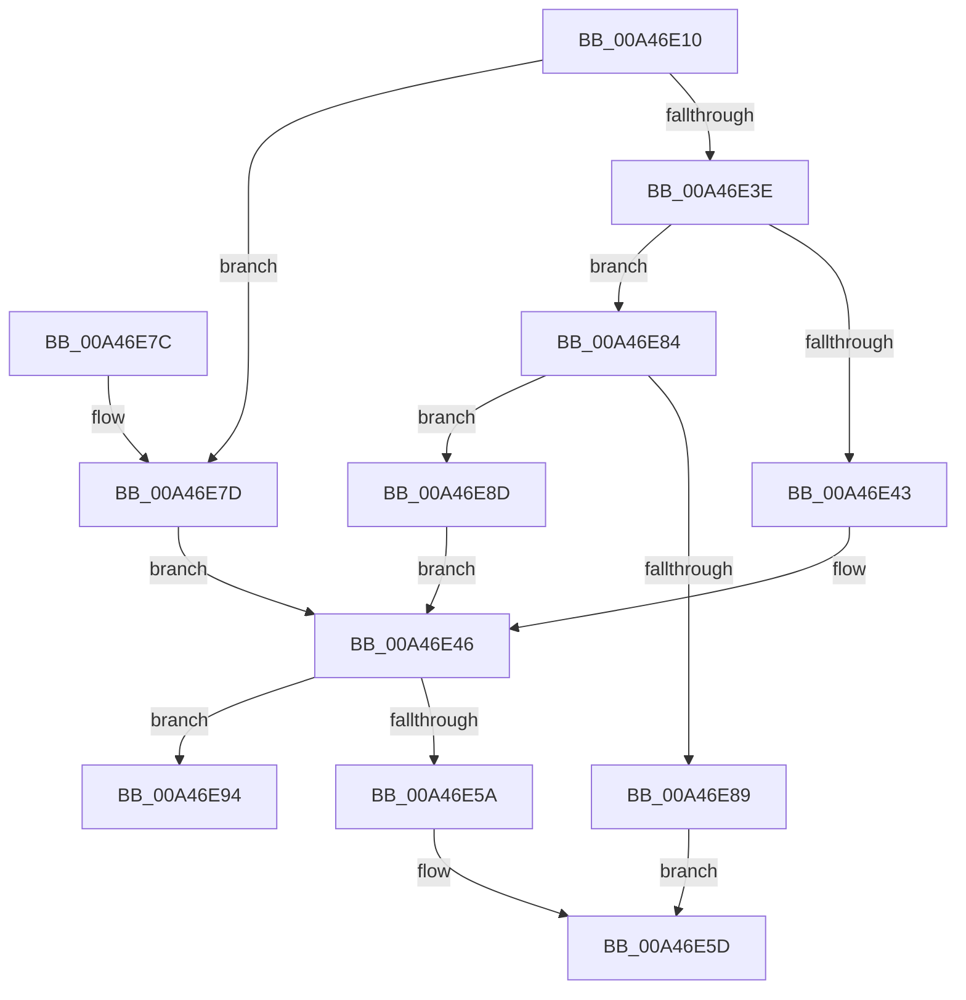

# KiShouldLogUserModeReturnMismatch

- RVA: `0x00A46E10`–`0x00A46E9B` (길이 `139` bytes)
- VA: `0x0000000140A46E10`
- 실행 섹션: `PAGE`
- PDB 이름 있음: `예`; PDB Function 태그: `예`
- unwind 정보 RVA: `0x000AF84C`
- 디코드: `43`개 명령, `139/139` bytes 표시
- 미해석 바이트: `0` (있으면 어셈블리에 `.byte`로 보존)

> 이 문서는 커널 이미지의 기계어와 PDB 기호를 분석해 생성했습니다. 4번과 5번은 함수 원형과 자료형을 바이너리 사용 방식에서 추정한 C 해석이며 원본 소스 복구 결과는 아닙니다.

## 1. Dependencies

- 직접 호출 지점: **0**; 고유 호출 대상: **0**
- 직접 호출자로 확인된 함수: **1**
- RIP 상대 이미지 참조: **0**

### Outgoing calls
- 직접 디코드된 call 명령이 없습니다.

### Direct callers
- [KiLogControlProtectionUserModeReturnMismatch](../../text/44/KiLogControlProtectionUserModeReturnMismatch_function_00444AD0.md) at `0x00444AFD`

### Static image references
- 디코드된 RIP-relative 메모리 참조가 없습니다.

## 2. Other-region calls and transfers

- 다른 실행 섹션으로 향하는 call: **0**
- call이 아닌 외부 분기/꼬리 이동: **1**
  - `0x00A46E96` → [sub_00B3B680](../B3/Unknown_function_00B3B680.md) (`tail-transfer`)

## 3. Assembly (complete function range)

```asm
00A46E10  48 8B C4                        mov rax, rsp
00A46E13  48 89 58 08                     mov qword ptr [rax + 8], rbx
00A46E17  48 89 68 10                     mov qword ptr [rax + 0x10], rbp
00A46E1B  48 89 70 18                     mov qword ptr [rax + 0x18], rsi
00A46E1F  48 89 78 20                     mov qword ptr [rax + 0x20], rdi
00A46E23  41 54                           push r12
00A46E25  41 56                           push r14
00A46E27  41 57                           push r15
00A46E29  48 83 EC 20                     sub rsp, 0x20
00A46E2D  48 8B B9 A8 01 00 00            mov rdi, qword ptr [rcx + 0x1a8]
00A46E34  33 ED                           xor ebp, ebp
00A46E36  4D 8B F8                        mov r15, r8
00A46E39  83 EA 01                        sub edx, 1
00A46E3C  74 3F                           je 0x140a46e7d
00A46E3E  83 EA 01                        sub edx, 1
00A46E41  75 41                           jne 0x140a46e84
00A46E43  8D 75 20                        lea esi, [rbp + 0x20]
00A46E46  F0 FF 44 3E 10                  lock inc dword ptr [rsi + rdi + 0x10]
00A46E4B  44 8B 44 3E 08                  mov r8d, dword ptr [rsi + rdi + 8]
00A46E50  44 8B 64 3E 0C                  mov r12d, dword ptr [rsi + rdi + 0xc]
00A46E55  45 3B C4                        cmp r8d, r12d
00A46E58  75 3A                           jne 0x140a46e94
00A46E5A  40 8A C5                        mov al, bpl
00A46E5D  48 8B 5C 24 40                  mov rbx, qword ptr [rsp + 0x40]
00A46E62  48 8B 6C 24 48                  mov rbp, qword ptr [rsp + 0x48]
00A46E67  48 8B 74 24 50                  mov rsi, qword ptr [rsp + 0x50]
00A46E6C  48 8B 7C 24 58                  mov rdi, qword ptr [rsp + 0x58]
00A46E71  48 83 C4 20                     add rsp, 0x20
00A46E75  41 5F                           pop r15
00A46E77  41 5E                           pop r14
00A46E79  41 5C                           pop r12
00A46E7B  C3                              ret
00A46E7C  CC                              int3
00A46E7D  BE 08 00 00 00                  mov esi, 8
00A46E82  EB C2                           jmp 0x140a46e46
00A46E84  83 FA 01                        cmp edx, 1
00A46E87  74 04                           je 0x140a46e8d
00A46E89  32 C0                           xor al, al
00A46E8B  EB D0                           jmp 0x140a46e5d
00A46E8D  BE 38 00 00 00                  mov esi, 0x38
00A46E92  EB B2                           jmp 0x140a46e46
00A46E94  8B D5                           mov edx, ebp
00A46E96  E9 E5 47 0F 00                  jmp 0x140b3b680
```

## 4. C-style interpretation (structured pseudocode)

```c
__int64 __fastcall KiShouldLogUserModeReturnMismatch(__int64 a1, int a2, __int64 a3)
{
    __int64 result;
    __int64 v_rbp;
    __int64 v_rsp;
    unsigned __int64 v_stack_p10;
    unsigned __int64 v_stack_p18;
    unsigned __int64 v_stack_p20;
    unsigned __int64 v_stack_p8;

    *(unsigned __int64 *)(v_rsp + 8) = v_rbx;
    *(unsigned __int64 *)(v_rsp + 16) = v_rbp;
    *(unsigned __int64 *)(v_rsp + 24) = v_rsi;
    *(unsigned __int64 *)(v_rsp + 32) = v_rdi;
    v_rsp = (v_rsp) - (32);
    v_rbp = 0;
    a2 = (unsigned int)((a2) - (1));
    if (condition_is_equal) goto loc_00A46E7D;
    a2 = (unsigned int)((a2) - (1));
    if (condition_is_not_equal) goto loc_00A46E84;
loc_00A46E46:
    if (((unsigned int)((unsigned int)(*(unsigned int *)(v_rbp + 32 + *(unsigned __int64 *)(a1 + 424) * 1 + 8)))) != ((unsigned int)((unsigned int)(*(unsigned int *)(v_rbp + 32 + *(unsigned __int64 *)(a1 + 424) * 1 + 12))))) goto loc_00A46E94;
loc_00A46E5D:
    v_rsp = (v_rsp) + (32);
    return 0;
loc_00A46E7D:
    goto loc_00A46E46;
loc_00A46E84:
    if (a2 == 1) goto loc_00A46E8D;
    result = 0;
    goto loc_00A46E5D;
loc_00A46E8D:
    goto loc_00A46E46;
loc_00A46E94:
}
```

## 5. (Beta) C Style

```c
int64_t KiShouldLogUserModeReturnMismatch(void *Arg1, int32_t Arg2, int64_t Arg3)
{
    uint8_t *arg1 = (uint8_t *)Arg1;

    int64_t result;
    int64_t local_rbp;
    int64_t local_rsp;
    uint64_t v_stack_p10;
    uint64_t v_stack_p18;
    uint64_t v_stack_p20;
    uint64_t v_stack_p8;

    *(uint64_t *)(local_rsp + 0x8) = local_rbx;
    *(uint64_t *)(local_rsp + 0x10) = local_rbp;
    *(uint64_t *)(local_rsp + 0x18) = local_rsi;
    *(uint64_t *)(local_rsp + 0x20) = local_rdi;
    local_rsp = (local_rsp) - (32);
    local_rbp = 0;
    Arg2 = (uint32_t)((Arg2) - (1));
    if (condition_is_equal) goto loc_00A46E7D;
    Arg2 = (uint32_t)((Arg2) - (1));
    if (condition_is_not_equal) goto loc_00A46E84;
loc_00A46E46:
    if (((uint32_t)((uint32_t)(*(uint32_t *)(local_rbp + 0x20 + *(uint64_t *)(arg1 + 0x1A8) * 1 + 0x8)))) != ((uint32_t)((uint32_t)(*(uint32_t *)(local_rbp + 0x20 + *(uint64_t *)(arg1 + 0x1A8) * 1 + 0xC))))) goto loc_00A46E94;
loc_00A46E5D:
    local_rsp = (local_rsp) + (32);
    return 0;
loc_00A46E7D:
    goto loc_00A46E46;
loc_00A46E84:
    if (Arg2 == 1) goto loc_00A46E8D;
    result = 0;
    goto loc_00A46E5D;
loc_00A46E8D:
    goto loc_00A46E46;
loc_00A46E94:
}
```

### 관측된 메모리 오프셋

구조체 형식이 확인되지 않은 접근은 인자 기준의 오프셋으로만 기록했습니다.

| 기준 인자 | 오프셋 표현 | 폭 (bit) | 접근 |
|---|---:|---:|---|
| `Arg1` | `+ 0x1A8` | `64` | `R` |

## 6. Execution-region graph

[열기: 2D/3D 그래프와 함수 탐색 컨트롤 패널](../../../control-panel.html?section=page&rva=0x00A46E10&view=graph)

- 2D 그래프는 위에서 아래로 흐르고, 3D 그래프는 빈 공간을 드래그해 회전합니다. Shift+드래그는 이동, 휠은 확대·축소, 함수 노드 선택은 대상 보고서 이동입니다.

### Static fallback


