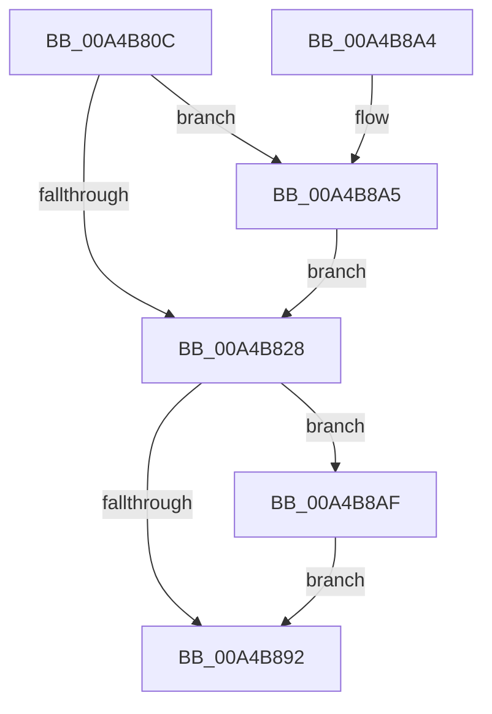

# MiAllocateKernelCfgBitmapPageTables

- RVA: `0x00A4B80C`–`0x00A4B8B6` (길이 `170` bytes)
- VA: `0x0000000140A4B80C`
- 실행 섹션: `PAGE`
- PDB 이름 있음: `예`; PDB Function 태그: `아니요`
- unwind 정보 RVA: `0x00078D6C`
- 디코드: `46`개 명령, `170/170` bytes 표시
- 미해석 바이트: `0` (있으면 어셈블리에 `.byte`로 보존)

> 이 문서는 커널 이미지의 기계어와 PDB 기호를 분석해 생성했습니다. 4번과 5번은 함수 원형과 자료형을 바이너리 사용 방식에서 추정한 C 해석이며 원본 소스 복구 결과는 아닙니다.

## 1. Dependencies

- 직접 호출 지점: **5**; 고유 호출 대상: **4**
- 직접 호출자로 확인된 함수: **3**
- RIP 상대 이미지 참조: **1**

### Outgoing calls
- `0x00A4B84D` → [MiGetPteAddress](../../text/43/MiGetPteAddress_function_0043E130.md) (function, `0x0043E130`)
- `0x00A4B86B` → [MiGetPteAddress](../../text/43/MiGetPteAddress_function_0043E130.md) (function, `0x0043E130`)
- `0x00A4B87D` → [MiMakeZeroedPageTables](../../text/3B/MiMakeZeroedPageTables_function_003B4F6C.md) (function, `0x003B4F6C`)
- `0x00A4B8A5` → [MiAcquireKernelCfgLock](MiAcquireKernelCfgLock_function_00A4B9A0.md) (function, `0x00A4B9A0`)
- `0x00A4B8AF` → [MiReleaseKernelCfgLock](MiReleaseKernelCfgLock_function_00A4B8BC.md) (function, `0x00A4B8BC`)

### Direct callers
- [MiApplyDriverHotPatch](../80/MiApplyDriverHotPatch_function_008018EC.md) at `0x00801C0A`
- [MiMarkKernelImageCfgBits](MiMarkKernelImageCfgBits_function_00A4B1E0.md) at `0x00A4B216`
- [MiInitializeKernelCfgImages](../../init/C6/MiInitializeKernelCfgImages_function_00C6A430.md) at `0x00C6A450`

### Static image references
- `0x00A4B846` → RVA `0x00E2D818` (`.data`; read)

## 2. Other-region calls and transfers

- 다른 실행 섹션으로 향하는 call: **3**
  - `0x00A4B84D` → [MiGetPteAddress](../../text/43/MiGetPteAddress_function_0043E130.md) (`PAGE` → `.text`)
  - `0x00A4B86B` → [MiGetPteAddress](../../text/43/MiGetPteAddress_function_0043E130.md) (`PAGE` → `.text`)
  - `0x00A4B87D` → [MiMakeZeroedPageTables](../../text/3B/MiMakeZeroedPageTables_function_003B4F6C.md) (`PAGE` → `.text`)
- 별도 외부 분기/꼬리 이동을 확인하지 못했습니다.

## 3. Assembly (complete function range)

```asm
00A4B80C  48 89 5C 24 08                  mov qword ptr [rsp + 8], rbx
00A4B811  48 89 74 24 10                  mov qword ptr [rsp + 0x10], rsi
00A4B816  57                              push rdi
00A4B817  48 83 EC 20                     sub rsp, 0x20
00A4B81B  41 8B D8                        mov ebx, r8d
00A4B81E  8B F2                           mov esi, edx
00A4B820  48 8B F9                        mov rdi, rcx
00A4B823  45 85 C0                        test r8d, r8d
00A4B826  74 7D                           je 0x140a4b8a5
00A4B828  8D 4E FF                        lea ecx, [rsi - 1]
00A4B82B  49 B9 00 00 00 00 00 80 00 00   movabs r9, 0x800000000000
00A4B835  49 03 C9                        add rcx, r9
00A4B838  48 03 CF                        add rcx, rdi
00A4B83B  48 C1 E9 04                     shr rcx, 4
00A4B83F  48 03 C9                        add rcx, rcx
00A4B842  48 C1 E9 03                     shr rcx, 3
00A4B846  48 03 0D CB 1F 3E 00            add rcx, qword ptr [rip + 0x3e1fcb]
00A4B84D  E8 DE 28 9F FF                  call 0x14043e130
00A4B852  4A 8D 0C 0F                     lea rcx, [rdi + r9]
00A4B856  48 8B D0                        mov rdx, rax
00A4B859  48 C1 E9 04                     shr rcx, 4
00A4B85D  48 03 C9                        add rcx, rcx
00A4B860  48 C1 E9 03                     shr rcx, 3
00A4B864  48 03 0D AD 1F 3E 00            add rcx, qword ptr [rip + 0x3e1fad]
00A4B86B  E8 C0 28 9F FF                  call 0x14043e130
00A4B870  41 B9 12 00 00 00               mov r9d, 0x12
00A4B876  48 8B C8                        mov rcx, rax
00A4B879  45 8D 41 EF                     lea r8d, [r9 - 0x11]
00A4B87D  E8 EA 96 96 FF                  call 0x1403b4f6c
00A4B882  F7 D8                           neg eax
00A4B884  1B FF                           sbb edi, edi
00A4B886  F7 D7                           not edi
00A4B888  81 E7 9A 00 00 C0               and edi, 0xc000009a
00A4B88E  85 DB                           test ebx, ebx
00A4B890  74 1D                           je 0x140a4b8af
00A4B892  48 8B 5C 24 30                  mov rbx, qword ptr [rsp + 0x30]
00A4B897  8B C7                           mov eax, edi
00A4B899  48 8B 74 24 38                  mov rsi, qword ptr [rsp + 0x38]
00A4B89E  48 83 C4 20                     add rsp, 0x20
00A4B8A2  5F                              pop rdi
00A4B8A3  C3                              ret
00A4B8A4  CC                              int3
00A4B8A5  E8 F6 00 00 00                  call 0x140a4b9a0
00A4B8AA  E9 79 FF FF FF                  jmp 0x140a4b828
00A4B8AF  E8 08 00 00 00                  call 0x140a4b8bc
00A4B8B4  EB DC                           jmp 0x140a4b892
```

## 4. C-style interpretation (structured pseudocode)

```c
__int64 __fastcall MiAllocateKernelCfgBitmapPageTables(__int64 a1, int a2, int a3)
{
    __int64 result;
    __int64 v_rdi;
    __int64 v_rsp;
    unsigned __int64 v_stack_p10;
    unsigned __int64 v_stack_p8;

    v_stack_p8 = v_rbx;
    v_stack_p10 = v_rsi;
    v_rsp = (v_rsp) - (32);
    if (a3 == 0) goto loc_00A4B8A5;
loc_00A4B828:
    a1 = ((unsigned int)(a2) - 1) + (a4);
    a1 = (a1) + (a1);
    a1 = (a1) >> (4);
    a1 = (a1) + (a1);
    a1 = (a1) >> (3);
    a1 = (a1) + (*(unsigned __int64 *)(v_rip + 4071371));
    result = MiGetPteAddress(a1, a2, a3, a4);
    a1 = (a1 + a4 * 1) >> (4);
    a1 = (a1) + (a1);
    a1 = (a1) >> (3);
    a1 = (a1) + (*(unsigned __int64 *)(v_rip + 4071341));
    result = MiGetPteAddress(a1, result, a3, a4);
    result = MiMakeZeroedPageTables(result, result, 18 - 17, 18);
    result = (unsigned int)(-(result));
    v_rdi = (unsigned int)(~(a1));
    v_rdi = (unsigned int)((v_rdi) & (0xC000009AULL));
    if ((unsigned int)((unsigned int)(a3)) == 0) goto loc_00A4B8AF;
loc_00A4B892:
    v_rsp = (v_rsp) + (32);
    return (unsigned int)((unsigned int)(v_rdi));
loc_00A4B8A5:
    result = MiAcquireKernelCfgLock(result, result, 18 - 17, 18);
    goto loc_00A4B828;
loc_00A4B8AF:
    result = MiReleaseKernelCfgLock(result, result, 18 - 17, 18);
    goto loc_00A4B892;
}
```

## 5. (Beta) C Style

```c
int64_t MiAllocateKernelCfgBitmapPageTables(void *Arg1, void *Arg2, int32_t Arg3)
{
    uint8_t *arg1 = (uint8_t *)Arg1;
    uint8_t *arg2 = (uint8_t *)Arg2;

    int64_t result;
    int64_t local_rdi;
    int64_t local_rsp;
    uint64_t v_stack_p10;
    uint64_t v_stack_p8;

    v_stack_p8 = local_rbx;
    v_stack_p10 = local_rsi;
    local_rsp = (local_rsp) - (32);
    if (Arg3 == 0) goto loc_00A4B8A5;
loc_00A4B828:
    Arg1 = ((uint32_t)(Arg2) - 1) + (a4);
    Arg1 = (Arg1) + (Arg1);
    Arg1 = (Arg1) >> (4);
    Arg1 = (Arg1) + (Arg1);
    Arg1 = (Arg1) >> (3);
    Arg1 = (Arg1) + (*(uint64_t *)(v_rip + 0x3E1FCB));
    result = MiGetPteAddress(Arg1, Arg2, Arg3, a4);
    Arg1 = (Arg1 + a4 * 1) >> (4);
    Arg1 = (Arg1) + (Arg1);
    Arg1 = (Arg1) >> (3);
    Arg1 = (Arg1) + (*(uint64_t *)(v_rip + 0x3E1FAD));
    result = MiGetPteAddress(Arg1, result, Arg3, a4);
    result = MiMakeZeroedPageTables(result, result, 18 - 17, 18);
    result = (uint32_t)(-(result));
    local_rdi = (uint32_t)(~(Arg1));
    local_rdi = (uint32_t)((local_rdi) & (0xC000009AULL));
    if ((uint32_t)((uint32_t)(Arg3)) == 0) goto loc_00A4B8AF;
loc_00A4B892:
    local_rsp = (local_rsp) + (32);
    return (uint32_t)((uint32_t)(local_rdi));
loc_00A4B8A5:
    result = MiAcquireKernelCfgLock(result, result, 18 - 17, 18);
    goto loc_00A4B828;
loc_00A4B8AF:
    result = MiReleaseKernelCfgLock(result, result, 18 - 17, 18);
    goto loc_00A4B892;
}
```

### 관측된 메모리 오프셋

구조체 형식이 확인되지 않은 접근은 인자 기준의 오프셋으로만 기록했습니다.

| 기준 인자 | 오프셋 표현 | 폭 (bit) | 접근 |
|---|---:|---:|---|
| `Arg1` | `+ 0x0 + r9*1` | `64` | `R` |
| `Arg2` | `- 0x1` | `32` | `R` |

## 6. Execution-region graph

[열기: 2D/3D 그래프와 함수 탐색 컨트롤 패널](../../../control-panel.html?section=page&rva=0x00A4B80C&view=graph)

- 2D 그래프는 위에서 아래로 흐르고, 3D 그래프는 빈 공간을 드래그해 회전합니다. Shift+드래그는 이동, 휠은 확대·축소, 함수 노드 선택은 대상 보고서 이동입니다.

### Static fallback


