# MiCopyPagesIntoEnclave

- RVA: `0x00A472AC`–`0x00A478FB` (길이 `1,615` bytes)
- VA: `0x0000000140A472AC`
- 실행 섹션: `PAGE`
- PDB 이름 있음: `예`; PDB Function 태그: `아니요`
- unwind 정보 RVA: `0x000AF8D4`
- 디코드: `356`개 명령, `1,615/1,615` bytes 표시
- 미해석 바이트: `0` (있으면 어셈블리에 `.byte`로 보존)

> 이 문서는 커널 이미지의 기계어와 PDB 기호를 분석해 생성했습니다. 4번과 5번은 함수 원형과 자료형을 바이너리 사용 방식에서 추정한 C 해석이며 원본 소스 복구 결과는 아닙니다.

## 1. Dependencies

- 직접 호출 지점: **26**; 고유 호출 대상: **23**
- 직접 호출자로 확인된 함수: **1**
- RIP 상대 이미지 참조: **2**

### Outgoing calls
- `0x00A47360` → [memset](../../text/6C/memset_function_006C6C40.md) (function, `0x006C6C40`)
- `0x00A47393` → [MiMakeProtectionMask](../../text/32/MiMakeProtectionMask_function_00329480.md) (function, `0x00329480`)
- `0x00A47400` → [KiStackAttachProcess](../../text/21/KiStackAttachProcess_function_00216820.md) (function, `0x00216820`)
- `0x00A4741A` → [MiCountCommittedPages](../../text/2C/MiCountCommittedPages_function_002C7950.md) (function, `0x002C7950`)
- `0x00A47437` → [KiUnstackDetachProcess](../../text/21/KiUnstackDetachProcess_function_00217D30.md) (function, `0x00217D30`)
- `0x00A4745F` → [MiGetPteAddress](../../text/43/MiGetPteAddress_function_0043E130.md) (function, `0x0043E130`)
- `0x00A47494` → [MiCreatePteCopyList](../../text/48/MiCreatePteCopyList_function_004887E8.md) (function, `0x004887E8`)
- `0x00A474C0` → [MiAllocatePool](../../text/35/MiAllocatePool_function_0035B540.md) (function, `0x0035B540`)
- `0x00A474E3` → [MiGetVmPartition](../../text/41/MiGetVmPartition_function_00418950.md) (function, `0x00418950`)
- `0x00A47618` → [MmProbeAndLockPages](../../text/23/MmProbeAndLockPages_function_0023B990.md) (function, `0x0023B990`)
- `0x00A47645` → [MmMapLockedPagesSpecifyCache](../../text/31/MmMapLockedPagesSpecifyCache_function_00318800.md) (function, `0x00318800`)
- `0x00A47673` → [ExFreePoolWithTag](../../poolcode/B8/ExFreePoolWithTag_function_00B82870.md) (function, `0x00B82870`)
- `0x00A47680` → [MiReleasePteCopyList](../../text/4B/MiReleasePteCopyList_function_004B0D14.md) (function, `0x004B0D14`)
- `0x00A47692` → [_security_check_cookie](../../text/6A/_security_check_cookie_function_006AC640.md) (function, `0x006AC640`)
- `0x00A476D3` → [memcpy](../../text/6C/memcpy_function_006C6840.md) (function, `0x006C6840`)
- `0x00A47708` → [KiStackAttachProcess](../../text/21/KiStackAttachProcess_function_00216820.md) (function, `0x00216820`)
- `0x00A4772F` → [KiUnstackDetachProcess](../../text/21/KiUnstackDetachProcess_function_00217D30.md) (function, `0x00217D30`)
- `0x00A47758` → [MiGetPageForEnclave](../../text/36/MiGetPageForEnclave_function_00367C38.md) (function, `0x00367C38`)
- `0x00A47779` → [MiGetPteFromCopyList](../../text/2B/MiGetPteFromCopyList_function_002B20E0.md) (function, `0x002B20E0`)
- `0x00A477BD` → [KeAddEnclavePage](../../text/36/KeAddEnclavePage_function_003683F8.md) (function, `0x003683F8`)
- `0x00A477EF` → [MiInitializeEnclavePfn](../../text/36/MiInitializeEnclavePfn_function_003682A8.md) (function, `0x003682A8`)
- `0x00A47802` → [MiMakeValidPte](../../text/2C/MiMakeValidPte_function_002C5590.md) (function, `0x002C5590`)
- `0x00A4781D` → [MiWriteEnclavePte](../../text/36/MiWriteEnclavePte_function_00368570.md) (function, `0x00368570`)
- `0x00A478C3` → [MiReturnEnclavePage](../../text/4D/MiReturnEnclavePage_function_004DEEF8.md) (function, `0x004DEEF8`)
- `0x00A478DF` → [MmUnlockPages](../../text/29/MmUnlockPages_function_0029EEE0.md) (function, `0x0029EEE0`)
- `0x00A478F1` → [MmUnlockPages](../../text/29/MmUnlockPages_function_0029EEE0.md) (function, `0x0029EEE0`)

### Direct callers
- [NtLoadEnclaveData](../AF/NtLoadEnclaveData_function_00AF8DF0.md) at `0x00AF9279`

### Static image references
- `0x00A472BF` → RVA `0x00E0A740` (`.data`; read)
- `0x00A477C4` → RVA `0x00010880` (`.rdata`; read)

## 2. Other-region calls and transfers

- 다른 실행 섹션으로 향하는 call: **26**
  - `0x00A47360` → [memset](../../text/6C/memset_function_006C6C40.md) (`PAGE` → `.text`)
  - `0x00A47393` → [MiMakeProtectionMask](../../text/32/MiMakeProtectionMask_function_00329480.md) (`PAGE` → `.text`)
  - `0x00A47400` → [KiStackAttachProcess](../../text/21/KiStackAttachProcess_function_00216820.md) (`PAGE` → `.text`)
  - `0x00A4741A` → [MiCountCommittedPages](../../text/2C/MiCountCommittedPages_function_002C7950.md) (`PAGE` → `.text`)
  - `0x00A47437` → [KiUnstackDetachProcess](../../text/21/KiUnstackDetachProcess_function_00217D30.md) (`PAGE` → `.text`)
  - `0x00A4745F` → [MiGetPteAddress](../../text/43/MiGetPteAddress_function_0043E130.md) (`PAGE` → `.text`)
  - `0x00A47494` → [MiCreatePteCopyList](../../text/48/MiCreatePteCopyList_function_004887E8.md) (`PAGE` → `.text`)
  - `0x00A474C0` → [MiAllocatePool](../../text/35/MiAllocatePool_function_0035B540.md) (`PAGE` → `.text`)
  - `0x00A474E3` → [MiGetVmPartition](../../text/41/MiGetVmPartition_function_00418950.md) (`PAGE` → `.text`)
  - `0x00A47618` → [MmProbeAndLockPages](../../text/23/MmProbeAndLockPages_function_0023B990.md) (`PAGE` → `.text`)
  - `0x00A47645` → [MmMapLockedPagesSpecifyCache](../../text/31/MmMapLockedPagesSpecifyCache_function_00318800.md) (`PAGE` → `.text`)
  - `0x00A47673` → [ExFreePoolWithTag](../../poolcode/B8/ExFreePoolWithTag_function_00B82870.md) (`PAGE` → `POOLCODE`)
  - `0x00A47680` → [MiReleasePteCopyList](../../text/4B/MiReleasePteCopyList_function_004B0D14.md) (`PAGE` → `.text`)
  - `0x00A47692` → [_security_check_cookie](../../text/6A/_security_check_cookie_function_006AC640.md) (`PAGE` → `.text`)
  - `0x00A476D3` → [memcpy](../../text/6C/memcpy_function_006C6840.md) (`PAGE` → `.text`)
  - `0x00A47708` → [KiStackAttachProcess](../../text/21/KiStackAttachProcess_function_00216820.md) (`PAGE` → `.text`)
  - `0x00A4772F` → [KiUnstackDetachProcess](../../text/21/KiUnstackDetachProcess_function_00217D30.md) (`PAGE` → `.text`)
  - `0x00A47758` → [MiGetPageForEnclave](../../text/36/MiGetPageForEnclave_function_00367C38.md) (`PAGE` → `.text`)
  - `0x00A47779` → [MiGetPteFromCopyList](../../text/2B/MiGetPteFromCopyList_function_002B20E0.md) (`PAGE` → `.text`)
  - `0x00A477BD` → [KeAddEnclavePage](../../text/36/KeAddEnclavePage_function_003683F8.md) (`PAGE` → `.text`)
  - `0x00A477EF` → [MiInitializeEnclavePfn](../../text/36/MiInitializeEnclavePfn_function_003682A8.md) (`PAGE` → `.text`)
  - `0x00A47802` → [MiMakeValidPte](../../text/2C/MiMakeValidPte_function_002C5590.md) (`PAGE` → `.text`)
  - `0x00A4781D` → [MiWriteEnclavePte](../../text/36/MiWriteEnclavePte_function_00368570.md) (`PAGE` → `.text`)
  - `0x00A478C3` → [MiReturnEnclavePage](../../text/4D/MiReturnEnclavePage_function_004DEEF8.md) (`PAGE` → `.text`)
  - `0x00A478DF` → [MmUnlockPages](../../text/29/MmUnlockPages_function_0029EEE0.md) (`PAGE` → `.text`)
  - `0x00A478F1` → [MmUnlockPages](../../text/29/MmUnlockPages_function_0029EEE0.md) (`PAGE` → `.text`)
- 별도 외부 분기/꼬리 이동을 확인하지 못했습니다.

## 3. Assembly (complete function range)

```asm
00A472AC  40 53                           push rbx
00A472AE  56                              push rsi
00A472AF  57                              push rdi
00A472B0  41 54                           push r12
00A472B2  41 55                           push r13
00A472B4  41 56                           push r14
00A472B6  41 57                           push r15
00A472B8  48 81 EC D0 01 00 00            sub rsp, 0x1d0
00A472BF  48 8B 05 7A 34 3C 00            mov rax, qword ptr [rip + 0x3c347a]
00A472C6  48 33 C4                        xor rax, rsp
00A472C9  48 89 84 24 C0 01 00 00         mov qword ptr [rsp + 0x1c0], rax
00A472D1  49 8B F9                        mov rdi, r9
00A472D4  4C 89 4C 24 48                  mov qword ptr [rsp + 0x48], r9
00A472D9  44 88 44 24 30                  mov byte ptr [rsp + 0x30], r8b
00A472DE  48 8B DA                        mov rbx, rdx
00A472E1  48 89 54 24 60                  mov qword ptr [rsp + 0x60], rdx
00A472E6  4C 8B E1                        mov r12, rcx
00A472E9  48 89 8C 24 80 00 00 00         mov qword ptr [rsp + 0x80], rcx
00A472F1  48 8B 84 24 30 02 00 00         mov rax, qword ptr [rsp + 0x230]
00A472F9  48 89 44 24 38                  mov qword ptr [rsp + 0x38], rax
00A472FE  4C 8B BC 24 38 02 00 00         mov r15, qword ptr [rsp + 0x238]
00A47306  48 8B 84 24 48 02 00 00         mov rax, qword ptr [rsp + 0x248]
00A4730E  48 89 44 24 70                  mov qword ptr [rsp + 0x70], rax
00A47313  48 8B 84 24 50 02 00 00         mov rax, qword ptr [rsp + 0x250]
00A4731B  48 89 84 24 98 00 00 00         mov qword ptr [rsp + 0x98], rax
00A47323  0F 57 C0                        xorps xmm0, xmm0
00A47326  0F 11 84 24 D0 00 00 00         movups xmmword ptr [rsp + 0xd0], xmm0
00A4732E  0F 11 84 24 E0 00 00 00         movups xmmword ptr [rsp + 0xe0], xmm0
00A47336  0F 11 84 24 F0 00 00 00         movups xmmword ptr [rsp + 0xf0], xmm0
00A4733E  33 C0                           xor eax, eax
00A47340  0F 11 84 24 B0 00 00 00         movups xmmword ptr [rsp + 0xb0], xmm0
00A47348  48 89 84 24 C0 00 00 00         mov qword ptr [rsp + 0xc0], rax
00A47350  33 D2                           xor edx, edx
00A47352  41 B8 B8 00 00 00               mov r8d, 0xb8
00A47358  48 8D 8C 24 00 01 00 00         lea rcx, [rsp + 0x100]
00A47360  E8 DB F8 C7 FF                  call 0x1406c6c40
00A47365  33 F6                           xor esi, esi
00A47367  44 8B F6                        mov r14d, esi
00A4736A  48 89 74 24 50                  mov qword ptr [rsp + 0x50], rsi
00A4736F  8B 8C 24 40 02 00 00            mov ecx, dword ptr [rsp + 0x240]
00A47376  8B D1                           mov edx, ecx
00A47378  C1 FA 1F                        sar edx, 0x1f
00A4737B  83 E2 08                        and edx, 8
00A4737E  44 8B C2                        mov r8d, edx
00A47381  41 83 C8 10                     or r8d, 0x10
00A47385  0F BA E1 1D                     bt ecx, 0x1d
00A47389  44 0F 43 C2                     cmovae r8d, edx
00A4738D  81 E1 FF FF FF 5F               and ecx, 0x5fffffff
00A47393  E8 E8 20 8E FF                  call 0x140329480
00A47398  44 8B E8                        mov r13d, eax
00A4739B  A8 07                           test al, 7
00A4739D  0F 84 E3 04 00 00               je 0x140a47886
00A473A3  83 F8 07                        cmp eax, 7
00A473A6  0F 87 DA 04 00 00               ja 0x140a47886
00A473AC  83 E0 05                        and eax, 5
00A473AF  3C 05                           cmp al, 5
00A473B1  0F 84 CF 04 00 00               je 0x140a47886
00A473B7  41 8B D5                        mov edx, r13d
00A473BA  83 E2 02                        and edx, 2
00A473BD  0F 85 96 04 00 00               jne 0x140a47859
00A473C3  41 8B C8                        mov ecx, r8d
00A473C6  83 C9 02                        or ecx, 2
00A473C9  41 F6 C5 04                     test r13b, 4
00A473CD  41 0F 44 C8                     cmove ecx, r8d
00A473D1  83 C9 01                        or ecx, 1
00A473D4  44 8B C1                        mov r8d, ecx
00A473D7  41 83 C8 40                     or r8d, 0x40
00A473DB  F6 43 40 02                     test byte ptr [rbx + 0x40], 2
00A473DF  44 0F 44 C1                     cmove r8d, ecx
00A473E3  44 89 44 24 58                  mov dword ptr [rsp + 0x58], r8d
00A473E8  8B 43 48                        mov eax, dword ptr [rbx + 0x48]
00A473EB  A8 01                           test al, 1
00A473ED  0F 85 C4 04 00 00               jne 0x140a478b7
00A473F3  4C 8D 84 24 D0 00 00 00         lea r8, [rsp + 0xd0]
00A473FB  33 D2                           xor edx, edx
00A473FD  49 8B CC                        mov rcx, r12
00A47400  E8 1B F4 7C FF                  call 0x140216820
00A47405  49 8D 57 FF                     lea rdx, [r15 - 1]
00A47409  48 03 D7                        add rdx, rdi
00A4740C  4D 8D 8C 24 00 04 00 00         lea r9, [r12 + 0x400]
00A47414  4C 8B C3                        mov r8, rbx
00A47417  48 8B CF                        mov rcx, rdi
00A4741A  E8 31 05 88 FF                  call 0x1402c7950
00A4741F  48 8B D8                        mov rbx, rax
00A47422  48 F7 D8                        neg rax
00A47425  1B FF                           sbb edi, edi
00A47427  81 E7 18 00 00 C0               and edi, 0xc0000018
00A4742D  33 D2                           xor edx, edx
00A4742F  48 8D 8C 24 D0 00 00 00         lea rcx, [rsp + 0xd0]
00A47437  E8 F4 08 7D FF                  call 0x140217d30
00A4743C  48 85 DB                        test rbx, rbx
00A4743F  0F 85 40 02 00 00               jne 0x140a47685
00A47445  BF FF 0F 00 00                  mov edi, 0xfff
00A4744A  4C 85 FF                        test rdi, r15
00A4744D  48 8B D6                        mov rdx, rsi
00A47450  0F 95 C2                        setne dl
00A47453  49 C1 EF 0C                     shr r15, 0xc
00A47457  49 03 D7                        add rdx, r15
00A4745A  48 8B 4C 24 48                  mov rcx, qword ptr [rsp + 0x48]
00A4745F  E8 CC 6C 9F FF                  call 0x14043e130
00A47464  48 8B D8                        mov rbx, rax
00A47467  48 89 44 24 68                  mov qword ptr [rsp + 0x68], rax
00A4746C  4C 8D 7A FF                     lea r15, [rdx - 1]
00A47470  4E 8D 3C F8                     lea r15, [rax + r15*8]
00A47474  4C 89 BC 24 A8 00 00 00         mov qword ptr [rsp + 0xa8], r15
00A4747C  B8 14 00 00 00                  mov eax, 0x14
00A47481  48 3B D0                        cmp rdx, rax
00A47484  48 0F 47 D0                     cmova rdx, rax
00A47488  48 8D 4A 01                     lea rcx, [rdx + 1]
00A4748C  48 8D 94 24 B0 00 00 00         lea rdx, [rsp + 0xb0]
00A47494  E8 4F 13 A4 FF                  call 0x1404887e8
00A47499  39 B4 24 B4 00 00 00            cmp dword ptr [rsp + 0xb4], esi
00A474A0  0F 84 A9 03 00 00               je 0x140a4784f
00A474A6  4C 8B 4C 24 38                  mov r9, qword ptr [rsp + 0x38]
00A474AB  44 85 CF                        test edi, r9d
00A474AE  74 2B                           je 0x140a474db
00A474B0  BA 00 00 01 00                  mov edx, 0x10000
00A474B5  B9 00 01 00 00                  mov ecx, 0x100
00A474BA  41 B8 4D 6D 45 44               mov r8d, 0x44456d4d
00A474C0  E8 7B 40 91 FF                  call 0x14035b540
00A474C5  4C 8B F0                        mov r14, rax
00A474C8  48 89 44 24 50                  mov qword ptr [rsp + 0x50], rax
00A474CD  48 85 C0                        test rax, rax
00A474D0  0F 84 80 01 00 00               je 0x140a47656
00A474D6  4C 8B 4C 24 38                  mov r9, qword ptr [rsp + 0x38]
00A474DB  49 8D 8C 24 00 04 00 00         lea rcx, [r12 + 0x400]
00A474E3  E8 68 14 9D FF                  call 0x140418950
00A474E8  48 89 84 24 88 00 00 00         mov qword ptr [rsp + 0x88], rax
00A474F0  8B FE                           mov edi, esi
00A474F2  48 8B 44 24 70                  mov rax, qword ptr [rsp + 0x70]
00A474F7  48 89 30                        mov qword ptr [rax], rsi
00A474FA  48 B9 00 00 00 00 80 F6 FF FF   movabs rcx, 0xfffff68000000000
00A47504  48 C1 E1 19                     shl rcx, 0x19
00A47508  48 89 8C 24 90 00 00 00         mov qword ptr [rsp + 0x90], rcx
00A47510  4C 8B 44 24 60                  mov r8, qword ptr [rsp + 0x60]
00A47515  49 8B 40 50                     mov rax, qword ptr [r8 + 0x50]
00A47519  48 C1 E0 19                     shl rax, 0x19
00A4751D  48 2B C1                        sub rax, rcx
00A47520  48 C1 F8 10                     sar rax, 0x10
00A47524  48 89 84 24 A0 00 00 00         mov qword ptr [rsp + 0xa0], rax
00A4752C  48 BA 00 00 FF FF FF 7F 00 00   movabs rdx, 0x7fffffff0000
00A47536  49 3B DF                        cmp rbx, r15
00A47539  0F 87 1C 01 00 00               ja 0x140a4765b
00A4753F  49 8B C7                        mov rax, r15
00A47542  48 2B C3                        sub rax, rbx
00A47545  48 83 C0 08                     add rax, 8
00A47549  48 C1 F8 03                     sar rax, 3
00A4754D  41 BC 10 00 00 00               mov r12d, 0x10
00A47553  49 3B C4                        cmp rax, r12
00A47556  44 0F 42 E0                     cmovb r12d, eax
00A4755A  44 89 64 24 40                  mov dword ptr [rsp + 0x40], r12d
00A4755F  8A 44 24 30                     mov al, byte ptr [rsp + 0x30]
00A47563  3C 01                           cmp al, 1
00A47565  0F 85 13 03 00 00               jne 0x140a4787e
00A4756B  41 8B DC                        mov ebx, r12d
00A4756E  48 B9 FF FF FF FF FF FF 0F 00   movabs rcx, 0xfffffffffffff
00A47578  48 85 D9                        test rcx, rbx
00A4757B  0F 84 31 01 00 00               je 0x140a476b2
00A47581  8B CB                           mov ecx, ebx
00A47583  48 C1 E1 0C                     shl rcx, 0xc
00A47587  49 03 C9                        add rcx, r9
00A4758A  48 3B CA                        cmp rcx, rdx
00A4758D  0F 87 18 01 00 00               ja 0x140a476ab
00A47593  49 3B C9                        cmp rcx, r9
00A47596  0F 82 0F 01 00 00               jb 0x140a476ab
00A4759C  8A 44 24 30                     mov al, byte ptr [rsp + 0x30]
00A475A0  E9 0D 01 00 00                  jmp 0x140a476b2
00A475A5  48 C1 E3 0C                     shl rbx, 0xc
00A475A9  3C 01                           cmp al, 1
00A475AB  0F 85 DF 02 00 00               jne 0x140a47890
00A475B1  48 89 B4 24 00 01 00 00         mov qword ptr [rsp + 0x100], rsi
00A475B9  41 8B D1                        mov edx, r9d
00A475BC  8B CA                           mov ecx, edx
00A475BE  41 B8 FF 0F 00 00               mov r8d, 0xfff
00A475C4  49 23 C8                        and rcx, r8
00A475C7  49 03 C8                        add rcx, r8
00A475CA  48 03 CB                        add rcx, rbx
00A475CD  48 C1 E9 0C                     shr rcx, 0xc
00A475D1  66 83 C1 06                     add cx, 6
00A475D5  66 C1 E1 03                     shl cx, 3
00A475D9  66 89 8C 24 08 01 00 00         mov word ptr [rsp + 0x108], cx
00A475E1  66 89 B4 24 0A 01 00 00         mov word ptr [rsp + 0x10a], si
00A475E9  49 8B C1                        mov rax, r9
00A475EC  48 25 00 F0 FF FF               and rax, 0xfffffffffffff000
00A475F2  48 89 84 24 20 01 00 00         mov qword ptr [rsp + 0x120], rax
00A475FA  41 23 D0                        and edx, r8d
00A475FD  89 94 24 2C 01 00 00            mov dword ptr [rsp + 0x12c], edx
00A47604  89 9C 24 28 01 00 00            mov dword ptr [rsp + 0x128], ebx
00A4760B  45 33 C0                        xor r8d, r8d
00A4760E  33 D2                           xor edx, edx
00A47610  48 8D 8C 24 00 01 00 00         lea rcx, [rsp + 0x100]
00A47618  E8 73 43 7F FF                  call 0x14023b990
00A4761D  EB 09                           jmp 0x140a47628
00A4761F  8B F8                           mov edi, eax
00A47621  4C 8B 74 24 50                  mov r14, qword ptr [rsp + 0x50]
00A47626  EB 33                           jmp 0x140a4765b
00A47628  C7 44 24 28 00 00 00 C0         mov dword ptr [rsp + 0x28], 0xc0000000
00A47630  89 74 24 20                     mov dword ptr [rsp + 0x20], esi
00A47634  45 33 C9                        xor r9d, r9d
00A47637  33 D2                           xor edx, edx
00A47639  45 8D 41 01                     lea r8d, [r9 + 1]
00A4763D  48 8D 8C 24 00 01 00 00         lea rcx, [rsp + 0x100]
00A47645  E8 B6 11 8D FF                  call 0x140318800
00A4764A  4C 8B F8                        mov r15, rax
00A4764D  48 85 C0                        test rax, rax
00A47650  0F 85 93 00 00 00               jne 0x140a476e9
00A47656  BF 9A 00 00 C0                  mov edi, 0xc000009a
00A4765B  F6 84 24 0A 01 00 00 02         test byte ptr [rsp + 0x10a], 2
00A47663  0F 85 80 02 00 00               jne 0x140a478e9
00A47669  4D 85 F6                        test r14, r14
00A4766C  74 0A                           je 0x140a47678
00A4766E  33 D2                           xor edx, edx
00A47670  49 8B CE                        mov rcx, r14
00A47673  E8 F8 B1 13 00                  call 0x140b82870
00A47678  48 8D 8C 24 B0 00 00 00         lea rcx, [rsp + 0xb0]
00A47680  E8 8F 96 A6 FF                  call 0x1404b0d14
00A47685  8B C7                           mov eax, edi
00A47687  48 8B 8C 24 C0 01 00 00         mov rcx, qword ptr [rsp + 0x1c0]
00A4768F  48 33 CC                        xor rcx, rsp
00A47692  E8 A9 4F C6 FF                  call 0x1406ac640
00A47697  48 81 C4 D0 01 00 00            add rsp, 0x1d0
00A4769E  41 5F                           pop r15
00A476A0  41 5E                           pop r14
00A476A2  41 5D                           pop r13
00A476A4  41 5C                           pop r12
00A476A6  5F                              pop rdi
00A476A7  5E                              pop rsi
00A476A8  5B                              pop rbx
00A476A9  C3                              ret
00A476AA  CC                              int3
00A476AB  8A 02                           mov al, byte ptr [rdx]
00A476AD  E9 EA FE FF FF                  jmp 0x140a4759c
00A476B2  EB 09                           jmp 0x140a476bd
00A476B4  8B F8                           mov edi, eax
00A476B6  4C 8B 74 24 50                  mov r14, qword ptr [rsp + 0x50]
00A476BB  EB 9E                           jmp 0x140a4765b
00A476BD  4D 85 F6                        test r14, r14
00A476C0  0F 84 DF FE FF FF               je 0x140a475a5
00A476C6  48 C1 E3 0C                     shl rbx, 0xc
00A476CA  4C 8B C3                        mov r8, rbx
00A476CD  49 8B D1                        mov rdx, r9
00A476D0  49 8B CE                        mov rcx, r14
00A476D3  E8 68 F1 C7 FF                  call 0x1406c6840
00A476D8  EB 0C                           jmp 0x140a476e6
00A476DA  8B F8                           mov edi, eax
00A476DC  4C 8B 74 24 50                  mov r14, qword ptr [rsp + 0x50]
00A476E1  E9 75 FF FF FF                  jmp 0x140a4765b
00A476E6  4D 8B FE                        mov r15, r14
00A476E9  4C 8B 4C 24 38                  mov r9, qword ptr [rsp + 0x38]
00A476EE  4C 03 CB                        add r9, rbx
00A476F1  4C 89 4C 24 38                  mov qword ptr [rsp + 0x38], r9
00A476F6  4C 8D 84 24 D0 00 00 00         lea r8, [rsp + 0xd0]
00A476FE  33 D2                           xor edx, edx
00A47700  48 8B 8C 24 80 00 00 00         mov rcx, qword ptr [rsp + 0x80]
00A47708  E8 13 F1 7C FF                  call 0x140216820
00A4770D  4C 2B 7C 24 48                  sub r15, qword ptr [rsp + 0x48]
00A47712  45 85 E4                        test r12d, r12d
00A47715  75 34                           jne 0x140a4774b
00A47717  F6 84 24 0A 01 00 00 02         test byte ptr [rsp + 0x10a], 2
00A4771F  0F 85 B2 01 00 00               jne 0x140a478d7
00A47725  33 D2                           xor edx, edx
00A47727  48 8D 8C 24 D0 00 00 00         lea rcx, [rsp + 0xd0]
00A4772F  E8 FC 05 7D FF                  call 0x140217d30
00A47734  4C 8B 4C 24 38                  mov r9, qword ptr [rsp + 0x38]
00A47739  48 8B 5C 24 68                  mov rbx, qword ptr [rsp + 0x68]
00A4773E  4C 8B BC 24 A8 00 00 00         mov r15, qword ptr [rsp + 0xa8]
00A47746  E9 E1 FD FF FF                  jmp 0x140a4752c
00A4774B  48 8B 94 24 88 00 00 00         mov rdx, qword ptr [rsp + 0x88]
00A47753  48 8B 4C 24 60                  mov rcx, qword ptr [rsp + 0x60]
00A47758  E8 DB 04 92 FF                  call 0x140367c38
00A4775D  4C 8B E0                        mov r12, rax
00A47760  48 83 F8 FF                     cmp rax, -1
00A47764  0F 84 63 01 00 00               je 0x140a478cd
00A4776A  49 83 C8 FF                     or r8, 0xffffffffffffffff
00A4776E  48 8B D0                        mov rdx, rax
00A47771  48 8D 8C 24 B0 00 00 00         lea rcx, [rsp + 0xb0]
00A47779  E8 62 A9 86 FF                  call 0x1402b20e0
00A4777E  48 8B D8                        mov rbx, rax
00A47781  4C 8B C0                        mov r8, rax
00A47784  49 C1 E0 19                     shl r8, 0x19
00A47788  4C 2B 84 24 90 00 00 00         sub r8, qword ptr [rsp + 0x90]
00A47790  49 C1 F8 10                     sar r8, 0x10
00A47794  48 8B 44 24 48                  mov rax, qword ptr [rsp + 0x48]
00A47799  4A 8D 14 38                     lea rdx, [rax + r15]
00A4779D  48 8B 8C 24 98 00 00 00         mov rcx, qword ptr [rsp + 0x98]
00A477A5  48 89 4C 24 28                  mov qword ptr [rsp + 0x28], rcx
00A477AA  8B 4C 24 58                     mov ecx, dword ptr [rsp + 0x58]
00A477AE  89 4C 24 20                     mov dword ptr [rsp + 0x20], ecx
00A477B2  4C 8B C8                        mov r9, rax
00A477B5  48 8B 8C 24 A0 00 00 00         mov rcx, qword ptr [rsp + 0xa0]
00A477BD  E8 36 0C 92 FF                  call 0x1403683f8
00A477C2  8B F8                           mov edi, eax
00A477C4  48 8B 0D B5 90 5C FF            mov rcx, qword ptr [rip - 0xa36f4b]
00A477CB  48 89 8C 24 C8 00 00 00         mov qword ptr [rsp + 0xc8], rcx
00A477D3  48 89 0B                        mov qword ptr [rbx], rcx
00A477D6  49 8B CC                        mov rcx, r12
00A477D9  85 C0                           test eax, eax
00A477DB  0F 88 E2 00 00 00               js 0x140a478c3
00A477E1  45 33 C9                        xor r9d, r9d
00A477E4  45 8B C5                        mov r8d, r13d
00A477E7  48 8B 5C 24 68                  mov rbx, qword ptr [rsp + 0x68]
00A477EC  48 8B D3                        mov rdx, rbx
00A477EF  E8 B4 0A 92 FF                  call 0x1403682a8
00A477F4  45 8B C5                        mov r8d, r13d
00A477F7  41 0F BA E8 1F                  bts r8d, 0x1f
00A477FC  49 8B D4                        mov rdx, r12
00A477FF  48 8B CB                        mov rcx, rbx
00A47802  E8 89 DD 87 FF                  call 0x1402c5590
00A47807  C7 44 24 20 01 00 00 00         mov dword ptr [rsp + 0x20], 1
00A4780F  45 33 C9                        xor r9d, r9d
00A47812  4C 8B 44 24 60                  mov r8, qword ptr [rsp + 0x60]
00A47817  48 8B D0                        mov rdx, rax
00A4781A  48 8B CB                        mov rcx, rbx
00A4781D  E8 4E 0D 92 FF                  call 0x140368570
00A47822  B9 00 10 00 00                  mov ecx, 0x1000
00A47827  48 01 4C 24 48                  add qword ptr [rsp + 0x48], rcx
00A4782C  48 83 C3 08                     add rbx, 8
00A47830  48 89 5C 24 68                  mov qword ptr [rsp + 0x68], rbx
00A47835  44 8B 64 24 40                  mov r12d, dword ptr [rsp + 0x40]
00A4783A  41 FF CC                        dec r12d
00A4783D  44 89 64 24 40                  mov dword ptr [rsp + 0x40], r12d
00A47842  48 8B 44 24 70                  mov rax, qword ptr [rsp + 0x70]
00A47847  48 01 08                        add qword ptr [rax], rcx
00A4784A  E9 C3 FE FF FF                  jmp 0x140a47712
00A4784F  B8 9A 00 00 C0                  mov eax, 0xc000009a
00A47854  E9 2E FE FF FF                  jmp 0x140a47687
00A47859  65 48 8B 04 25 88 01 00 00      mov rax, qword ptr gs:[0x188]
00A47862  48 8B 88 B8 00 00 00            mov rcx, qword ptr [rax + 0xb8]
00A47869  F7 81 50 07 00 00 00 01 00 00   test dword ptr [rcx + 0x750], 0x100
00A47873  75 23                           jne 0x140a47898
00A47875  41 83 C8 04                     or r8d, 4
00A47879  E9 45 FB FF FF                  jmp 0x140a473c3
00A4787E  41 8B DC                        mov ebx, r12d
00A47881  E9 37 FE FF FF                  jmp 0x140a476bd
00A47886  B8 45 00 00 C0                  mov eax, 0xc0000045
00A4788B  E9 F7 FD FF FF                  jmp 0x140a47687
00A47890  4D 8B F9                        mov r15, r9
00A47893  E9 56 FE FF FF                  jmp 0x140a476ee
00A47898  65 48 8B 04 25 88 01 00 00      mov rax, qword ptr gs:[0x188]
00A478A1  F7 80 A0 05 00 00 00 00 04 00   test dword ptr [rax + 0x5a0], 0x40000
00A478AB  75 C8                           jne 0x140a47875
00A478AD  B8 04 06 00 C0                  mov eax, 0xc0000604
00A478B2  E9 D0 FD FF FF                  jmp 0x140a47687
00A478B7  44 8B EA                        mov r13d, edx
00A478BA  41 83 CD 04                     or r13d, 4
00A478BE  E9 30 FB FF FF                  jmp 0x140a473f3
00A478C3  E8 30 76 A9 FF                  call 0x1404deef8
00A478C8  E9 4A FE FF FF                  jmp 0x140a47717
00A478CD  BF 17 00 00 C0                  mov edi, 0xc0000017
00A478D2  E9 40 FE FF FF                  jmp 0x140a47717
00A478D7  48 8D 8C 24 00 01 00 00         lea rcx, [rsp + 0x100]
00A478DF  E8 FC 75 85 FF                  call 0x14029eee0
00A478E4  E9 3C FE FF FF                  jmp 0x140a47725
00A478E9  48 8D 8C 24 00 01 00 00         lea rcx, [rsp + 0x100]
00A478F1  E8 EA 75 85 FF                  call 0x14029eee0
00A478F6  E9 6E FD FF FF                  jmp 0x140a47669
```

## 4. C-style interpretation (structured pseudocode)

```c
__int64 __fastcall MiCopyPagesIntoEnclave(__int64 a1, __int64 a2, unsigned __int8 a3, __int64 a4, __int64 a5, __int64 a6, unsigned int a7, __int64 a8, __int64 a9)
{
    __int64 result;
    __int64 v_r12;
    __int64 v_r13;
    __int64 v_r15;
    __int64 v_rbx;
    __int64 v_rdi;
    __int64 v_rsi;
    __int64 v_rsp;
    unsigned __int16 v_stack_m100;
    unsigned __int64 v_stack_m108;
    unsigned __int64 v_stack_m118;
    unsigned __int64 v_stack_m128;
    unsigned __int64 v_stack_m138;
    unsigned __int64 v_stack_m148;
    unsigned int v_stack_m154;
    unsigned __int64 v_stack_m158;
    unsigned __int64 v_stack_m160;
    unsigned __int64 v_stack_m168;
    unsigned __int64 v_stack_m170;
    unsigned __int64 v_stack_m178;
    unsigned __int64 v_stack_m180;
    unsigned __int64 v_stack_m188;
    unsigned __int64 v_stack_m198;
    unsigned __int64 v_stack_m1A0;
    unsigned __int64 v_stack_m1A8;
    unsigned int v_stack_m1B0;
    unsigned __int64 v_stack_m1B8;
    unsigned __int64 v_stack_m1C0;
    unsigned int v_stack_m1C8;
    unsigned __int64 v_stack_m1D0;
    unsigned __int8 v_stack_m1D8;
    unsigned int v_stack_m1E0;
    unsigned int v_stack_m1E8;
    unsigned __int64 v_stack_m48;
    unsigned int v_stack_mDC;
    unsigned int v_stack_mE0;
    unsigned __int64 v_stack_mE8;
    unsigned __int16 v_stack_mFE;
    unsigned __int64 v_stack_p100;
    unsigned __int8 v_stack_p10A;
    unsigned int v_stack_p20;
    unsigned __int64 v_stack_p28;
    unsigned __int64 v_stack_p38;
    unsigned int v_stack_p40;
    unsigned __int64 v_stack_p48;
    unsigned __int64 v_stack_p50;
    unsigned int v_stack_p58;
    unsigned __int64 v_stack_p60;
    unsigned __int64 v_stack_p68;
    unsigned __int64 v_stack_p70;
    unsigned __int64 v_stack_p80;
    unsigned __int64 v_stack_p88;
    unsigned __int64 v_stack_p90;
    unsigned __int64 v_stack_p98;
    unsigned __int64 v_stack_pA0;
    unsigned __int64 v_stack_pA8;
    unsigned __int64 v_stack_pB0;
    unsigned __int64 v_stack_pC8;
    unsigned __int64 v_stack_pD0;

    v_rsp = (v_rsp) - (464);
    result = (*(unsigned __int64 *)(v_rip + 3945594)) ^ (v_rsp);
    v_stack_m48 = result;
    v_stack_m1C0 = a4;
    v_stack_m1D8 = a3;
    v_stack_m1A8 = a2;
    v_stack_m188 = a1;
    v_stack_m1D0 = a5;
    v_stack_m198 = a8;
    v_stack_m170 = a9;
    v_stack_m138 = v_xmm0;
    v_stack_m128 = v_xmm0;
    v_stack_m118 = v_xmm0;
    result = 0;
    v_stack_m158 = v_xmm0;
    v_stack_m148 = 0;
    a2 = 0;
    result = memset(v_stack_m108, a2, 184, a4);
    v_rsi = 0;
    v_stack_m1B8 = 0;
    a2 = (unsigned int)(((unsigned int)((unsigned int)((unsigned int)(a7)))) >> (31));
    a2 = (unsigned int)((a2) & (8));
    a3 = (unsigned int)(((unsigned int)((unsigned int)(a2))) | (16));
    if (condition_is_above_or_equal) { a3 = (unsigned int)(a2); }
    a1 = (unsigned int)(((unsigned int)(a7)) & (0x5FFFFFFFULL));
    result = MiMakeProtectionMask(a1, a2, a3, a4);
    if ((((unsigned __int8)(result)) & (7)) == 0) goto loc_00A47886;
    if (((unsigned int)(result)) > 7) goto loc_00A47886;
    result = (unsigned int)((result) & (5));
    if (((unsigned __int8)(result)) == 5) goto loc_00A47886;
    a2 = (unsigned int)(((unsigned int)((unsigned int)((unsigned int)((unsigned int)(result))))) & (2));
    if (condition_is_not_equal) goto loc_00A47859;
loc_00A473C3:
    a1 = (unsigned int)(((unsigned int)(a3)) | (2));
    if ((((unsigned __int8)((unsigned int)((unsigned int)(result)))) & (4)) == 0) { a1 = a3; }
    a1 = (unsigned int)((a1) | (1));
    a3 = (unsigned int)(((unsigned int)((unsigned int)(a1))) | (64));
    if (((*(unsigned __int8 *)(a2 + 64)) & (2)) == 0) { a3 = (unsigned int)(a1); }
    v_stack_m1B0 = a3;
    if ((((unsigned __int8)((unsigned int)(*(unsigned int *)(a2 + 72)))) & (1)) != 0) goto loc_00A478B7;
loc_00A473F3:
    a2 = 0;
    result = KiStackAttachProcess(a1, a2, v_stack_m138, a4);
    a2 = (a6 - 1) + (a4);
    result = MiCountCommittedPages(a4, a2, a2, a1 + 1024);
    result = -(result);
    v_rdi = (unsigned int)((a4) & (0xC0000018ULL));
    a2 = 0;
    result = KiUnstackDetachProcess(v_stack_m138, a2, a2, a1 + 1024);
    if (result != 0) goto loc_00A47685;
    a2 = ((((unsigned int)(0xFFFULL)) & (a6)) != 0) ? 1 : 0;
    v_r15 = (a6) >> (12);
    a2 = (a2) + (v_r15);
    result = MiGetPteAddress(v_stack_m1C0, a2, a2, a1 + 1024);
    v_stack_m1A0 = result;
    v_stack_m160 = result + a2 - 1 * 8;
    if (a2 > 20) { a2 = 20; }
    result = MiCreatePteCopyList(a2 + 1, v_stack_m158, a2, a1 + 1024);
    if (v_stack_m154 == 0) goto loc_00A4784F;
    if ((((unsigned int)((unsigned int)(0xFFFULL))) & ((unsigned int)(v_stack_m1D0))) == 0) goto loc_00A474DB;
    result = MiAllocatePool(256, (unsigned int)(0x10000ULL), (unsigned int)(0x44456D4DULL), v_stack_m1D0);
    v_stack_m1B8 = result;
    if (result == 0) goto loc_00A47656;
loc_00A474DB:
    result = MiGetVmPartition(a1 + 1024, (unsigned int)(0x10000ULL), (unsigned int)(0x44456D4DULL), v_stack_m1D0);
    v_stack_m180 = result;
    *(unsigned __int64 *)(v_stack_m198) = 0;
    a1 = (a1 + 1024) << (25);
    v_stack_m178 = a1;
    result = (*(unsigned __int64 *)(v_stack_m1A8 + 80)) << (25);
    result = (result) - (a1);
    result = (result) >> (16);
    v_stack_m168 = result;
loc_00A4752C:
    if (result > (result + a2 - 1 * 8)) goto loc_00A4765B;
    result = (result + a2 - 1 * 8) - (result);
    result = (result) + (8);
    result = (result) >> (3);
    v_r12 = 16;
    if (result < 16) { v_r12 = (unsigned int)(result); }
    v_stack_m1C8 = (unsigned int)(v_r12);
    if (((unsigned __int8)(v_stack_m1D8)) != 1) goto loc_00A4787E;
    if (((a1) & ((unsigned int)((unsigned int)(v_r12)))) == 0) goto loc_00A476B2;
    a1 = ((unsigned int)((unsigned int)((unsigned int)((unsigned int)(v_r12))))) << (12);
    a1 = (a1) + (v_stack_m1D0);
    if (a1 > ((unsigned int)(0x10000ULL))) goto loc_00A476AB;
    if (a1 < v_stack_m1D0) goto loc_00A476AB;
loc_00A4759C:
    goto loc_00A476B2;
loc_00A475A5:
    v_rbx = ((unsigned int)((unsigned int)(v_r12))) << (12);
    if (((unsigned __int8)(v_stack_m1D8)) != 1) goto loc_00A47890;
    v_stack_m108 = 0;
    a1 = ((unsigned int)((unsigned int)((unsigned int)((unsigned int)(v_stack_m1D0))))) & ((unsigned int)(0xFFFULL));
    a1 = (a1) + ((unsigned int)(0xFFFULL));
    a1 = (a1) + (v_rbx);
    a1 = (a1) >> (12);
    a1 = (unsigned __int16)((a1) + (6));
    a1 = (unsigned __int16)((a1) << (3));
    v_stack_m100 = (unsigned __int16)(a1);
    v_stack_mFE = 0;
    result = (v_stack_m1D0) & (0xFFFFFFFFFFFFF000ULL);
    v_stack_mE8 = result;
    a2 = (unsigned int)(((unsigned int)((unsigned int)(v_stack_m1D0))) & ((unsigned int)((unsigned int)(0xFFFULL))));
    v_stack_mDC = (unsigned int)(a2);
    v_stack_mE0 = (unsigned int)(v_rbx);
    a3 = 0;
    a2 = 0;
    result = MmProbeAndLockPages(v_stack_m108, a2, a3, v_stack_m1D0);
    goto loc_00A47628;
loc_00A47628:
    v_stack_m1E0 = 0xC0000000ULL;
    v_stack_m1E8 = 0;
    a4 = 0;
    a2 = 0;
    result = MmMapLockedPagesSpecifyCache(v_stack_m108, a2, a4 + 1, a4);
    if (result != 0) goto loc_00A476E9;
loc_00A47656:
loc_00A4765B:
    if (((v_stack_mFE) & (2)) != 0) goto loc_00A478E9;
loc_00A47669:
    if (result != 0) {
        a2 = 0;
        a1 = result;
        result = ExFreePoolWithTag(a1, a2, a4 + 1, a4);
    }
    result = MiReleasePteCopyList(v_stack_m158, a2, a4 + 1, a4);
loc_00A47685:
loc_00A47687:
    a1 = (v_stack_m48) ^ (v_rsp);
    result = _security_check_cookie(a1, a2, a4 + 1, a4);
    v_rsp = (v_rsp) + (464);
    return result;
loc_00A476AB:
    goto loc_00A4759C;
loc_00A476B2:
    goto loc_00A476BD;
loc_00A476BD:
    if (result == 0) goto loc_00A475A5;
    v_rbx = (v_rbx) << (12);
    result = memcpy(result, 0, v_rbx, a4);
    goto loc_00A476E6;
loc_00A476E6:
loc_00A476E9:
loc_00A476EE:
    a4 = (v_stack_p38) + (v_rbx);
    v_stack_p38 = a4;
    a2 = 0;
    result = KiStackAttachProcess(v_stack_p80, a2, v_stack_pD0, a4);
    v_r15 = (result) - (v_stack_p48);
loc_00A47712:
    if ((unsigned int)(v_r12) != 0) goto loc_00A4774B;
loc_00A47717:
    if (((v_stack_p10A) & (2)) != 0) goto loc_00A478D7;
loc_00A47725:
    a2 = 0;
    result = KiUnstackDetachProcess(v_stack_pD0, a2, v_stack_pD0, a4);
    goto loc_00A4752C;
loc_00A4774B:
    result = MiGetPageForEnclave(v_stack_p60, v_stack_p88, v_stack_pD0, v_stack_p38);
    if (result == -1) goto loc_00A478CD;
    a3 = (v_stack_pD0) | (-1);
    result = MiGetPteFromCopyList(v_stack_pB0, result, a3, v_stack_p38);
    a3 = (result) << (25);
    a3 = (a3) - (v_stack_p90);
    a3 = (a3) >> (16);
    v_stack_p28 = v_stack_p98;
    v_stack_p20 = (unsigned int)((unsigned int)(v_stack_p58));
    result = KeAddEnclavePage(v_stack_pA0, v_stack_p48 + v_stack_pA8 * 1, a3, v_stack_p48);
    v_stack_pC8 = *(unsigned __int64 *)(v_rip - 10710859);
    *(unsigned __int64 *)(result) = *(unsigned __int64 *)(v_rip - 10710859);
    if (sign_flag) goto loc_00A478C3;
    a4 = 0;
    result = MiInitializeEnclavePfn(result, v_stack_p68, (unsigned int)((unsigned int)((unsigned int)((unsigned int)(result)))), a4);
    result = MiMakeValidPte(v_stack_p68, result, (unsigned int)((unsigned int)((unsigned int)((unsigned int)(result)))), a4);
    v_stack_p20 = 1;
    a4 = 0;
    result = MiWriteEnclavePte(v_stack_p68, result, v_stack_p60, a4);
    v_rbx = (v_stack_p68) + (8);
    v_stack_p68 = v_rbx;
    v_r12 = (unsigned int)(((unsigned int)(v_stack_p40)) - 1);
    v_stack_p40 = (unsigned int)(v_r12);
    goto loc_00A47712;
loc_00A4784F:
    goto loc_00A47687;
loc_00A47859:
    if (((*(unsigned int *)(*(unsigned __int64 *)(*(unsigned __int64 *)(gs_base + (0 + 392)) + 184) + 1872)) & (256)) != 0) goto loc_00A47898;
loc_00A47875:
    a3 = (unsigned int)((v_stack_p60) | (4));
    goto loc_00A473C3;
loc_00A4787E:
    goto loc_00A476BD;
loc_00A47886:
    goto loc_00A47687;
loc_00A47890:
    goto loc_00A476EE;
loc_00A47898:
    if (((*(unsigned int *)(*(unsigned __int64 *)(gs_base + (0 + 392)) + 1440)) & (0x40000ULL)) != 0) goto loc_00A47875;
    goto loc_00A47687;
loc_00A478B7:
    v_r13 = (unsigned int)(((unsigned int)((unsigned int)(result))) | (4));
    goto loc_00A473F3;
loc_00A478C3:
    result = MiReturnEnclavePage(*(unsigned __int64 *)(*(unsigned __int64 *)(gs_base + (0 + 392)) + 184), result, a3, a4);
    goto loc_00A47717;
loc_00A478CD:
    goto loc_00A47717;
loc_00A478D7:
    result = MmUnlockPages(v_stack_p100, result, a3, a4);
    goto loc_00A47725;
loc_00A478E9:
    result = MmUnlockPages(v_stack_p100, result, a3, a4);
    goto loc_00A47669;
}
```

## 5. (Beta) C Style

```c
int64_t MiCopyPagesIntoEnclave(void *Arg1, void *Arg2, uint8_t Arg3, int64_t Arg4, int64_t Arg5, void *Arg6, uint32_t Arg7, int64_t Arg8, int64_t Arg9)
{
    uint8_t *arg1 = (uint8_t *)Arg1;
    uint8_t *arg2 = (uint8_t *)Arg2;
    uint8_t *arg6 = (uint8_t *)Arg6;

    int64_t result;
    int64_t local_r12;
    int64_t local_r13;
    int64_t local_r15;
    int64_t local_rbx;
    int64_t local_rdi;
    int64_t local_rsi;
    int64_t local_rsp;
    uint16_t v_stack_m100;
    uint64_t v_stack_m108;
    uint64_t v_stack_m118;
    uint64_t v_stack_m128;
    uint64_t v_stack_m138;
    uint64_t v_stack_m148;
    uint32_t v_stack_m154;
    uint64_t v_stack_m158;
    uint64_t v_stack_m160;
    uint64_t v_stack_m168;
    uint64_t v_stack_m170;
    uint64_t v_stack_m178;
    uint64_t v_stack_m180;
    uint64_t v_stack_m188;
    uint64_t v_stack_m198;
    uint64_t v_stack_m1A0;
    uint64_t v_stack_m1A8;
    uint32_t v_stack_m1B0;
    uint64_t v_stack_m1B8;
    uint64_t v_stack_m1C0;
    uint32_t v_stack_m1C8;
    uint64_t v_stack_m1D0;
    uint8_t v_stack_m1D8;
    uint32_t v_stack_m1E0;
    uint32_t v_stack_m1E8;
    uint64_t v_stack_m48;
    uint32_t v_stack_mDC;
    uint32_t v_stack_mE0;
    uint64_t v_stack_mE8;
    uint16_t v_stack_mFE;
    uint64_t v_stack_p100;
    uint8_t v_stack_p10A;
    uint32_t v_stack_p20;
    uint64_t v_stack_p28;
    uint64_t v_stack_p38;
    uint32_t v_stack_p40;
    uint64_t v_stack_p48;
    uint64_t v_stack_p50;
    uint32_t v_stack_p58;
    uint64_t v_stack_p60;
    uint64_t v_stack_p68;
    uint64_t v_stack_p70;
    uint64_t v_stack_p80;
    uint64_t v_stack_p88;
    uint64_t v_stack_p90;
    uint64_t v_stack_p98;
    uint64_t v_stack_pA0;
    uint64_t v_stack_pA8;
    uint64_t v_stack_pB0;
    uint64_t v_stack_pC8;
    uint64_t v_stack_pD0;

    local_rsp = (local_rsp) - (464);
    result = (*(uint64_t *)(v_rip + 0x3C347A)) ^ (local_rsp);
    v_stack_m48 = result;
    v_stack_m1C0 = Arg4;
    v_stack_m1D8 = Arg3;
    v_stack_m1A8 = Arg2;
    v_stack_m188 = Arg1;
    v_stack_m1D0 = Arg5;
    v_stack_m198 = Arg8;
    v_stack_m170 = Arg9;
    v_stack_m138 = v_xmm0;
    v_stack_m128 = v_xmm0;
    v_stack_m118 = v_xmm0;
    result = 0;
    v_stack_m158 = v_xmm0;
    v_stack_m148 = 0;
    Arg2 = 0;
    result = memset(v_stack_m108, Arg2, 184, Arg4);
    local_rsi = 0;
    v_stack_m1B8 = 0;
    Arg2 = (uint32_t)(((uint32_t)((uint32_t)((uint32_t)(Arg7)))) >> (31));
    Arg2 = (uint32_t)((Arg2) & (8));
    Arg3 = (uint32_t)(((uint32_t)((uint32_t)(Arg2))) | (16));
    if (condition_is_above_or_equal) { Arg3 = (uint32_t)(Arg2); }
    Arg1 = (uint32_t)(((uint32_t)(Arg7)) & (0x5FFFFFFFULL));
    result = MiMakeProtectionMask(Arg1, Arg2, Arg3, Arg4);
    if ((((uint8_t)(result)) & (7)) == 0) goto loc_00A47886;
    if (((uint32_t)(result)) > 7) goto loc_00A47886;
    result = (uint32_t)((result) & (5));
    if (((uint8_t)(result)) == 5) goto loc_00A47886;
    Arg2 = (uint32_t)(((uint32_t)((uint32_t)((uint32_t)((uint32_t)(result))))) & (2));
    if (condition_is_not_equal) goto loc_00A47859;
loc_00A473C3:
    Arg1 = (uint32_t)(((uint32_t)(Arg3)) | (2));
    if ((((uint8_t)((uint32_t)((uint32_t)(result)))) & (4)) == 0) { Arg1 = Arg3; }
    Arg1 = (uint32_t)((Arg1) | (1));
    Arg3 = (uint32_t)(((uint32_t)((uint32_t)(Arg1))) | (64));
    if (((*(uint8_t *)(arg2 + 0x40)) & (2)) == 0) { Arg3 = (uint32_t)(Arg1); }
    v_stack_m1B0 = Arg3;
    if ((((uint8_t)((uint32_t)(*(uint32_t *)(arg2 + 0x48)))) & (1)) != 0) goto loc_00A478B7;
loc_00A473F3:
    Arg2 = 0;
    result = KiStackAttachProcess(Arg1, Arg2, v_stack_m138, Arg4);
    Arg2 = (Arg6 - 1) + (Arg4);
    result = MiCountCommittedPages(Arg4, Arg2, Arg2, Arg1 + 1024);
    result = -(result);
    local_rdi = (uint32_t)((Arg4) & (0xC0000018ULL));
    Arg2 = 0;
    result = KiUnstackDetachProcess(v_stack_m138, Arg2, Arg2, Arg1 + 1024);
    if (result != 0) goto loc_00A47685;
    Arg2 = ((((uint32_t)(0xFFFULL)) & (Arg6)) != 0) ? 1 : 0;
    local_r15 = (Arg6) >> (12);
    Arg2 = (Arg2) + (local_r15);
    result = MiGetPteAddress(v_stack_m1C0, Arg2, Arg2, Arg1 + 1024);
    v_stack_m1A0 = result;
    v_stack_m160 = result + Arg2 - 1 * 8;
    if (Arg2 > 20) { Arg2 = 20; }
    result = MiCreatePteCopyList(Arg2 + 1, v_stack_m158, Arg2, Arg1 + 1024);
    if (v_stack_m154 == 0) goto loc_00A4784F;
    if ((((uint32_t)((uint32_t)(0xFFFULL))) & ((uint32_t)(v_stack_m1D0))) == 0) goto loc_00A474DB;
    result = MiAllocatePool(256, (uint32_t)(0x10000ULL), (uint32_t)(0x44456D4DULL), v_stack_m1D0);
    v_stack_m1B8 = result;
    if (result == 0) goto loc_00A47656;
loc_00A474DB:
    result = MiGetVmPartition(Arg1 + 1024, (uint32_t)(0x10000ULL), (uint32_t)(0x44456D4DULL), v_stack_m1D0);
    v_stack_m180 = result;
    *(uint64_t *)(v_stack_m198) = 0;
    Arg1 = (Arg1 + 1024) << (25);
    v_stack_m178 = Arg1;
    result = (*(uint64_t *)(v_stack_m1A8 + 0x50)) << (25);
    result = (result) - (Arg1);
    result = (result) >> (16);
    v_stack_m168 = result;
loc_00A4752C:
    if (result > (result + Arg2 - 1 * 8)) goto loc_00A4765B;
    result = (result + Arg2 - 1 * 8) - (result);
    result = (result) + (8);
    result = (result) >> (3);
    local_r12 = 16;
    if (result < 16) { local_r12 = (uint32_t)(result); }
    v_stack_m1C8 = (uint32_t)(local_r12);
    if (((uint8_t)(v_stack_m1D8)) != 1) goto loc_00A4787E;
    if (((Arg1) & ((uint32_t)((uint32_t)(local_r12)))) == 0) goto loc_00A476B2;
    Arg1 = ((uint32_t)((uint32_t)((uint32_t)((uint32_t)(local_r12))))) << (12);
    Arg1 = (Arg1) + (v_stack_m1D0);
    if (Arg1 > ((uint32_t)(0x10000ULL))) goto loc_00A476AB;
    if (Arg1 < v_stack_m1D0) goto loc_00A476AB;
loc_00A4759C:
    goto loc_00A476B2;
loc_00A475A5:
    local_rbx = ((uint32_t)((uint32_t)(local_r12))) << (12);
    if (((uint8_t)(v_stack_m1D8)) != 1) goto loc_00A47890;
    v_stack_m108 = 0;
    Arg1 = ((uint32_t)((uint32_t)((uint32_t)((uint32_t)(v_stack_m1D0))))) & ((uint32_t)(0xFFFULL));
    Arg1 = (Arg1) + ((uint32_t)(0xFFFULL));
    Arg1 = (Arg1) + (local_rbx);
    Arg1 = (Arg1) >> (12);
    Arg1 = (uint16_t)((Arg1) + (6));
    Arg1 = (uint16_t)((Arg1) << (3));
    v_stack_m100 = (uint16_t)(Arg1);
    v_stack_mFE = 0;
    result = (v_stack_m1D0) & (0xFFFFFFFFFFFFF000ULL);
    v_stack_mE8 = result;
    Arg2 = (uint32_t)(((uint32_t)((uint32_t)(v_stack_m1D0))) & ((uint32_t)((uint32_t)(0xFFFULL))));
    v_stack_mDC = (uint32_t)(Arg2);
    v_stack_mE0 = (uint32_t)(local_rbx);
    Arg3 = 0;
    Arg2 = 0;
    result = MmProbeAndLockPages(v_stack_m108, Arg2, Arg3, v_stack_m1D0);
    goto loc_00A47628;
loc_00A47628:
    v_stack_m1E0 = 0xC0000000ULL;
    v_stack_m1E8 = 0;
    Arg4 = 0;
    Arg2 = 0;
    result = MmMapLockedPagesSpecifyCache(v_stack_m108, Arg2, Arg4 + 1, Arg4);
    if (result != 0) goto loc_00A476E9;
loc_00A47656:
loc_00A4765B:
    if (((v_stack_mFE) & (2)) != 0) goto loc_00A478E9;
loc_00A47669:
    if (result != 0) {
        Arg2 = 0;
        Arg1 = result;
        result = ExFreePoolWithTag(Arg1, Arg2, Arg4 + 1, Arg4);
    }
    result = MiReleasePteCopyList(v_stack_m158, Arg2, Arg4 + 1, Arg4);
loc_00A47685:
loc_00A47687:
    Arg1 = (v_stack_m48) ^ (local_rsp);
    result = _security_check_cookie(Arg1, Arg2, Arg4 + 1, Arg4);
    local_rsp = (local_rsp) + (464);
    return result;
loc_00A476AB:
    goto loc_00A4759C;
loc_00A476B2:
    goto loc_00A476BD;
loc_00A476BD:
    if (result == 0) goto loc_00A475A5;
    local_rbx = (local_rbx) << (12);
    result = memcpy(result, 0, local_rbx, Arg4);
    goto loc_00A476E6;
loc_00A476E6:
loc_00A476E9:
loc_00A476EE:
    Arg4 = (v_stack_p38) + (local_rbx);
    v_stack_p38 = Arg4;
    Arg2 = 0;
    result = KiStackAttachProcess(v_stack_p80, Arg2, v_stack_pD0, Arg4);
    local_r15 = (result) - (v_stack_p48);
loc_00A47712:
    if ((uint32_t)(local_r12) != 0) goto loc_00A4774B;
loc_00A47717:
    if (((v_stack_p10A) & (2)) != 0) goto loc_00A478D7;
loc_00A47725:
    Arg2 = 0;
    result = KiUnstackDetachProcess(v_stack_pD0, Arg2, v_stack_pD0, Arg4);
    goto loc_00A4752C;
loc_00A4774B:
    result = MiGetPageForEnclave(v_stack_p60, v_stack_p88, v_stack_pD0, v_stack_p38);
    if (result == -1) goto loc_00A478CD;
    Arg3 = (v_stack_pD0) | (-1);
    result = MiGetPteFromCopyList(v_stack_pB0, result, Arg3, v_stack_p38);
    Arg3 = (result) << (25);
    Arg3 = (Arg3) - (v_stack_p90);
    Arg3 = (Arg3) >> (16);
    v_stack_p28 = v_stack_p98;
    v_stack_p20 = (uint32_t)((uint32_t)(v_stack_p58));
    result = KeAddEnclavePage(v_stack_pA0, v_stack_p48 + v_stack_pA8 * 1, Arg3, v_stack_p48);
    v_stack_pC8 = *(uint64_t *)(v_rip - 0xA36F4B);
    *(uint64_t *)(result) = *(uint64_t *)(v_rip - 0xA36F4B);
    if (sign_flag) goto loc_00A478C3;
    Arg4 = 0;
    result = MiInitializeEnclavePfn(result, v_stack_p68, (uint32_t)((uint32_t)((uint32_t)((uint32_t)(result)))), Arg4);
    result = MiMakeValidPte(v_stack_p68, result, (uint32_t)((uint32_t)((uint32_t)((uint32_t)(result)))), Arg4);
    v_stack_p20 = 1;
    Arg4 = 0;
    result = MiWriteEnclavePte(v_stack_p68, result, v_stack_p60, Arg4);
    local_rbx = (v_stack_p68) + (8);
    v_stack_p68 = local_rbx;
    local_r12 = (uint32_t)(((uint32_t)(v_stack_p40)) - 1);
    v_stack_p40 = (uint32_t)(local_r12);
    goto loc_00A47712;
loc_00A4784F:
    goto loc_00A47687;
loc_00A47859:
    if (((*(uint32_t *)(*(uint64_t *)(*(uint64_t *)(gs_base + (0 + 0x188)) + 0xB8) + 0x750)) & (256)) != 0) goto loc_00A47898;
loc_00A47875:
    Arg3 = (uint32_t)((v_stack_p60) | (4));
    goto loc_00A473C3;
loc_00A4787E:
    goto loc_00A476BD;
loc_00A47886:
    goto loc_00A47687;
loc_00A47890:
    goto loc_00A476EE;
loc_00A47898:
    if (((*(uint32_t *)(*(uint64_t *)(gs_base + (0 + 0x188)) + 0x5A0)) & (0x40000ULL)) != 0) goto loc_00A47875;
    goto loc_00A47687;
loc_00A478B7:
    local_r13 = (uint32_t)(((uint32_t)((uint32_t)(result))) | (4));
    goto loc_00A473F3;
loc_00A478C3:
    result = MiReturnEnclavePage(*(uint64_t *)(*(uint64_t *)(gs_base + (0 + 0x188)) + 0xB8), result, Arg3, Arg4);
    goto loc_00A47717;
loc_00A478CD:
    goto loc_00A47717;
loc_00A478D7:
    result = MmUnlockPages(v_stack_p100, result, Arg3, Arg4);
    goto loc_00A47725;
loc_00A478E9:
    result = MmUnlockPages(v_stack_p100, result, Arg3, Arg4);
    goto loc_00A47669;
}
```

### 관측된 메모리 오프셋

구조체 형식이 확인되지 않은 접근은 인자 기준의 오프셋으로만 기록했습니다.

| 기준 인자 | 오프셋 표현 | 폭 (bit) | 접근 |
|---|---:|---:|---|
| `Arg1` | `+ 0x400` | `64` | `R` |
| `Arg2` | `+ 0x40` | `8` | `R` |
| `Arg2` | `+ 0x48` | `32` | `R` |
| `Arg6` | `- 0x1` | `64` | `R` |

## 6. Execution-region graph

[열기: 2D/3D 그래프와 함수 탐색 컨트롤 패널](../../../control-panel.html?section=page&rva=0x00A472AC&view=graph)

- 2D 그래프는 위에서 아래로 흐르고, 3D 그래프는 빈 공간을 드래그해 회전합니다. Shift+드래그는 이동, 휠은 확대·축소, 함수 노드 선택은 대상 보고서 이동입니다.

### Static fallback

```mermaid
flowchart TD
  bb_00A472AC[BB_00A472AC]
  bb_00A473A3[BB_00A473A3]
  bb_00A473AC[BB_00A473AC]
  bb_00A473B7[BB_00A473B7]
  bb_00A473C3[BB_00A473C3]
  bb_00A473F3[BB_00A473F3]
  bb_00A47445[BB_00A47445]
  bb_00A474A6[BB_00A474A6]
  bb_00A474B0[BB_00A474B0]
  bb_00A474D6[BB_00A474D6]
  bb_00A474DB[BB_00A474DB]
  bb_00A4752C[BB_00A4752C]
  bb_00A4753F[BB_00A4753F]
  bb_00A4756B[BB_00A4756B]
  bb_00A47581[BB_00A47581]
  bb_00A47593[BB_00A47593]
  bb_00A4759C[BB_00A4759C]
  bb_00A475A5[BB_00A475A5]
  bb_00A475B1[BB_00A475B1]
  bb_00A4761F[BB_00A4761F]
  bb_00A47628[BB_00A47628]
  bb_00A47656[BB_00A47656]
  bb_00A4765B[BB_00A4765B]
  bb_00A47669[BB_00A47669]
  bb_00A4766E[BB_00A4766E]
  bb_00A47678[BB_00A47678]
  bb_00A47685[BB_00A47685]
  bb_00A47687[BB_00A47687]
  bb_00A476AA[BB_00A476AA]
  bb_00A476AB[BB_00A476AB]
  bb_00A476B2[BB_00A476B2]
  bb_00A476B4[BB_00A476B4]
  bb_00A476BD[BB_00A476BD]
  bb_00A476C6[BB_00A476C6]
  bb_00A476DA[BB_00A476DA]
  bb_00A476E6[BB_00A476E6]
  bb_00A476E9[BB_00A476E9]
  bb_00A476EE[BB_00A476EE]
  bb_00A47712[BB_00A47712]
  bb_00A47717[BB_00A47717]
  bb_00A47725[BB_00A47725]
  bb_00A4774B[BB_00A4774B]
  bb_00A4776A[BB_00A4776A]
  bb_00A477E1[BB_00A477E1]
  bb_00A4784F[BB_00A4784F]
  bb_00A47859[BB_00A47859]
  bb_00A47875[BB_00A47875]
  bb_00A4787E[BB_00A4787E]
  bb_00A47886[BB_00A47886]
  bb_00A47890[BB_00A47890]
  bb_00A47898[BB_00A47898]
  bb_00A478AD[BB_00A478AD]
  bb_00A478B7[BB_00A478B7]
  bb_00A478C3[BB_00A478C3]
  bb_00A478CD[BB_00A478CD]
  bb_00A478D7[BB_00A478D7]
  bb_00A478E9[BB_00A478E9]
  bb_00A472AC -->|branch| bb_00A47886
  bb_00A472AC -->|fallthrough| bb_00A473A3
  bb_00A473A3 -->|branch| bb_00A47886
  bb_00A473A3 -->|fallthrough| bb_00A473AC
  bb_00A473AC -->|branch| bb_00A47886
  bb_00A473AC -->|fallthrough| bb_00A473B7
  bb_00A473B7 -->|branch| bb_00A47859
  bb_00A473B7 -->|fallthrough| bb_00A473C3
  bb_00A473C3 -->|branch| bb_00A478B7
  bb_00A473C3 -->|fallthrough| bb_00A473F3
  bb_00A473F3 -->|branch| bb_00A47685
  bb_00A473F3 -->|fallthrough| bb_00A47445
  bb_00A47445 -->|branch| bb_00A4784F
  bb_00A47445 -->|fallthrough| bb_00A474A6
  bb_00A474A6 -->|branch| bb_00A474DB
  bb_00A474A6 -->|fallthrough| bb_00A474B0
  bb_00A474B0 -->|branch| bb_00A47656
  bb_00A474B0 -->|fallthrough| bb_00A474D6
  bb_00A474D6 -->|flow| bb_00A474DB
  bb_00A474DB -->|flow| bb_00A4752C
  bb_00A4752C -->|branch| bb_00A4765B
  bb_00A4752C -->|fallthrough| bb_00A4753F
  bb_00A4753F -->|branch| bb_00A4787E
  bb_00A4753F -->|fallthrough| bb_00A4756B
  bb_00A4756B -->|branch| bb_00A476B2
  bb_00A4756B -->|fallthrough| bb_00A47581
  bb_00A47581 -->|branch| bb_00A476AB
  bb_00A47581 -->|fallthrough| bb_00A47593
  bb_00A47593 -->|branch| bb_00A476AB
  bb_00A47593 -->|fallthrough| bb_00A4759C
  bb_00A4759C -->|branch| bb_00A476B2
  bb_00A475A5 -->|branch| bb_00A47890
  bb_00A475A5 -->|fallthrough| bb_00A475B1
  bb_00A475B1 -->|branch| bb_00A47628
  bb_00A4761F -->|branch| bb_00A4765B
  bb_00A47628 -->|branch| bb_00A476E9
  bb_00A47628 -->|fallthrough| bb_00A47656
  bb_00A47656 -->|flow| bb_00A4765B
  bb_00A4765B -->|branch| bb_00A478E9
  bb_00A4765B -->|fallthrough| bb_00A47669
  bb_00A47669 -->|branch| bb_00A47678
  bb_00A47669 -->|fallthrough| bb_00A4766E
  bb_00A4766E -->|flow| bb_00A47678
  bb_00A47678 -->|flow| bb_00A47685
  bb_00A47685 -->|flow| bb_00A47687
  bb_00A476AA -->|flow| bb_00A476AB
  bb_00A476AB -->|branch| bb_00A4759C
  bb_00A476B2 -->|branch| bb_00A476BD
  bb_00A476B4 -->|branch| bb_00A4765B
  bb_00A476BD -->|branch| bb_00A475A5
  bb_00A476BD -->|fallthrough| bb_00A476C6
  bb_00A476C6 -->|branch| bb_00A476E6
  bb_00A476DA -->|branch| bb_00A4765B
  bb_00A476E6 -->|flow| bb_00A476E9
  bb_00A476E9 -->|flow| bb_00A476EE
  bb_00A476EE -->|flow| bb_00A47712
  bb_00A47712 -->|branch| bb_00A4774B
  bb_00A47712 -->|fallthrough| bb_00A47717
  bb_00A47717 -->|branch| bb_00A478D7
  bb_00A47717 -->|fallthrough| bb_00A47725
  bb_00A47725 -->|branch| bb_00A4752C
  bb_00A4774B -->|branch| bb_00A478CD
  bb_00A4774B -->|fallthrough| bb_00A4776A
  bb_00A4776A -->|branch| bb_00A478C3
  bb_00A4776A -->|fallthrough| bb_00A477E1
  bb_00A477E1 -->|branch| bb_00A47712
  bb_00A4784F -->|branch| bb_00A47687
  bb_00A47859 -->|branch| bb_00A47898
  bb_00A47859 -->|fallthrough| bb_00A47875
  bb_00A47875 -->|branch| bb_00A473C3
  bb_00A4787E -->|branch| bb_00A476BD
  bb_00A47886 -->|branch| bb_00A47687
  bb_00A47890 -->|branch| bb_00A476EE
  bb_00A47898 -->|branch| bb_00A47875
  bb_00A47898 -->|fallthrough| bb_00A478AD
  bb_00A478AD -->|branch| bb_00A47687
  bb_00A478B7 -->|branch| bb_00A473F3
  bb_00A478C3 -->|branch| bb_00A47717
  bb_00A478CD -->|branch| bb_00A47717
  bb_00A478D7 -->|branch| bb_00A47725
  bb_00A478E9 -->|branch| bb_00A47669
```


