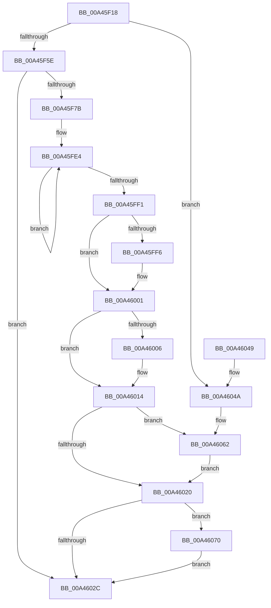

# MiDeleteVadBitmap

- RVA: `0x00A45F18`–`0x00A4608F` (길이 `375` bytes)
- VA: `0x0000000140A45F18`
- 실행 섹션: `PAGE`
- PDB 이름 있음: `예`; PDB Function 태그: `아니요`
- unwind 정보 RVA: `0x000AF6D0`
- 디코드: `92`개 명령, `375/375` bytes 표시
- 미해석 바이트: `0` (있으면 어셈블리에 `.byte`로 보존)

> 이 문서는 커널 이미지의 기계어와 PDB 기호를 분석해 생성했습니다. 4번과 5번은 함수 원형과 자료형을 바이너리 사용 방식에서 추정한 C 해석이며 원본 소스 복구 결과는 아닙니다.

## 1. Dependencies

- 직접 호출 지점: **10**; 고유 호출 대상: **10**
- 직접 호출자로 확인된 함수: **1**
- RIP 상대 이미지 참조: **1**

### Outgoing calls
- `0x00A45F7B` → [EmpCheckErrataList](../../text/49/EmpCheckErrataList_function_0049E550.md) (function, `0x0049E550`)
- `0x00A45F95` → [MiHyperSpaceSize](../../text/2C/MiHyperSpaceSize_function_002C2DFC.md) (function, `0x002C2DFC`)
- `0x00A45FBC` → [MiDeletePagablePteRange](../../text/2A/MiDeletePagablePteRange_function_002A96B4.md) (function, `0x002A96B4`)
- `0x00A45FC9` → [MiGetProcessPartition](../../text/44/MiGetProcessPartition_function_00443B10.md) (function, `0x00443B10`)
- `0x00A45FFC` → [MiReturnFullProcessCharges](../../text/2C/MiReturnFullProcessCharges_function_002C2E70.md) (function, `0x002C2E70`)
- `0x00A4600F` → [MiReturnCommit](../../text/24/MiReturnCommit_function_00248410.md) (function, `0x00248410`)
- `0x00A4605C` → [KeBugCheckEx](../../text/4F/KeBugCheckEx_function_004FD660.md) (function, `0x004FD660`)
- `0x00A46062` → [HalAdjustResourceList](../../text/48/HalAdjustResourceList_function_0048FDC0.md) (function, `0x0048FDC0`)
- `0x00A4607D` → [MiUpdateChargedWsles](../../text/4F/MiUpdateChargedWsles_function_004F6EA0.md) (function, `0x004F6EA0`)
- `0x00A46088` → [MiReturnFullProcessCommitment](../9E/MiReturnFullProcessCommitment_function_009E5D58.md) (function, `0x009E5D58`)

### Direct callers
- [MiDeleteFinalPageTables](../../text/46/MiDeleteFinalPageTables_function_004659AC.md) at `0x00465A79`

### Static image references
- `0x00A45F87` → RVA `0x00E2F388` (`.data`; read)

## 2. Other-region calls and transfers

- 다른 실행 섹션으로 향하는 call: **9**
  - `0x00A45F7B` → [EmpCheckErrataList](../../text/49/EmpCheckErrataList_function_0049E550.md) (`PAGE` → `.text`)
  - `0x00A45F95` → [MiHyperSpaceSize](../../text/2C/MiHyperSpaceSize_function_002C2DFC.md) (`PAGE` → `.text`)
  - `0x00A45FBC` → [MiDeletePagablePteRange](../../text/2A/MiDeletePagablePteRange_function_002A96B4.md) (`PAGE` → `.text`)
  - `0x00A45FC9` → [MiGetProcessPartition](../../text/44/MiGetProcessPartition_function_00443B10.md) (`PAGE` → `.text`)
  - `0x00A45FFC` → [MiReturnFullProcessCharges](../../text/2C/MiReturnFullProcessCharges_function_002C2E70.md) (`PAGE` → `.text`)
  - `0x00A4600F` → [MiReturnCommit](../../text/24/MiReturnCommit_function_00248410.md) (`PAGE` → `.text`)
  - `0x00A4605C` → [KeBugCheckEx](../../text/4F/KeBugCheckEx_function_004FD660.md) (`PAGE` → `.text`)
  - `0x00A46062` → [HalAdjustResourceList](../../text/48/HalAdjustResourceList_function_0048FDC0.md) (`PAGE` → `.text`)
  - `0x00A4607D` → [MiUpdateChargedWsles](../../text/4F/MiUpdateChargedWsles_function_004F6EA0.md) (`PAGE` → `.text`)
- 별도 외부 분기/꼬리 이동을 확인하지 못했습니다.

## 3. Assembly (complete function range)

```asm
00A45F18  4C 8B DC                        mov r11, rsp
00A45F1B  49 89 5B 08                     mov qword ptr [r11 + 8], rbx
00A45F1F  49 89 6B 10                     mov qword ptr [r11 + 0x10], rbp
00A45F23  49 89 73 18                     mov qword ptr [r11 + 0x18], rsi
00A45F27  57                              push rdi
00A45F28  41 56                           push r14
00A45F2A  41 57                           push r15
00A45F2C  48 81 EC 80 00 00 00            sub rsp, 0x80
00A45F33  4C 8B 89 80 02 00 00            mov r9, qword ptr [rcx + 0x280]
00A45F3A  0F 57 C0                        xorps xmm0, xmm0
00A45F3D  33 C0                           xor eax, eax
00A45F3F  48 8B F9                        mov rdi, rcx
00A45F42  0F 11 44 24 40                  movups xmmword ptr [rsp + 0x40], xmm0
00A45F47  0F 11 44 24 50                  movups xmmword ptr [rsp + 0x50], xmm0
00A45F4C  0F 11 44 24 60                  movups xmmword ptr [rsp + 0x60], xmm0
00A45F51  49 89 43 D8                     mov qword ptr [r11 - 0x28], rax
00A45F55  4D 85 C9                        test r9, r9
00A45F58  0F 85 EC 00 00 00               jne 0x140a4604a
00A45F5E  65 48 8B 04 25 88 01 00 00      mov rax, qword ptr gs:[0x188]
00A45F67  48 8B A8 B8 00 00 00            mov rbp, qword ptr [rax + 0xb8]
00A45F6E  4C 39 8D 10 04 00 00            cmp qword ptr [rbp + 0x410], r9
00A45F75  0F 84 B1 00 00 00               je 0x140a4602c
00A45F7B  E8 D0 85 A5 FF                  call 0x14049e550
00A45F80  48 8B 99 10 04 00 00            mov rbx, qword ptr [rcx + 0x410]
00A45F87  4C 8B 15 FA 93 3E 00            mov r10, qword ptr [rip + 0x3e93fa]
00A45F8E  48 8B B3 E0 03 00 00            mov rsi, qword ptr [rbx + 0x3e0]
00A45F95  E8 62 CE 87 FF                  call 0x1402c2dfc
00A45F9A  4D 8D 4A FF                     lea r9, [r10 - 1]
00A45F9E  4D 8B C2                        mov r8, r10
00A45FA1  4C 03 C8                        add r9, rax
00A45FA4  48 8D 8D 00 04 00 00            lea rcx, [rbp + 0x400]
00A45FAB  48 8D 44 24 40                  lea rax, [rsp + 0x40]
00A45FB0  B2 11                           mov dl, 0x11
00A45FB2  48 89 44 24 30                  mov qword ptr [rsp + 0x30], rax
00A45FB7  83 64 24 28 00                  and dword ptr [rsp + 0x28], 0
00A45FBC  E8 F3 36 86 FF                  call 0x1402a96b4
00A45FC1  4C 8B 74 24 48                  mov r14, qword ptr [rsp + 0x48]
00A45FC6  48 8B CF                        mov rcx, rdi
00A45FC9  E8 42 DB 9F FF                  call 0x140443b10
00A45FCE  48 03 B3 F0 03 00 00            add rsi, qword ptr [rbx + 0x3f0]
00A45FD5  33 C9                           xor ecx, ecx
00A45FD7  4C 8B F8                        mov r15, rax
00A45FDA  48 81 C3 58 05 00 00            add rbx, 0x558
00A45FE1  8D 51 02                        lea edx, [rcx + 2]
00A45FE4  48 03 0B                        add rcx, qword ptr [rbx]
00A45FE7  48 8D 5B 08                     lea rbx, [rbx + 8]
00A45FEB  48 83 EA 01                     sub rdx, 1
00A45FEF  75 F3                           jne 0x140a45fe4
00A45FF1  48 03 F1                        add rsi, rcx
00A45FF4  74 0B                           je 0x140a46001
00A45FF6  48 8B D6                        mov rdx, rsi
00A45FF9  48 8B CF                        mov rcx, rdi
00A45FFC  E8 6F CE 87 FF                  call 0x1402c2e70
00A46001  49 2B F6                        sub rsi, r14
00A46004  74 0E                           je 0x140a46014
00A46006  45 33 C0                        xor r8d, r8d
00A46009  48 8B D6                        mov rdx, rsi
00A4600C  49 8B CF                        mov rcx, r15
00A4600F  E8 FC 23 80 FF                  call 0x140248410
00A46014  48 8B 87 F8 04 00 00            mov rax, qword ptr [rdi + 0x4f8]
00A4601B  48 85 C0                        test rax, rax
00A4601E  75 42                           jne 0x140a46062
00A46020  4C 8B 87 F0 04 00 00            mov r8, qword ptr [rdi + 0x4f0]
00A46027  4D 85 C0                        test r8, r8
00A4602A  75 44                           jne 0x140a46070
00A4602C  4C 8D 9C 24 80 00 00 00         lea r11, [rsp + 0x80]
00A46034  49 8B 5B 20                     mov rbx, qword ptr [r11 + 0x20]
00A46038  49 8B 6B 28                     mov rbp, qword ptr [r11 + 0x28]
00A4603C  49 8B 73 30                     mov rsi, qword ptr [r11 + 0x30]
00A46040  49 8B E3                        mov rsp, r11
00A46043  41 5F                           pop r15
00A46045  41 5E                           pop r14
00A46047  5F                              pop rdi
00A46048  C3                              ret
00A46049  CC                              int3
00A4604A  48 21 44 24 20                  and qword ptr [rsp + 0x20], rax
00A4604F  4C 8B C7                        mov r8, rdi
00A46052  BA 50 34 00 00                  mov edx, 0x3450
00A46057  B9 1A 00 00 00                  mov ecx, 0x1a
00A4605C  E8 FF 75 AB FF                  call 0x1404fd660
00A46061  CC                              int3
00A46062  E8 59 9D A4 FF                  call 0x14048fdc0
00A46067  48 8B 87 F8 04 00 00            mov rax, qword ptr [rdi + 0x4f8]
00A4606E  EB B0                           jmp 0x140a46020
00A46070  49 8B D0                        mov rdx, r8
00A46073  48 8D 8D 00 04 00 00            lea rcx, [rbp + 0x400]
00A4607A  48 F7 DA                        neg rdx
00A4607D  E8 1E 0E AB FF                  call 0x1404f6ea0
00A46082  49 8B D0                        mov rdx, r8
00A46085  48 8B CF                        mov rcx, rdi
00A46088  E8 CB FC F9 FF                  call 0x1409e5d58
00A4608D  EB 9D                           jmp 0x140a4602c
```

## 4. C-style interpretation (structured pseudocode)

```c
__int64 __fastcall MiDeleteVadBitmap(__int64 a1)
{
    __int64 result;
    __int64 v_rbx;
    __int64 v_rsi;
    __int64 v_rsp;
    unsigned __int64 v_stack_m18;
    unsigned __int64 v_stack_m38;
    unsigned __int64 v_stack_m48;
    unsigned __int64 v_stack_m50;
    unsigned __int64 v_stack_m58;
    unsigned __int64 v_stack_m60;
    unsigned __int64 v_stack_m68;
    unsigned int v_stack_m70;

    *(unsigned __int64 *)(v_rsp + 8) = v_rbx;
    *(unsigned __int64 *)(v_rsp + 16) = v_rbp;
    *(unsigned __int64 *)(v_rsp + 24) = v_rsi;
    v_rsp = (v_rsp) - (128);
    result = 0;
    v_stack_m58 = v_xmm0;
    v_stack_m48 = v_xmm0;
    v_stack_m38 = v_xmm0;
    *(unsigned __int64 *)(v_rsp - 40) = 0;
    if (*(unsigned __int64 *)(a1 + 640) != 0) goto loc_00A4604A;
    if ((*(unsigned __int64 *)(*(unsigned __int64 *)(*(unsigned __int64 *)(gs_base + (0 + 392)) + 184) + 1040)) == (*(unsigned __int64 *)(a1 + 640))) goto loc_00A4602C;
    result = EmpCheckErrataList(a1, a2, a3, *(unsigned __int64 *)(a1 + 640));
    result = MiHyperSpaceSize(a1, a2, a3, *(unsigned __int64 *)(a1 + 640));
    a4 = (*(unsigned __int64 *)(v_rip + 4101114) - 1) + (result);
    v_stack_m68 = v_stack_m58;
    result = MiDeletePagablePteRange(*(unsigned __int64 *)(*(unsigned __int64 *)(gs_base + (0 + 392)) + 184) + 1024, 17, *(unsigned __int64 *)(v_rip + 4101114), a4);
    result = MiGetProcessPartition(a1, 17, *(unsigned __int64 *)(v_rip + 4101114), a4);
    v_rsi = (*(unsigned __int64 *)(*(unsigned __int64 *)(a1 + 1040) + 992)) + (*(unsigned __int64 *)(*(unsigned __int64 *)(a1 + 1040) + 1008));
    a1 = 0;
    v_rbx = (*(unsigned __int64 *)(a1 + 1040)) + (0x558ULL);
loc_00A45FE4:
    a1 = (a1) + (*(unsigned __int64 *)(v_rbx));
    a2 = (a1 + 2) - (1);
    if (condition_is_not_equal) goto loc_00A45FE4;
    v_rsi = (v_rsi) + (a1);
    if (!(condition_is_equal)) {
        a2 = v_rsi;
        a1 = a1;
        result = MiReturnFullProcessCharges(a1, a2, *(unsigned __int64 *)(v_rip + 4101114), a4);
    }
    v_rsi = (v_rsi) - (v_stack_m50);
    if (!(condition_is_equal)) {
        a3 = 0;
        a2 = v_rsi;
        a1 = result;
        result = MiReturnCommit(a1, a2, a3, a4);
    }
    if (*(unsigned __int64 *)(a1 + 1272) != 0) goto loc_00A46062;
loc_00A46020:
    if (*(unsigned __int64 *)(a1 + 1264) != 0) goto loc_00A46070;
loc_00A4602C:
    return *(unsigned __int64 *)(a1 + 1272);
loc_00A4604A:
    result = KeBugCheckEx(26, (unsigned int)(0x3450ULL), a1, a4);
loc_00A46062:
    result = HalAdjustResourceList(26, (unsigned int)(0x3450ULL), a1, a4);
    goto loc_00A46020;
loc_00A46070:
    a2 = -(a1);
    result = MiUpdateChargedWsles(*(unsigned __int64 *)(v_stack_m18 + 40) + 1024, a2, a1, a4);
    result = MiReturnFullProcessCommitment(a1, a1, a1, a4);
    goto loc_00A4602C;
}
```

## 5. (Beta) C Style

```c
int64_t MiDeleteVadBitmap(void *Arg1)
{
    uint8_t *arg1 = (uint8_t *)Arg1;

    int64_t result;
    int64_t local_rbx;
    int64_t local_rsi;
    int64_t local_rsp;
    uint64_t v_stack_m18;
    uint64_t v_stack_m38;
    uint64_t v_stack_m48;
    uint64_t v_stack_m50;
    uint64_t v_stack_m58;
    uint64_t v_stack_m60;
    uint64_t v_stack_m68;
    uint32_t v_stack_m70;

    *(uint64_t *)(local_rsp + 0x8) = local_rbx;
    *(uint64_t *)(local_rsp + 0x10) = local_rbp;
    *(uint64_t *)(local_rsp + 0x18) = local_rsi;
    local_rsp = (local_rsp) - (128);
    result = 0;
    v_stack_m58 = v_xmm0;
    v_stack_m48 = v_xmm0;
    v_stack_m38 = v_xmm0;
    *(uint64_t *)(local_rsp - 0x28) = 0;
    if (*(uint64_t *)(arg1 + 0x280) != 0) goto loc_00A4604A;
    if ((*(uint64_t *)(*(uint64_t *)(*(uint64_t *)(gs_base + (0 + 0x188)) + 0xB8) + 0x410)) == (*(uint64_t *)(arg1 + 0x280))) goto loc_00A4602C;
    result = EmpCheckErrataList(Arg1, a2, a3, *(uint64_t *)(arg1 + 0x280));
    result = MiHyperSpaceSize(Arg1, a2, a3, *(uint64_t *)(arg1 + 0x280));
    a4 = (*(uint64_t *)(v_rip + 0x3E93FA) - 1) + (result);
    v_stack_m68 = v_stack_m58;
    result = MiDeletePagablePteRange(*(uint64_t *)(*(uint64_t *)(gs_base + (0 + 0x188)) + 0xB8) + 1024, 17, *(uint64_t *)(v_rip + 0x3E93FA), a4);
    result = MiGetProcessPartition(Arg1, 17, *(uint64_t *)(v_rip + 0x3E93FA), a4);
    local_rsi = (*(uint64_t *)(*(uint64_t *)(arg1 + 0x410) + 0x3E0)) + (*(uint64_t *)(*(uint64_t *)(arg1 + 0x410) + 0x3F0));
    Arg1 = 0;
    local_rbx = (*(uint64_t *)(arg1 + 0x410)) + (0x558ULL);
loc_00A45FE4:
    Arg1 = (Arg1) + (*(uint64_t *)(local_rbx));
    a2 = (Arg1 + 2) - (1);
    if (condition_is_not_equal) goto loc_00A45FE4;
    local_rsi = (local_rsi) + (Arg1);
    if (!(condition_is_equal)) {
        a2 = local_rsi;
        Arg1 = Arg1;
        result = MiReturnFullProcessCharges(Arg1, a2, *(uint64_t *)(v_rip + 0x3E93FA), a4);
    }
    local_rsi = (local_rsi) - (v_stack_m50);
    if (!(condition_is_equal)) {
        a3 = 0;
        a2 = local_rsi;
        Arg1 = result;
        result = MiReturnCommit(Arg1, a2, a3, a4);
    }
    if (*(uint64_t *)(arg1 + 0x4F8) != 0) goto loc_00A46062;
loc_00A46020:
    if (*(uint64_t *)(arg1 + 0x4F0) != 0) goto loc_00A46070;
loc_00A4602C:
    return *(uint64_t *)(arg1 + 0x4F8);
loc_00A4604A:
    result = KeBugCheckEx(26, (uint32_t)(0x3450ULL), Arg1, a4);
loc_00A46062:
    result = HalAdjustResourceList(26, (uint32_t)(0x3450ULL), Arg1, a4);
    goto loc_00A46020;
loc_00A46070:
    a2 = -(Arg1);
    result = MiUpdateChargedWsles(*(uint64_t *)(v_stack_m18 + 0x28) + 1024, a2, Arg1, a4);
    result = MiReturnFullProcessCommitment(Arg1, Arg1, Arg1, a4);
    goto loc_00A4602C;
}
```

### 관측된 메모리 오프셋

구조체 형식이 확인되지 않은 접근은 인자 기준의 오프셋으로만 기록했습니다.

| 기준 인자 | 오프셋 표현 | 폭 (bit) | 접근 |
|---|---:|---:|---|
| `Arg1` | `+ 0x280` | `64` | `R` |
| `Arg1` | `+ 0x4F0` | `64` | `R` |
| `Arg1` | `+ 0x4F8` | `64` | `R` |

## 6. Execution-region graph

[열기: 2D/3D 그래프와 함수 탐색 컨트롤 패널](../../../control-panel.html?section=page&rva=0x00A45F18&view=graph)

- 2D 그래프는 위에서 아래로 흐르고, 3D 그래프는 빈 공간을 드래그해 회전합니다. Shift+드래그는 이동, 휠은 확대·축소, 함수 노드 선택은 대상 보고서 이동입니다.

### Static fallback


