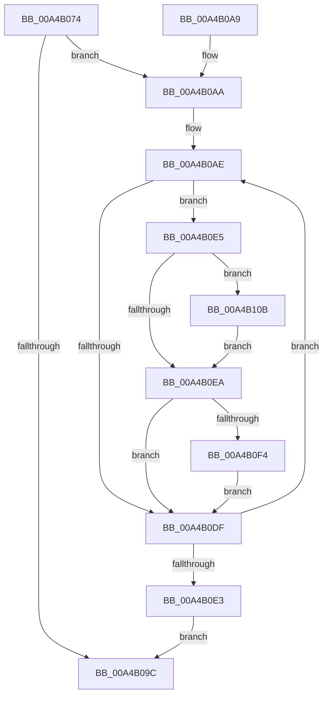

# MiDisablePagingOfDriver

- RVA: `0x00A4B074`–`0x00A4B119` (길이 `165` bytes)
- VA: `0x0000000140A4B074`
- 실행 섹션: `PAGE`
- PDB 이름 있음: `예`; PDB Function 태그: `아니요`
- unwind 정보 RVA: `0x000B01D0`
- 디코드: `52`개 명령, `165/165` bytes 표시
- 미해석 바이트: `0` (있으면 어셈블리에 `.byte`로 보존)

> 이 문서는 커널 이미지의 기계어와 PDB 기호를 분석해 생성했습니다. 4번과 5번은 함수 원형과 자료형을 바이너리 사용 방식에서 추정한 C 해석이며 원본 소스 복구 결과는 아닙니다.

## 1. Dependencies

- 직접 호출 지점: **3**; 고유 호출 대상: **3**
- 직접 호출자로 확인된 함수: **1**
- RIP 상대 이미지 참조: **0**

### Outgoing calls
- `0x00A4B093` → [MI_IS_PHYSICAL_ADDRESS](../../text/23/MI_IS_PHYSICAL_ADDRESS_function_0023B3A0.md) (function, `0x0023B3A0`)
- `0x00A4B0CE` → [MiSnapDriverRange](MiSnapDriverRange_function_00A4B328.md) (function, `0x00A4B328`)
- `0x00A4B100` → [MiLockCode](../../text/36/MiLockCode_function_0036F91C.md) (function, `0x0036F91C`)

### Direct callers
- [MiHandleDriverNonPagedSections](MiHandleDriverNonPagedSections_function_00A4AEA8.md) at `0x00A4AEFA`

### Static image references
- 디코드된 RIP-relative 메모리 참조가 없습니다.

## 2. Other-region calls and transfers

- 다른 실행 섹션으로 향하는 call: **2**
  - `0x00A4B093` → [MI_IS_PHYSICAL_ADDRESS](../../text/23/MI_IS_PHYSICAL_ADDRESS_function_0023B3A0.md) (`PAGE` → `.text`)
  - `0x00A4B100` → [MiLockCode](../../text/36/MiLockCode_function_0036F91C.md) (`PAGE` → `.text`)
- 별도 외부 분기/꼬리 이동을 확인하지 못했습니다.

## 3. Assembly (complete function range)

```asm
00A4B074  48 89 5C 24 18                  mov qword ptr [rsp + 0x18], rbx
00A4B079  55                              push rbp
00A4B07A  56                              push rsi
00A4B07B  57                              push rdi
00A4B07C  48 83 EC 30                     sub rsp, 0x30
00A4B080  48 83 64 24 58 00               and qword ptr [rsp + 0x58], 0
00A4B086  48 8B F1                        mov rsi, rcx
00A4B089  48 8B 49 30                     mov rcx, qword ptr [rcx + 0x30]
00A4B08D  48 83 64 24 50 00               and qword ptr [rsp + 0x50], 0
00A4B093  E8 08 03 7F FF                  call 0x14023b3a0
00A4B098  85 C0                           test eax, eax
00A4B09A  74 0E                           je 0x140a4b0aa
00A4B09C  48 8B 5C 24 60                  mov rbx, qword ptr [rsp + 0x60]
00A4B0A1  48 83 C4 30                     add rsp, 0x30
00A4B0A5  5F                              pop rdi
00A4B0A6  5E                              pop rsi
00A4B0A7  5D                              pop rbp
00A4B0A8  C3                              ret
00A4B0A9  CC                              int3
00A4B0AA  33 ED                           xor ebp, ebp
00A4B0AC  33 DB                           xor ebx, ebx
00A4B0AE  45 33 C9                        xor r9d, r9d
00A4B0B1  48 8D 44 24 58                  lea rax, [rsp + 0x58]
00A4B0B6  48 89 44 24 28                  mov qword ptr [rsp + 0x28], rax
00A4B0BB  8B D5                           mov edx, ebp
00A4B0BD  48 8D 44 24 50                  lea rax, [rsp + 0x50]
00A4B0C2  48 8B CE                        mov rcx, rsi
00A4B0C5  48 89 44 24 20                  mov qword ptr [rsp + 0x20], rax
00A4B0CA  45 8D 41 04                     lea r8d, [r9 + 4]
00A4B0CE  E8 55 02 00 00                  call 0x140a4b328
00A4B0D3  48 8B 54 24 50                  mov rdx, qword ptr [rsp + 0x50]
00A4B0D8  8B E8                           mov ebp, eax
00A4B0DA  48 85 D2                        test rdx, rdx
00A4B0DD  75 06                           jne 0x140a4b0e5
00A4B0DF  85 ED                           test ebp, ebp
00A4B0E1  75 CB                           jne 0x140a4b0ae
00A4B0E3  EB B7                           jmp 0x140a4b09c
00A4B0E5  48 85 DB                        test rbx, rbx
00A4B0E8  75 21                           jne 0x140a4b10b
00A4B0EA  48 8B 7C 24 58                  mov rdi, qword ptr [rsp + 0x58]
00A4B0EF  48 3B D7                        cmp rdx, rdi
00A4B0F2  77 EB                           ja 0x140a4b0df
00A4B0F4  41 B9 02 00 00 00               mov r9d, 2
00A4B0FA  4C 8B C7                        mov r8, rdi
00A4B0FD  48 8B CE                        mov rcx, rsi
00A4B100  E8 17 48 92 FF                  call 0x14036f91c
00A4B105  48 8D 5F 08                     lea rbx, [rdi + 8]
00A4B109  EB D4                           jmp 0x140a4b0df
00A4B10B  48 3B D3                        cmp rdx, rbx
00A4B10E  48 0F 42 D3                     cmovb rdx, rbx
00A4B112  48 89 54 24 50                  mov qword ptr [rsp + 0x50], rdx
00A4B117  EB D1                           jmp 0x140a4b0ea
```

## 4. C-style interpretation (structured pseudocode)

```c
__int64 __fastcall MiDisablePagingOfDriver(__int64 a1, __int64 a2, __int64 a3, int a4)
{
    __int64 result;
    __int64 v_rbp;
    __int64 v_rbx;
    __int64 v_rsp;
    unsigned __int64 v_stack_p10;
    unsigned __int64 v_stack_p18;
    unsigned __int64 v_stack_p20;
    unsigned __int64 v_stack_p28;
    unsigned __int64 v_stack_p50;
    unsigned __int64 v_stack_p58;
    unsigned __int64 v_stack_p8;

    v_stack_p18 = v_rbx;
    v_rsp = (v_rsp) - (48);
    result = MI_IS_PHYSICAL_ADDRESS(*(unsigned __int64 *)(a1 + 48), a2, a3, a4);
    if ((unsigned int)(result) == 0) goto loc_00A4B0AA;
loc_00A4B09C:
    v_rsp = (v_rsp) + (48);
    return result;
loc_00A4B0AA:
    v_rbp = 0;
    v_rbx = 0;
loc_00A4B0AE:
    a4 = 0;
    v_stack_p28 = v_stack_p58;
    v_stack_p20 = v_stack_p50;
    result = MiSnapDriverRange(a1, 0, a4 + 4, a4);
    if (v_stack_p50 != 0) goto loc_00A4B0E5;
loc_00A4B0DF:
    if ((unsigned int)((unsigned int)((unsigned int)(result))) != 0) goto loc_00A4B0AE;
    goto loc_00A4B09C;
loc_00A4B0E5:
    if (0 != 0) goto loc_00A4B10B;
loc_00A4B0EA:
    if (v_stack_p50 > v_stack_p58) goto loc_00A4B0DF;
    result = MiLockCode(a1, v_stack_p50, v_stack_p58, 2);
    goto loc_00A4B0DF;
loc_00A4B10B:
    a2 = v_stack_p50;
    if (v_stack_p50 < (v_stack_p58 + 8)) { a2 = v_stack_p58 + 8; }
    v_stack_p50 = a2;
    goto loc_00A4B0EA;
}
```

## 5. (Beta) C Style

```c
int64_t MiDisablePagingOfDriver(void *Arg1, int64_t Arg2, int64_t Arg3, int32_t Arg4)
{
    uint8_t *arg1 = (uint8_t *)Arg1;

    int64_t result;
    int64_t local_rbp;
    int64_t local_rbx;
    int64_t local_rsp;
    uint64_t v_stack_p10;
    uint64_t v_stack_p18;
    uint64_t v_stack_p20;
    uint64_t v_stack_p28;
    uint64_t v_stack_p50;
    uint64_t v_stack_p58;
    uint64_t v_stack_p8;

    v_stack_p18 = local_rbx;
    local_rsp = (local_rsp) - (48);
    result = MI_IS_PHYSICAL_ADDRESS(*(uint64_t *)(arg1 + 0x30), Arg2, Arg3, Arg4);
    if ((uint32_t)(result) == 0) goto loc_00A4B0AA;
loc_00A4B09C:
    local_rsp = (local_rsp) + (48);
    return result;
loc_00A4B0AA:
    local_rbp = 0;
    local_rbx = 0;
loc_00A4B0AE:
    Arg4 = 0;
    v_stack_p28 = v_stack_p58;
    v_stack_p20 = v_stack_p50;
    result = MiSnapDriverRange(Arg1, 0, Arg4 + 4, Arg4);
    if (v_stack_p50 != 0) goto loc_00A4B0E5;
loc_00A4B0DF:
    if ((uint32_t)((uint32_t)((uint32_t)(result))) != 0) goto loc_00A4B0AE;
    goto loc_00A4B09C;
loc_00A4B0E5:
    if (0 != 0) goto loc_00A4B10B;
loc_00A4B0EA:
    if (v_stack_p50 > v_stack_p58) goto loc_00A4B0DF;
    result = MiLockCode(Arg1, v_stack_p50, v_stack_p58, 2);
    goto loc_00A4B0DF;
loc_00A4B10B:
    Arg2 = v_stack_p50;
    if (v_stack_p50 < (v_stack_p58 + 8)) { Arg2 = v_stack_p58 + 8; }
    v_stack_p50 = Arg2;
    goto loc_00A4B0EA;
}
```

### 관측된 메모리 오프셋

구조체 형식이 확인되지 않은 접근은 인자 기준의 오프셋으로만 기록했습니다.

| 기준 인자 | 오프셋 표현 | 폭 (bit) | 접근 |
|---|---:|---:|---|
| `Arg1` | `+ 0x30` | `64` | `R` |

## 6. Execution-region graph

[열기: 2D/3D 그래프와 함수 탐색 컨트롤 패널](../../../control-panel.html?section=page&rva=0x00A4B074&view=graph)

- 2D 그래프는 위에서 아래로 흐르고, 3D 그래프는 빈 공간을 드래그해 회전합니다. Shift+드래그는 이동, 휠은 확대·축소, 함수 노드 선택은 대상 보고서 이동입니다.

### Static fallback


