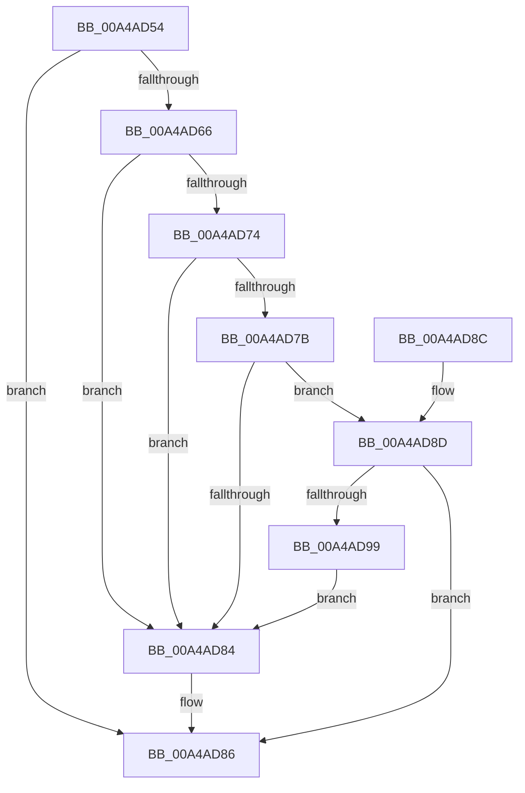

# MiFinalizeDriverCfgState

- RVA: `0x00A4AD54`–`0x00A4ADA0` (길이 `76` bytes)
- VA: `0x0000000140A4AD54`
- 실행 섹션: `PAGE`
- PDB 이름 있음: `예`; PDB Function 태그: `아니요`
- unwind 정보 RVA: `0x0006EDB4`
- 디코드: `24`개 명령, `76/76` bytes 표시
- 미해석 바이트: `0` (있으면 어셈블리에 `.byte`로 보존)

> 이 문서는 커널 이미지의 기계어와 PDB 기호를 분석해 생성했습니다. 4번과 5번은 함수 원형과 자료형을 바이너리 사용 방식에서 추정한 C 해석이며 원본 소스 복구 결과는 아닙니다.

## 1. Dependencies

- 직접 호출 지점: **2**; 고유 호출 대상: **2**
- 직접 호출자로 확인된 함수: **1**
- RIP 상대 이미지 참조: **1**

### Outgoing calls
- `0x00A4AD5D` → [MiProcessKernelCfgImage](../../text/4D/MiProcessKernelCfgImage_function_004D0744.md) (function, `0x004D0744`)
- `0x00A4AD90` → [MiCompleteSecureDriverLoad](MiCompleteSecureDriverLoad_function_00A4B920.md) (function, `0x00A4B920`)

### Direct callers
- [MmLoadSystemImageEx](../99/MmLoadSystemImageEx_function_00999B8C.md) at `0x0099A0ED`

### Static image references
- `0x00A4AD66` → RVA `0x00FC6A88` (`ALMOSTRO`; read)

## 2. Other-region calls and transfers

- 다른 실행 섹션으로 향하는 call: **1**
  - `0x00A4AD5D` → [MiProcessKernelCfgImage](../../text/4D/MiProcessKernelCfgImage_function_004D0744.md) (`PAGE` → `.text`)
- 별도 외부 분기/꼬리 이동을 확인하지 못했습니다.

## 3. Assembly (complete function range)

```asm
00A4AD54  40 53                           push rbx
00A4AD56  48 83 EC 20                     sub rsp, 0x20
00A4AD5A  48 8B D9                        mov rbx, rcx
00A4AD5D  E8 E2 59 A8 FF                  call 0x1404d0744
00A4AD62  85 C0                           test eax, eax
00A4AD64  78 20                           js 0x140a4ad86
00A4AD66  48 8B 05 1B BD 57 00            mov rax, qword ptr [rip + 0x57bd1b]
00A4AD6D  48 0F BA E0 0E                  bt rax, 0xe
00A4AD72  73 10                           jae 0x140a4ad84
00A4AD74  48 0F BA E0 12                  bt rax, 0x12
00A4AD79  72 09                           jb 0x140a4ad84
00A4AD7B  F7 43 68 00 20 00 00            test dword ptr [rbx + 0x68], 0x2000
00A4AD82  74 09                           je 0x140a4ad8d
00A4AD84  33 C0                           xor eax, eax
00A4AD86  48 83 C4 20                     add rsp, 0x20
00A4AD8A  5B                              pop rbx
00A4AD8B  C3                              ret
00A4AD8C  CC                              int3
00A4AD8D  48 8B CB                        mov rcx, rbx
00A4AD90  E8 8B 0B 00 00                  call 0x140a4b920
00A4AD95  85 C0                           test eax, eax
00A4AD97  78 ED                           js 0x140a4ad86
00A4AD99  0F BA 6B 68 0D                  bts dword ptr [rbx + 0x68], 0xd
00A4AD9E  EB E4                           jmp 0x140a4ad84
```

## 4. C-style interpretation (structured pseudocode)

```c
__int64 __fastcall MiFinalizeDriverCfgState(__int64 a1)
{
    __int64 result;
    __int64 v_rsp;

    v_rsp = (v_rsp) - (32);
    result = MiProcessKernelCfgImage(a1, a2, a3, a4);
    if (sign_flag) goto loc_00A4AD86;
    if (condition_is_above_or_equal) goto loc_00A4AD84;
    if (condition_is_below) goto loc_00A4AD84;
    if (((*(unsigned int *)(a1 + 104)) & (0x2000ULL)) == 0) goto loc_00A4AD8D;
loc_00A4AD84:
    result = 0;
loc_00A4AD86:
    v_rsp = (v_rsp) + (32);
    return result;
loc_00A4AD8D:
    result = MiCompleteSecureDriverLoad(a1, a2, a3, a4);
    if (sign_flag) goto loc_00A4AD86;
    goto loc_00A4AD84;
}
```

## 5. (Beta) C Style

```c
int64_t MiFinalizeDriverCfgState(void *Arg1)
{
    uint8_t *arg1 = (uint8_t *)Arg1;

    int64_t result;
    int64_t local_rsp;

    local_rsp = (local_rsp) - (32);
    result = MiProcessKernelCfgImage(Arg1, a2, a3, a4);
    if (sign_flag) goto loc_00A4AD86;
    if (condition_is_above_or_equal) goto loc_00A4AD84;
    if (condition_is_below) goto loc_00A4AD84;
    if (((*(uint32_t *)(arg1 + 0x68)) & (0x2000ULL)) == 0) goto loc_00A4AD8D;
loc_00A4AD84:
    result = 0;
loc_00A4AD86:
    local_rsp = (local_rsp) + (32);
    return result;
loc_00A4AD8D:
    result = MiCompleteSecureDriverLoad(Arg1, a2, a3, a4);
    if (sign_flag) goto loc_00A4AD86;
    goto loc_00A4AD84;
}
```

### 관측된 메모리 오프셋

구조체 형식이 확인되지 않은 접근은 인자 기준의 오프셋으로만 기록했습니다.

| 기준 인자 | 오프셋 표현 | 폭 (bit) | 접근 |
|---|---:|---:|---|
| `Arg1` | `+ 0x68` | `32` | `R` |
| `Arg1` | `+ 0x68` | `32` | `R/W` |

## 6. Execution-region graph

[열기: 2D/3D 그래프와 함수 탐색 컨트롤 패널](../../../control-panel.html?section=page&rva=0x00A4AD54&view=graph)

- 2D 그래프는 위에서 아래로 흐르고, 3D 그래프는 빈 공간을 드래그해 회전합니다. Shift+드래그는 이동, 휠은 확대·축소, 함수 노드 선택은 대상 보고서 이동입니다.

### Static fallback


