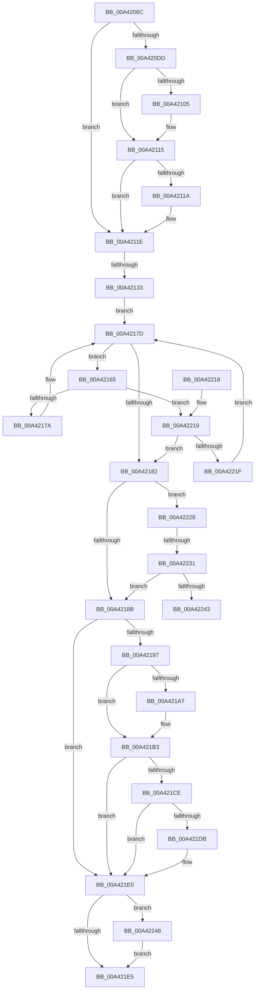

# MiFindProcessImageHotPatchRecord

- RVA: `0x00A4206C`–`0x00A42252` (길이 `486` bytes)
- VA: `0x0000000140A4206C`
- 실행 섹션: `PAGE`
- PDB 이름 있음: `예`; PDB Function 태그: `예`
- unwind 정보 RVA: `0x000AEC0C`
- 디코드: `122`개 명령, `486/486` bytes 표시
- 미해석 바이트: `0` (있으면 어셈블리에 `.byte`로 보존)

> 이 문서는 커널 이미지의 기계어와 PDB 기호를 분석해 생성했습니다. 4번과 5번은 함수 원형과 자료형을 바이너리 사용 방식에서 추정한 C 해석이며 원본 소스 복구 결과는 아닙니다.

## 1. Dependencies

- 직접 호출 지점: **10**; 고유 호출 대상: **10**
- 직접 호출자로 확인된 함수: **3**
- RIP 상대 이미지 참조: **4**

### Outgoing calls
- `0x00A420C2` → [memset](../../text/6C/memset_function_006C6C40.md) (function, `0x006C6C40`)
- `0x00A420ED` → [KeAbPreAcquire](../../text/21/KeAbPreAcquire_function_00210230.md) (function, `0x00210230`)
- `0x00A42110` → [ExfAcquirePushLockSharedEx](../../text/21/ExfAcquirePushLockSharedEx_function_0021044C.md) (function, `0x0021044C`)
- `0x00A4216D` → [MiCompareHotPatchNodes](../80/MiCompareHotPatchNodes_function_00803114.md) (function, `0x00803114`)
- `0x00A421AE` → [ExfReleasePushLockShared](../../text/26/ExfReleasePushLockShared_function_00263440.md) (function, `0x00263440`)
- `0x00A421BA` → [KeAbPostRelease](../../text/2E/KeAbPostRelease_function_002E1600.md) (function, `0x002E1600`)
- `0x00A421DB` → [KiCheckForKernelApcDelivery](../../text/2E/KiCheckForKernelApcDelivery_function_002E2C80.md) (function, `0x002E2C80`)
- `0x00A421F2` → [_security_check_cookie](../../text/6A/_security_check_cookie_function_006AC640.md) (function, `0x006AC640`)
- `0x00A42236` → [RtlIsPatchMachineApplicable](../84/RtlIsPatchMachineApplicable_function_00841194.md) (function, `0x00841194`)
- `0x00A4224B` → [ObfDereferenceObject](../../text/2F/ObfDereferenceObject_function_002F9350.md) (function, `0x002F9350`)

### Direct callers
- [MiCreatePatchSectionRequest](../80/MiCreatePatchSectionRequest_function_008031E0.md) at `0x00803322`
- [MiGetAllRegisteredPatches](../80/MiGetAllRegisteredPatches_function_0080367C.md) at `0x00803889`
- [MiQuerySingleLoadedPatch](MiQuerySingleLoadedPatch_function_00A41EB0.md) at `0x00A41F6C`

### Static image references
- `0x00A4208B` → RVA `0x00E0A740` (`.data`; read)
- `0x00A420D0` → RVA `0x00E37590` (`.data`; read)
- `0x00A4211E` → RVA `0x00E37570` (`.data`; read)
- `0x00A42136` → RVA `0x00E37578` (`.data`; read)

## 2. Other-region calls and transfers

- 다른 실행 섹션으로 향하는 call: **8**
  - `0x00A420C2` → [memset](../../text/6C/memset_function_006C6C40.md) (`PAGE` → `.text`)
  - `0x00A420ED` → [KeAbPreAcquire](../../text/21/KeAbPreAcquire_function_00210230.md) (`PAGE` → `.text`)
  - `0x00A42110` → [ExfAcquirePushLockSharedEx](../../text/21/ExfAcquirePushLockSharedEx_function_0021044C.md) (`PAGE` → `.text`)
  - `0x00A421AE` → [ExfReleasePushLockShared](../../text/26/ExfReleasePushLockShared_function_00263440.md) (`PAGE` → `.text`)
  - `0x00A421BA` → [KeAbPostRelease](../../text/2E/KeAbPostRelease_function_002E1600.md) (`PAGE` → `.text`)
  - `0x00A421DB` → [KiCheckForKernelApcDelivery](../../text/2E/KiCheckForKernelApcDelivery_function_002E2C80.md) (`PAGE` → `.text`)
  - `0x00A421F2` → [_security_check_cookie](../../text/6A/_security_check_cookie_function_006AC640.md) (`PAGE` → `.text`)
  - `0x00A4224B` → [ObfDereferenceObject](../../text/2F/ObfDereferenceObject_function_002F9350.md) (`PAGE` → `.text`)
- call이 아닌 외부 분기/꼬리 이동: **3**
  - `0x00A4212D` → [sub_00B3ABCE](../B3/Unknown_function_00B3ABCE.md) (`tail-transfer`)
  - `0x00A4222B` → [sub_00B3ABCE + 0x74](../B3/Unknown_function_00B3ABCE.md) (`tail-transfer`)
  - `0x00A42243` → [sub_00B3ABCE + 0x74](../B3/Unknown_function_00B3ABCE.md) (`tail-transfer`)

## 3. Assembly (complete function range)

```asm
00A4206C  4C 8B DC                        mov r11, rsp
00A4206F  49 89 5B 10                     mov qword ptr [r11 + 0x10], rbx
00A42073  49 89 6B 18                     mov qword ptr [r11 + 0x18], rbp
00A42077  49 89 73 20                     mov qword ptr [r11 + 0x20], rsi
00A4207B  57                              push rdi
00A4207C  41 54                           push r12
00A4207E  41 55                           push r13
00A42080  41 56                           push r14
00A42082  41 57                           push r15
00A42084  48 81 EC F0 00 00 00            sub rsp, 0xf0
00A4208B  48 8B 05 AE 86 3C 00            mov rax, qword ptr [rip + 0x3c86ae]
00A42092  48 33 C4                        xor rax, rsp
00A42095  48 89 84 24 E0 00 00 00         mov qword ptr [rsp + 0xe0], rax
00A4209D  4C 8B B4 24 40 01 00 00         mov r14, qword ptr [rsp + 0x140]
00A420A5  44 8B EA                        mov r13d, edx
00A420A8  33 D2                           xor edx, edx
00A420AA  41 8B D9                        mov ebx, r9d
00A420AD  45 8B E0                        mov r12d, r8d
00A420B0  89 5C 24 40                     mov dword ptr [rsp + 0x40], ebx
00A420B4  4C 8B F9                        mov r15, rcx
00A420B7  49 8D 8B 78 FF FF FF            lea rcx, [r11 - 0x88]
00A420BE  44 8D 42 44                     lea r8d, [rdx + 0x44]
00A420C2  E8 79 4B C8 FF                  call 0x1406c6c40
00A420C7  65 48 8B 3C 25 88 01 00 00      mov rdi, qword ptr gs:[0x188]
00A420D0  48 8D 35 B9 54 3F 00            lea rsi, [rip + 0x3f54b9]
00A420D7  33 ED                           xor ebp, ebp
00A420D9  85 DB                           test ebx, ebx
00A420DB  75 41                           jne 0x140a4211e
00A420DD  66 FF 8F E6 01 00 00            dec word ptr [rdi + 0x1e6]
00A420E4  45 33 C0                        xor r8d, r8d
00A420E7  33 D2                           xor edx, edx
00A420E9  48 8B CE                        mov rcx, rsi
00A420EC  90                              nop
00A420ED  E8 3E E1 7C FF                  call 0x140210230
00A420F2  48 8B D8                        mov rbx, rax
00A420F5  8D 4D 11                        lea ecx, [rbp + 0x11]
00A420F8  33 C0                           xor eax, eax
00A420FA  F0 48 0F B1 0D 8D 54 3F 00      lock cmpxchg qword ptr [rip + 0x3f548d], rcx
00A42103  74 10                           je 0x140a42115
00A42105  4C 8B CE                        mov r9, rsi
00A42108  4C 8B C3                        mov r8, rbx
00A4210B  33 D2                           xor edx, edx
00A4210D  48 8B CE                        mov rcx, rsi
00A42110  E8 37 E3 7C FF                  call 0x14021044c
00A42115  48 85 DB                        test rbx, rbx
00A42118  74 04                           je 0x140a4211e
00A4211A  C6 43 0A 01                     mov byte ptr [rbx + 0xa], 1
00A4211E  48 39 2D 4B 54 3F 00            cmp qword ptr [rip + 0x3f544b], rbp
00A42125  41 0F B7 B7 EC 06 00 00         movzx esi, word ptr [r15 + 0x6ec]
00A4212D  0F 85 9B 8A 0F 00               jne 0x140b3abce
00A42133  45 33 FF                        xor r15d, r15d
00A42136  48 8B 1D 3B 54 3F 00            mov rbx, qword ptr [rip + 0x3f543b]
00A4213D  0F 57 C0                        xorps xmm0, xmm0
00A42140  0F 11 44 24 60                  movups xmmword ptr [rsp + 0x60], xmm0
00A42145  33 C0                           xor eax, eax
00A42147  44 89 6C 24 68                  mov dword ptr [rsp + 0x68], r13d
00A4214C  44 89 64 24 6C                  mov dword ptr [rsp + 0x6c], r12d
00A42151  0F 11 44 24 50                  movups xmmword ptr [rsp + 0x50], xmm0
00A42156  48 89 84 24 80 00 00 00         mov qword ptr [rsp + 0x80], rax
00A4215E  0F 11 44 24 70                  movups xmmword ptr [rsp + 0x70], xmm0
00A42163  EB 18                           jmp 0x140a4217d
00A42165  48 8B D3                        mov rdx, rbx
00A42168  48 8D 4C 24 50                  lea rcx, [rsp + 0x50]
00A4216D  E8 A2 0F DC FF                  call 0x140803114
00A42172  85 C0                           test eax, eax
00A42174  0F 89 9F 00 00 00               jns 0x140a42219
00A4217A  48 8B 1B                        mov rbx, qword ptr [rbx]
00A4217D  48 85 DB                        test rbx, rbx
00A42180  75 E3                           jne 0x140a42165
00A42182  48 85 DB                        test rbx, rbx
00A42185  0F 85 9D 00 00 00               jne 0x140a42228
00A4218B  BB 25 02 00 C0                  mov ebx, 0xc0000225
00A42190  44 39 7C 24 40                  cmp dword ptr [rsp + 0x40], r15d
00A42195  75 49                           jne 0x140a421e0
00A42197  B8 11 00 00 00                  mov eax, 0x11
00A4219C  F0 4C 0F B1 3D EB 53 3F 00      lock cmpxchg qword ptr [rip + 0x3f53eb], r15
00A421A5  74 0C                           je 0x140a421b3
00A421A7  48 8D 0D E2 53 3F 00            lea rcx, [rip + 0x3f53e2]
00A421AE  E8 8D 12 82 FF                  call 0x140263440
00A421B3  48 8D 0D D6 53 3F 00            lea rcx, [rip + 0x3f53d6]
00A421BA  E8 41 F4 89 FF                  call 0x1402e1600
00A421BF  B9 01 00 00 00                  mov ecx, 1
00A421C4  90                              nop
00A421C5  66 01 8F E6 01 00 00            add word ptr [rdi + 0x1e6], cx
00A421CC  75 12                           jne 0x140a421e0
00A421CE  48 8D 87 98 00 00 00            lea rax, [rdi + 0x98]
00A421D5  90                              nop
00A421D6  48 39 00                        cmp qword ptr [rax], rax
00A421D9  74 05                           je 0x140a421e0
00A421DB  E8 A0 0A 8A FF                  call 0x1402e2c80
00A421E0  48 85 ED                        test rbp, rbp
00A421E3  75 63                           jne 0x140a42248
00A421E5  8B C3                           mov eax, ebx
00A421E7  48 8B 8C 24 E0 00 00 00         mov rcx, qword ptr [rsp + 0xe0]
00A421EF  48 33 CC                        xor rcx, rsp
00A421F2  E8 49 A4 C6 FF                  call 0x1406ac640
00A421F7  4C 8D 9C 24 F0 00 00 00         lea r11, [rsp + 0xf0]
00A421FF  49 8B 5B 38                     mov rbx, qword ptr [r11 + 0x38]
00A42203  49 8B 6B 40                     mov rbp, qword ptr [r11 + 0x40]
00A42207  49 8B 73 48                     mov rsi, qword ptr [r11 + 0x48]
00A4220B  49 8B E3                        mov rsp, r11
00A4220E  41 5F                           pop r15
00A42210  41 5E                           pop r14
00A42212  41 5D                           pop r13
00A42214  41 5C                           pop r12
00A42216  5F                              pop rdi
00A42217  C3                              ret
00A42218  CC                              int3
00A42219  0F 8E 63 FF FF FF               jle 0x140a42182
00A4221F  48 8B 5B 08                     mov rbx, qword ptr [rbx + 8]
00A42223  E9 55 FF FF FF                  jmp 0x140a4217d
00A42228  66 85 F6                        test si, si
00A4222B  0F 84 11 8A 0F 00               je 0x140b3ac42
00A42231  8B 53 24                        mov edx, dword ptr [rbx + 0x24]
00A42234  8B CE                           mov ecx, esi
00A42236  E8 59 EF DF FF                  call 0x140841194
00A4223B  84 C0                           test al, al
00A4223D  0F 84 48 FF FF FF               je 0x140a4218b
00A42243  E9 FA 89 0F 00                  jmp 0x140b3ac42
00A42248  48 8B CD                        mov rcx, rbp
00A4224B  E8 00 71 8B FF                  call 0x1402f9350
00A42250  EB 93                           jmp 0x140a421e5
```

## 4. C-style interpretation (structured pseudocode)

```c
__int64 __fastcall MiFindProcessImageHotPatchRecord(__int64 a1, int a2, int a3, int a4, __int64 a5)
{
    __int64 result;
    __int64 v_r15;
    __int64 v_rbp;
    __int64 v_rsp;
    unsigned __int64 v_stack_m28;
    unsigned __int64 v_stack_m38;
    unsigned __int64 v_stack_m98;
    unsigned __int64 v_stack_mA8;
    unsigned int v_stack_mAC;
    unsigned int v_stack_mB0;
    unsigned __int64 v_stack_mB8;
    unsigned __int64 v_stack_mC8;
    unsigned int v_stack_mD8;

    *(unsigned __int64 *)(v_rsp + 16) = v_rbx;
    *(unsigned __int64 *)(v_rsp + 24) = v_rbp;
    *(unsigned __int64 *)(v_rsp + 32) = v_rsi;
    v_rsp = (v_rsp) - (240);
    result = (*(unsigned __int64 *)(v_rip + 3966638)) ^ (v_rsp);
    v_stack_m38 = result;
    a2 = 0;
    v_stack_mD8 = (unsigned int)((unsigned int)(a4));
    result = memset(v_rsp - 136, a2, a2 + 68, a4);
    v_rbp = 0;
    if ((unsigned int)((unsigned int)(a4)) != 0) goto loc_00A4211E;
    a3 = 0;
    a2 = 0;
    result = KeAbPreAcquire(v_rip + 4150457, a2, a3, a4);
    result = 0;
    if (!(condition_is_equal)) {
        a4 = v_rip + 4150457;
        a3 = 0;
        a2 = 0;
        a1 = v_rip + 4150457;
        result = ExfAcquirePushLockSharedEx(a1, a2, a3, a4);
    }
    if (result != 0) {
        *(unsigned __int8 *)(result + 10) = 1;
    }
    v_r15 = 0;
    v_stack_mB8 = v_xmm0;
    result = 0;
    v_stack_mB0 = (unsigned int)((unsigned int)(a2));
    v_stack_mAC = (unsigned int)((unsigned int)(a3));
    v_stack_mC8 = v_xmm0;
    v_stack_m98 = 0;
    v_stack_mA8 = v_xmm0;
    goto loc_00A4217D;
loc_00A42165:
    result = MiCompareHotPatchNodes(v_stack_mC8, *(unsigned __int64 *)(v_rip + 4150331), a3, a4);
    if (!sign_flag) goto loc_00A42219;
loc_00A4217D:
    if (*(unsigned __int64 *)(*(unsigned __int64 *)(v_rip + 4150331)) != 0) goto loc_00A42165;
loc_00A42182:
    if (*(unsigned __int64 *)(*(unsigned __int64 *)(v_rip + 4150331)) != 0) goto loc_00A42228;
loc_00A4218B:
    if (v_stack_mD8 != 0) goto loc_00A421E0;
    result = 17;
    if (v_stack_mD8 != 0) {
        a1 = v_rip + 4150242;
        result = ExfReleasePushLockShared(a1, *(unsigned __int64 *)(v_rip + 4150331), a3, a4);
    }
    result = KeAbPostRelease(v_rip + 4150230, *(unsigned __int64 *)(v_rip + 4150331), a3, a4);
    if (v_stack_mD8 != 0) goto loc_00A421E0;
    result = *(unsigned __int64 *)(gs_base + (0 + 392)) + 152;
    if ((*(unsigned __int64 *)(*(unsigned __int64 *)(gs_base + (0 + 392)) + 152)) != (*(unsigned __int64 *)(gs_base + (0 + 392)) + 152)) {
        result = KiCheckForKernelApcDelivery(1, *(unsigned __int64 *)(v_rip + 4150331), a3, a4);
    }
    if (0 != 0) goto loc_00A42248;
loc_00A421E5:
    a1 = (v_stack_m38) ^ (v_rsp);
    result = _security_check_cookie(a1, *(unsigned __int64 *)(v_rip + 4150331), a3, a4);
    return result;
loc_00A42219:
    if (condition_is_less_or_equal) goto loc_00A42182;
    goto loc_00A4217D;
loc_00A42228:
    result = RtlIsPatchMachineApplicable((unsigned int)((unsigned int)(*(unsigned __int64 *)(v_stack_m28 + 72))), (unsigned int)(*(unsigned int *)(*(unsigned __int64 *)(*(unsigned __int64 *)(v_stack_m28 + 56) + 8) + 36)), a3, a4);
    if ((unsigned __int8)(result) == 0) goto loc_00A4218B;
loc_00A42248:
    result = ObfDereferenceObject(*(unsigned __int64 *)(v_stack_m28 + 64), (unsigned int)(*(unsigned int *)(*(unsigned __int64 *)(*(unsigned __int64 *)(v_stack_m28 + 56) + 8) + 36)), a3, a4);
    goto loc_00A421E5;
}
```

## 5. (Beta) C Style

```c
int64_t MiFindProcessImageHotPatchRecord(void *Arg1, int32_t Arg2, int32_t Arg3, int32_t Arg4, int64_t Arg5)
{
    uint8_t *arg1 = (uint8_t *)Arg1;

    int64_t result;
    int64_t local_r15;
    int64_t local_rbp;
    int64_t local_rsp;
    uint64_t v_stack_m28;
    uint64_t v_stack_m38;
    uint64_t v_stack_m98;
    uint64_t v_stack_mA8;
    uint32_t v_stack_mAC;
    uint32_t v_stack_mB0;
    uint64_t v_stack_mB8;
    uint64_t v_stack_mC8;
    uint32_t v_stack_mD8;

    *(uint64_t *)(local_rsp + 0x10) = local_rbx;
    *(uint64_t *)(local_rsp + 0x18) = local_rbp;
    *(uint64_t *)(local_rsp + 0x20) = local_rsi;
    local_rsp = (local_rsp) - (240);
    result = (*(uint64_t *)(v_rip + 0x3C86AE)) ^ (local_rsp);
    v_stack_m38 = result;
    Arg2 = 0;
    v_stack_mD8 = (uint32_t)((uint32_t)(Arg4));
    result = memset(local_rsp - 136, Arg2, Arg2 + 68, Arg4);
    local_rbp = 0;
    if ((uint32_t)((uint32_t)(Arg4)) != 0) goto loc_00A4211E;
    Arg3 = 0;
    Arg2 = 0;
    result = KeAbPreAcquire(v_rip + 4150457, Arg2, Arg3, Arg4);
    result = 0;
    if (!(condition_is_equal)) {
        Arg4 = v_rip + 4150457;
        Arg3 = 0;
        Arg2 = 0;
        Arg1 = v_rip + 4150457;
        result = ExfAcquirePushLockSharedEx(Arg1, Arg2, Arg3, Arg4);
    }
    if (result != 0) {
        *(uint8_t *)(result + 0xA) = 1;
    }
    local_r15 = 0;
    v_stack_mB8 = v_xmm0;
    result = 0;
    v_stack_mB0 = (uint32_t)((uint32_t)(Arg2));
    v_stack_mAC = (uint32_t)((uint32_t)(Arg3));
    v_stack_mC8 = v_xmm0;
    v_stack_m98 = 0;
    v_stack_mA8 = v_xmm0;
    goto loc_00A4217D;
loc_00A42165:
    result = MiCompareHotPatchNodes(v_stack_mC8, *(uint64_t *)(v_rip + 0x3F543B), Arg3, Arg4);
    if (!sign_flag) goto loc_00A42219;
loc_00A4217D:
    if (*(uint64_t *)(*(uint64_t *)(v_rip + 0x3F543B)) != 0) goto loc_00A42165;
loc_00A42182:
    if (*(uint64_t *)(*(uint64_t *)(v_rip + 0x3F543B)) != 0) goto loc_00A42228;
loc_00A4218B:
    if (v_stack_mD8 != 0) goto loc_00A421E0;
    result = 17;
    if (v_stack_mD8 != 0) {
        Arg1 = v_rip + 4150242;
        result = ExfReleasePushLockShared(Arg1, *(uint64_t *)(v_rip + 0x3F543B), Arg3, Arg4);
    }
    result = KeAbPostRelease(v_rip + 4150230, *(uint64_t *)(v_rip + 0x3F543B), Arg3, Arg4);
    if (v_stack_mD8 != 0) goto loc_00A421E0;
    result = *(uint64_t *)(gs_base + (0 + 0x188)) + 152;
    if ((*(uint64_t *)(*(uint64_t *)(gs_base + (0 + 0x188)) + 0x98)) != (*(uint64_t *)(gs_base + (0 + 0x188)) + 152)) {
        result = KiCheckForKernelApcDelivery(1, *(uint64_t *)(v_rip + 0x3F543B), Arg3, Arg4);
    }
    if (0 != 0) goto loc_00A42248;
loc_00A421E5:
    Arg1 = (v_stack_m38) ^ (local_rsp);
    result = _security_check_cookie(Arg1, *(uint64_t *)(v_rip + 0x3F543B), Arg3, Arg4);
    return result;
loc_00A42219:
    if (condition_is_less_or_equal) goto loc_00A42182;
    goto loc_00A4217D;
loc_00A42228:
    result = RtlIsPatchMachineApplicable((uint32_t)((uint32_t)(*(uint64_t *)(v_stack_m28 + 0x48))), (uint32_t)(*(uint32_t *)(*(uint64_t *)(*(uint64_t *)(v_stack_m28 + 0x38) + 0x8) + 0x24)), Arg3, Arg4);
    if ((uint8_t)(result) == 0) goto loc_00A4218B;
loc_00A42248:
    result = ObfDereferenceObject(*(uint64_t *)(v_stack_m28 + 0x40), (uint32_t)(*(uint32_t *)(*(uint64_t *)(*(uint64_t *)(v_stack_m28 + 0x38) + 0x8) + 0x24)), Arg3, Arg4);
    goto loc_00A421E5;
}
```

### 관측된 메모리 오프셋

구조체 형식이 확인되지 않은 접근은 인자 기준의 오프셋으로만 기록했습니다.

| 기준 인자 | 오프셋 표현 | 폭 (bit) | 접근 |
|---|---:|---:|---|
| `Arg1` | `+ 0x6EC` | `16` | `R` |

## 6. Execution-region graph

[열기: 2D/3D 그래프와 함수 탐색 컨트롤 패널](../../../control-panel.html?section=page&rva=0x00A4206C&view=graph)

- 2D 그래프는 위에서 아래로 흐르고, 3D 그래프는 빈 공간을 드래그해 회전합니다. Shift+드래그는 이동, 휠은 확대·축소, 함수 노드 선택은 대상 보고서 이동입니다.

### Static fallback


