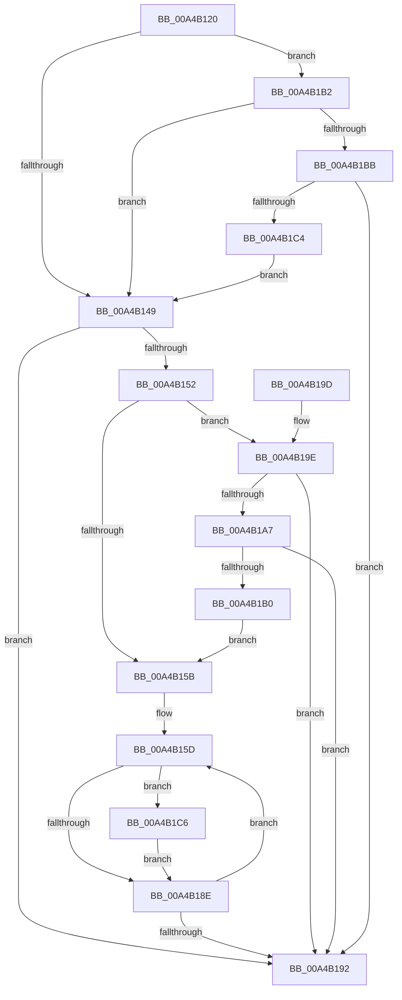

# MiFreeDriverInitialization

- RVA: `0x00A4B120`–`0x00A4B1D8` (길이 `184` bytes)
- VA: `0x0000000140A4B120`
- 실행 섹션: `PAGE`
- PDB 이름 있음: `예`; PDB Function 태그: `아니요`
- unwind 정보 RVA: `0x000B01E4`
- 디코드: `51`개 명령, `184/184` bytes 표시
- 미해석 바이트: `0` (있으면 어셈블리에 `.byte`로 보존)

> 이 문서는 커널 이미지의 기계어와 PDB 기호를 분석해 생성했습니다. 4번과 5번은 함수 원형과 자료형을 바이너리 사용 방식에서 추정한 C 해석이며 원본 소스 복구 결과는 아닙니다.

## 1. Dependencies

- 직접 호출 지점: **3**; 고유 호출 대상: **3**
- 직접 호출자로 확인된 함수: **3**
- RIP 상대 이미지 참조: **3**

### Outgoing calls
- `0x00A4B140` → [MI_IS_PHYSICAL_ADDRESS](../../text/23/MI_IS_PHYSICAL_ADDRESS_function_0023B3A0.md) (function, `0x0023B3A0`)
- `0x00A4B17D` → [MiSnapDriverRange](MiSnapDriverRange_function_00A4B328.md) (function, `0x00A4B328`)
- `0x00A4B1D1` → [MiFreeInitializationCode](../7F/MiFreeInitializationCode_function_007F88A0.md) (function, `0x007F88A0`)

### Direct callers
- [MiFreeBootDriverInitializationCode](../7F/MiFreeBootDriverInitializationCode_function_007F8880.md) at `0x007F888D`
- [MmLoadSystemImageEx](../99/MmLoadSystemImageEx_function_00999B8C.md) at `0x0099A184`
- [MmFreeDriverInitialization](MmFreeDriverInitialization_function_00A4AD08.md) at `0x00A4AD2A`

### Static image references
- `0x00A4B152` → RVA `0x00FC5258` (`ALMOSTRO`; read)
- `0x00A4B19E` → RVA `0x00FC6B28` (`ALMOSTRO`; read)
- `0x00A4B1A7` → RVA `0x00FC6B98` (`ALMOSTRO`; read)

## 2. Other-region calls and transfers

- 다른 실행 섹션으로 향하는 call: **1**
  - `0x00A4B140` → [MI_IS_PHYSICAL_ADDRESS](../../text/23/MI_IS_PHYSICAL_ADDRESS_function_0023B3A0.md) (`PAGE` → `.text`)
- 별도 외부 분기/꼬리 이동을 확인하지 못했습니다.

## 3. Assembly (complete function range)

```asm
00A4B120  48 89 5C 24 18                  mov qword ptr [rsp + 0x18], rbx
00A4B125  57                              push rdi
00A4B126  48 83 EC 30                     sub rsp, 0x30
00A4B12A  48 8B 59 30                     mov rbx, qword ptr [rcx + 0x30]
00A4B12E  48 8B F9                        mov rdi, rcx
00A4B131  48 83 64 24 48 00               and qword ptr [rsp + 0x48], 0
00A4B137  48 8B CB                        mov rcx, rbx
00A4B13A  48 83 64 24 40 00               and qword ptr [rsp + 0x40], 0
00A4B140  E8 5B 02 7F FF                  call 0x14023b3a0
00A4B145  85 C0                           test eax, eax
00A4B147  75 69                           jne 0x140a4b1b2
00A4B149  F7 47 68 00 08 00 00            test dword ptr [rdi + 0x68], 0x800
00A4B150  75 40                           jne 0x140a4b192
00A4B152  83 3D FF A0 57 00 00            cmp dword ptr [rip + 0x57a0ff], 0
00A4B159  75 43                           jne 0x140a4b19e
00A4B15B  33 DB                           xor ebx, ebx
00A4B15D  45 33 C9                        xor r9d, r9d
00A4B160  48 8D 44 24 48                  lea rax, [rsp + 0x48]
00A4B165  48 89 44 24 28                  mov qword ptr [rsp + 0x28], rax
00A4B16A  8B D3                           mov edx, ebx
00A4B16C  48 8D 44 24 40                  lea rax, [rsp + 0x40]
00A4B171  48 8B CF                        mov rcx, rdi
00A4B174  48 89 44 24 20                  mov qword ptr [rsp + 0x20], rax
00A4B179  45 8D 41 02                     lea r8d, [r9 + 2]
00A4B17D  E8 A6 01 00 00                  call 0x140a4b328
00A4B182  48 8B 54 24 40                  mov rdx, qword ptr [rsp + 0x40]
00A4B187  8B D8                           mov ebx, eax
00A4B189  48 85 D2                        test rdx, rdx
00A4B18C  75 38                           jne 0x140a4b1c6
00A4B18E  85 DB                           test ebx, ebx
00A4B190  75 CB                           jne 0x140a4b15d
00A4B192  48 8B 5C 24 50                  mov rbx, qword ptr [rsp + 0x50]
00A4B197  48 83 C4 30                     add rsp, 0x30
00A4B19B  5F                              pop rdi
00A4B19C  C3                              ret
00A4B19D  CC                              int3
00A4B19E  48 3B 1D 83 B9 57 00            cmp rbx, qword ptr [rip + 0x57b983]
00A4B1A5  74 EB                           je 0x140a4b192
00A4B1A7  48 3B 1D EA B9 57 00            cmp rbx, qword ptr [rip + 0x57b9ea]
00A4B1AE  74 E2                           je 0x140a4b192
00A4B1B0  EB A9                           jmp 0x140a4b15b
00A4B1B2  48 3B 1D 6F B9 57 00            cmp rbx, qword ptr [rip + 0x57b96f]
00A4B1B9  74 8E                           je 0x140a4b149
00A4B1BB  48 3B 1D D6 B9 57 00            cmp rbx, qword ptr [rip + 0x57b9d6]
00A4B1C2  75 CE                           jne 0x140a4b192
00A4B1C4  EB 83                           jmp 0x140a4b149
00A4B1C6  4C 8B 44 24 48                  mov r8, qword ptr [rsp + 0x48]
00A4B1CB  45 33 C9                        xor r9d, r9d
00A4B1CE  48 8B CF                        mov rcx, rdi
00A4B1D1  E8 CA D6 DA FF                  call 0x1407f88a0
00A4B1D6  EB B6                           jmp 0x140a4b18e
```

## 4. C-style interpretation (structured pseudocode)

```c
__int64 __fastcall MiFreeDriverInitialization(__int64 a1, __int64 a2, __int64 a3, int a4)
{
    __int64 result;
    __int64 v_rbx;
    __int64 v_rsp;
    unsigned __int64 v_stack_m10;
    unsigned __int64 v_stack_m18;
    unsigned __int64 v_stack_p10;
    unsigned __int64 v_stack_p18;
    unsigned __int64 v_stack_p48;
    unsigned __int64 v_stack_p8;

    v_stack_p18 = v_rbx;
    v_rsp = (v_rsp) - (48);
    result = MI_IS_PHYSICAL_ADDRESS(*(unsigned __int64 *)(a1 + 48), a2, a3, a4);
    if ((unsigned int)(result) != 0) goto loc_00A4B1B2;
loc_00A4B149:
    if (((*(unsigned int *)(a1 + 104)) & (0x800ULL)) != 0) goto loc_00A4B192;
    if ((*(unsigned int *)(v_rip + 5742847)) != 0) goto loc_00A4B19E;
loc_00A4B15B:
    v_rbx = 0;
loc_00A4B15D:
    a4 = 0;
    v_stack_m10 = v_stack_p10;
    v_stack_m18 = v_stack_p8;
    result = MiSnapDriverRange(a1, 0, a4 + 2, a4);
    if (v_stack_p8 != 0) goto loc_00A4B1C6;
loc_00A4B18E:
    if ((unsigned int)((unsigned int)((unsigned int)(result))) != 0) goto loc_00A4B15D;
loc_00A4B192:
    v_rsp = (v_rsp) + (48);
    return result;
loc_00A4B19E:
    if (v_stack_p18 == (*(unsigned __int64 *)(v_rip + 5749123))) goto loc_00A4B192;
    if (v_stack_p18 == (*(unsigned __int64 *)(v_rip + 5749226))) goto loc_00A4B192;
    goto loc_00A4B15B;
loc_00A4B1B2:
    if (v_stack_p18 == (*(unsigned __int64 *)(v_rip + 5749103))) goto loc_00A4B149;
    if (v_stack_p18 != (*(unsigned __int64 *)(v_rip + 5749206))) goto loc_00A4B192;
    goto loc_00A4B149;
loc_00A4B1C6:
    a4 = 0;
    result = MiFreeInitializationCode(a1, v_stack_p8, v_stack_p48, a4);
    goto loc_00A4B18E;
}
```

## 5. (Beta) C Style

```c
int64_t MiFreeDriverInitialization(void *Arg1, int64_t Arg2, int64_t Arg3, int32_t Arg4)
{
    uint8_t *arg1 = (uint8_t *)Arg1;

    int64_t result;
    int64_t local_rbx;
    int64_t local_rsp;
    uint64_t v_stack_m10;
    uint64_t v_stack_m18;
    uint64_t v_stack_p10;
    uint64_t v_stack_p18;
    uint64_t v_stack_p48;
    uint64_t v_stack_p8;

    v_stack_p18 = local_rbx;
    local_rsp = (local_rsp) - (48);
    result = MI_IS_PHYSICAL_ADDRESS(*(uint64_t *)(arg1 + 0x30), Arg2, Arg3, Arg4);
    if ((uint32_t)(result) != 0) goto loc_00A4B1B2;
loc_00A4B149:
    if (((*(uint32_t *)(arg1 + 0x68)) & (0x800ULL)) != 0) goto loc_00A4B192;
    if ((*(uint32_t *)(v_rip + 0x57A0FF)) != 0) goto loc_00A4B19E;
loc_00A4B15B:
    local_rbx = 0;
loc_00A4B15D:
    Arg4 = 0;
    v_stack_m10 = v_stack_p10;
    v_stack_m18 = v_stack_p8;
    result = MiSnapDriverRange(Arg1, 0, Arg4 + 2, Arg4);
    if (v_stack_p8 != 0) goto loc_00A4B1C6;
loc_00A4B18E:
    if ((uint32_t)((uint32_t)((uint32_t)(result))) != 0) goto loc_00A4B15D;
loc_00A4B192:
    local_rsp = (local_rsp) + (48);
    return result;
loc_00A4B19E:
    if (v_stack_p18 == (*(uint64_t *)(v_rip + 0x57B983))) goto loc_00A4B192;
    if (v_stack_p18 == (*(uint64_t *)(v_rip + 0x57B9EA))) goto loc_00A4B192;
    goto loc_00A4B15B;
loc_00A4B1B2:
    if (v_stack_p18 == (*(uint64_t *)(v_rip + 0x57B96F))) goto loc_00A4B149;
    if (v_stack_p18 != (*(uint64_t *)(v_rip + 0x57B9D6))) goto loc_00A4B192;
    goto loc_00A4B149;
loc_00A4B1C6:
    Arg4 = 0;
    result = MiFreeInitializationCode(Arg1, v_stack_p8, v_stack_p48, Arg4);
    goto loc_00A4B18E;
}
```

### 관측된 메모리 오프셋

구조체 형식이 확인되지 않은 접근은 인자 기준의 오프셋으로만 기록했습니다.

| 기준 인자 | 오프셋 표현 | 폭 (bit) | 접근 |
|---|---:|---:|---|
| `Arg1` | `+ 0x30` | `64` | `R` |
| `Arg1` | `+ 0x68` | `32` | `R` |

## 6. Execution-region graph

[열기: 2D/3D 그래프와 함수 탐색 컨트롤 패널](../../../control-panel.html?section=page&rva=0x00A4B120&view=graph)

- 2D 그래프는 위에서 아래로 흐르고, 3D 그래프는 빈 공간을 드래그해 회전합니다. Shift+드래그는 이동, 휠은 확대·축소, 함수 노드 선택은 대상 보고서 이동입니다.

### Static fallback


