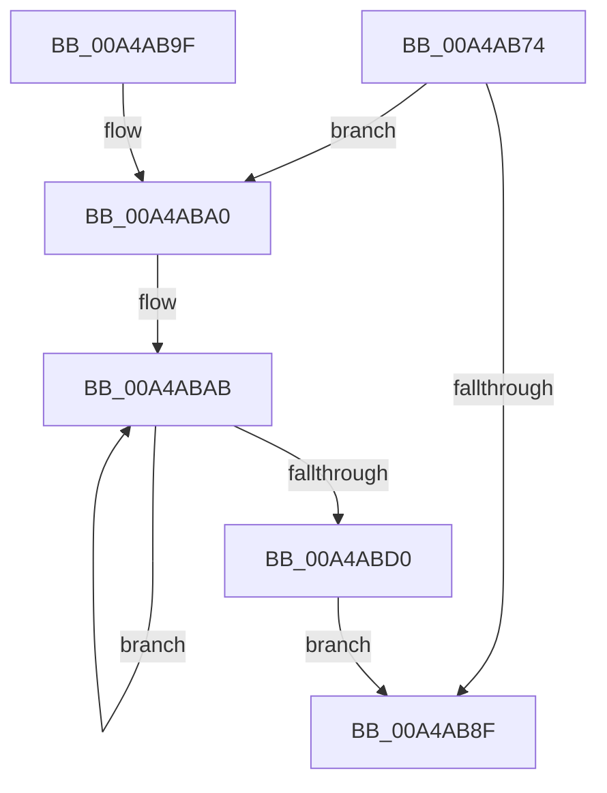

# MiFreeReservationRun

- RVA: `0x00A4AB74`–`0x00A4ABD2` (길이 `94` bytes)
- VA: `0x0000000140A4AB74`
- 실행 섹션: `PAGE`
- PDB 이름 있음: `예`; PDB Function 태그: `아니요`
- unwind 정보 RVA: `0x00069264`
- 디코드: `29`개 명령, `94/94` bytes 표시
- 미해석 바이트: `0` (있으면 어셈블리에 `.byte`로 보존)

> 이 문서는 커널 이미지의 기계어와 PDB 기호를 분석해 생성했습니다. 4번과 5번은 함수 원형과 자료형을 바이너리 사용 방식에서 추정한 C 해석이며 원본 소스 복구 결과는 아닙니다.

## 1. Dependencies

- 직접 호출 지점: **3**; 고유 호출 대상: **3**
- 직접 호출자로 확인된 함수: **2**
- RIP 상대 이미지 참조: **0**

### Outgoing calls
- `0x00A4ABA3` → [MiGetPageFileHigh](../../text/41/MiGetPageFileHigh_function_0041E6F0.md) (function, `0x0041E6F0`)
- `0x00A4ABB4` → [MiReleasePageFileInfo](../../text/28/MiReleasePageFileInfo_function_00283FD0.md) (function, `0x00283FD0`)
- `0x00A4ABC2` → [MiUpdatePageFileHighInPte](../../text/36/MiUpdatePageFileHighInPte_function_0036D840.md) (function, `0x0036D840`)

### Direct callers
- [MiFreeWorkingSetSwapContext](MiFreeWorkingSetSwapContext_function_00A4AABC.md) at `0x00A4AAFB`
- [MiFreeReservationRuns](MiFreeReservationRuns_function_00A4AB28.md) at `0x00A4AB4C`

### Static image references
- 디코드된 RIP-relative 메모리 참조가 없습니다.

## 2. Other-region calls and transfers

- 다른 실행 섹션으로 향하는 call: **3**
  - `0x00A4ABA3` → [MiGetPageFileHigh](../../text/41/MiGetPageFileHigh_function_0041E6F0.md) (`PAGE` → `.text`)
  - `0x00A4ABB4` → [MiReleasePageFileInfo](../../text/28/MiReleasePageFileInfo_function_00283FD0.md) (`PAGE` → `.text`)
  - `0x00A4ABC2` → [MiUpdatePageFileHighInPte](../../text/36/MiUpdatePageFileHighInPte_function_0036D840.md) (`PAGE` → `.text`)
- 별도 외부 분기/꼬리 이동을 확인하지 못했습니다.

## 3. Assembly (complete function range)

```asm
00A4AB74  48 89 5C 24 08                  mov qword ptr [rsp + 8], rbx
00A4AB79  48 89 74 24 10                  mov qword ptr [rsp + 0x10], rsi
00A4AB7E  57                              push rdi
00A4AB7F  48 83 EC 20                     sub rsp, 0x20
00A4AB83  83 7A 08 00                     cmp dword ptr [rdx + 8], 0
00A4AB87  48 8B DA                        mov rbx, rdx
00A4AB8A  48 8B F1                        mov rsi, rcx
00A4AB8D  75 11                           jne 0x140a4aba0
00A4AB8F  48 8B 5C 24 30                  mov rbx, qword ptr [rsp + 0x30]
00A4AB94  48 8B 74 24 38                  mov rsi, qword ptr [rsp + 0x38]
00A4AB99  48 83 C4 20                     add rsp, 0x20
00A4AB9D  5F                              pop rdi
00A4AB9E  C3                              ret
00A4AB9F  CC                              int3
00A4ABA0  48 8B 0A                        mov rcx, qword ptr [rdx]
00A4ABA3  E8 48 3B 9D FF                  call 0x14041e6f0
00A4ABA8  48 8B F8                        mov rdi, rax
00A4ABAB  48 8B 13                        mov rdx, qword ptr [rbx]
00A4ABAE  45 33 C0                        xor r8d, r8d
00A4ABB1  48 8B CE                        mov rcx, rsi
00A4ABB4  E8 17 94 83 FF                  call 0x140283fd0
00A4ABB9  48 8B 0B                        mov rcx, qword ptr [rbx]
00A4ABBC  48 FF C7                        inc rdi
00A4ABBF  48 8B D7                        mov rdx, rdi
00A4ABC2  E8 79 2C 92 FF                  call 0x14036d840
00A4ABC7  83 43 08 FF                     add dword ptr [rbx + 8], -1
00A4ABCB  48 89 03                        mov qword ptr [rbx], rax
00A4ABCE  75 DB                           jne 0x140a4abab
00A4ABD0  EB BD                           jmp 0x140a4ab8f
```

## 4. C-style interpretation (structured pseudocode)

```c
__int64 __fastcall MiFreeReservationRun(__int64 a1, __int64 a2, int a3)
{
    __int64 result;
    __int64 v_rdi;
    __int64 v_rsp;
    unsigned __int64 v_stack_p10;
    unsigned __int64 v_stack_p8;

    v_stack_p8 = v_rbx;
    v_stack_p10 = v_rsi;
    v_rsp = (v_rsp) - (32);
    if ((*(unsigned int *)(a2 + 8)) != 0) goto loc_00A4ABA0;
loc_00A4AB8F:
    v_rsp = (v_rsp) + (32);
    return result;
loc_00A4ABA0:
    result = MiGetPageFileHigh(*(unsigned __int64 *)(a2), a2, a3, a4);
loc_00A4ABAB:
    a3 = 0;
    result = MiReleasePageFileInfo(v_stack_p10, *(unsigned __int64 *)(v_stack_p8), a3, a4);
    v_rdi = (result) + 1;
    result = MiUpdatePageFileHighInPte(*(unsigned __int64 *)(v_stack_p8), v_rdi, a3, a4);
    *(unsigned __int64 *)(v_stack_p8) = result;
    if (condition_is_not_equal) goto loc_00A4ABAB;
    goto loc_00A4AB8F;
}
```

## 5. (Beta) C Style

```c
int64_t MiFreeReservationRun(int64_t Arg1, void *Arg2, int32_t Arg3)
{
    uint8_t *arg2 = (uint8_t *)Arg2;

    int64_t result;
    int64_t local_rdi;
    int64_t local_rsp;
    uint64_t v_stack_p10;
    uint64_t v_stack_p8;

    v_stack_p8 = local_rbx;
    v_stack_p10 = local_rsi;
    local_rsp = (local_rsp) - (32);
    if ((*(uint32_t *)(arg2 + 0x8)) != 0) goto loc_00A4ABA0;
loc_00A4AB8F:
    local_rsp = (local_rsp) + (32);
    return result;
loc_00A4ABA0:
    result = MiGetPageFileHigh(*(uint64_t *)(arg2), Arg2, Arg3, a4);
loc_00A4ABAB:
    Arg3 = 0;
    result = MiReleasePageFileInfo(v_stack_p10, *(uint64_t *)(v_stack_p8), Arg3, a4);
    local_rdi = (result) + 1;
    result = MiUpdatePageFileHighInPte(*(uint64_t *)(v_stack_p8), local_rdi, Arg3, a4);
    *(uint64_t *)(v_stack_p8) = result;
    if (condition_is_not_equal) goto loc_00A4ABAB;
    goto loc_00A4AB8F;
}
```

### 관측된 메모리 오프셋

구조체 형식이 확인되지 않은 접근은 인자 기준의 오프셋으로만 기록했습니다.

| 기준 인자 | 오프셋 표현 | 폭 (bit) | 접근 |
|---|---:|---:|---|
| `Arg2` | `+ 0x0` | `64` | `R` |
| `Arg2` | `+ 0x0` | `64` | `W` |
| `Arg2` | `+ 0x8` | `32` | `R` |
| `Arg2` | `+ 0x8` | `32` | `R/W` |

## 6. Execution-region graph

[열기: 2D/3D 그래프와 함수 탐색 컨트롤 패널](../../../control-panel.html?section=page&rva=0x00A4AB74&view=graph)

- 2D 그래프는 위에서 아래로 흐르고, 3D 그래프는 빈 공간을 드래그해 회전합니다. Shift+드래그는 이동, 휠은 확대·축소, 함수 노드 선택은 대상 보고서 이동입니다.

### Static fallback


