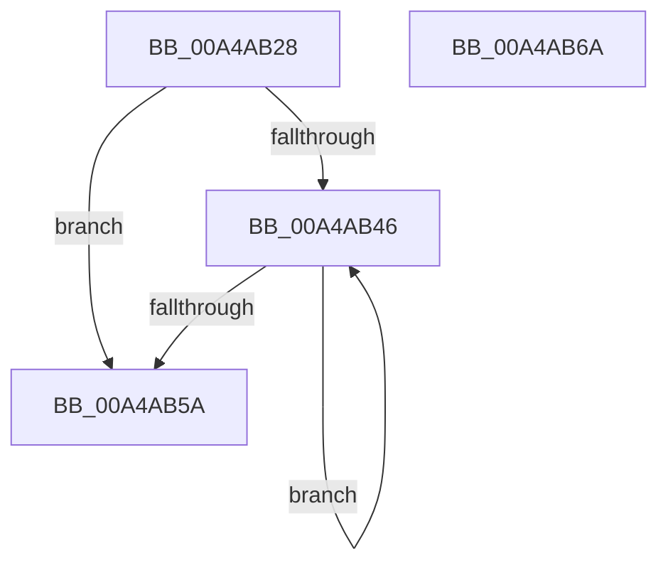

# MiFreeReservationRuns

- RVA: `0x00A4AB28`–`0x00A4AB6B` (길이 `67` bytes)
- VA: `0x0000000140A4AB28`
- 실행 섹션: `PAGE`
- PDB 이름 있음: `예`; PDB Function 태그: `아니요`
- unwind 정보 RVA: `0x00060BC4`
- 디코드: `21`개 명령, `67/67` bytes 표시
- 미해석 바이트: `0` (있으면 어셈블리에 `.byte`로 보존)

> 이 문서는 커널 이미지의 기계어와 PDB 기호를 분석해 생성했습니다. 4번과 5번은 함수 원형과 자료형을 바이너리 사용 방식에서 추정한 C 해석이며 원본 소스 복구 결과는 아닙니다.

## 1. Dependencies

- 직접 호출 지점: **1**; 고유 호출 대상: **1**
- 직접 호출자로 확인된 함수: **3**
- RIP 상대 이미지 참조: **0**

### Outgoing calls
- `0x00A4AB4C` → [MiFreeReservationRun](MiFreeReservationRun_function_00A4AB74.md) (function, `0x00A4AB74`)

### Direct callers
- [MmOutSwapWorkingSet](../../text/2A/MmOutSwapWorkingSet_function_002A6BC8.md) at `0x002A6F35`
- [MmOutSwapVirtualAddresses](../../text/2A/MmOutSwapVirtualAddresses_function_002A8C30.md) at `0x002A8D5E`
- [MiReserveWorkingSetSwapSpace](../A8/MiReserveWorkingSetSwapSpace_function_00A833E4.md) at `0x00A83467`

### Static image references
- 디코드된 RIP-relative 메모리 참조가 없습니다.

## 2. Other-region calls and transfers

- 다른 실행 섹션으로 향하는 call: **0**
- 별도 외부 분기/꼬리 이동을 확인하지 못했습니다.

## 3. Assembly (complete function range)

```asm
00A4AB28  48 89 5C 24 08                  mov qword ptr [rsp + 8], rbx
00A4AB2D  48 89 74 24 10                  mov qword ptr [rsp + 0x10], rsi
00A4AB32  57                              push rdi
00A4AB33  48 83 EC 20                     sub rsp, 0x20
00A4AB37  48 8D 7A 50                     lea rdi, [rdx + 0x50]
00A4AB3B  48 8B DA                        mov rbx, rdx
00A4AB3E  48 8B F1                        mov rsi, rcx
00A4AB41  48 3B D7                        cmp rdx, rdi
00A4AB44  73 14                           jae 0x140a4ab5a
00A4AB46  48 8B D3                        mov rdx, rbx
00A4AB49  48 8B CE                        mov rcx, rsi
00A4AB4C  E8 23 00 00 00                  call 0x140a4ab74
00A4AB51  48 83 C3 10                     add rbx, 0x10
00A4AB55  48 3B DF                        cmp rbx, rdi
00A4AB58  72 EC                           jb 0x140a4ab46
00A4AB5A  48 8B 5C 24 30                  mov rbx, qword ptr [rsp + 0x30]
00A4AB5F  48 8B 74 24 38                  mov rsi, qword ptr [rsp + 0x38]
00A4AB64  48 83 C4 20                     add rsp, 0x20
00A4AB68  5F                              pop rdi
00A4AB69  C3                              ret
00A4AB6A  CC                              int3
```

## 4. C-style interpretation (structured pseudocode)

```c
__int64 __fastcall MiFreeReservationRuns(__int64 a1, __int64 a2)
{
    __int64 result;
    __int64 v_rbx;
    __int64 v_rsp;
    unsigned __int64 v_stack_p10;
    unsigned __int64 v_stack_p8;

    v_stack_p8 = v_rbx;
    v_stack_p10 = v_rsi;
    v_rsp = (v_rsp) - (32);
    if (a2 >= (a2 + 80)) goto loc_00A4AB5A;
loc_00A4AB46:
    result = MiFreeReservationRun(a1, a2, a3, a4);
    v_rbx = (a2) + (16);
    if (v_rbx < (a2 + 80)) goto loc_00A4AB46;
loc_00A4AB5A:
    v_rsp = (v_rsp) + (32);
    return result;
}
```

## 5. (Beta) C Style

```c
int64_t MiFreeReservationRuns(int64_t Arg1, void *Arg2)
{
    uint8_t *arg2 = (uint8_t *)Arg2;

    int64_t result;
    int64_t local_rbx;
    int64_t local_rsp;
    uint64_t v_stack_p10;
    uint64_t v_stack_p8;

    v_stack_p8 = local_rbx;
    v_stack_p10 = local_rsi;
    local_rsp = (local_rsp) - (32);
    if (Arg2 >= (Arg2 + 80)) goto loc_00A4AB5A;
loc_00A4AB46:
    result = MiFreeReservationRun(Arg1, Arg2, a3, a4);
    local_rbx = (Arg2) + (16);
    if (local_rbx < (Arg2 + 80)) goto loc_00A4AB46;
loc_00A4AB5A:
    local_rsp = (local_rsp) + (32);
    return result;
}
```

### 관측된 메모리 오프셋

구조체 형식이 확인되지 않은 접근은 인자 기준의 오프셋으로만 기록했습니다.

| 기준 인자 | 오프셋 표현 | 폭 (bit) | 접근 |
|---|---:|---:|---|
| `Arg2` | `+ 0x50` | `64` | `R` |

## 6. Execution-region graph

[열기: 2D/3D 그래프와 함수 탐색 컨트롤 패널](../../../control-panel.html?section=page&rva=0x00A4AB28&view=graph)

- 2D 그래프는 위에서 아래로 흐르고, 3D 그래프는 빈 공간을 드래그해 회전합니다. Shift+드래그는 이동, 휠은 확대·축소, 함수 노드 선택은 대상 보고서 이동입니다.

### Static fallback


