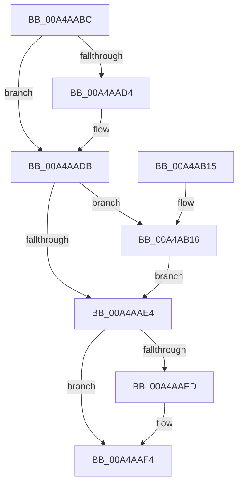

# MiFreeWorkingSetSwapContext

- RVA: `0x00A4AABC`–`0x00A4AB1F` (길이 `99` bytes)
- VA: `0x0000000140A4AABC`
- 실행 섹션: `PAGE`
- PDB 이름 있음: `예`; PDB Function 태그: `아니요`
- unwind 정보 RVA: `0x00060BE4`
- 디코드: `32`개 명령, `99/99` bytes 표시
- 미해석 바이트: `0` (있으면 어셈블리에 `.byte`로 보존)

> 이 문서는 커널 이미지의 기계어와 PDB 기호를 분석해 생성했습니다. 4번과 5번은 함수 원형과 자료형을 바이너리 사용 방식에서 추정한 C 해석이며 원본 소스 복구 결과는 아닙니다.

## 1. Dependencies

- 직접 호출 지점: **5**; 고유 호출 대상: **2**
- 직접 호출자로 확인된 함수: **4**
- RIP 상대 이미지 참조: **0**

### Outgoing calls
- `0x00A4AAD6` → [ExFreePoolWithTag](../../poolcode/B8/ExFreePoolWithTag_function_00B82870.md) (function, `0x00B82870`)
- `0x00A4AAEF` → [ExFreePoolWithTag](../../poolcode/B8/ExFreePoolWithTag_function_00B82870.md) (function, `0x00B82870`)
- `0x00A4AAFB` → [MiFreeReservationRun](MiFreeReservationRun_function_00A4AB74.md) (function, `0x00A4AB74`)
- `0x00A4AB05` → [ExFreePoolWithTag](../../poolcode/B8/ExFreePoolWithTag_function_00B82870.md) (function, `0x00B82870`)
- `0x00A4AB18` → [ExFreePoolWithTag](../../poolcode/B8/ExFreePoolWithTag_function_00B82870.md) (function, `0x00B82870`)

### Direct callers
- [MiBeginProcessClean](../../text/2A/MiBeginProcessClean_function_002A473C.md) at `0x002A4813`
- [MmOutSwapWorkingSet](../../text/2A/MmOutSwapWorkingSet_function_002A6BC8.md) at `0x002A6F49`
- [MmInSwapWorkingSet](../../text/45/MmInSwapWorkingSet_function_0045B6C4.md) at `0x0045B7E3`
- [MiInSwapSharedWorkingSetWorker](../80/MiInSwapSharedWorkingSetWorker_function_0080C510.md) at `0x0080C5D2`

### Static image references
- 디코드된 RIP-relative 메모리 참조가 없습니다.

## 2. Other-region calls and transfers

- 다른 실행 섹션으로 향하는 call: **4**
  - `0x00A4AAD6` → [ExFreePoolWithTag](../../poolcode/B8/ExFreePoolWithTag_function_00B82870.md) (`PAGE` → `POOLCODE`)
  - `0x00A4AAEF` → [ExFreePoolWithTag](../../poolcode/B8/ExFreePoolWithTag_function_00B82870.md) (`PAGE` → `POOLCODE`)
  - `0x00A4AB05` → [ExFreePoolWithTag](../../poolcode/B8/ExFreePoolWithTag_function_00B82870.md) (`PAGE` → `POOLCODE`)
  - `0x00A4AB18` → [ExFreePoolWithTag](../../poolcode/B8/ExFreePoolWithTag_function_00B82870.md) (`PAGE` → `POOLCODE`)
- 별도 외부 분기/꼬리 이동을 확인하지 못했습니다.

## 3. Assembly (complete function range)

```asm
00A4AABC  48 89 5C 24 08                  mov qword ptr [rsp + 8], rbx
00A4AAC1  57                              push rdi
00A4AAC2  48 83 EC 20                     sub rsp, 0x20
00A4AAC6  48 8B F9                        mov rdi, rcx
00A4AAC9  48 8B DA                        mov rbx, rdx
00A4AACC  48 8B 0A                        mov rcx, qword ptr [rdx]
00A4AACF  48 85 C9                        test rcx, rcx
00A4AAD2  74 07                           je 0x140a4aadb
00A4AAD4  33 D2                           xor edx, edx
00A4AAD6  E8 95 7D 13 00                  call 0x140b82870
00A4AADB  48 8B 4B 08                     mov rcx, qword ptr [rbx + 8]
00A4AADF  48 85 C9                        test rcx, rcx
00A4AAE2  75 32                           jne 0x140a4ab16
00A4AAE4  48 8B 4B 38                     mov rcx, qword ptr [rbx + 0x38]
00A4AAE8  48 85 C9                        test rcx, rcx
00A4AAEB  74 07                           je 0x140a4aaf4
00A4AAED  33 D2                           xor edx, edx
00A4AAEF  E8 7C 7D 13 00                  call 0x140b82870
00A4AAF4  48 8D 53 40                     lea rdx, [rbx + 0x40]
00A4AAF8  48 8B CF                        mov rcx, rdi
00A4AAFB  E8 74 00 00 00                  call 0x140a4ab74
00A4AB00  33 D2                           xor edx, edx
00A4AB02  48 8B CB                        mov rcx, rbx
00A4AB05  E8 66 7D 13 00                  call 0x140b82870
00A4AB0A  48 8B 5C 24 30                  mov rbx, qword ptr [rsp + 0x30]
00A4AB0F  48 83 C4 20                     add rsp, 0x20
00A4AB13  5F                              pop rdi
00A4AB14  C3                              ret
00A4AB15  CC                              int3
00A4AB16  33 D2                           xor edx, edx
00A4AB18  E8 53 7D 13 00                  call 0x140b82870
00A4AB1D  EB C5                           jmp 0x140a4aae4
```

## 4. C-style interpretation (structured pseudocode)

```c
__int64 __fastcall MiFreeWorkingSetSwapContext(__int64 a1, __int64 a2)
{
    __int64 result;
    __int64 v_rsp;
    unsigned __int64 v_stack_p8;

    v_stack_p8 = v_rbx;
    v_rsp = (v_rsp) - (32);
    if (*(unsigned __int64 *)(a2) != 0) {
        a2 = 0;
        result = ExFreePoolWithTag(*(unsigned __int64 *)(a2), a2, a3, a4);
    }
    if (*(unsigned __int64 *)(a2 + 8) != 0) goto loc_00A4AB16;
loc_00A4AAE4:
    if (*(unsigned __int64 *)(a2 + 56) != 0) {
        a2 = 0;
        result = ExFreePoolWithTag(*(unsigned __int64 *)(a2 + 56), a2, a3, a4);
    }
    result = MiFreeReservationRun(a1, a2 + 64, a3, a4);
    a2 = 0;
    result = ExFreePoolWithTag(0, a2, a3, a4);
    v_rsp = (v_rsp) + (32);
    return result;
loc_00A4AB16:
    a2 = 0;
    result = ExFreePoolWithTag(0, a2, a3, a4);
    goto loc_00A4AAE4;
}
```

## 5. (Beta) C Style

```c
int64_t MiFreeWorkingSetSwapContext(int64_t Arg1, void *Arg2)
{
    uint8_t *arg2 = (uint8_t *)Arg2;

    int64_t result;
    int64_t local_rsp;
    uint64_t v_stack_p8;

    v_stack_p8 = local_rbx;
    local_rsp = (local_rsp) - (32);
    if (*(uint64_t *)(arg2) != 0) {
        Arg2 = 0;
        result = ExFreePoolWithTag(*(uint64_t *)(arg2), Arg2, a3, a4);
    }
    if (*(uint64_t *)(arg2 + 0x8) != 0) goto loc_00A4AB16;
loc_00A4AAE4:
    if (*(uint64_t *)(arg2 + 0x38) != 0) {
        Arg2 = 0;
        result = ExFreePoolWithTag(*(uint64_t *)(arg2 + 0x38), Arg2, a3, a4);
    }
    result = MiFreeReservationRun(Arg1, Arg2 + 64, a3, a4);
    Arg2 = 0;
    result = ExFreePoolWithTag(0, Arg2, a3, a4);
    local_rsp = (local_rsp) + (32);
    return result;
loc_00A4AB16:
    Arg2 = 0;
    result = ExFreePoolWithTag(0, Arg2, a3, a4);
    goto loc_00A4AAE4;
}
```

### 관측된 메모리 오프셋

구조체 형식이 확인되지 않은 접근은 인자 기준의 오프셋으로만 기록했습니다.

| 기준 인자 | 오프셋 표현 | 폭 (bit) | 접근 |
|---|---:|---:|---|
| `Arg2` | `+ 0x0` | `64` | `R` |
| `Arg2` | `+ 0x8` | `64` | `R` |
| `Arg2` | `+ 0x38` | `64` | `R` |
| `Arg2` | `+ 0x40` | `64` | `R` |

## 6. Execution-region graph

[열기: 2D/3D 그래프와 함수 탐색 컨트롤 패널](../../../control-panel.html?section=page&rva=0x00A4AABC&view=graph)

- 2D 그래프는 위에서 아래로 흐르고, 3D 그래프는 빈 공간을 드래그해 회전합니다. Shift+드래그는 이동, 휠은 확대·축소, 함수 노드 선택은 대상 보고서 이동입니다.

### Static fallback


