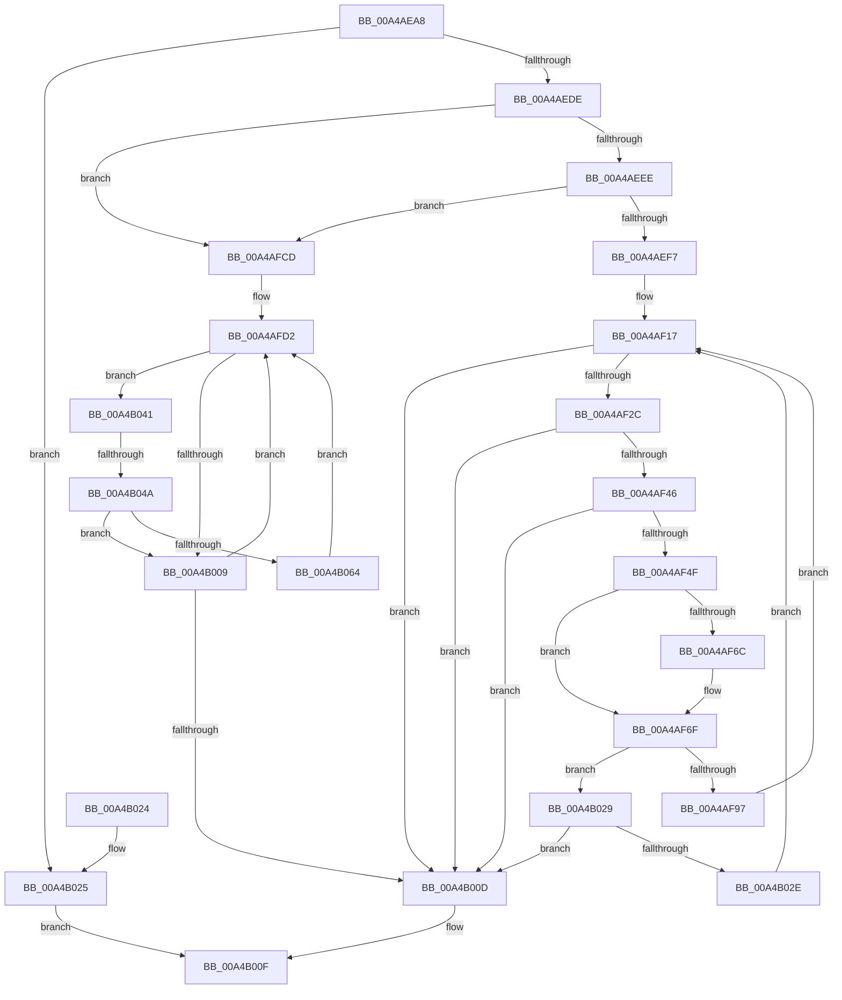

# MiHandleDriverNonPagedSections

- RVA: `0x00A4AEA8`–`0x00A4B06E` (길이 `454` bytes)
- VA: `0x0000000140A4AEA8`
- 실행 섹션: `PAGE`
- PDB 이름 있음: `예`; PDB Function 태그: `예`
- unwind 정보 RVA: `0x000B01A4`
- 디코드: `131`개 명령, `454/454` bytes 표시
- 미해석 바이트: `0` (있으면 어셈블리에 `.byte`로 보존)

> 이 문서는 커널 이미지의 기계어와 PDB 기호를 분석해 생성했습니다. 4번과 5번은 함수 원형과 자료형을 바이너리 사용 방식에서 추정한 C 해석이며 원본 소스 복구 결과는 아닙니다.

## 1. Dependencies

- 직접 호출 지점: **10**; 고유 호출 대상: **9**
- 직접 호출자로 확인된 함수: **3**
- RIP 상대 이미지 참조: **1**

### Outgoing calls
- `0x00A4AED1` → [MI_IS_PHYSICAL_ADDRESS](../../text/23/MI_IS_PHYSICAL_ADDRESS_function_0023B3A0.md) (function, `0x0023B3A0`)
- `0x00A4AEFA` → [MiDisablePagingOfDriver](MiDisablePagingOfDriver_function_00A4B074.md) (function, `0x00A4B074`)
- `0x00A4AF0F` → [MiGetExtendedLoaderBitmap](../../text/4F/MiGetExtendedLoaderBitmap_function_004FCC74.md) (function, `0x004FCC74`)
- `0x00A4AF37` → [RtlFindSetBits](../../text/3F/RtlFindSetBits_function_003F0610.md) (function, `0x003F0610`)
- `0x00A4AF5C` → [RtlFindNextForwardRunClear](../../text/3C/RtlFindNextForwardRunClear_function_003CF6A0.md) (function, `0x003CF6A0`)
- `0x00A4AF7D` → [MiGetPteAddress](../../text/43/MiGetPteAddress_function_0043E130.md) (function, `0x0043E130`)
- `0x00A4AFA6` → [MiLockCode](../../text/36/MiLockCode_function_0036F91C.md) (function, `0x0036F91C`)
- `0x00A4AFF5` → [MiSnapDriverRange](MiSnapDriverRange_function_00A4B328.md) (function, `0x00A4B328`)
- `0x00A4B034` → [MiUnlockCodePage](../../text/2A/MiUnlockCodePage_function_002A2AB8.md) (function, `0x002A2AB8`)
- `0x00A4B059` → [MiLockCode](../../text/36/MiLockCode_function_0036F91C.md) (function, `0x0036F91C`)

### Direct callers
- [MiApplyHotPatchToLoadedDriver](../80/MiApplyHotPatchToLoadedDriver_function_00802078.md) at `0x008022A5`
- [MmLoadSystemImageEx](../99/MmLoadSystemImageEx_function_00999B8C.md) at `0x0099A0C6`
- [MmRegisterHotPatches](../../init/C6/MmRegisterHotPatches_function_00C678DC.md) at `0x00C67C6E`

### Static image references
- `0x00A4AEDE` → RVA `0x00FC51F4` (`ALMOSTRO`; read)

## 2. Other-region calls and transfers

- 다른 실행 섹션으로 향하는 call: **8**
  - `0x00A4AED1` → [MI_IS_PHYSICAL_ADDRESS](../../text/23/MI_IS_PHYSICAL_ADDRESS_function_0023B3A0.md) (`PAGE` → `.text`)
  - `0x00A4AF0F` → [MiGetExtendedLoaderBitmap](../../text/4F/MiGetExtendedLoaderBitmap_function_004FCC74.md) (`PAGE` → `.text`)
  - `0x00A4AF37` → [RtlFindSetBits](../../text/3F/RtlFindSetBits_function_003F0610.md) (`PAGE` → `.text`)
  - `0x00A4AF5C` → [RtlFindNextForwardRunClear](../../text/3C/RtlFindNextForwardRunClear_function_003CF6A0.md) (`PAGE` → `.text`)
  - `0x00A4AF7D` → [MiGetPteAddress](../../text/43/MiGetPteAddress_function_0043E130.md) (`PAGE` → `.text`)
  - `0x00A4AFA6` → [MiLockCode](../../text/36/MiLockCode_function_0036F91C.md) (`PAGE` → `.text`)
  - `0x00A4B034` → [MiUnlockCodePage](../../text/2A/MiUnlockCodePage_function_002A2AB8.md) (`PAGE` → `.text`)
  - `0x00A4B059` → [MiLockCode](../../text/36/MiLockCode_function_0036F91C.md) (`PAGE` → `.text`)
- call이 아닌 외부 분기/꼬리 이동: **1**
  - `0x00A4B044` → [sub_00B3B7F6](../B3/Unknown_function_00B3B7F6.md) (`tail-transfer`)

## 3. Assembly (complete function range)

```asm
00A4AEA8  48 8B C4                        mov rax, rsp
00A4AEAB  48 89 58 10                     mov qword ptr [rax + 0x10], rbx
00A4AEAF  55                              push rbp
00A4AEB0  56                              push rsi
00A4AEB1  57                              push rdi
00A4AEB2  41 54                           push r12
00A4AEB4  41 55                           push r13
00A4AEB6  41 56                           push r14
00A4AEB8  41 57                           push r15
00A4AEBA  48 83 EC 30                     sub rsp, 0x30
00A4AEBE  48 83 60 18 00                  and qword ptr [rax + 0x18], 0
00A4AEC3  48 8B F9                        mov rdi, rcx
00A4AEC6  48 8B 49 30                     mov rcx, qword ptr [rcx + 0x30]
00A4AECA  8B DA                           mov ebx, edx
00A4AECC  48 83 60 08 00                  and qword ptr [rax + 8], 0
00A4AED1  E8 CA 04 7F FF                  call 0x14023b3a0
00A4AED6  85 C0                           test eax, eax
00A4AED8  0F 85 47 01 00 00               jne 0x140a4b025
00A4AEDE  8B 05 10 A3 57 00               mov eax, dword ptr [rip + 0x57a310]
00A4AEE4  33 F6                           xor esi, esi
00A4AEE6  A8 01                           test al, 1
00A4AEE8  0F 85 DF 00 00 00               jne 0x140a4afcd
00A4AEEE  F6 C3 02                        test bl, 2
00A4AEF1  0F 85 D6 00 00 00               jne 0x140a4afcd
00A4AEF7  48 8B CF                        mov rcx, rdi
00A4AEFA  E8 75 01 00 00                  call 0x140a4b074
00A4AEFF  48 8B CF                        mov rcx, rdi
00A4AF02  C7 44 24 70 01 00 00 00         mov dword ptr [rsp + 0x70], 1
00A4AF0A  33 ED                           xor ebp, ebp
00A4AF0C  45 33 FF                        xor r15d, r15d
00A4AF0F  E8 60 1D AB FF                  call 0x1404fcc74
00A4AF14  4C 8B F0                        mov r14, rax
00A4AF17  83 A4 24 80 00 00 00 00         and dword ptr [rsp + 0x80], 0
00A4AF1F  4C 8B 6F 30                     mov r13, qword ptr [rdi + 0x30]
00A4AF23  41 3B 2E                        cmp ebp, dword ptr [r14]
00A4AF26  0F 84 E1 00 00 00               je 0x140a4b00d
00A4AF2C  44 8B C5                        mov r8d, ebp
00A4AF2F  BA 01 00 00 00                  mov edx, 1
00A4AF34  49 8B CE                        mov rcx, r14
00A4AF37  E8 D4 56 9A FF                  call 0x1403f0610
00A4AF3C  8B D8                           mov ebx, eax
00A4AF3E  3B C5                           cmp eax, ebp
00A4AF40  0F 82 C7 00 00 00               jb 0x140a4b00d
00A4AF46  83 F8 FF                        cmp eax, -1
00A4AF49  0F 84 BE 00 00 00               je 0x140a4b00d
00A4AF4F  4C 8D 84 24 80 00 00 00         lea r8, [rsp + 0x80]
00A4AF57  8B D0                           mov edx, eax
00A4AF59  49 8B CE                        mov rcx, r14
00A4AF5C  E8 3F 47 98 FF                  call 0x1403cf6a0
00A4AF61  8B 94 24 80 00 00 00            mov edx, dword ptr [rsp + 0x80]
00A4AF68  85 C0                           test eax, eax
00A4AF6A  75 03                           jne 0x140a4af6f
00A4AF6C  41 8B 16                        mov edx, dword ptr [r14]
00A4AF6F  2B D3                           sub edx, ebx
00A4AF71  44 8D 24 1A                     lea r12d, [rdx + rbx]
00A4AF75  C1 E3 0C                        shl ebx, 0xc
00A4AF78  8B CB                           mov ecx, ebx
00A4AF7A  49 03 CD                        add rcx, r13
00A4AF7D  E8 AE 31 9F FF                  call 0x14043e130
00A4AF82  83 7C 24 70 01                  cmp dword ptr [rsp + 0x70], 1
00A4AF87  48 8B D8                        mov rbx, rax
00A4AF8A  8D 42 FF                        lea eax, [rdx - 1]
00A4AF8D  48 8D 14 C3                     lea rdx, [rbx + rax*8]
00A4AF91  0F 85 92 00 00 00               jne 0x140a4b029
00A4AF97  4C 8B C2                        mov r8, rdx
00A4AF9A  41 B9 02 00 00 00               mov r9d, 2
00A4AFA0  48 8B D3                        mov rdx, rbx
00A4AFA3  48 8B CF                        mov rcx, rdi
00A4AFA6  E8 71 49 92 FF                  call 0x14036f91c
00A4AFAB  85 C0                           test eax, eax
00A4AFAD  8B F0                           mov esi, eax
00A4AFAF  4C 0F 48 FB                     cmovs r15, rbx
00A4AFB3  33 ED                           xor ebp, ebp
00A4AFB5  85 C0                           test eax, eax
00A4AFB7  41 0F 49 EC                     cmovns ebp, r12d
00A4AFBB  33 C9                           xor ecx, ecx
00A4AFBD  85 C0                           test eax, eax
00A4AFBF  0F 49 4C 24 70                  cmovns ecx, dword ptr [rsp + 0x70]
00A4AFC4  89 4C 24 70                     mov dword ptr [rsp + 0x70], ecx
00A4AFC8  E9 4A FF FF FF                  jmp 0x140a4af17
00A4AFCD  33 ED                           xor ebp, ebp
00A4AFCF  45 33 F6                        xor r14d, r14d
00A4AFD2  45 33 C9                        xor r9d, r9d
00A4AFD5  48 8D 44 24 70                  lea rax, [rsp + 0x70]
00A4AFDA  48 89 44 24 28                  mov qword ptr [rsp + 0x28], rax
00A4AFDF  8B D5                           mov edx, ebp
00A4AFE1  48 8D 84 24 80 00 00 00         lea rax, [rsp + 0x80]
00A4AFE9  48 8B CF                        mov rcx, rdi
00A4AFEC  48 89 44 24 20                  mov qword ptr [rsp + 0x20], rax
00A4AFF1  45 8D 41 08                     lea r8d, [r9 + 8]
00A4AFF5  E8 2E 03 00 00                  call 0x140a4b328
00A4AFFA  48 8B 9C 24 80 00 00 00         mov rbx, qword ptr [rsp + 0x80]
00A4B002  8B E8                           mov ebp, eax
00A4B004  48 85 DB                        test rbx, rbx
00A4B007  75 38                           jne 0x140a4b041
00A4B009  85 ED                           test ebp, ebp
00A4B00B  75 C5                           jne 0x140a4afd2
00A4B00D  8B C6                           mov eax, esi
00A4B00F  48 8B 5C 24 78                  mov rbx, qword ptr [rsp + 0x78]
00A4B014  48 83 C4 30                     add rsp, 0x30
00A4B018  41 5F                           pop r15
00A4B01A  41 5E                           pop r14
00A4B01C  41 5D                           pop r13
00A4B01E  41 5C                           pop r12
00A4B020  5F                              pop rdi
00A4B021  5E                              pop rsi
00A4B022  5D                              pop rbp
00A4B023  C3                              ret
00A4B024  CC                              int3
00A4B025  33 C0                           xor eax, eax
00A4B027  EB E6                           jmp 0x140a4b00f
00A4B029  49 3B DF                        cmp rbx, r15
00A4B02C  74 DF                           je 0x140a4b00d
00A4B02E  45 33 C0                        xor r8d, r8d
00A4B031  48 8B CB                        mov rcx, rbx
00A4B034  E8 7F 7A 85 FF                  call 0x1402a2ab8
00A4B039  41 8B EC                        mov ebp, r12d
00A4B03C  E9 D6 FE FF FF                  jmp 0x140a4af17
00A4B041  4D 85 F6                        test r14, r14
00A4B044  0F 85 AC 07 0F 00               jne 0x140b3b7f6
00A4B04A  4C 8B 44 24 70                  mov r8, qword ptr [rsp + 0x70]
00A4B04F  45 8D 4E 02                     lea r9d, [r14 + 2]
00A4B053  48 8B D3                        mov rdx, rbx
00A4B056  48 8B CF                        mov rcx, rdi
00A4B059  E8 BE 48 92 FF                  call 0x14036f91c
00A4B05E  8B F0                           mov esi, eax
00A4B060  85 C0                           test eax, eax
00A4B062  79 A5                           jns 0x140a4b009
00A4B064  33 ED                           xor ebp, ebp
00A4B066  4C 8B F3                        mov r14, rbx
00A4B069  E9 64 FF FF FF                  jmp 0x140a4afd2
```

## 4. C-style interpretation (structured pseudocode)

```c
__int64 __fastcall MiHandleDriverNonPagedSections(__int64 a1, int a2)
{
    __int64 result;
    __int64 v_r14;
    __int64 v_r15;
    __int64 v_rbp;
    __int64 v_rbx;
    __int64 v_rsi;
    __int64 v_rsp;
    unsigned __int64 v_stack_m40;
    unsigned __int64 v_stack_m48;
    unsigned __int64 v_stack_p10;
    unsigned int v_stack_p18;
    unsigned __int64 v_stack_p70;
    unsigned int v_stack_p8;

    *(unsigned __int64 *)(v_rsp + 16) = v_rbx;
    v_rsp = (v_rsp) - (48);
    result = MI_IS_PHYSICAL_ADDRESS(*(unsigned __int64 *)(a1 + 48), a2, a3, a4);
    if ((unsigned int)(result) != 0) goto loc_00A4B025;
    v_rsi = 0;
    if ((((unsigned __int8)((unsigned int)(*(unsigned int *)(v_rip + 5743376)))) & (1)) != 0) goto loc_00A4AFCD;
    if ((((unsigned __int8)((unsigned int)(a2))) & (2)) != 0) goto loc_00A4AFCD;
    result = MiDisablePagingOfDriver(a1, a2, a3, a4);
    v_stack_p8 = 1;
    v_rbp = 0;
    v_r15 = 0;
    result = MiGetExtendedLoaderBitmap(a1, a2, a3, a4);
loc_00A4AF17:
    if (0 == (*(unsigned int *)(result))) goto loc_00A4B00D;
    result = RtlFindSetBits(result, 1, 0, a4);
    if (((unsigned int)(result)) < 0) goto loc_00A4B00D;
    if (((unsigned int)(result)) == -1) goto loc_00A4B00D;
    result = RtlFindNextForwardRunClear(result, (unsigned int)((unsigned int)(result)), v_stack_p18, a4);
    if ((unsigned int)(result) == 0) {
        a2 = *(unsigned int *)(result);
    }
    a2 = (unsigned int)((a2) - ((unsigned int)((unsigned int)((unsigned int)(result)))));
    v_rbx = (unsigned int)(((unsigned int)((unsigned int)(result))) << (12));
    a1 = ((unsigned int)((unsigned int)(v_rbx))) + (*(unsigned __int64 *)(a1 + 48));
    result = MiGetPteAddress(a1, a2, v_stack_p18, a4);
    if (v_stack_p8 != 1) goto loc_00A4B029;
    result = MiLockCode(a1, result, result + a2 - 1 * 8, 2);
    if (sign_flag) { v_r15 = result; }
    v_rbp = 0;
    if (!sign_flag) { v_rbp = (unsigned int)(a2 + (unsigned int)((unsigned int)(result)) * 1); }
    a1 = 0;
    if (!sign_flag) { a1 = v_stack_p8; }
    v_stack_p8 = (unsigned int)(a1);
    goto loc_00A4AF17;
loc_00A4AFCD:
    v_rbp = 0;
    v_r14 = 0;
loc_00A4AFD2:
    a4 = 0;
    v_stack_m40 = v_stack_p8;
    v_stack_m48 = v_stack_p18;
    result = MiSnapDriverRange(a1, 0, a4 + 8, a4);
    if (v_stack_p18 != 0) goto loc_00A4B041;
loc_00A4B009:
    if ((unsigned int)((unsigned int)((unsigned int)(result))) != 0) goto loc_00A4AFD2;
loc_00A4B00D:
loc_00A4B00F:
    v_rsp = (v_rsp) + (48);
    return (unsigned int)((unsigned int)((unsigned int)((unsigned int)(result))));
loc_00A4B025:
    result = 0;
    goto loc_00A4B00F;
loc_00A4B029:
    if (v_stack_p10 == v_r15) goto loc_00A4B00D;
    a3 = 0;
    result = MiUnlockCodePage(v_stack_p10, 0, a3, a4);
    goto loc_00A4AF17;
loc_00A4B041:
    result = MiLockCode(a1, v_stack_p10, v_stack_p70, v_r14 + 2);
    if (!sign_flag) goto loc_00A4B009;
    v_rbp = 0;
    goto loc_00A4AFD2;
}
```

## 5. (Beta) C Style

```c
int64_t MiHandleDriverNonPagedSections(void *Arg1, int32_t Arg2)
{
    uint8_t *arg1 = (uint8_t *)Arg1;

    int64_t result;
    int64_t local_r14;
    int64_t local_r15;
    int64_t local_rbp;
    int64_t local_rbx;
    int64_t local_rsi;
    int64_t local_rsp;
    uint64_t v_stack_m40;
    uint64_t v_stack_m48;
    uint64_t v_stack_p10;
    uint32_t v_stack_p18;
    uint64_t v_stack_p70;
    uint32_t v_stack_p8;

    *(uint64_t *)(local_rsp + 0x10) = local_rbx;
    local_rsp = (local_rsp) - (48);
    result = MI_IS_PHYSICAL_ADDRESS(*(uint64_t *)(arg1 + 0x30), Arg2, a3, a4);
    if ((uint32_t)(result) != 0) goto loc_00A4B025;
    local_rsi = 0;
    if ((((uint8_t)((uint32_t)(*(uint32_t *)(v_rip + 0x57A310)))) & (1)) != 0) goto loc_00A4AFCD;
    if ((((uint8_t)((uint32_t)(Arg2))) & (2)) != 0) goto loc_00A4AFCD;
    result = MiDisablePagingOfDriver(Arg1, Arg2, a3, a4);
    v_stack_p8 = 1;
    local_rbp = 0;
    local_r15 = 0;
    result = MiGetExtendedLoaderBitmap(Arg1, Arg2, a3, a4);
loc_00A4AF17:
    if (0 == (*(uint32_t *)(result))) goto loc_00A4B00D;
    result = RtlFindSetBits(result, 1, 0, a4);
    if (((uint32_t)(result)) < 0) goto loc_00A4B00D;
    if (((uint32_t)(result)) == -1) goto loc_00A4B00D;
    result = RtlFindNextForwardRunClear(result, (uint32_t)((uint32_t)(result)), v_stack_p18, a4);
    if ((uint32_t)(result) == 0) {
        Arg2 = *(uint32_t *)(result);
    }
    Arg2 = (uint32_t)((Arg2) - ((uint32_t)((uint32_t)((uint32_t)(result)))));
    local_rbx = (uint32_t)(((uint32_t)((uint32_t)(result))) << (12));
    Arg1 = ((uint32_t)((uint32_t)(local_rbx))) + (*(uint64_t *)(arg1 + 0x30));
    result = MiGetPteAddress(Arg1, Arg2, v_stack_p18, a4);
    if (v_stack_p8 != 1) goto loc_00A4B029;
    result = MiLockCode(Arg1, result, result + Arg2 - 1 * 8, 2);
    if (sign_flag) { local_r15 = result; }
    local_rbp = 0;
    if (!sign_flag) { local_rbp = (uint32_t)(Arg2 + (uint32_t)((uint32_t)(result)) * 1); }
    Arg1 = 0;
    if (!sign_flag) { Arg1 = v_stack_p8; }
    v_stack_p8 = (uint32_t)(Arg1);
    goto loc_00A4AF17;
loc_00A4AFCD:
    local_rbp = 0;
    local_r14 = 0;
loc_00A4AFD2:
    a4 = 0;
    v_stack_m40 = v_stack_p8;
    v_stack_m48 = v_stack_p18;
    result = MiSnapDriverRange(Arg1, 0, a4 + 8, a4);
    if (v_stack_p18 != 0) goto loc_00A4B041;
loc_00A4B009:
    if ((uint32_t)((uint32_t)((uint32_t)(result))) != 0) goto loc_00A4AFD2;
loc_00A4B00D:
loc_00A4B00F:
    local_rsp = (local_rsp) + (48);
    return (uint32_t)((uint32_t)((uint32_t)((uint32_t)(result))));
loc_00A4B025:
    result = 0;
    goto loc_00A4B00F;
loc_00A4B029:
    if (v_stack_p10 == local_r15) goto loc_00A4B00D;
    a3 = 0;
    result = MiUnlockCodePage(v_stack_p10, 0, a3, a4);
    goto loc_00A4AF17;
loc_00A4B041:
    result = MiLockCode(Arg1, v_stack_p10, v_stack_p70, local_r14 + 2);
    if (!sign_flag) goto loc_00A4B009;
    local_rbp = 0;
    goto loc_00A4AFD2;
}
```

### 관측된 메모리 오프셋

구조체 형식이 확인되지 않은 접근은 인자 기준의 오프셋으로만 기록했습니다.

| 기준 인자 | 오프셋 표현 | 폭 (bit) | 접근 |
|---|---:|---:|---|
| `Arg1` | `+ 0x30` | `64` | `R` |

## 6. Execution-region graph

[열기: 2D/3D 그래프와 함수 탐색 컨트롤 패널](../../../control-panel.html?section=page&rva=0x00A4AEA8&view=graph)

- 2D 그래프는 위에서 아래로 흐르고, 3D 그래프는 빈 공간을 드래그해 회전합니다. Shift+드래그는 이동, 휠은 확대·축소, 함수 노드 선택은 대상 보고서 이동입니다.

### Static fallback


