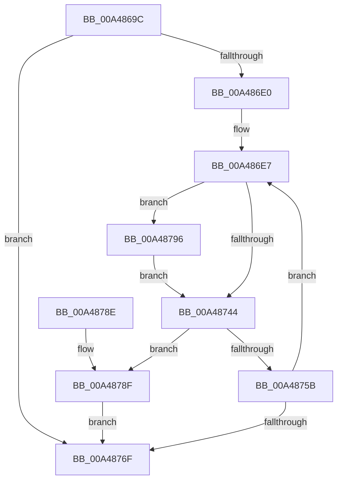

# MiInitializeVadBitMap

- RVA: `0x00A4869C`–`0x00A4879B` (길이 `255` bytes)
- VA: `0x0000000140A4869C`
- 실행 섹션: `PAGE`
- PDB 이름 있음: `예`; PDB Function 태그: `아니요`
- unwind 정보 RVA: `0x000AFA70`
- 디코드: `67`개 명령, `255/255` bytes 표시
- 미해석 바이트: `0` (있으면 어셈블리에 `.byte`로 보존)

> 이 문서는 커널 이미지의 기계어와 PDB 기호를 분석해 생성했습니다. 4번과 5번은 함수 원형과 자료형을 바이너리 사용 방식에서 추정한 C 해석이며 원본 소스 복구 결과는 아닙니다.

## 1. Dependencies

- 직접 호출 지점: **3**; 고유 호출 대상: **3**
- 직접 호출자로 확인된 함수: **1**
- RIP 상대 이미지 참조: **1**

### Outgoing calls
- `0x00A48726` → [LOCK_ADDRESS_SPACE](../../text/2A/LOCK_ADDRESS_SPACE_function_002A4944.md) (function, `0x002A4944`)
- `0x00A48738` → [MiExpandVadBitMap](../88/MiExpandVadBitMap_function_00886574.md) (function, `0x00886574`)
- `0x00A48751` → [UNLOCK_ADDRESS_SPACE](../../text/2A/UNLOCK_ADDRESS_SPACE_function_002A4844.md) (function, `0x002A4844`)

### Direct callers
- [MmInitializeProcessAddressSpace](../8C/MmInitializeProcessAddressSpace_function_008CF6B0.md) at `0x008CF83E`
- [MmInitializeProcessAddressSpace](../8C/MmInitializeProcessAddressSpace_function_008CF6B0.md) at `0x008CFA17`

### Static image references
- `0x00A48715` → RVA `0x00E2F388` (`.data`; read)

## 2. Other-region calls and transfers

- 다른 실행 섹션으로 향하는 call: **2**
  - `0x00A48726` → [LOCK_ADDRESS_SPACE](../../text/2A/LOCK_ADDRESS_SPACE_function_002A4944.md) (`PAGE` → `.text`)
  - `0x00A48751` → [UNLOCK_ADDRESS_SPACE](../../text/2A/UNLOCK_ADDRESS_SPACE_function_002A4844.md) (`PAGE` → `.text`)
- 별도 외부 분기/꼬리 이동을 확인하지 못했습니다.

## 3. Assembly (complete function range)

```asm
00A4869C  48 89 5C 24 08                  mov qword ptr [rsp + 8], rbx
00A486A1  48 89 6C 24 10                  mov qword ptr [rsp + 0x10], rbp
00A486A6  48 89 74 24 18                  mov qword ptr [rsp + 0x18], rsi
00A486AB  57                              push rdi
00A486AC  41 54                           push r12
00A486AE  41 55                           push r13
00A486B0  41 56                           push r14
00A486B2  41 57                           push r15
00A486B4  48 83 EC 20                     sub rsp, 0x20
00A486B8  65 48 8B 04 25 88 01 00 00      mov rax, qword ptr gs:[0x188]
00A486C1  33 FF                           xor edi, edi
00A486C3  33 F6                           xor esi, esi
00A486C5  48 8B 88 B8 00 00 00            mov rcx, qword ptr [rax + 0xb8]
00A486CC  48 8B A9 10 04 00 00            mov rbp, qword ptr [rcx + 0x410]
00A486D3  48 39 B5 D8 03 00 00            cmp qword ptr [rbp + 0x3d8], rsi
00A486DA  0F 86 8F 00 00 00               jbe 0x140a4876f
00A486E0  48 8D 9D 10 03 00 00            lea rbx, [rbp + 0x310]
00A486E7  65 4C 8B 3C 25 88 01 00 00      mov r15, qword ptr gs:[0x188]
00A486F0  4C 8D 73 F0                     lea r14, [rbx - 0x10]
00A486F4  48 8B 4B 30                     mov rcx, qword ptr [rbx + 0x30]
00A486F8  48 8B C1                        mov rax, rcx
00A486FB  48 C1 E9 0F                     shr rcx, 0xf
00A486FF  48 C1 E1 0C                     shl rcx, 0xc
00A48703  25 FF 7F 00 00                  and eax, 0x7fff
00A48708  4D 8B A7 B8 00 00 00            mov r12, qword ptr [r15 + 0xb8]
00A4870F  48 89 03                        mov qword ptr [rbx], rax
00A48712  49 8B D4                        mov rdx, r12
00A48715  48 03 0D 6C 6C 3E 00            add rcx, qword ptr [rip + 0x3e6c6c]
00A4871C  49 21 3E                        and qword ptr [r14], rdi
00A4871F  48 89 4B F8                     mov qword ptr [rbx - 8], rcx
00A48723  49 8B CF                        mov rcx, r15
00A48726  E8 19 C2 85 FF                  call 0x1402a4944
00A4872B  45 33 C9                        xor r9d, r9d
00A4872E  45 33 C0                        xor r8d, r8d
00A48731  49 8B CE                        mov rcx, r14
00A48734  41 8D 51 01                     lea edx, [r9 + 1]
00A48738  E8 37 DE E3 FF                  call 0x140886574
00A4873D  44 8B E8                        mov r13d, eax
00A48740  85 C0                           test eax, eax
00A48742  74 52                           je 0x140a48796
00A48744  48 8B 03                        mov rax, qword ptr [rbx]
00A48747  49 8B D4                        mov rdx, r12
00A4874A  49 8B CF                        mov rcx, r15
00A4874D  48 89 43 10                     mov qword ptr [rbx + 0x10], rax
00A48751  E8 EE C0 85 FF                  call 0x1402a4844
00A48756  45 85 ED                        test r13d, r13d
00A48759  74 34                           je 0x140a4878f
00A4875B  48 FF C6                        inc rsi
00A4875E  48 83 C3 48                     add rbx, 0x48
00A48762  48 3B B5 D8 03 00 00            cmp rsi, qword ptr [rbp + 0x3d8]
00A48769  0F 82 78 FF FF FF               jb 0x140a486e7
00A4876F  48 8B 5C 24 50                  mov rbx, qword ptr [rsp + 0x50]
00A48774  8B C7                           mov eax, edi
00A48776  48 8B 6C 24 58                  mov rbp, qword ptr [rsp + 0x58]
00A4877B  48 8B 74 24 60                  mov rsi, qword ptr [rsp + 0x60]
00A48780  48 83 C4 20                     add rsp, 0x20
00A48784  41 5F                           pop r15
00A48786  41 5E                           pop r14
00A48788  41 5D                           pop r13
00A4878A  41 5C                           pop r12
00A4878C  5F                              pop rdi
00A4878D  C3                              ret
00A4878E  CC                              int3
00A4878F  BF 17 00 00 C0                  mov edi, 0xc0000017
00A48794  EB D9                           jmp 0x140a4876f
00A48796  49 21 3E                        and qword ptr [r14], rdi
00A48799  EB A9                           jmp 0x140a48744
```

## 4. C-style interpretation (structured pseudocode)

```c
__int64 __fastcall MiInitializeVadBitMap(__int64 a1, __int64 a2, int a3, int a4)
{
    __int64 result;
    __int64 v_rbx;
    __int64 v_rdi;
    __int64 v_rsi;
    __int64 v_rsp;
    unsigned __int64 v_stack_p10;
    unsigned __int64 v_stack_p18;
    unsigned __int64 v_stack_p8;

    v_stack_p8 = v_rbx;
    v_stack_p10 = v_rbp;
    v_stack_p18 = v_rsi;
    v_rsp = (v_rsp) - (32);
    v_rdi = 0;
    v_rsi = 0;
    if ((*(unsigned __int64 *)(*(unsigned __int64 *)(*(unsigned __int64 *)(*(unsigned __int64 *)(gs_base + (0 + 392)) + 184) + 1040) + 984)) <= 0) goto loc_00A4876F;
loc_00A486E7:
    a1 = (*(unsigned __int64 *)(*(unsigned __int64 *)(*(unsigned __int64 *)(*(unsigned __int64 *)(gs_base + (0 + 392)) + 184) + 1040) + 784 + 48)) >> (15);
    a1 = (a1) << (12);
    result = (unsigned int)((*(unsigned __int64 *)(*(unsigned __int64 *)(*(unsigned __int64 *)(*(unsigned __int64 *)(gs_base + (0 + 392)) + 184) + 1040) + 784 + 48)) & (0x7FFFULL));
    *(unsigned __int64 *)(*(unsigned __int64 *)(*(unsigned __int64 *)(*(unsigned __int64 *)(gs_base + (0 + 392)) + 184) + 1040) + 784) = result;
    a1 = (a1) + (*(unsigned __int64 *)(v_rip + 4090988));
    *(unsigned __int64 *)(*(unsigned __int64 *)(*(unsigned __int64 *)(*(unsigned __int64 *)(gs_base + (0 + 392)) + 184) + 1040) + 784 - 8) = a1;
    result = LOCK_ADDRESS_SPACE(*(unsigned __int64 *)(gs_base + (0 + 392)), *(unsigned __int64 *)(*(unsigned __int64 *)(gs_base + (0 + 392)) + 184), a3, a4);
    a4 = 0;
    a3 = 0;
    result = MiExpandVadBitMap(*(unsigned __int64 *)(*(unsigned __int64 *)(*(unsigned __int64 *)(gs_base + (0 + 392)) + 184) + 1040) + 784 - 16, a4 + 1, a3, a4);
    if ((unsigned int)(result) == 0) goto loc_00A48796;
loc_00A48744:
    *(unsigned __int64 *)(*(unsigned __int64 *)(*(unsigned __int64 *)(*(unsigned __int64 *)(gs_base + (0 + 392)) + 184) + 1040) + 784 + 16) = *(unsigned __int64 *)(*(unsigned __int64 *)(*(unsigned __int64 *)(*(unsigned __int64 *)(gs_base + (0 + 392)) + 184) + 1040) + 784);
    result = UNLOCK_ADDRESS_SPACE(*(unsigned __int64 *)(gs_base + (0 + 392)), *(unsigned __int64 *)(*(unsigned __int64 *)(gs_base + (0 + 392)) + 184), a3, a4);
    if ((unsigned int)((unsigned int)((unsigned int)(result))) == 0) goto loc_00A4878F;
    v_rsi = (v_rsi) + 1;
    v_rbx = (*(unsigned __int64 *)(*(unsigned __int64 *)(*(unsigned __int64 *)(gs_base + (0 + 392)) + 184) + 1040) + 784) + (72);
    if (v_rsi < (*(unsigned __int64 *)(*(unsigned __int64 *)(*(unsigned __int64 *)(*(unsigned __int64 *)(gs_base + (0 + 392)) + 184) + 1040) + 984))) goto loc_00A486E7;
loc_00A4876F:
    v_rsp = (v_rsp) + (32);
    return 0;
loc_00A4878F:
    goto loc_00A4876F;
loc_00A48796:
    goto loc_00A48744;
}
```

## 5. (Beta) C Style

```c
int64_t MiInitializeVadBitMap(int64_t Arg1, int64_t Arg2, int32_t Arg3, int32_t Arg4)
{
    int64_t result;
    int64_t local_rbx;
    int64_t local_rdi;
    int64_t local_rsi;
    int64_t local_rsp;
    uint64_t v_stack_p10;
    uint64_t v_stack_p18;
    uint64_t v_stack_p8;

    v_stack_p8 = local_rbx;
    v_stack_p10 = local_rbp;
    v_stack_p18 = local_rsi;
    local_rsp = (local_rsp) - (32);
    local_rdi = 0;
    local_rsi = 0;
    if ((*(uint64_t *)(*(uint64_t *)(*(uint64_t *)(*(uint64_t *)(gs_base + (0 + 0x188)) + 0xB8) + 0x410) + 0x3D8)) <= 0) goto loc_00A4876F;
loc_00A486E7:
    Arg1 = (*(uint64_t *)(*(uint64_t *)(*(uint64_t *)(*(uint64_t *)(gs_base + (0 + 0x188)) + 0xB8) + 0x410) + 0x310 + 0x30)) >> (15);
    Arg1 = (Arg1) << (12);
    result = (uint32_t)((*(uint64_t *)(*(uint64_t *)(*(uint64_t *)(*(uint64_t *)(gs_base + (0 + 0x188)) + 0xB8) + 0x410) + 0x310 + 0x30)) & (0x7FFFULL));
    *(uint64_t *)(*(uint64_t *)(*(uint64_t *)(*(uint64_t *)(gs_base + (0 + 0x188)) + 0xB8) + 0x410) + 0x310) = result;
    Arg1 = (Arg1) + (*(uint64_t *)(v_rip + 0x3E6C6C));
    *(uint64_t *)(*(uint64_t *)(*(uint64_t *)(*(uint64_t *)(gs_base + (0 + 0x188)) + 0xB8) + 0x410) + 0x310 - 0x8) = Arg1;
    result = LOCK_ADDRESS_SPACE(*(uint64_t *)(gs_base + (0 + 0x188)), *(uint64_t *)(*(uint64_t *)(gs_base + (0 + 0x188)) + 0xB8), Arg3, Arg4);
    Arg4 = 0;
    Arg3 = 0;
    result = MiExpandVadBitMap(*(uint64_t *)(*(uint64_t *)(*(uint64_t *)(gs_base + (0 + 0x188)) + 0xB8) + 0x410) + 784 - 16, Arg4 + 1, Arg3, Arg4);
    if ((uint32_t)(result) == 0) goto loc_00A48796;
loc_00A48744:
    *(uint64_t *)(*(uint64_t *)(*(uint64_t *)(*(uint64_t *)(gs_base + (0 + 0x188)) + 0xB8) + 0x410) + 0x310 + 0x10) = *(uint64_t *)(*(uint64_t *)(*(uint64_t *)(*(uint64_t *)(gs_base + (0 + 0x188)) + 0xB8) + 0x410) + 0x310);
    result = UNLOCK_ADDRESS_SPACE(*(uint64_t *)(gs_base + (0 + 0x188)), *(uint64_t *)(*(uint64_t *)(gs_base + (0 + 0x188)) + 0xB8), Arg3, Arg4);
    if ((uint32_t)((uint32_t)((uint32_t)(result))) == 0) goto loc_00A4878F;
    local_rsi = (local_rsi) + 1;
    local_rbx = (*(uint64_t *)(*(uint64_t *)(*(uint64_t *)(gs_base + (0 + 0x188)) + 0xB8) + 0x410) + 784) + (72);
    if (local_rsi < (*(uint64_t *)(*(uint64_t *)(*(uint64_t *)(*(uint64_t *)(gs_base + (0 + 0x188)) + 0xB8) + 0x410) + 0x3D8))) goto loc_00A486E7;
loc_00A4876F:
    local_rsp = (local_rsp) + (32);
    return 0;
loc_00A4878F:
    goto loc_00A4876F;
loc_00A48796:
    goto loc_00A48744;
}
```

## 6. Execution-region graph

[열기: 2D/3D 그래프와 함수 탐색 컨트롤 패널](../../../control-panel.html?section=page&rva=0x00A4869C&view=graph)

- 2D 그래프는 위에서 아래로 흐르고, 3D 그래프는 빈 공간을 드래그해 회전합니다. Shift+드래그는 이동, 휠은 확대·축소, 함수 노드 선택은 대상 보고서 이동입니다.

### Static fallback


