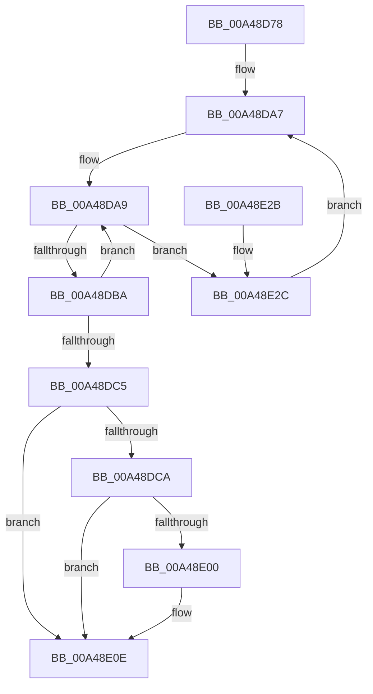

# MiLockImageSection

- RVA: `0x00A48D78`–`0x00A48E51` (길이 `217` bytes)
- VA: `0x0000000140A48D78`
- 실행 섹션: `PAGE`
- PDB 이름 있음: `예`; PDB Function 태그: `아니요`
- unwind 정보 RVA: `0x000AFBF0`
- 디코드: `56`개 명령, `217/217` bytes 표시
- 미해석 바이트: `0` (있으면 어셈블리에 `.byte`로 보존)

> 이 문서는 커널 이미지의 기계어와 PDB 기호를 분석해 생성했습니다. 4번과 5번은 함수 원형과 자료형을 바이너리 사용 방식에서 추정한 C 해석이며 원본 소스 복구 결과는 아닙니다.

## 1. Dependencies

- 직접 호출 지점: **5**; 고유 호출 대상: **5**
- 직접 호출자로 확인된 함수: **1**
- RIP 상대 이미지 참조: **1**

### Outgoing calls
- `0x00A48DCE` → [MiGetPteAddress](../../text/43/MiGetPteAddress_function_0043E130.md) (function, `0x0043E130`)
- `0x00A48DE9` → [MiLockCode](../../text/36/MiLockCode_function_0036F91C.md) (function, `0x0036F91C`)
- `0x00A48E09` → [ExfUnblockPushLock](../../text/2A/ExfUnblockPushLock_function_002A3FE0.md) (function, `0x002A3FE0`)
- `0x00A48E11` → [KeLeaveCriticalRegionThread](../../text/25/KeLeaveCriticalRegionThread_function_0025EFF0.md) (function, `0x0025EFF0`)
- `0x00A48E47` → [ExBlockOnAddressPushLock](../../text/2A/ExBlockOnAddressPushLock_function_002A43A0.md) (function, `0x002A43A0`)

### Direct callers
- [MiLockPagableImageSection](../../text/2A/MiLockPagableImageSection_function_002A3A60.md) at `0x002A3AC2`

### Static image references
- `0x00A48DF6` → RVA `0x00E2D978` (`.data`; read)

## 2. Other-region calls and transfers

- 다른 실행 섹션으로 향하는 call: **5**
  - `0x00A48DCE` → [MiGetPteAddress](../../text/43/MiGetPteAddress_function_0043E130.md) (`PAGE` → `.text`)
  - `0x00A48DE9` → [MiLockCode](../../text/36/MiLockCode_function_0036F91C.md) (`PAGE` → `.text`)
  - `0x00A48E09` → [ExfUnblockPushLock](../../text/2A/ExfUnblockPushLock_function_002A3FE0.md) (`PAGE` → `.text`)
  - `0x00A48E11` → [KeLeaveCriticalRegionThread](../../text/25/KeLeaveCriticalRegionThread_function_0025EFF0.md) (`PAGE` → `.text`)
  - `0x00A48E47` → [ExBlockOnAddressPushLock](../../text/2A/ExBlockOnAddressPushLock_function_002A43A0.md) (`PAGE` → `.text`)
- 별도 외부 분기/꼬리 이동을 확인하지 못했습니다.

## 3. Assembly (complete function range)

```asm
00A48D78  48 89 5C 24 08                  mov qword ptr [rsp + 8], rbx
00A48D7D  48 89 6C 24 18                  mov qword ptr [rsp + 0x18], rbp
00A48D82  48 89 74 24 20                  mov qword ptr [rsp + 0x20], rsi
00A48D87  57                              push rdi
00A48D88  48 83 EC 30                     sub rsp, 0x30
00A48D8C  65 48 8B 3C 25 88 01 00 00      mov rdi, qword ptr gs:[0x188]
00A48D95  48 8D 5A 08                     lea rbx, [rdx + 8]
00A48D99  48 8B F2                        mov rsi, rdx
00A48D9C  48 8B E9                        mov rbp, rcx
00A48D9F  66 FF 8F E4 01 00 00            dec word ptr [rdi + 0x1e4]
00A48DA6  90                              nop
00A48DA7  8B 03                           mov eax, dword ptr [rbx]
00A48DA9  89 44 24 48                     mov dword ptr [rsp + 0x48], eax
00A48DAD  44 8B C8                        mov r9d, eax
00A48DB0  8B C8                           mov ecx, eax
00A48DB2  44 8B C0                        mov r8d, eax
00A48DB5  83 F8 01                        cmp eax, 1
00A48DB8  74 72                           je 0x140a48e2c
00A48DBA  FF C1                           inc ecx
00A48DBC  F0 0F B1 0B                     lock cmpxchg dword ptr [rbx], ecx
00A48DC0  41 3B C0                        cmp eax, r8d
00A48DC3  75 E4                           jne 0x140a48da9
00A48DC5  83 F8 02                        cmp eax, 2
00A48DC8  73 44                           jae 0x140a48e0e
00A48DCA  48 8B 4D 30                     mov rcx, qword ptr [rbp + 0x30]
00A48DCE  E8 5D 53 9F FF                  call 0x14043e130
00A48DD3  8B 56 04                        mov edx, dword ptr [rsi + 4]
00A48DD6  41 B9 01 00 00 00               mov r9d, 1
00A48DDC  48 8B CD                        mov rcx, rbp
00A48DDF  4C 8D 04 D0                     lea r8, [rax + rdx*8]
00A48DE3  8B 16                           mov edx, dword ptr [rsi]
00A48DE5  48 8D 14 D0                     lea rdx, [rax + rdx*8]
00A48DE9  E8 2E 6B 92 FF                  call 0x14036f91c
00A48DEE  F0 FF 03                        lock inc dword ptr [rbx]
00A48DF1  F0 83 0C 24 00                  lock or dword ptr [rsp], 0
00A48DF6  48 83 3D 7A 4B 3E 00 00         cmp qword ptr [rip + 0x3e4b7a], 0
00A48DFE  74 0E                           je 0x140a48e0e
00A48E00  33 D2                           xor edx, edx
00A48E02  48 8D 0D 6F 4B 3E 00            lea rcx, [rip + 0x3e4b6f]
00A48E09  E8 D2 B1 85 FF                  call 0x1402a3fe0
00A48E0E  48 8B CF                        mov rcx, rdi
00A48E11  E8 DA 61 81 FF                  call 0x14025eff0
00A48E16  48 8B 5C 24 40                  mov rbx, qword ptr [rsp + 0x40]
00A48E1B  48 8B 6C 24 50                  mov rbp, qword ptr [rsp + 0x50]
00A48E20  48 8B 74 24 58                  mov rsi, qword ptr [rsp + 0x58]
00A48E25  48 83 C4 30                     add rsp, 0x30
00A48E29  5F                              pop rdi
00A48E2A  C3                              ret
00A48E2B  CC                              int3
00A48E2C  48 83 64 24 20 00               and qword ptr [rsp + 0x20], 0
00A48E32  4C 8D 44 24 48                  lea r8, [rsp + 0x48]
00A48E37  41 B9 04 00 00 00               mov r9d, 4
00A48E3D  48 8D 0D 34 4B 3E 00            lea rcx, [rip + 0x3e4b34]
00A48E44  48 8B D3                        mov rdx, rbx
00A48E47  E8 54 B5 85 FF                  call 0x1402a43a0
00A48E4C  E9 56 FF FF FF                  jmp 0x140a48da7
```

## 4. C-style interpretation (structured pseudocode)

```c
__int64 __fastcall MiLockImageSection(__int64 a1, __int64 a2)
{
    __int64 result;
    __int64 v_rsp;
    unsigned int v_stack_m38;
    unsigned int v_stack_p10;
    unsigned __int64 v_stack_p18;
    unsigned __int64 v_stack_p20;
    unsigned __int64 v_stack_p48;
    unsigned __int64 v_stack_p8;

    v_stack_p8 = v_rbx;
    v_stack_p18 = v_rbp;
    v_stack_p20 = v_rsi;
    v_rsp = (v_rsp) - (48);
loc_00A48DA7:
loc_00A48DA9:
    v_stack_p10 = (unsigned int)((unsigned int)(*(unsigned int *)(a2 + 8)));
    if (((unsigned int)((unsigned int)(*(unsigned int *)(a2 + 8)))) == 1) goto loc_00A48E2C;
    a1 = (unsigned int)(((unsigned int)((unsigned int)((unsigned int)(*(unsigned int *)(a2 + 8))))) + 1);
    if (((unsigned int)((unsigned int)(*(unsigned int *)(a2 + 8)))) != ((unsigned int)((unsigned int)((unsigned int)((unsigned int)(*(unsigned int *)(a2 + 8))))))) goto loc_00A48DA9;
    if (((unsigned int)((unsigned int)(*(unsigned int *)(a2 + 8)))) >= 2) goto loc_00A48E0E;
    result = MiGetPteAddress(*(unsigned __int64 *)(a1 + 48), a2, (unsigned int)((unsigned int)((unsigned int)(*(unsigned int *)(a2 + 8)))), (unsigned int)((unsigned int)((unsigned int)(*(unsigned int *)(a2 + 8)))));
    result = MiLockCode(a1, result + (unsigned int)(*(unsigned int *)(a2)) * 8, result + (unsigned int)(*(unsigned int *)(a2 + 4)) * 8, 1);
    if ((*(unsigned __int64 *)(v_rip + 4082554)) != 0) {
        a2 = 0;
        a1 = v_rip + 4082543;
        result = ExfUnblockPushLock(a1, a2, result + (unsigned int)(*(unsigned int *)(a2 + 4)) * 8, 1);
    }
    result = KeLeaveCriticalRegionThread(*(unsigned __int64 *)(gs_base + (0 + 392)), a2, result + (unsigned int)(*(unsigned int *)(a2 + 4)) * 8, 1);
    v_rsp = (v_rsp) + (48);
    return result;
loc_00A48E2C:
    result = ExBlockOnAddressPushLock(v_rip + 4082484, v_stack_p8, v_stack_p48, 4);
    goto loc_00A48DA7;
}
```

## 5. (Beta) C Style

```c
int64_t MiLockImageSection(void *Arg1, void *Arg2)
{
    uint8_t *arg1 = (uint8_t *)Arg1;
    uint8_t *arg2 = (uint8_t *)Arg2;

    int64_t result;
    int64_t local_rsp;
    uint32_t v_stack_m38;
    uint32_t v_stack_p10;
    uint64_t v_stack_p18;
    uint64_t v_stack_p20;
    uint64_t v_stack_p48;
    uint64_t v_stack_p8;

    v_stack_p8 = local_rbx;
    v_stack_p18 = local_rbp;
    v_stack_p20 = local_rsi;
    local_rsp = (local_rsp) - (48);
loc_00A48DA7:
loc_00A48DA9:
    v_stack_p10 = (uint32_t)((uint32_t)(*(uint32_t *)(arg2 + 0x8)));
    if (((uint32_t)((uint32_t)(*(uint32_t *)(arg2 + 0x8)))) == 1) goto loc_00A48E2C;
    Arg1 = (uint32_t)(((uint32_t)((uint32_t)((uint32_t)(*(uint32_t *)(arg2 + 0x8))))) + 1);
    if (((uint32_t)((uint32_t)(*(uint32_t *)(arg2 + 0x8)))) != ((uint32_t)((uint32_t)((uint32_t)((uint32_t)(*(uint32_t *)(arg2 + 0x8))))))) goto loc_00A48DA9;
    if (((uint32_t)((uint32_t)(*(uint32_t *)(arg2 + 0x8)))) >= 2) goto loc_00A48E0E;
    result = MiGetPteAddress(*(uint64_t *)(arg1 + 0x30), Arg2, (uint32_t)((uint32_t)((uint32_t)(*(uint32_t *)(arg2 + 0x8)))), (uint32_t)((uint32_t)((uint32_t)(*(uint32_t *)(arg2 + 0x8)))));
    result = MiLockCode(Arg1, result + (uint32_t)(*(uint32_t *)(arg2)) * 8, result + (uint32_t)(*(uint32_t *)(arg2 + 0x4)) * 8, 1);
    if ((*(uint64_t *)(v_rip + 0x3E4B7A)) != 0) {
        Arg2 = 0;
        Arg1 = v_rip + 4082543;
        result = ExfUnblockPushLock(Arg1, Arg2, result + (uint32_t)(*(uint32_t *)(arg2 + 0x4)) * 8, 1);
    }
    result = KeLeaveCriticalRegionThread(*(uint64_t *)(gs_base + (0 + 0x188)), Arg2, result + (uint32_t)(*(uint32_t *)(arg2 + 0x4)) * 8, 1);
    local_rsp = (local_rsp) + (48);
    return result;
loc_00A48E2C:
    result = ExBlockOnAddressPushLock(v_rip + 4082484, v_stack_p8, v_stack_p48, 4);
    goto loc_00A48DA7;
}
```

### 관측된 메모리 오프셋

구조체 형식이 확인되지 않은 접근은 인자 기준의 오프셋으로만 기록했습니다.

| 기준 인자 | 오프셋 표현 | 폭 (bit) | 접근 |
|---|---:|---:|---|
| `Arg1` | `+ 0x30` | `64` | `R` |
| `Arg2` | `+ 0x0` | `32` | `R` |
| `Arg2` | `+ 0x0` | `32` | `R/W` |
| `Arg2` | `+ 0x4` | `32` | `R` |
| `Arg2` | `+ 0x8` | `64` | `R` |

## 6. Execution-region graph

[열기: 2D/3D 그래프와 함수 탐색 컨트롤 패널](../../../control-panel.html?section=page&rva=0x00A48D78&view=graph)

- 2D 그래프는 위에서 아래로 흐르고, 3D 그래프는 빈 공간을 드래그해 회전합니다. Shift+드래그는 이동, 휠은 확대·축소, 함수 노드 선택은 대상 보고서 이동입니다.

### Static fallback


