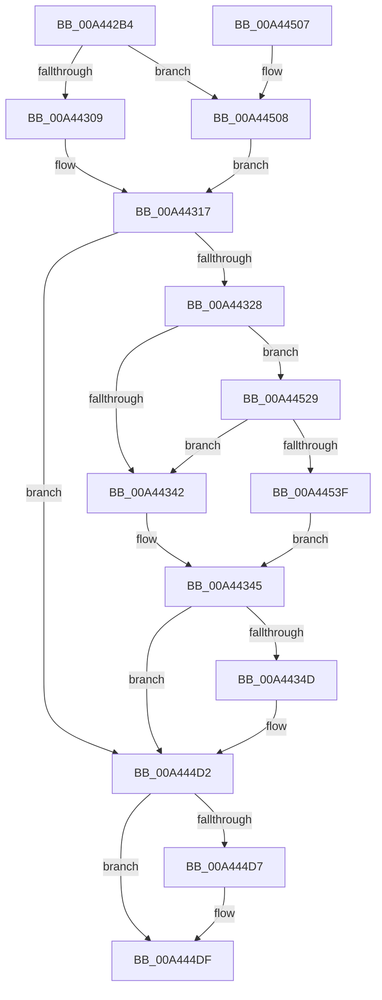

# MiLogPinDriverAddress

- RVA: `0x00A442B4`–`0x00A44544` (길이 `656` bytes)
- VA: `0x0000000140A442B4`
- 실행 섹션: `PAGE`
- PDB 이름 있음: `예`; PDB Function 태그: `아니요`
- unwind 정보 RVA: `0x000AF0F8`
- 디코드: `154`개 명령, `656/656` bytes 표시
- 미해석 바이트: `0` (있으면 어셈블리에 `.byte`로 보존)

> 이 문서는 커널 이미지의 기계어와 PDB 기호를 분석해 생성했습니다. 4번과 5번은 함수 원형과 자료형을 바이너리 사용 방식에서 추정한 C 해석이며 원본 소스 복구 결과는 아닙니다.

## 1. Dependencies

- 직접 호출 지점: **5**; 고유 호출 대상: **5**
- 직접 호출자로 확인된 함수: **1**
- RIP 상대 이미지 참조: **4**

### Outgoing calls
- `0x00A442F5` → [MmLockLoadedDataTableEntry](../../text/2A/MmLockLoadedDataTableEntry_function_002A437C.md) (function, `0x002A437C`)
- `0x00A444CD` → [tlgWriteAgg](../../text/2F/tlgWriteAgg_function_002F0F7C.md) (function, `0x002F0F7C`)
- `0x00A444DA` → [MmUnlockLoadedDataTableEntry](../../text/2A/MmUnlockLoadedDataTableEntry_function_002A3C98.md) (function, `0x002A3C98`)
- `0x00A444E6` → [_security_check_cookie](../../text/6A/_security_check_cookie_function_006AC640.md) (function, `0x006AC640`)
- `0x00A4451F` → [RtlInitUnicodeString](../../text/42/RtlInitUnicodeString_function_0042A780.md) (function, `0x0042A780`)

### Direct callers
- [MiLogPinDriverAddressesWorker](MiLogPinDriverAddressesWorker_function_00A441B0.md) at `0x00A442A1`

### Static image references
- `0x00A442D2` → RVA `0x00E0A740` (`.data`; read)
- `0x00A44317` → RVA `0x00E37618` (`.data`; read)
- `0x00A444BE` → RVA `0x00059FB7` (`.rdata`; read)
- `0x00A44508` → RVA `0x00B0A0C0` (` ?? ::NNGAKEGL::`string'`; read)

## 2. Other-region calls and transfers

- 다른 실행 섹션으로 향하는 call: **5**
  - `0x00A442F5` → [MmLockLoadedDataTableEntry](../../text/2A/MmLockLoadedDataTableEntry_function_002A437C.md) (`PAGE` → `.text`)
  - `0x00A444CD` → [tlgWriteAgg](../../text/2F/tlgWriteAgg_function_002F0F7C.md) (`PAGE` → `.text`)
  - `0x00A444DA` → [MmUnlockLoadedDataTableEntry](../../text/2A/MmUnlockLoadedDataTableEntry_function_002A3C98.md) (`PAGE` → `.text`)
  - `0x00A444E6` → [_security_check_cookie](../../text/6A/_security_check_cookie_function_006AC640.md) (`PAGE` → `.text`)
  - `0x00A4451F` → [RtlInitUnicodeString](../../text/42/RtlInitUnicodeString_function_0042A780.md) (`PAGE` → `.text`)
- 별도 외부 분기/꼬리 이동을 확인하지 못했습니다.

## 3. Assembly (complete function range)

```asm
00A442B4  48 89 5C 24 10                  mov qword ptr [rsp + 0x10], rbx
00A442B9  48 89 74 24 18                  mov qword ptr [rsp + 0x18], rsi
00A442BE  55                              push rbp
00A442BF  57                              push rdi
00A442C0  41 54                           push r12
00A442C2  41 56                           push r14
00A442C4  41 57                           push r15
00A442C6  48 8D 6C 24 80                  lea rbp, [rsp - 0x80]
00A442CB  48 81 EC 80 01 00 00            sub rsp, 0x180
00A442D2  48 8B 05 67 64 3C 00            mov rax, qword ptr [rip + 0x3c6467]
00A442D9  48 33 C4                        xor rax, rsp
00A442DC  48 89 45 70                     mov qword ptr [rbp + 0x70], rax
00A442E0  4C 8B F9                        mov r15, rcx
00A442E3  0F 57 C0                        xorps xmm0, xmm0
00A442E6  48 8B 09                        mov rcx, qword ptr [rcx]
00A442E9  48 81 E1 00 F0 FF FF            and rcx, 0xfffffffffffff000
00A442F0  0F 11 44 24 58                  movups xmmword ptr [rsp + 0x58], xmm0
00A442F5  E8 82 00 86 FF                  call 0x1402a437c
00A442FA  45 33 E4                        xor r12d, r12d
00A442FD  48 8B D8                        mov rbx, rax
00A44300  48 85 C0                        test rax, rax
00A44303  0F 84 FF 01 00 00               je 0x140a44508
00A44309  8B 70 78                        mov esi, dword ptr [rax + 0x78]
00A4430C  48 8D 78 58                     lea rdi, [rax + 0x58]
00A44310  44 8B B0 9C 00 00 00            mov r14d, dword ptr [rax + 0x9c]
00A44317  4C 8B 05 FA 32 3F 00            mov r8, qword ptr [rip + 0x3f32fa]
00A4431E  41 83 38 05                     cmp dword ptr [r8], 5
00A44322  0F 86 AA 01 00 00               jbe 0x140a444d2
00A44328  48 BA 00 00 00 00 00 40 00 00   movabs rdx, 0x400000000000
00A44332  41 BA 01 00 00 00               mov r10d, 1
00A44338  49 85 50 10                     test qword ptr [r8 + 0x10], rdx
00A4433C  0F 85 E7 01 00 00               jne 0x140a44529
00A44342  41 8A C4                        mov al, r12b
00A44345  84 C0                           test al, al
00A44347  0F 84 85 01 00 00               je 0x140a444d2
00A4434D  41 8B 0F                        mov ecx, dword ptr [r15]
00A44350  48 8D 44 24 68                  lea rax, [rsp + 0x68]
00A44355  48 89 45 90                     mov qword ptr [rbp - 0x70], rax
00A44359  8B C1                           mov eax, ecx
00A4435B  D1 E8                           shr eax, 1
00A4435D  41 23 C2                        and eax, r10d
00A44360  4C 89 54 24 68                  mov qword ptr [rsp + 0x68], r10
00A44365  89 44 24 30                     mov dword ptr [rsp + 0x30], eax
00A44369  48 8D 44 24 30                  lea rax, [rsp + 0x30]
00A4436E  48 89 45 A0                     mov qword ptr [rbp - 0x60], rax
00A44372  8B C1                           mov eax, ecx
00A44374  C1 E8 02                        shr eax, 2
00A44377  41 23 C2                        and eax, r10d
00A4437A  48 C7 45 98 08 00 00 00         mov qword ptr [rbp - 0x68], 8
00A44382  89 44 24 34                     mov dword ptr [rsp + 0x34], eax
00A44386  48 8D 44 24 34                  lea rax, [rsp + 0x34]
00A4438B  48 89 45 B0                     mov qword ptr [rbp - 0x50], rax
00A4438F  8B C1                           mov eax, ecx
00A44391  C1 E8 03                        shr eax, 3
00A44394  41 23 C2                        and eax, r10d
00A44397  48 C7 45 A8 04 00 00 00         mov qword ptr [rbp - 0x58], 4
00A4439F  89 44 24 38                     mov dword ptr [rsp + 0x38], eax
00A443A3  48 8D 44 24 38                  lea rax, [rsp + 0x38]
00A443A8  48 89 45 C0                     mov qword ptr [rbp - 0x40], rax
00A443AC  8B C1                           mov eax, ecx
00A443AE  C1 E8 04                        shr eax, 4
00A443B1  41 23 C2                        and eax, r10d
00A443B4  48 C7 45 B8 04 00 00 00         mov qword ptr [rbp - 0x48], 4
00A443BC  89 44 24 3C                     mov dword ptr [rsp + 0x3c], eax
00A443C0  48 8D 44 24 3C                  lea rax, [rsp + 0x3c]
00A443C5  48 89 45 D0                     mov qword ptr [rbp - 0x30], rax
00A443C9  8B C1                           mov eax, ecx
00A443CB  C1 E8 05                        shr eax, 5
00A443CE  41 23 C2                        and eax, r10d
00A443D1  48 C7 45 C8 04 00 00 00         mov qword ptr [rbp - 0x38], 4
00A443D9  89 44 24 40                     mov dword ptr [rsp + 0x40], eax
00A443DD  48 8D 44 24 40                  lea rax, [rsp + 0x40]
00A443E2  48 89 45 E0                     mov qword ptr [rbp - 0x20], rax
00A443E6  8B C1                           mov eax, ecx
00A443E8  C1 E8 06                        shr eax, 6
00A443EB  83 E0 03                        and eax, 3
00A443EE  48 C7 45 D8 04 00 00 00         mov qword ptr [rbp - 0x28], 4
00A443F6  89 44 24 44                     mov dword ptr [rsp + 0x44], eax
00A443FA  48 8D 44 24 44                  lea rax, [rsp + 0x44]
00A443FF  48 89 45 F0                     mov qword ptr [rbp - 0x10], rax
00A44403  8B C1                           mov eax, ecx
00A44405  C1 E8 0A                        shr eax, 0xa
00A44408  83 E0 03                        and eax, 3
00A4440B  C1 E9 08                        shr ecx, 8
00A4440E  89 44 24 48                     mov dword ptr [rsp + 0x48], eax
00A44412  83 E1 03                        and ecx, 3
00A44415  48 8D 44 24 48                  lea rax, [rsp + 0x48]
00A4441A  48 C7 45 E8 04 00 00 00         mov qword ptr [rbp - 0x18], 4
00A44422  48 89 45 00                     mov qword ptr [rbp], rax
00A44426  48 8D 44 24 4C                  lea rax, [rsp + 0x4c]
00A4442B  48 89 45 10                     mov qword ptr [rbp + 0x10], rax
00A4442F  48 8D 45 38                     lea rax, [rbp + 0x38]
00A44433  48 89 45 20                     mov qword ptr [rbp + 0x20], rax
00A44437  48 8B 47 08                     mov rax, qword ptr [rdi + 8]
00A4443B  48 89 45 30                     mov qword ptr [rbp + 0x30], rax
00A4443F  0F B7 07                        movzx eax, word ptr [rdi]
00A44442  89 45 38                        mov dword ptr [rbp + 0x38], eax
00A44445  48 8D 44 24 50                  lea rax, [rsp + 0x50]
00A4444A  48 89 45 40                     mov qword ptr [rbp + 0x40], rax
00A4444E  48 8D 44 24 54                  lea rax, [rsp + 0x54]
00A44453  48 89 45 50                     mov qword ptr [rbp + 0x50], rax
00A44457  B8 00 00 00 81                  mov eax, 0x81000000
00A4445C  48 89 44 24 58                  mov qword ptr [rsp + 0x58], rax
00A44461  48 8D 44 24 58                  lea rax, [rsp + 0x58]
00A44466  48 89 45 60                     mov qword ptr [rbp + 0x60], rax
00A4446A  48 C7 45 F8 04 00 00 00         mov qword ptr [rbp - 8], 4
00A44472  48 C7 45 08 04 00 00 00         mov qword ptr [rbp + 8], 4
00A4447A  89 4C 24 4C                     mov dword ptr [rsp + 0x4c], ecx
00A4447E  48 C7 45 18 04 00 00 00         mov qword ptr [rbp + 0x18], 4
00A44486  48 C7 45 28 02 00 00 00         mov qword ptr [rbp + 0x28], 2
00A4448E  44 89 65 3C                     mov dword ptr [rbp + 0x3c], r12d
00A44492  89 74 24 50                     mov dword ptr [rsp + 0x50], esi
00A44496  48 C7 45 48 04 00 00 00         mov qword ptr [rbp + 0x48], 4
00A4449E  44 89 74 24 54                  mov dword ptr [rsp + 0x54], r14d
00A444A3  48 C7 45 58 04 00 00 00         mov qword ptr [rbp + 0x58], 4
00A444AB  48 C7 45 68 08 00 00 00         mov qword ptr [rbp + 0x68], 8
00A444B3  48 8D 44 24 70                  lea rax, [rsp + 0x70]
00A444B8  41 B9 10 00 00 00               mov r9d, 0x10
00A444BE  48 8D 15 F2 5A 61 FF            lea rdx, [rip - 0x9ea50e]
00A444C5  48 89 44 24 20                  mov qword ptr [rsp + 0x20], rax
00A444CA  49 8B C8                        mov rcx, r8
00A444CD  E8 AA CA 8A FF                  call 0x1402f0f7c
00A444D2  48 85 DB                        test rbx, rbx
00A444D5  74 08                           je 0x140a444df
00A444D7  48 8B CB                        mov rcx, rbx
00A444DA  E8 B9 F7 85 FF                  call 0x1402a3c98
00A444DF  48 8B 4D 70                     mov rcx, qword ptr [rbp + 0x70]
00A444E3  48 33 CC                        xor rcx, rsp
00A444E6  E8 55 81 C6 FF                  call 0x1406ac640
00A444EB  4C 8D 9C 24 80 01 00 00         lea r11, [rsp + 0x180]
00A444F3  49 8B 5B 38                     mov rbx, qword ptr [r11 + 0x38]
00A444F7  49 8B 73 40                     mov rsi, qword ptr [r11 + 0x40]
00A444FB  49 8B E3                        mov rsp, r11
00A444FE  41 5F                           pop r15
00A44500  41 5E                           pop r14
00A44502  41 5C                           pop r12
00A44504  5F                              pop rdi
00A44505  5D                              pop rbp
00A44506  C3                              ret
00A44507  CC                              int3
00A44508  48 8D 15 B1 5B 0C 00            lea rdx, [rip + 0xc5bb1]
00A4450F  41 8B F4                        mov esi, r12d
00A44512  48 8D 4C 24 58                  lea rcx, [rsp + 0x58]
00A44517  45 8B F4                        mov r14d, r12d
00A4451A  48 8D 7C 24 58                  lea rdi, [rsp + 0x58]
00A4451F  E8 5C 62 9E FF                  call 0x14042a780
00A44524  E9 EE FD FF FF                  jmp 0x140a44317
00A44529  49 8B 48 18                     mov rcx, qword ptr [r8 + 0x18]
00A4452D  48 8B C1                        mov rax, rcx
00A44530  48 23 C2                        and rax, rdx
00A44533  48 3B C1                        cmp rax, rcx
00A44536  41 8A C2                        mov al, r10b
00A44539  0F 85 03 FE FF FF               jne 0x140a44342
00A4453F  E9 01 FE FF FF                  jmp 0x140a44345
```

## 4. C-style interpretation (structured pseudocode)

```c
__int64 __fastcall MiLogPinDriverAddress(__int64 a1)
{
    __int64 result;
    __int64 v_r12;
    __int64 v_rsp;
    unsigned __int64 v_stack_m100;
    unsigned __int64 v_stack_m108;
    unsigned __int64 v_stack_m110;
    unsigned __int64 v_stack_m118;
    unsigned __int64 v_stack_m128;
    unsigned __int64 v_stack_m138;
    unsigned __int64 v_stack_m140;
    unsigned __int64 v_stack_m150;
    unsigned __int64 v_stack_m154;
    unsigned __int64 v_stack_m158;
    unsigned __int64 v_stack_m15C;
    unsigned int v_stack_m160;
    unsigned int v_stack_m164;
    unsigned int v_stack_m168;
    unsigned int v_stack_m16C;
    unsigned int v_stack_m170;
    unsigned int v_stack_m174;
    unsigned int v_stack_m178;
    unsigned __int64 v_stack_m188;
    unsigned __int64 v_stack_m28;
    unsigned __int64 v_stack_m38;
    unsigned __int64 v_stack_m40;
    unsigned __int64 v_stack_m48;
    unsigned __int64 v_stack_m50;
    unsigned __int64 v_stack_m58;
    unsigned __int64 v_stack_m60;
    unsigned __int64 v_stack_m68;
    unsigned int v_stack_m6C;
    unsigned __int64 v_stack_m70;
    unsigned __int64 v_stack_m78;
    unsigned __int64 v_stack_m80;
    unsigned __int64 v_stack_m88;
    unsigned __int64 v_stack_m90;
    unsigned __int64 v_stack_m98;
    unsigned __int64 v_stack_mA0;
    unsigned __int64 v_stack_mA8;
    unsigned __int64 v_stack_mB0;
    unsigned __int64 v_stack_mB8;
    unsigned __int64 v_stack_mC0;
    unsigned __int64 v_stack_mC8;
    unsigned __int64 v_stack_mD0;
    unsigned __int64 v_stack_mD8;
    unsigned __int64 v_stack_mE0;
    unsigned __int64 v_stack_mE8;
    unsigned __int64 v_stack_mF0;
    unsigned __int64 v_stack_mF8;
    unsigned __int64 v_stack_p10;
    unsigned __int64 v_stack_p18;

    v_stack_p10 = v_rbx;
    v_stack_p18 = v_rsi;
    v_rsp = (v_rsp) - (384);
    result = (*(unsigned __int64 *)(v_rip + 3957863)) ^ (v_rsp);
    v_stack_m38 = result;
    a1 = (*(unsigned __int64 *)(a1)) & (0xFFFFFFFFFFFFF000ULL);
    v_stack_m150 = v_xmm0;
    result = MmLockLoadedDataTableEntry(a1, a2, a3, a4);
    v_r12 = 0;
    if (result == 0) goto loc_00A44508;
loc_00A44317:
    if ((*(unsigned int *)(*(unsigned __int64 *)(v_rip + 4141818))) <= 5) goto loc_00A444D2;
    if (((*(unsigned __int64 *)(*(unsigned __int64 *)(v_rip + 4141818) + 16)) & (a2)) != 0) goto loc_00A44529;
loc_00A44342:
loc_00A44345:
    result = 0;
    if (0 != 0) {
        a1 = *(unsigned int *)(a1);
        result = v_stack_m140;
        v_stack_m118 = result;
        result = (unsigned int)(a1);
        result = (unsigned int)((result) >> (1));
        result = (unsigned int)((result) & (1));
        v_stack_m140 = 1;
        v_stack_m178 = (unsigned int)(result);
        result = v_stack_m178;
        v_stack_m108 = result;
        result = (unsigned int)(a1);
        result = (unsigned int)((result) >> (2));
        result = (unsigned int)((result) & (1));
        v_stack_m110 = 8;
        v_stack_m174 = (unsigned int)(result);
        result = v_stack_m174;
        v_stack_mF8 = result;
        result = (unsigned int)(a1);
        result = (unsigned int)((result) >> (3));
        result = (unsigned int)((result) & (1));
        v_stack_m100 = 4;
        v_stack_m170 = (unsigned int)(result);
        result = v_stack_m170;
        v_stack_mE8 = result;
        result = (unsigned int)(a1);
        result = (unsigned int)((result) >> (4));
        result = (unsigned int)((result) & (1));
        v_stack_mF0 = 4;
        v_stack_m16C = (unsigned int)(result);
        result = v_stack_m16C;
        v_stack_mD8 = result;
        result = (unsigned int)(a1);
        result = (unsigned int)((result) >> (5));
        result = (unsigned int)((result) & (1));
        v_stack_mE0 = 4;
        v_stack_m168 = (unsigned int)(result);
        result = v_stack_m168;
        v_stack_mC8 = result;
        result = (unsigned int)(a1);
        result = (unsigned int)((result) >> (6));
        result = (unsigned int)((result) & (3));
        v_stack_mD0 = 4;
        v_stack_m164 = (unsigned int)(result);
        result = v_stack_m164;
        v_stack_mB8 = result;
        result = (unsigned int)(a1);
        result = (unsigned int)((result) >> (10));
        result = (unsigned int)((result) & (3));
        a1 = (unsigned int)((a1) >> (8));
        v_stack_m160 = (unsigned int)(result);
        a1 = (unsigned int)((a1) & (3));
        result = v_stack_m160;
        v_stack_mC0 = 4;
        v_stack_mA8 = result;
        result = v_stack_m15C;
        v_stack_m98 = result;
        result = v_stack_m70;
        v_stack_m88 = result;
        result = *(unsigned __int64 *)(result + 88 + 8);
        v_stack_m78 = result;
        result = *(unsigned __int16 *)(result + 88);
        v_stack_m70 = (unsigned int)(result);
        result = v_stack_m158;
        v_stack_m68 = result;
        result = v_stack_m154;
        v_stack_m58 = result;
        result = 0x81000000ULL;
        v_stack_m150 = result;
        result = v_stack_m150;
        v_stack_m48 = result;
        v_stack_mB0 = 4;
        v_stack_mA0 = 4;
        v_stack_m15C = (unsigned int)(a1);
        v_stack_m90 = 4;
        v_stack_m80 = 2;
        v_stack_m6C = 0;
        v_stack_m158 = (unsigned int)((unsigned int)(*(unsigned int *)(result + 120)));
        v_stack_m60 = 4;
        v_stack_m154 = (unsigned int)((unsigned int)(*(unsigned int *)(result + 156)));
        v_stack_m50 = 4;
        v_stack_m40 = 8;
        result = v_stack_m138;
        a4 = 16;
        a2 = v_rip - 10396942;
        v_stack_m188 = result;
        a1 = *(unsigned __int64 *)(v_rip + 4141818);
        result = tlgWriteAgg(a1, a2, *(unsigned __int64 *)(v_rip + 4141818), a4);
    }
    if (result != 0) {
        a1 = result;
        result = MmUnlockLoadedDataTableEntry(a1, a2, *(unsigned __int64 *)(v_rip + 4141818), a4);
    }
    a1 = (v_stack_m38) ^ (v_rsp);
    result = _security_check_cookie(a1, a2, *(unsigned __int64 *)(v_rip + 4141818), a4);
    return result;
loc_00A44508:
    result = RtlInitUnicodeString(v_stack_m128, v_rip + 809905, *(unsigned __int64 *)(v_rip + 4141818), a4);
    goto loc_00A44317;
loc_00A44529:
    result = (*(unsigned __int64 *)(*(unsigned __int64 *)(v_rip + 4141818) + 24)) & (v_rip + 809905);
    if (result != (*(unsigned __int64 *)(*(unsigned __int64 *)(v_rip + 4141818) + 24))) goto loc_00A44342;
    goto loc_00A44345;
}
```

## 5. (Beta) C Style

```c
int64_t MiLogPinDriverAddress(void *Arg1)
{
    uint8_t *arg1 = (uint8_t *)Arg1;

    int64_t result;
    int64_t local_r12;
    int64_t local_rsp;
    uint64_t v_stack_m100;
    uint64_t v_stack_m108;
    uint64_t v_stack_m110;
    uint64_t v_stack_m118;
    uint64_t v_stack_m128;
    uint64_t v_stack_m138;
    uint64_t v_stack_m140;
    uint64_t v_stack_m150;
    uint64_t v_stack_m154;
    uint64_t v_stack_m158;
    uint64_t v_stack_m15C;
    uint32_t v_stack_m160;
    uint32_t v_stack_m164;
    uint32_t v_stack_m168;
    uint32_t v_stack_m16C;
    uint32_t v_stack_m170;
    uint32_t v_stack_m174;
    uint32_t v_stack_m178;
    uint64_t v_stack_m188;
    uint64_t v_stack_m28;
    uint64_t v_stack_m38;
    uint64_t v_stack_m40;
    uint64_t v_stack_m48;
    uint64_t v_stack_m50;
    uint64_t v_stack_m58;
    uint64_t v_stack_m60;
    uint64_t v_stack_m68;
    uint32_t v_stack_m6C;
    uint64_t v_stack_m70;
    uint64_t v_stack_m78;
    uint64_t v_stack_m80;
    uint64_t v_stack_m88;
    uint64_t v_stack_m90;
    uint64_t v_stack_m98;
    uint64_t v_stack_mA0;
    uint64_t v_stack_mA8;
    uint64_t v_stack_mB0;
    uint64_t v_stack_mB8;
    uint64_t v_stack_mC0;
    uint64_t v_stack_mC8;
    uint64_t v_stack_mD0;
    uint64_t v_stack_mD8;
    uint64_t v_stack_mE0;
    uint64_t v_stack_mE8;
    uint64_t v_stack_mF0;
    uint64_t v_stack_mF8;
    uint64_t v_stack_p10;
    uint64_t v_stack_p18;

    v_stack_p10 = local_rbx;
    v_stack_p18 = local_rsi;
    local_rsp = (local_rsp) - (384);
    result = (*(uint64_t *)(v_rip + 0x3C6467)) ^ (local_rsp);
    v_stack_m38 = result;
    Arg1 = (*(uint64_t *)(arg1)) & (0xFFFFFFFFFFFFF000ULL);
    v_stack_m150 = v_xmm0;
    result = MmLockLoadedDataTableEntry(Arg1, a2, a3, a4);
    local_r12 = 0;
    if (result == 0) goto loc_00A44508;
loc_00A44317:
    if ((*(uint32_t *)(*(uint64_t *)(v_rip + 0x3F32FA))) <= 5) goto loc_00A444D2;
    if (((*(uint64_t *)(*(uint64_t *)(v_rip + 0x3F32FA) + 0x10)) & (a2)) != 0) goto loc_00A44529;
loc_00A44342:
loc_00A44345:
    result = 0;
    if (0 != 0) {
        Arg1 = *(uint32_t *)(arg1);
        result = v_stack_m140;
        v_stack_m118 = result;
        result = (uint32_t)(Arg1);
        result = (uint32_t)((result) >> (1));
        result = (uint32_t)((result) & (1));
        v_stack_m140 = 1;
        v_stack_m178 = (uint32_t)(result);
        result = v_stack_m178;
        v_stack_m108 = result;
        result = (uint32_t)(Arg1);
        result = (uint32_t)((result) >> (2));
        result = (uint32_t)((result) & (1));
        v_stack_m110 = 8;
        v_stack_m174 = (uint32_t)(result);
        result = v_stack_m174;
        v_stack_mF8 = result;
        result = (uint32_t)(Arg1);
        result = (uint32_t)((result) >> (3));
        result = (uint32_t)((result) & (1));
        v_stack_m100 = 4;
        v_stack_m170 = (uint32_t)(result);
        result = v_stack_m170;
        v_stack_mE8 = result;
        result = (uint32_t)(Arg1);
        result = (uint32_t)((result) >> (4));
        result = (uint32_t)((result) & (1));
        v_stack_mF0 = 4;
        v_stack_m16C = (uint32_t)(result);
        result = v_stack_m16C;
        v_stack_mD8 = result;
        result = (uint32_t)(Arg1);
        result = (uint32_t)((result) >> (5));
        result = (uint32_t)((result) & (1));
        v_stack_mE0 = 4;
        v_stack_m168 = (uint32_t)(result);
        result = v_stack_m168;
        v_stack_mC8 = result;
        result = (uint32_t)(Arg1);
        result = (uint32_t)((result) >> (6));
        result = (uint32_t)((result) & (3));
        v_stack_mD0 = 4;
        v_stack_m164 = (uint32_t)(result);
        result = v_stack_m164;
        v_stack_mB8 = result;
        result = (uint32_t)(Arg1);
        result = (uint32_t)((result) >> (10));
        result = (uint32_t)((result) & (3));
        Arg1 = (uint32_t)((Arg1) >> (8));
        v_stack_m160 = (uint32_t)(result);
        Arg1 = (uint32_t)((Arg1) & (3));
        result = v_stack_m160;
        v_stack_mC0 = 4;
        v_stack_mA8 = result;
        result = v_stack_m15C;
        v_stack_m98 = result;
        result = v_stack_m70;
        v_stack_m88 = result;
        result = *(uint64_t *)(result + 0x58 + 0x8);
        v_stack_m78 = result;
        result = *(uint16_t *)(result + 0x58);
        v_stack_m70 = (uint32_t)(result);
        result = v_stack_m158;
        v_stack_m68 = result;
        result = v_stack_m154;
        v_stack_m58 = result;
        result = 0x81000000ULL;
        v_stack_m150 = result;
        result = v_stack_m150;
        v_stack_m48 = result;
        v_stack_mB0 = 4;
        v_stack_mA0 = 4;
        v_stack_m15C = (uint32_t)(Arg1);
        v_stack_m90 = 4;
        v_stack_m80 = 2;
        v_stack_m6C = 0;
        v_stack_m158 = (uint32_t)((uint32_t)(*(uint32_t *)(result + 0x78)));
        v_stack_m60 = 4;
        v_stack_m154 = (uint32_t)((uint32_t)(*(uint32_t *)(result + 0x9C)));
        v_stack_m50 = 4;
        v_stack_m40 = 8;
        result = v_stack_m138;
        a4 = 16;
        a2 = v_rip - 10396942;
        v_stack_m188 = result;
        Arg1 = *(uint64_t *)(v_rip + 0x3F32FA);
        result = tlgWriteAgg(Arg1, a2, *(uint64_t *)(v_rip + 0x3F32FA), a4);
    }
    if (result != 0) {
        Arg1 = result;
        result = MmUnlockLoadedDataTableEntry(Arg1, a2, *(uint64_t *)(v_rip + 0x3F32FA), a4);
    }
    Arg1 = (v_stack_m38) ^ (local_rsp);
    result = _security_check_cookie(Arg1, a2, *(uint64_t *)(v_rip + 0x3F32FA), a4);
    return result;
loc_00A44508:
    result = RtlInitUnicodeString(v_stack_m128, v_rip + 809905, *(uint64_t *)(v_rip + 0x3F32FA), a4);
    goto loc_00A44317;
loc_00A44529:
    result = (*(uint64_t *)(*(uint64_t *)(v_rip + 0x3F32FA) + 0x18)) & (v_rip + 809905);
    if (result != (*(uint64_t *)(*(uint64_t *)(v_rip + 0x3F32FA) + 0x18))) goto loc_00A44342;
    goto loc_00A44345;
}
```

### 관측된 메모리 오프셋

구조체 형식이 확인되지 않은 접근은 인자 기준의 오프셋으로만 기록했습니다.

| 기준 인자 | 오프셋 표현 | 폭 (bit) | 접근 |
|---|---:|---:|---|
| `Arg1` | `+ 0x0` | `32` | `R` |
| `Arg1` | `+ 0x0` | `64` | `R` |

## 6. Execution-region graph

[열기: 2D/3D 그래프와 함수 탐색 컨트롤 패널](../../../control-panel.html?section=page&rva=0x00A442B4&view=graph)

- 2D 그래프는 위에서 아래로 흐르고, 3D 그래프는 빈 공간을 드래그해 회전합니다. Shift+드래그는 이동, 휠은 확대·축소, 함수 노드 선택은 대상 보고서 이동입니다.

### Static fallback


