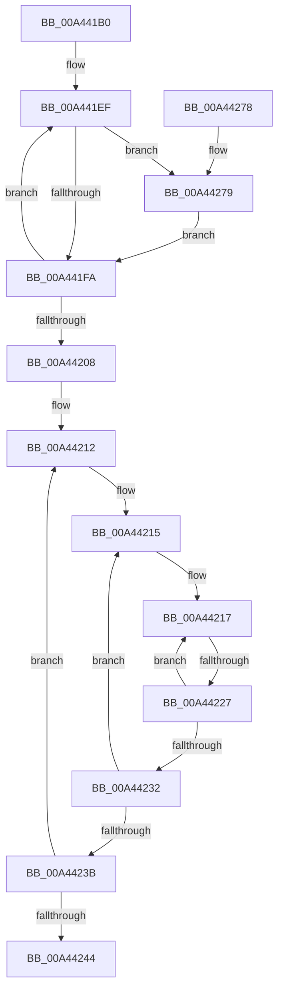

# MiLogPinDriverAddressesWorker

- RVA: `0x00A441B0`–`0x00A442AB` (길이 `251` bytes)
- VA: `0x0000000140A441B0`
- 실행 섹션: `PAGE`
- PDB 이름 있음: `예`; PDB Function 태그: `예`
- unwind 정보 RVA: `0x000AF0BC`
- 디코드: `70`개 명령, `251/251` bytes 표시
- 미해석 바이트: `0` (있으면 어셈블리에 `.byte`로 보존)

> 이 문서는 커널 이미지의 기계어와 PDB 기호를 분석해 생성했습니다. 4번과 5번은 함수 원형과 자료형을 바이너리 사용 방식에서 추정한 C 해석이며 원본 소스 복구 결과는 아닙니다.

## 1. Dependencies

- 직접 호출 지점: **3**; 고유 호출 대상: **3**
- 직접 호출자로 확인된 함수: **0**
- RIP 상대 이미지 참조: **5**

### Outgoing calls
- `0x00A44252` → [_security_check_cookie](../../text/6A/_security_check_cookie_function_006AC640.md) (function, `0x006AC640`)
- `0x00A44298` → [RtlInterlockedClearBitRun](../../text/46/RtlInterlockedClearBitRun_function_00466D00.md) (function, `0x00466D00`)
- `0x00A442A1` → [MiLogPinDriverAddress](MiLogPinDriverAddress_function_00A442B4.md) (function, `0x00A442B4`)

### Direct callers
- 이 함수 시작 RVA로 연결되는 직접 call은 확인되지 않았습니다. 간접 호출은 완전히 역산할 수 없습니다.

### Static image references
- `0x00A441D3` → RVA `0x00E0A740` (`.data`; read)
- `0x00A441E3` → RVA `0x00EF0E60` (`.data`; read)
- `0x00A4420B` → RVA `0x00EF4F74` (`.data`; read)
- `0x00A44244` → RVA `0x00EF4FD0` (`.data`; read/write)
- `0x00A44291` → RVA `0x00EF4E60` (`.data`; read)

## 2. Other-region calls and transfers

- 다른 실행 섹션으로 향하는 call: **2**
  - `0x00A44252` → [_security_check_cookie](../../text/6A/_security_check_cookie_function_006AC640.md) (`PAGE` → `.text`)
  - `0x00A44298` → [RtlInterlockedClearBitRun](../../text/46/RtlInterlockedClearBitRun_function_00466D00.md) (`PAGE` → `.text`)
- call이 아닌 외부 분기/꼬리 이동: **1**
  - `0x00A44221` → [sub_00B3AD1E](../B3/Unknown_function_00B3AD1E.md) (`tail-transfer`)

## 3. Assembly (complete function range)

```asm
00A441B0  48 8B C4                        mov rax, rsp
00A441B3  48 89 58 08                     mov qword ptr [rax + 8], rbx
00A441B7  48 89 70 10                     mov qword ptr [rax + 0x10], rsi
00A441BB  48 89 78 18                     mov qword ptr [rax + 0x18], rdi
00A441BF  4C 89 60 20                     mov qword ptr [rax + 0x20], r12
00A441C3  55                              push rbp
00A441C4  41 56                           push r14
00A441C6  41 57                           push r15
00A441C8  48 8D 68 A1                     lea rbp, [rax - 0x5f]
00A441CC  48 81 EC E0 00 00 00            sub rsp, 0xe0
00A441D3  48 8B 05 66 65 3C 00            mov rax, qword ptr [rip + 0x3c6566]
00A441DA  48 33 C4                        xor rax, rsp
00A441DD  48 89 45 37                     mov qword ptr [rbp + 0x37], rax
00A441E1  33 DB                           xor ebx, ebx
00A441E3  4C 8D 35 76 CC 4A 00            lea r14, [rip + 0x4acc76]
00A441EA  8B FB                           mov edi, ebx
00A441EC  49 8B F6                        mov rsi, r14
00A441EF  48 8B 06                        mov rax, qword ptr [rsi]
00A441F2  48 89 45 97                     mov qword ptr [rbp - 0x69], rax
00A441F6  A8 01                           test al, 1
00A441F8  75 7F                           jne 0x140a44279
00A441FA  FF C7                           inc edi
00A441FC  48 83 C6 08                     add rsi, 8
00A44200  81 FF 00 08 00 00               cmp edi, 0x800
00A44206  72 E7                           jb 0x140a441ef
00A44208  44 8B F3                        mov r14d, ebx
00A4420B  48 8D 3D 62 0D 4B 00            lea rdi, [rip + 0x4b0d62]
00A44212  44 8B FB                        mov r15d, ebx
00A44215  8B F3                           mov esi, ebx
00A44217  44 8B 67 FC                     mov r12d, dword ptr [rdi - 4]
00A4421B  44 8B 0F                        mov r9d, dword ptr [rdi]
00A4421E  45 3B E1                        cmp r12d, r9d
00A44221  0F 85 F7 6A 0F 00               jne 0x140b3ad1e
00A44227  FF C6                           inc esi
00A44229  48 83 C7 08                     add rdi, 8
00A4422D  83 FE 02                        cmp esi, 2
00A44230  72 E5                           jb 0x140a44217
00A44232  41 FF C7                        inc r15d
00A44235  41 83 FF 02                     cmp r15d, 2
00A44239  72 DA                           jb 0x140a44215
00A4423B  41 FF C6                        inc r14d
00A4423E  41 83 FE 02                     cmp r14d, 2
00A44242  72 CE                           jb 0x140a44212
00A44244  66 87 1D 85 0D 4B 00            xchg word ptr [rip + 0x4b0d85], bx
00A4424B  48 8B 4D 37                     mov rcx, qword ptr [rbp + 0x37]
00A4424F  48 33 CC                        xor rcx, rsp
00A44252  E8 E9 83 C6 FF                  call 0x1406ac640
00A44257  4C 8D 9C 24 E0 00 00 00         lea r11, [rsp + 0xe0]
00A4425F  49 8B 5B 20                     mov rbx, qword ptr [r11 + 0x20]
00A44263  49 8B 73 28                     mov rsi, qword ptr [r11 + 0x28]
00A44267  49 8B 7B 30                     mov rdi, qword ptr [r11 + 0x30]
00A4426B  4D 8B 63 38                     mov r12, qword ptr [r11 + 0x38]
00A4426F  49 8B E3                        mov rsp, r11
00A44272  41 5F                           pop r15
00A44274  41 5E                           pop r14
00A44276  5D                              pop rbp
00A44277  C3                              ret
00A44278  CC                              int3
00A44279  83 E0 FE                        and eax, 0xfffffffe
00A4427C  8B CF                           mov ecx, edi
00A4427E  89 45 97                        mov dword ptr [rbp - 0x69], eax
00A44281  41 B8 01 00 00 00               mov r8d, 1
00A44287  48 8B 45 97                     mov rax, qword ptr [rbp - 0x69]
00A4428B  8B D7                           mov edx, edi
00A4428D  49 89 04 CE                     mov qword ptr [r14 + rcx*8], rax
00A44291  48 8D 0D C8 0B 4B 00            lea rcx, [rip + 0x4b0bc8]
00A44298  E8 63 2A A2 FF                  call 0x140466d00
00A4429D  48 8D 4D 97                     lea rcx, [rbp - 0x69]
00A442A1  E8 0E 00 00 00                  call 0x140a442b4
00A442A6  E9 4F FF FF FF                  jmp 0x140a441fa
```

## 4. C-style interpretation (structured pseudocode)

```c
__int64 __fastcall MiLogPinDriverAddressesWorker(void)
{
    __int64 result;
    __int64 v_r14;
    __int64 v_r15;
    __int64 v_rbx;
    __int64 v_rdi;
    __int64 v_rsi;
    __int64 v_rsp;
    unsigned __int64 v_stack_m18;

    *(unsigned __int64 *)(v_rsp + 8) = v_rbx;
    *(unsigned __int64 *)(v_rsp + 16) = v_rsi;
    *(unsigned __int64 *)(v_rsp + 24) = v_rdi;
    *(unsigned __int64 *)(v_rsp + 32) = v_r12;
    v_rsp = (v_rsp) - (224);
    result = (*(unsigned __int64 *)(v_rip + 3958118)) ^ (v_rsp);
    *(unsigned __int64 *)(v_rsp - 95 + 55) = result;
    v_rbx = 0;
loc_00A441EF:
    *(unsigned __int64 *)(v_rsp - 95 - 105) = *(unsigned __int64 *)(v_rip + 4902006);
    if ((((unsigned __int8)(*(unsigned __int64 *)(v_rip + 4902006))) & (1)) != 0) goto loc_00A44279;
loc_00A441FA:
    v_rdi = (unsigned int)((0) + 1);
    v_rsi = (v_rip + 4902006) + (8);
    if (((unsigned int)(v_rdi)) < 0x800ULL) goto loc_00A441EF;
loc_00A44212:
loc_00A44215:
loc_00A44217:
    v_rsi = (unsigned int)((0) + 1);
    v_rdi = (v_rip + 4918626) + (8);
    if (((unsigned int)(v_rsi)) < 2) goto loc_00A44217;
    v_r15 = (unsigned int)((0) + 1);
    if (((unsigned int)(v_r15)) < 2) goto loc_00A44215;
    v_r14 = (unsigned int)((0) + 1);
    if (((unsigned int)(v_r14)) < 2) goto loc_00A44212;
    a1 = (*(unsigned __int64 *)(v_rsp - 95 + 55)) ^ (v_rsp);
    result = _security_check_cookie(a1, a2, a3, (unsigned int)(*(unsigned int *)(v_rip + 4918626)));
    return result;
loc_00A44279:
    result = (unsigned int)((result) & (0xFFFFFFFEULL));
    *(unsigned int *)(v_rsp - 95 - 105) = (unsigned int)(result);
    *(unsigned __int64 *)(v_r14 + (unsigned int)((unsigned int)(*(unsigned __int64 *)(v_stack_m18 + 48))) * 8) = *(unsigned __int64 *)(v_rsp - 95 - 105);
    result = RtlInterlockedClearBitRun(v_rip + 4918216, (unsigned int)((unsigned int)(*(unsigned __int64 *)(v_stack_m18 + 48))), 1, (unsigned int)(*(unsigned int *)(v_rip + 4918626)));
    result = MiLogPinDriverAddress(v_rsp - 95 - 105, (unsigned int)((unsigned int)(*(unsigned __int64 *)(v_stack_m18 + 48))), 1, (unsigned int)(*(unsigned int *)(v_rip + 4918626)));
    goto loc_00A441FA;
}
```

## 5. (Beta) C Style

```c
void MiLogPinDriverAddressesWorker(void)
{
    int64_t result;
    int64_t local_r14;
    int64_t local_r15;
    int64_t local_rbx;
    int64_t local_rdi;
    int64_t local_rsi;
    int64_t local_rsp;
    uint64_t v_stack_m18;

    *(uint64_t *)(local_rsp + 0x8) = local_rbx;
    *(uint64_t *)(local_rsp + 0x10) = local_rsi;
    *(uint64_t *)(local_rsp + 0x18) = local_rdi;
    *(uint64_t *)(local_rsp + 0x20) = local_r12;
    local_rsp = (local_rsp) - (224);
    result = (*(uint64_t *)(v_rip + 0x3C6566)) ^ (local_rsp);
    *(uint64_t *)(local_rsp - 0x5F + 0x37) = result;
    local_rbx = 0;
loc_00A441EF:
    *(uint64_t *)(local_rsp - 0x5F - 0x69) = *(uint64_t *)(v_rip + 0x4ACC76);
    if ((((uint8_t)(*(uint64_t *)(v_rip + 0x4ACC76))) & (1)) != 0) goto loc_00A44279;
loc_00A441FA:
    local_rdi = (uint32_t)((0) + 1);
    local_rsi = (v_rip + 4902006) + (8);
    if (((uint32_t)(local_rdi)) < 0x800ULL) goto loc_00A441EF;
loc_00A44212:
loc_00A44215:
loc_00A44217:
    local_rsi = (uint32_t)((0) + 1);
    local_rdi = (v_rip + 4918626) + (8);
    if (((uint32_t)(local_rsi)) < 2) goto loc_00A44217;
    local_r15 = (uint32_t)((0) + 1);
    if (((uint32_t)(local_r15)) < 2) goto loc_00A44215;
    local_r14 = (uint32_t)((0) + 1);
    if (((uint32_t)(local_r14)) < 2) goto loc_00A44212;
    a1 = (*(uint64_t *)(local_rsp - 0x5F + 0x37)) ^ (local_rsp);
    result = _security_check_cookie(a1, a2, a3, (uint32_t)(*(uint32_t *)(v_rip + 0x4B0D62)));
    return result;
loc_00A44279:
    result = (uint32_t)((result) & (0xFFFFFFFEULL));
    *(uint32_t *)(local_rsp - 0x5F - 0x69) = (uint32_t)(result);
    *(uint64_t *)(local_r14 + (uint32_t)((uint32_t)(*(uint64_t *)(v_stack_m18 + 0x30))) * 8) = *(uint64_t *)(local_rsp - 0x5F - 0x69);
    result = RtlInterlockedClearBitRun(v_rip + 4918216, (uint32_t)((uint32_t)(*(uint64_t *)(v_stack_m18 + 0x30))), 1, (uint32_t)(*(uint32_t *)(v_rip + 0x4B0D62)));
    result = MiLogPinDriverAddress(local_rsp - 95 - 105, (uint32_t)((uint32_t)(*(uint64_t *)(v_stack_m18 + 0x30))), 1, (uint32_t)(*(uint32_t *)(v_rip + 0x4B0D62)));
    goto loc_00A441FA;
}
```

## 6. Execution-region graph

[열기: 2D/3D 그래프와 함수 탐색 컨트롤 패널](../../../control-panel.html?section=page&rva=0x00A441B0&view=graph)

- 2D 그래프는 위에서 아래로 흐르고, 3D 그래프는 빈 공간을 드래그해 회전합니다. Shift+드래그는 이동, 휠은 확대·축소, 함수 노드 선택은 대상 보고서 이동입니다.

### Static fallback


