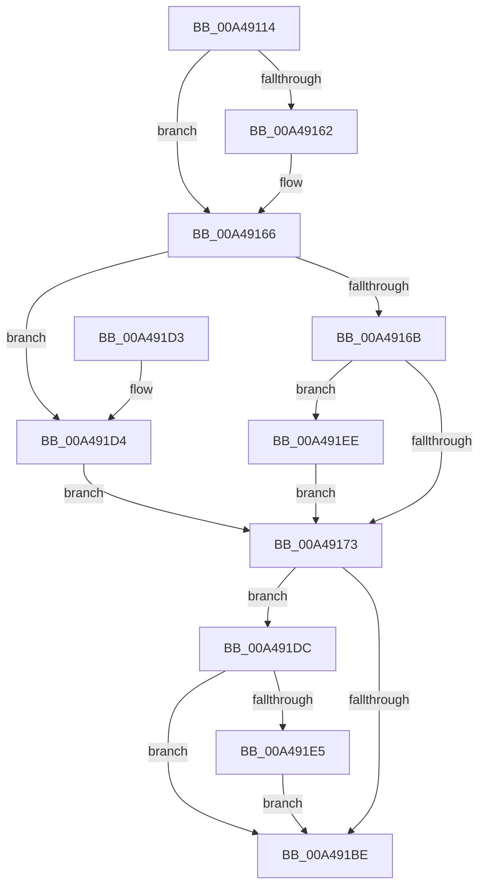

# MiMapSecurePureReserveView

- RVA: `0x00A49114`–`0x00A4921F` (길이 `267` bytes)
- VA: `0x0000000140A49114`
- 실행 섹션: `PAGE`
- PDB 이름 있음: `예`; PDB Function 태그: `아니요`
- unwind 정보 RVA: `0x000AFD44`
- 디코드: `64`개 명령, `267/267` bytes 표시
- 미해석 바이트: `0` (있으면 어셈블리에 `.byte`로 보존)

> 이 문서는 커널 이미지의 기계어와 PDB 기호를 분석해 생성했습니다. 4번과 5번은 함수 원형과 자료형을 바이너리 사용 방식에서 추정한 C 해석이며 원본 소스 복구 결과는 아닙니다.

## 1. Dependencies

- 직접 호출 지점: **1**; 고유 호출 대상: **1**
- 직접 호출자로 확인된 함수: **2**
- RIP 상대 이미지 참조: **0**

### Outgoing calls
- `0x00A491B5` → [MmMapViewOfSectionEx](../../text/48/MmMapViewOfSectionEx_function_0048E244.md) (function, `0x0048E244`)

### Direct callers
- [MiCfgInitializeProcess](../8D/MiCfgInitializeProcess_function_008D0364.md) at `0x008D03DA`
- [MiCfgInitializeProcess](../8D/MiCfgInitializeProcess_function_008D0364.md) at `0x008D047D`
- [MiCfgInitializeProcess](../8D/MiCfgInitializeProcess_function_008D0364.md) at `0x008D04BA`
- [MmInitializeImageViewExtension](../../init/C6/MmInitializeImageViewExtension_function_00C64F08.md) at `0x00C64F6C`

### Static image references
- 디코드된 RIP-relative 메모리 참조가 없습니다.

## 2. Other-region calls and transfers

- 다른 실행 섹션으로 향하는 call: **1**
  - `0x00A491B5` → [MmMapViewOfSectionEx](../../text/48/MmMapViewOfSectionEx_function_0048E244.md) (`PAGE` → `.text`)
- 별도 외부 분기/꼬리 이동을 확인하지 못했습니다.

## 3. Assembly (complete function range)

```asm
00A49114  48 89 5C 24 08                  mov qword ptr [rsp + 8], rbx
00A49119  48 89 7C 24 10                  mov qword ptr [rsp + 0x10], rdi
00A4911E  55                              push rbp
00A4911F  48 8D 6C 24 B1                  lea rbp, [rsp - 0x4f]
00A49124  48 81 EC A0 00 00 00            sub rsp, 0xa0
00A4912B  48 83 65 6F 00                  and qword ptr [rbp + 0x6f], 0
00A49130  48 8D 45 2F                     lea rax, [rbp + 0x2f]
00A49134  48 83 65 77 00                  and qword ptr [rbp + 0x77], 0
00A49139  4C 8B DA                        mov r11, rdx
00A4913C  48 89 45 27                     mov qword ptr [rbp + 0x27], rax
00A49140  33 D2                           xor edx, edx
00A49142  33 C0                           xor eax, eax
00A49144  48 C7 45 1F 01 00 00 00         mov qword ptr [rbp + 0x1f], 1
00A4914C  48 89 45 3F                     mov qword ptr [rbp + 0x3f], rax
00A49150  45 33 D2                        xor r10d, r10d
00A49153  49 8B 01                        mov rax, qword ptr [r9]
00A49156  0F 57 C0                        xorps xmm0, xmm0
00A49159  0F 11 45 2F                     movups xmmword ptr [rbp + 0x2f], xmm0
00A4915D  48 85 C0                        test rax, rax
00A49160  75 04                           jne 0x140a49166
00A49162  49 8B 43 30                     mov rax, qword ptr [r11 + 0x30]
00A49166  49 39 10                        cmp qword ptr [r8], rdx
00A49169  75 69                           jne 0x140a491d4
00A4916B  48 3D 00 00 00 04               cmp rax, 0x4000000
00A49171  77 7B                           ja 0x140a491ee
00A49173  44 89 54 24 60                  mov dword ptr [rsp + 0x60], r10d
00A49178  48 8D 45 6F                     lea rax, [rbp + 0x6f]
00A4917C  48 89 44 24 50                  mov qword ptr [rsp + 0x50], rax
00A49181  48 8D 45 1F                     lea rax, [rbp + 0x1f]
00A49185  C7 44 24 48 01 00 00 80         mov dword ptr [rsp + 0x48], 0x80000001
00A4918D  C7 44 24 40 01 00 00 00         mov dword ptr [rsp + 0x40], 1
00A49195  48 89 44 24 38                  mov qword ptr [rsp + 0x38], rax
00A4919A  C7 44 24 30 01 00 00 00         mov dword ptr [rsp + 0x30], 1
00A491A2  89 54 24 28                     mov dword ptr [rsp + 0x28], edx
00A491A6  48 8B D1                        mov rdx, rcx
00A491A9  4C 89 4C 24 20                  mov qword ptr [rsp + 0x20], r9
00A491AE  49 8B CB                        mov rcx, r11
00A491B1  4C 8D 4D 77                     lea r9, [rbp + 0x77]
00A491B5  E8 8A 50 A4 FF                  call 0x14048e244
00A491BA  85 C0                           test eax, eax
00A491BC  79 1E                           jns 0x140a491dc
00A491BE  4C 8D 9C 24 A0 00 00 00         lea r11, [rsp + 0xa0]
00A491C6  49 8B 5B 10                     mov rbx, qword ptr [r11 + 0x10]
00A491CA  49 8B 7B 18                     mov rdi, qword ptr [r11 + 0x18]
00A491CE  49 8B E3                        mov rsp, r11
00A491D1  5D                              pop rbp
00A491D2  C3                              ret
00A491D3  CC                              int3
00A491D4  41 BA 08 00 00 00               mov r10d, 8
00A491DA  EB 97                           jmp 0x140a49173
00A491DC  48 8B 55 7F                     mov rdx, qword ptr [rbp + 0x7f]
00A491E0  48 85 D2                        test rdx, rdx
00A491E3  74 D9                           je 0x140a491be
00A491E5  48 8B 4D 6F                     mov rcx, qword ptr [rbp + 0x6f]
00A491E9  48 89 0A                        mov qword ptr [rdx], rcx
00A491EC  EB D0                           jmp 0x140a491be
00A491EE  48 8B 45 37                     mov rax, qword ptr [rbp + 0x37]
00A491F2  48 BB 00 00 00 00 01 00 00 00   movabs rbx, 0x100000000
00A491FC  48 39 99 68 03 00 00            cmp qword ptr [rcx + 0x368], rbx
00A49203  48 BF FF FF FE FF FF 7F 00 00   movabs rdi, 0x7ffffffeffff
00A4920D  BA 00 00 10 00                  mov edx, 0x100000
00A49212  48 0F 46 C7                     cmovbe rax, rdi
00A49216  48 89 45 37                     mov qword ptr [rbp + 0x37], rax
00A4921A  E9 54 FF FF FF                  jmp 0x140a49173
```

## 4. C-style interpretation (structured pseudocode)

```c
__int64 __fastcall MiMapSecurePureReserveView(__int64 a1, __int64 a2, __int64 a3, __int64 a4, __int64 a5)
{
    __int64 result;
    __int64 v_r10;
    __int64 v_rsp;
    unsigned __int64 v_stack_m18;
    unsigned __int64 v_stack_m20;
    unsigned __int64 v_stack_m28;
    unsigned __int64 v_stack_m30;
    unsigned __int64 v_stack_m38;
    unsigned int v_stack_m48;
    unsigned __int64 v_stack_m57;
    unsigned __int64 v_stack_m58;
    unsigned int v_stack_m60;
    unsigned int v_stack_m68;
    unsigned __int64 v_stack_m70;
    unsigned int v_stack_m78;
    unsigned __int64 v_stack_m8;
    unsigned int v_stack_m80;
    unsigned __int64 v_stack_m88;
    unsigned __int64 v_stack_p10;
    unsigned __int64 v_stack_p18;
    unsigned __int64 v_stack_p20;
    unsigned __int64 v_stack_p8;

    v_stack_p8 = v_rbx;
    v_stack_p10 = v_rdi;
    v_rsp = (v_rsp) - (160);
    v_stack_m30 = v_stack_m28;
    a2 = 0;
    result = 0;
    v_stack_m38 = 1;
    v_stack_m18 = 0;
    v_r10 = 0;
    v_stack_m28 = v_xmm0;
    result = *(unsigned __int64 *)(a4);
    if (*(unsigned __int64 *)(a4) == 0) {
        result = *(unsigned __int64 *)(a2 + 48);
    }
    if ((*(unsigned __int64 *)(a3)) != 0) goto loc_00A491D4;
    if (result > 0x4000000ULL) goto loc_00A491EE;
loc_00A49173:
    v_stack_m48 = 0;
    v_stack_m58 = v_stack_p18;
    v_stack_m60 = 0x80000001ULL;
    v_stack_m68 = 1;
    v_stack_m70 = v_stack_m38;
    v_stack_m78 = 1;
    v_stack_m80 = 0;
    v_stack_m88 = a4;
    result = MmMapViewOfSectionEx(0, a1, a3, v_stack_p20);
    if (!sign_flag) goto loc_00A491DC;
loc_00A491BE:
    return result;
loc_00A491D4:
    goto loc_00A49173;
loc_00A491DC:
    if (a5 == 0) goto loc_00A491BE;
    *(unsigned __int64 *)(a5) = v_stack_p18;
    goto loc_00A491BE;
loc_00A491EE:
    result = v_stack_m20;
    if ((*(unsigned __int64 *)(v_stack_p18 + 872)) <= (*(unsigned __int64 *)(v_stack_m8 + 16))) { result = *(unsigned __int64 *)(v_stack_m8 + 24); }
    v_stack_m20 = result;
    goto loc_00A49173;
}
```

## 5. (Beta) C Style

```c
int64_t MiMapSecurePureReserveView(void *Arg1, void *Arg2, void *Arg3, void *Arg4, int64_t Arg5)
{
    uint8_t *arg1 = (uint8_t *)Arg1;
    uint8_t *arg2 = (uint8_t *)Arg2;
    uint8_t *arg3 = (uint8_t *)Arg3;
    uint8_t *arg4 = (uint8_t *)Arg4;

    int64_t result;
    int64_t local_r10;
    int64_t local_rsp;
    uint64_t v_stack_m18;
    uint64_t v_stack_m20;
    uint64_t v_stack_m28;
    uint64_t v_stack_m30;
    uint64_t v_stack_m38;
    uint32_t v_stack_m48;
    uint64_t v_stack_m57;
    uint64_t v_stack_m58;
    uint32_t v_stack_m60;
    uint32_t v_stack_m68;
    uint64_t v_stack_m70;
    uint32_t v_stack_m78;
    uint64_t v_stack_m8;
    uint32_t v_stack_m80;
    uint64_t v_stack_m88;
    uint64_t v_stack_p10;
    uint64_t v_stack_p18;
    uint64_t v_stack_p20;
    uint64_t v_stack_p8;

    v_stack_p8 = local_rbx;
    v_stack_p10 = local_rdi;
    local_rsp = (local_rsp) - (160);
    v_stack_m30 = v_stack_m28;
    Arg2 = 0;
    result = 0;
    v_stack_m38 = 1;
    v_stack_m18 = 0;
    local_r10 = 0;
    v_stack_m28 = v_xmm0;
    result = *(uint64_t *)(arg4);
    if (*(uint64_t *)(arg4) == 0) {
        result = *(uint64_t *)(arg2 + 0x30);
    }
    if ((*(uint64_t *)(arg3)) != 0) goto loc_00A491D4;
    if (result > 0x4000000ULL) goto loc_00A491EE;
loc_00A49173:
    v_stack_m48 = 0;
    v_stack_m58 = v_stack_p18;
    v_stack_m60 = 0x80000001ULL;
    v_stack_m68 = 1;
    v_stack_m70 = v_stack_m38;
    v_stack_m78 = 1;
    v_stack_m80 = 0;
    v_stack_m88 = Arg4;
    result = MmMapViewOfSectionEx(0, Arg1, Arg3, v_stack_p20);
    if (!sign_flag) goto loc_00A491DC;
loc_00A491BE:
    return result;
loc_00A491D4:
    goto loc_00A49173;
loc_00A491DC:
    if (Arg5 == 0) goto loc_00A491BE;
    *(uint64_t *)(Arg5) = v_stack_p18;
    goto loc_00A491BE;
loc_00A491EE:
    result = v_stack_m20;
    if ((*(uint64_t *)(v_stack_p18 + 0x368)) <= (*(uint64_t *)(v_stack_m8 + 0x10))) { result = *(uint64_t *)(v_stack_m8 + 0x18); }
    v_stack_m20 = result;
    goto loc_00A49173;
}
```

### 관측된 메모리 오프셋

구조체 형식이 확인되지 않은 접근은 인자 기준의 오프셋으로만 기록했습니다.

| 기준 인자 | 오프셋 표현 | 폭 (bit) | 접근 |
|---|---:|---:|---|
| `Arg1` | `+ 0x368` | `64` | `R` |
| `Arg2` | `+ 0x30` | `64` | `R` |
| `Arg3` | `+ 0x0` | `64` | `R` |
| `Arg4` | `+ 0x0` | `64` | `R` |

## 6. Execution-region graph

[열기: 2D/3D 그래프와 함수 탐색 컨트롤 패널](../../../control-panel.html?section=page&rva=0x00A49114&view=graph)

- 2D 그래프는 위에서 아래로 흐르고, 3D 그래프는 빈 공간을 드래그해 회전합니다. Shift+드래그는 이동, 휠은 확대·축소, 함수 노드 선택은 대상 보고서 이동입니다.

### Static fallback


