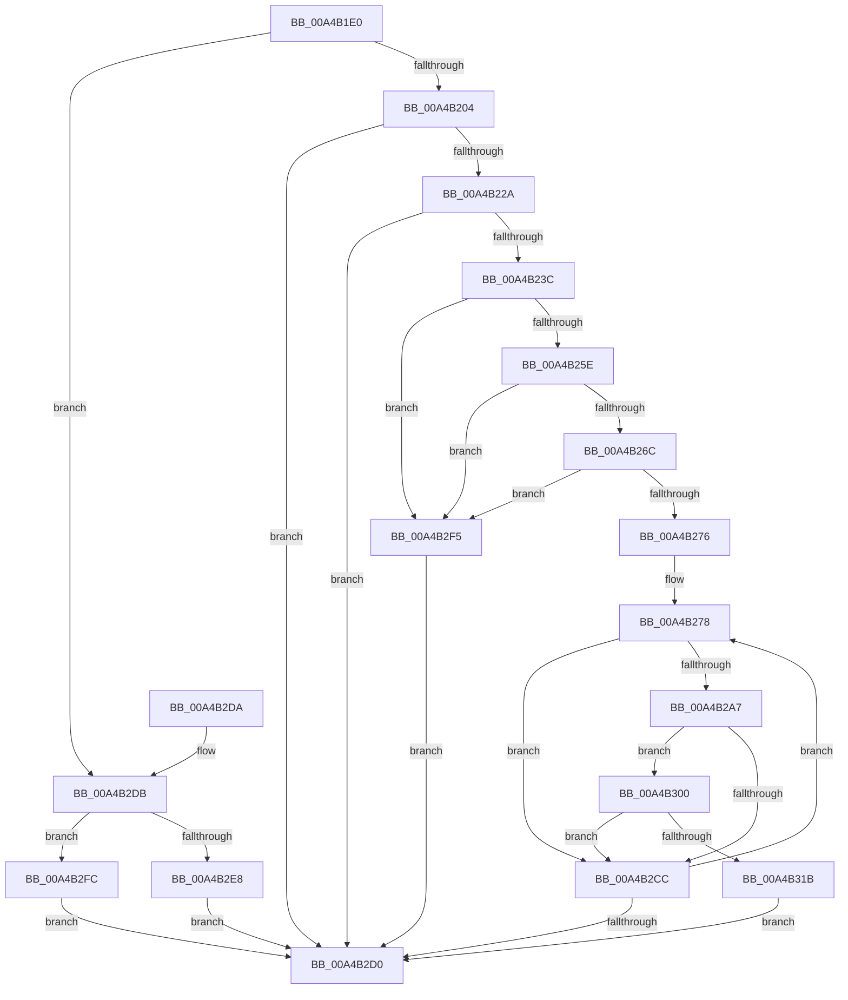

# MiMarkKernelImageCfgBits

- RVA: `0x00A4B1E0`–`0x00A4B322` (길이 `322` bytes)
- VA: `0x0000000140A4B1E0`
- 실행 섹션: `PAGE`
- PDB 이름 있음: `예`; PDB Function 태그: `아니요`
- unwind 정보 RVA: `0x000B01F4`
- 디코드: `85`개 명령, `322/322` bytes 표시
- 미해석 바이트: `0` (있으면 어셈블리에 `.byte`로 보존)

> 이 문서는 커널 이미지의 기계어와 PDB 기호를 분석해 생성했습니다. 4번과 5번은 함수 원형과 자료형을 바이너리 사용 방식에서 추정한 C 해석이며 원본 소스 복구 결과는 아닙니다.

## 1. Dependencies

- 직접 호출 지점: **7**; 고유 호출 대상: **7**
- 직접 호출자로 확인된 함수: **3**
- RIP 상대 이미지 참조: **1**

### Outgoing calls
- `0x00A4B204` → [MiAcquireKernelCfgLock](MiAcquireKernelCfgLock_function_00A4B9A0.md) (function, `0x00A4B9A0`)
- `0x00A4B216` → [MiAllocateKernelCfgBitmapPageTables](MiAllocateKernelCfgBitmapPageTables_function_00A4B80C.md) (function, `0x00A4B80C`)
- `0x00A4B21D` → [MiReleaseKernelCfgLock](MiReleaseKernelCfgLock_function_00A4B8BC.md) (function, `0x00A4B8BC`)
- `0x00A4B22D` → [MiCompleteSecureDriverLoad](MiCompleteSecureDriverLoad_function_00A4B920.md) (function, `0x00A4B920`)
- `0x00A4B24D` → [RtlImageDirectoryEntryToData](../../text/43/RtlImageDirectoryEntryToData_function_004328D0.md) (function, `0x004328D0`)
- `0x00A4B296` → [MiSnapDriverRange](MiSnapDriverRange_function_00A4B328.md) (function, `0x00A4B328`)
- `0x00A4B2EC` → [VslUnloadSecureDriver](VslUnloadSecureDriver_function_00A4BA04.md) (function, `0x00A4BA04`)

### Direct callers
- [MiProcessKernelCfgImage](../../text/4D/MiProcessKernelCfgImage_function_004D0744.md) at `0x004D0799`
- [MiUnloadSystemImage](../AA/MiUnloadSystemImage_function_00AA2FD4.md) at `0x00AA30FB`
- [MiInitializeKernelCfgImages](../../init/C6/MiInitializeKernelCfgImages_function_00C6A430.md) at `0x00C6A4B5`

### Static image references
- `0x00A4B2DB` → RVA `0x00FC6A88` (`ALMOSTRO`; read)

## 2. Other-region calls and transfers

- 다른 실행 섹션으로 향하는 call: **1**
  - `0x00A4B24D` → [RtlImageDirectoryEntryToData](../../text/43/RtlImageDirectoryEntryToData_function_004328D0.md) (`PAGE` → `.text`)
- 별도 외부 분기/꼬리 이동을 확인하지 못했습니다.

## 3. Assembly (complete function range)

```asm
00A4B1E0  40 53                           push rbx
00A4B1E2  56                              push rsi
00A4B1E3  57                              push rdi
00A4B1E4  48 83 EC 30                     sub rsp, 0x30
00A4B1E8  48 83 64 24 68 00               and qword ptr [rsp + 0x68], 0
00A4B1EE  48 8B D9                        mov rbx, rcx
00A4B1F1  48 83 64 24 60 00               and qword ptr [rsp + 0x60], 0
00A4B1F7  83 64 24 58 00                  and dword ptr [rsp + 0x58], 0
00A4B1FC  85 D2                           test edx, edx
00A4B1FE  0F 84 D7 00 00 00               je 0x140a4b2db
00A4B204  E8 97 07 00 00                  call 0x140a4b9a0
00A4B209  8B 53 40                        mov edx, dword ptr [rbx + 0x40]
00A4B20C  41 B8 01 00 00 00               mov r8d, 1
00A4B212  48 8B 4B 30                     mov rcx, qword ptr [rbx + 0x30]
00A4B216  E8 F1 05 00 00                  call 0x140a4b80c
00A4B21B  8B F8                           mov edi, eax
00A4B21D  E8 9A 06 00 00                  call 0x140a4b8bc
00A4B222  85 FF                           test edi, edi
00A4B224  0F 88 A6 00 00 00               js 0x140a4b2d0
00A4B22A  48 8B CB                        mov rcx, rbx
00A4B22D  E8 EE 06 00 00                  call 0x140a4b920
00A4B232  8B F8                           mov edi, eax
00A4B234  85 C0                           test eax, eax
00A4B236  0F 88 94 00 00 00               js 0x140a4b2d0
00A4B23C  48 8B 4B 30                     mov rcx, qword ptr [rbx + 0x30]
00A4B240  4C 8D 4C 24 58                  lea r9, [rsp + 0x58]
00A4B245  41 B8 0A 00 00 00               mov r8d, 0xa
00A4B24B  B2 01                           mov dl, 1
00A4B24D  E8 7E 76 9E FF                  call 0x1404328d0
00A4B252  48 8B F0                        mov rsi, rax
00A4B255  48 85 C0                        test rax, rax
00A4B258  0F 84 97 00 00 00               je 0x140a4b2f5
00A4B25E  81 7C 24 58 B0 00 00 00         cmp dword ptr [rsp + 0x58], 0xb0
00A4B266  0F 82 89 00 00 00               jb 0x140a4b2f5
00A4B26C  48 83 B8 A8 00 00 00 00         cmp qword ptr [rax + 0xa8], 0
00A4B274  74 7F                           je 0x140a4b2f5
00A4B276  33 D2                           xor edx, edx
00A4B278  45 33 C9                        xor r9d, r9d
00A4B27B  48 8D 44 24 68                  lea rax, [rsp + 0x68]
00A4B280  48 89 44 24 28                  mov qword ptr [rsp + 0x28], rax
00A4B285  48 8B CB                        mov rcx, rbx
00A4B288  48 8D 44 24 60                  lea rax, [rsp + 0x60]
00A4B28D  48 89 44 24 20                  mov qword ptr [rsp + 0x20], rax
00A4B292  45 8D 41 02                     lea r8d, [r9 + 2]
00A4B296  E8 8D 00 00 00                  call 0x140a4b328
00A4B29B  8B D0                           mov edx, eax
00A4B29D  48 8B 44 24 60                  mov rax, qword ptr [rsp + 0x60]
00A4B2A2  48 85 C0                        test rax, rax
00A4B2A5  74 25                           je 0x140a4b2cc
00A4B2A7  48 B9 00 00 00 00 80 F6 FF FF   movabs rcx, 0xfffff68000000000
00A4B2B1  4C 8B 86 A0 00 00 00            mov r8, qword ptr [rsi + 0xa0]
00A4B2B8  48 C1 E0 19                     shl rax, 0x19
00A4B2BC  48 C1 E1 19                     shl rcx, 0x19
00A4B2C0  48 2B C1                        sub rax, rcx
00A4B2C3  48 C1 F8 10                     sar rax, 0x10
00A4B2C7  4C 3B C0                        cmp r8, rax
00A4B2CA  73 34                           jae 0x140a4b300
00A4B2CC  85 D2                           test edx, edx
00A4B2CE  75 A8                           jne 0x140a4b278
00A4B2D0  8B C7                           mov eax, edi
00A4B2D2  48 83 C4 30                     add rsp, 0x30
00A4B2D6  5F                              pop rdi
00A4B2D7  5E                              pop rsi
00A4B2D8  5B                              pop rbx
00A4B2D9  C3                              ret
00A4B2DA  CC                              int3
00A4B2DB  48 F7 05 A2 B7 57 00 00 40 00 00  test qword ptr [rip + 0x57b7a2], 0x4000
00A4B2E6  74 14                           je 0x140a4b2fc
00A4B2E8  48 8B 49 30                     mov rcx, qword ptr [rcx + 0x30]
00A4B2EC  E8 13 07 00 00                  call 0x140a4ba04
00A4B2F1  8B F8                           mov edi, eax
00A4B2F3  EB DB                           jmp 0x140a4b2d0
00A4B2F5  0F BA 6B 68 08                  bts dword ptr [rbx + 0x68], 8
00A4B2FA  EB D4                           jmp 0x140a4b2d0
00A4B2FC  33 FF                           xor edi, edi
00A4B2FE  EB D0                           jmp 0x140a4b2d0
00A4B300  48 8B 44 24 68                  mov rax, qword ptr [rsp + 0x68]
00A4B305  48 C1 E0 19                     shl rax, 0x19
00A4B309  48 2B C1                        sub rax, rcx
00A4B30C  48 0D 00 00 FF 0F               or rax, 0xfff0000
00A4B312  48 C1 F8 10                     sar rax, 0x10
00A4B316  4C 3B C0                        cmp r8, rax
00A4B319  77 B1                           ja 0x140a4b2cc
00A4B31B  0F BA 6B 68 0B                  bts dword ptr [rbx + 0x68], 0xb
00A4B320  EB AE                           jmp 0x140a4b2d0
```

## 4. C-style interpretation (structured pseudocode)

```c
__int64 __fastcall MiMarkKernelImageCfgBits(__int64 a1, int a2)
{
    __int64 result;
    __int64 v_rdi;
    __int64 v_rsp;
    unsigned __int64 v_stack_m20;
    unsigned __int64 v_stack_m28;
    unsigned int v_stack_p10;
    unsigned __int64 v_stack_p18;
    unsigned __int64 v_stack_p20;
    unsigned __int64 v_stack_p68;

    v_rsp = (v_rsp) - (48);
    if (a2 == 0) goto loc_00A4B2DB;
    result = MiAcquireKernelCfgLock(a1, a2, a3, a4);
    result = MiAllocateKernelCfgBitmapPageTables(*(unsigned __int64 *)(a1 + 48), (unsigned int)(*(unsigned int *)(a1 + 64)), 1, a4);
    result = MiReleaseKernelCfgLock(*(unsigned __int64 *)(a1 + 48), (unsigned int)(*(unsigned int *)(a1 + 64)), 1, a4);
    if (sign_flag) goto loc_00A4B2D0;
    result = MiCompleteSecureDriverLoad(a1, (unsigned int)(*(unsigned int *)(a1 + 64)), 1, a4);
    if (sign_flag) goto loc_00A4B2D0;
    result = RtlImageDirectoryEntryToData(*(unsigned __int64 *)(a1 + 48), 1, 10, v_stack_p10);
    if (result == 0) goto loc_00A4B2F5;
    if (v_stack_p10 < 176) goto loc_00A4B2F5;
    if ((*(unsigned __int64 *)(result + 168)) == 0) goto loc_00A4B2F5;
    a2 = 0;
loc_00A4B278:
    a4 = 0;
    v_stack_m20 = v_stack_p20;
    v_stack_m28 = v_stack_p18;
    result = MiSnapDriverRange(a1, a2, a4 + 2, a4);
    if (v_stack_p18 == 0) goto loc_00A4B2CC;
    result = (v_stack_p18) << (25);
    a1 = (a1) << (25);
    result = (result) - (a1);
    result = (result) >> (16);
    if ((*(unsigned __int64 *)(result + 160)) >= result) goto loc_00A4B300;
loc_00A4B2CC:
    if ((unsigned int)((unsigned int)((unsigned int)(result))) != 0) goto loc_00A4B278;
loc_00A4B2D0:
    v_rsp = (v_rsp) + (48);
    return (unsigned int)((unsigned int)((unsigned int)((unsigned int)(result))));
loc_00A4B2DB:
    if (((*(unsigned __int64 *)(v_rip + 5748642)) & (0x4000ULL)) == 0) goto loc_00A4B2FC;
    result = VslUnloadSecureDriver(*(unsigned __int64 *)(a1 + 48), (unsigned int)((unsigned int)(result)), *(unsigned __int64 *)(result + 160), a4);
    goto loc_00A4B2D0;
loc_00A4B2F5:
    goto loc_00A4B2D0;
loc_00A4B2FC:
    v_rdi = 0;
    goto loc_00A4B2D0;
loc_00A4B300:
    result = (v_stack_p68) << (25);
    result = (result) - (*(unsigned __int64 *)(a1 + 48));
    result = (result) | (0xFFF0000ULL);
    result = (result) >> (16);
    if ((*(unsigned __int64 *)(result + 160)) > result) goto loc_00A4B2CC;
    goto loc_00A4B2D0;
}
```

## 5. (Beta) C Style

```c
int64_t MiMarkKernelImageCfgBits(void *Arg1, int32_t Arg2)
{
    uint8_t *arg1 = (uint8_t *)Arg1;

    int64_t result;
    int64_t local_rdi;
    int64_t local_rsp;
    uint64_t v_stack_m20;
    uint64_t v_stack_m28;
    uint32_t v_stack_p10;
    uint64_t v_stack_p18;
    uint64_t v_stack_p20;
    uint64_t v_stack_p68;

    local_rsp = (local_rsp) - (48);
    if (Arg2 == 0) goto loc_00A4B2DB;
    result = MiAcquireKernelCfgLock(Arg1, Arg2, a3, a4);
    result = MiAllocateKernelCfgBitmapPageTables(*(uint64_t *)(arg1 + 0x30), (uint32_t)(*(uint32_t *)(arg1 + 0x40)), 1, a4);
    result = MiReleaseKernelCfgLock(*(uint64_t *)(arg1 + 0x30), (uint32_t)(*(uint32_t *)(arg1 + 0x40)), 1, a4);
    if (sign_flag) goto loc_00A4B2D0;
    result = MiCompleteSecureDriverLoad(Arg1, (uint32_t)(*(uint32_t *)(arg1 + 0x40)), 1, a4);
    if (sign_flag) goto loc_00A4B2D0;
    result = RtlImageDirectoryEntryToData(*(uint64_t *)(arg1 + 0x30), 1, 10, v_stack_p10);
    if (result == 0) goto loc_00A4B2F5;
    if (v_stack_p10 < 176) goto loc_00A4B2F5;
    if ((*(uint64_t *)(result + 0xA8)) == 0) goto loc_00A4B2F5;
    Arg2 = 0;
loc_00A4B278:
    a4 = 0;
    v_stack_m20 = v_stack_p20;
    v_stack_m28 = v_stack_p18;
    result = MiSnapDriverRange(Arg1, Arg2, a4 + 2, a4);
    if (v_stack_p18 == 0) goto loc_00A4B2CC;
    result = (v_stack_p18) << (25);
    Arg1 = (Arg1) << (25);
    result = (result) - (Arg1);
    result = (result) >> (16);
    if ((*(uint64_t *)(result + 0xA0)) >= result) goto loc_00A4B300;
loc_00A4B2CC:
    if ((uint32_t)((uint32_t)((uint32_t)(result))) != 0) goto loc_00A4B278;
loc_00A4B2D0:
    local_rsp = (local_rsp) + (48);
    return (uint32_t)((uint32_t)((uint32_t)((uint32_t)(result))));
loc_00A4B2DB:
    if (((*(uint64_t *)(v_rip + 0x57B7A2)) & (0x4000ULL)) == 0) goto loc_00A4B2FC;
    result = VslUnloadSecureDriver(*(uint64_t *)(arg1 + 0x30), (uint32_t)((uint32_t)(result)), *(uint64_t *)(result + 0xA0), a4);
    goto loc_00A4B2D0;
loc_00A4B2F5:
    goto loc_00A4B2D0;
loc_00A4B2FC:
    local_rdi = 0;
    goto loc_00A4B2D0;
loc_00A4B300:
    result = (v_stack_p68) << (25);
    result = (result) - (*(uint64_t *)(arg1 + 0x30));
    result = (result) | (0xFFF0000ULL);
    result = (result) >> (16);
    if ((*(uint64_t *)(result + 0xA0)) > result) goto loc_00A4B2CC;
    goto loc_00A4B2D0;
}
```

### 관측된 메모리 오프셋

구조체 형식이 확인되지 않은 접근은 인자 기준의 오프셋으로만 기록했습니다.

| 기준 인자 | 오프셋 표현 | 폭 (bit) | 접근 |
|---|---:|---:|---|
| `Arg1` | `+ 0x30` | `64` | `R` |
| `Arg1` | `+ 0x40` | `32` | `R` |
| `Arg1` | `+ 0x68` | `32` | `R/W` |

## 6. Execution-region graph

[열기: 2D/3D 그래프와 함수 탐색 컨트롤 패널](../../../control-panel.html?section=page&rva=0x00A4B1E0&view=graph)

- 2D 그래프는 위에서 아래로 흐르고, 3D 그래프는 빈 공간을 드래그해 회전합니다. Shift+드래그는 이동, 휠은 확대·축소, 함수 노드 선택은 대상 보고서 이동입니다.

### Static fallback


