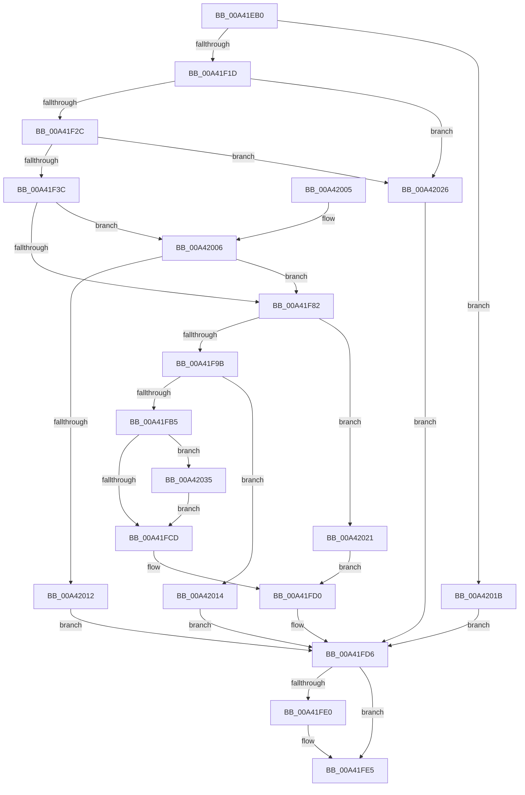

# MiQuerySingleLoadedPatch

- RVA: `0x00A41EB0`–`0x00A42066` (길이 `438` bytes)
- VA: `0x0000000140A41EB0`
- 실행 섹션: `PAGE`
- PDB 이름 있음: `예`; PDB Function 태그: `아니요`
- unwind 정보 RVA: `0x000AEBEC`
- 디코드: `119`개 명령, `438/438` bytes 표시
- 미해석 바이트: `0` (있으면 어셈블리에 `.byte`로 보존)

> 이 문서는 커널 이미지의 기계어와 PDB 기호를 분석해 생성했습니다. 4번과 5번은 함수 원형과 자료형을 바이너리 사용 방식에서 추정한 C 해석이며 원본 소스 복구 결과는 아닙니다.

## 1. Dependencies

- 직접 호출 지점: **9**; 고유 호출 대상: **8**
- 직접 호출자로 확인된 함수: **1**
- RIP 상대 이미지 참조: **0**

### Outgoing calls
- `0x00A41EFD` → [RtlInitUnicodeString](../../text/42/RtlInitUnicodeString_function_0042A780.md) (function, `0x0042A780`)
- `0x00A41F0C` → [MiObtainReferencedVadEx](../../text/31/MiObtainReferencedVadEx_function_00316690.md) (function, `0x00316690`)
- `0x00A41F2F` → [MiVadDeleted](../../text/43/MiVadDeleted_function_00431350.md) (function, `0x00431350`)
- `0x00A41F52` → [MiUnlockAndDereferenceVad](../../text/31/MiUnlockAndDereferenceVad_function_00316E60.md) (function, `0x00316E60`)
- `0x00A41F6C` → [MiFindProcessImageHotPatchRecord](MiFindProcessImageHotPatchRecord_function_00A4206C.md) (function, `0x00A4206C`)
- `0x00A41FA8` → [MiAllocatePool](../../text/35/MiAllocatePool_function_0035B540.md) (function, `0x0035B540`)
- `0x00A41FE0` → [ExFreePool](../../poolcode/B8/ExFreePool_function_00B82850.md) (function, `0x00B82850`)
- `0x00A4202E` → [MiUnlockAndDereferenceVad](../../text/31/MiUnlockAndDereferenceVad_function_00316E60.md) (function, `0x00316E60`)
- `0x00A4204D` → [RtlCopyUnicodeString](../../text/3F/RtlCopyUnicodeString_function_003FEF30.md) (function, `0x003FEF30`)

### Direct callers
- [NtManageHotPatch](../AF/NtManageHotPatch_function_00AF8660.md) at `0x00AF8CC4`

### Static image references
- 디코드된 RIP-relative 메모리 참조가 없습니다.

## 2. Other-region calls and transfers

- 다른 실행 섹션으로 향하는 call: **8**
  - `0x00A41EFD` → [RtlInitUnicodeString](../../text/42/RtlInitUnicodeString_function_0042A780.md) (`PAGE` → `.text`)
  - `0x00A41F0C` → [MiObtainReferencedVadEx](../../text/31/MiObtainReferencedVadEx_function_00316690.md) (`PAGE` → `.text`)
  - `0x00A41F2F` → [MiVadDeleted](../../text/43/MiVadDeleted_function_00431350.md) (`PAGE` → `.text`)
  - `0x00A41F52` → [MiUnlockAndDereferenceVad](../../text/31/MiUnlockAndDereferenceVad_function_00316E60.md) (`PAGE` → `.text`)
  - `0x00A41FA8` → [MiAllocatePool](../../text/35/MiAllocatePool_function_0035B540.md) (`PAGE` → `.text`)
  - `0x00A41FE0` → [ExFreePool](../../poolcode/B8/ExFreePool_function_00B82850.md) (`PAGE` → `POOLCODE`)
  - `0x00A4202E` → [MiUnlockAndDereferenceVad](../../text/31/MiUnlockAndDereferenceVad_function_00316E60.md) (`PAGE` → `.text`)
  - `0x00A4204D` → [RtlCopyUnicodeString](../../text/3F/RtlCopyUnicodeString_function_003FEF30.md) (`PAGE` → `.text`)
- 별도 외부 분기/꼬리 이동을 확인하지 못했습니다.

## 3. Assembly (complete function range)

```asm
00A41EB0  48 8B C4                        mov rax, rsp
00A41EB3  48 89 58 08                     mov qword ptr [rax + 8], rbx
00A41EB7  48 89 68 10                     mov qword ptr [rax + 0x10], rbp
00A41EBB  48 89 70 18                     mov qword ptr [rax + 0x18], rsi
00A41EBF  57                              push rdi
00A41EC0  41 54                           push r12
00A41EC2  41 55                           push r13
00A41EC4  41 56                           push r14
00A41EC6  41 57                           push r15
00A41EC8  48 83 EC 50                     sub rsp, 0x50
00A41ECC  0F 57 C0                        xorps xmm0, xmm0
00A41ECF  4C 8B F2                        mov r14, rdx
00A41ED2  0F 11 40 C0                     movups xmmword ptr [rax - 0x40], xmm0
00A41ED6  4C 8B F9                        mov r15, rcx
00A41ED9  45 33 ED                        xor r13d, r13d
00A41EDC  44 89 68 B8                     mov dword ptr [rax - 0x48], r13d
00A41EE0  48 8D 4C 24 38                  lea rcx, [rsp + 0x38]
00A41EE5  65 48 8B 04 25 88 01 00 00      mov rax, qword ptr gs:[0x188]
00A41EEE  33 D2                           xor edx, edx
00A41EF0  45 8B E1                        mov r12d, r9d
00A41EF3  49 8B E8                        mov rbp, r8
00A41EF6  48 8B B0 B8 00 00 00            mov rsi, qword ptr [rax + 0xb8]
00A41EFD  E8 7E 88 9E FF                  call 0x14042a780
00A41F02  4C 8D 44 24 30                  lea r8, [rsp + 0x30]
00A41F07  33 D2                           xor edx, edx
00A41F09  48 8B CD                        mov rcx, rbp
00A41F0C  E8 7F 47 8D FF                  call 0x140316690
00A41F11  4C 8B C8                        mov r9, rax
00A41F14  48 85 C0                        test rax, rax
00A41F17  0F 84 FE 00 00 00               je 0x140a4201b
00A41F1D  8B 48 30                        mov ecx, dword ptr [rax + 0x30]
00A41F20  80 E1 70                        and cl, 0x70
00A41F23  80 F9 20                        cmp cl, 0x20
00A41F26  0F 85 FA 00 00 00               jne 0x140a42026
00A41F2C  48 8B C8                        mov rcx, rax
00A41F2F  E8 1C F4 9E FF                  call 0x140431350
00A41F34  85 C0                           test eax, eax
00A41F36  0F 85 EA 00 00 00               jne 0x140a42026
00A41F3C  48 8B 41 48                     mov rax, qword ptr [rcx + 0x48]
00A41F40  48 8B 10                        mov rdx, qword ptr [rax]
00A41F43  48 8B 02                        mov rax, qword ptr [rdx]
00A41F46  4C 8B 40 38                     mov r8, qword ptr [rax + 0x38]
00A41F4A  41 8B 78 3C                     mov edi, dword ptr [r8 + 0x3c]
00A41F4E  41 8B 58 48                     mov ebx, dword ptr [r8 + 0x48]
00A41F52  E8 09 4F 8D FF                  call 0x140316e60
00A41F57  48 8D 44 24 38                  lea rax, [rsp + 0x38]
00A41F5C  45 33 C9                        xor r9d, r9d
00A41F5F  44 8B C3                        mov r8d, ebx
00A41F62  48 89 44 24 20                  mov qword ptr [rsp + 0x20], rax
00A41F67  8B D7                           mov edx, edi
00A41F69  48 8B CE                        mov rcx, rsi
00A41F6C  E8 FB 00 00 00                  call 0x140a4206c
00A41F71  B9 00 00 00 80                  mov ecx, 0x80000000
00A41F76  8B D8                           mov ebx, eax
00A41F78  03 C1                           add eax, ecx
00A41F7A  85 C1                           test ecx, eax
00A41F7C  0F 84 84 00 00 00               je 0x140a42006
00A41F82  0F B7 74 24 38                  movzx esi, word ptr [rsp + 0x38]
00A41F87  8B 84 24 A8 00 00 00            mov eax, dword ptr [rsp + 0xa8]
00A41F8E  48 8D 7E 30                     lea rdi, [rsi + 0x30]
00A41F92  48 3B C7                        cmp rax, rdi
00A41F95  0F 82 86 00 00 00               jb 0x140a42021
00A41F9B  8B D7                           mov edx, edi
00A41F9D  B9 00 01 00 00                  mov ecx, 0x100
00A41FA2  41 B8 4D 6D 48 71               mov r8d, 0x71486d4d
00A41FA8  E8 93 95 91 FF                  call 0x14035b540
00A41FAD  48 8B D8                        mov rbx, rax
00A41FB0  48 85 C0                        test rax, rax
00A41FB3  74 5F                           je 0x140a42014
00A41FB5  48 83 48 08 FF                  or qword ptr [rax + 8], 0xffffffffffffffff
00A41FBA  C7 00 01 00 00 00               mov dword ptr [rax], 1
00A41FC0  44 89 60 18                     mov dword ptr [rax + 0x18], r12d
00A41FC4  48 89 68 10                     mov qword ptr [rax + 0x10], rbp
00A41FC8  66 85 F6                        test si, si
00A41FCB  75 68                           jne 0x140a42035
00A41FCD  49 89 1F                        mov qword ptr [r15], rbx
00A41FD0  41 89 3E                        mov dword ptr [r14], edi
00A41FD3  41 8B DD                        mov ebx, r13d
00A41FD6  48 8B 4C 24 40                  mov rcx, qword ptr [rsp + 0x40]
00A41FDB  48 85 C9                        test rcx, rcx
00A41FDE  74 05                           je 0x140a41fe5
00A41FE0  E8 6B 08 14 00                  call 0x140b82850
00A41FE5  4C 8D 5C 24 50                  lea r11, [rsp + 0x50]
00A41FEA  8B C3                           mov eax, ebx
00A41FEC  49 8B 5B 30                     mov rbx, qword ptr [r11 + 0x30]
00A41FF0  49 8B 6B 38                     mov rbp, qword ptr [r11 + 0x38]
00A41FF4  49 8B 73 40                     mov rsi, qword ptr [r11 + 0x40]
00A41FF8  49 8B E3                        mov rsp, r11
00A41FFB  41 5F                           pop r15
00A41FFD  41 5E                           pop r14
00A41FFF  41 5D                           pop r13
00A42001  41 5C                           pop r12
00A42003  5F                              pop rdi
00A42004  C3                              ret
00A42005  CC                              int3
00A42006  81 FB 25 02 00 C0               cmp ebx, 0xc0000225
00A4200C  0F 84 70 FF FF FF               je 0x140a41f82
00A42012  EB C2                           jmp 0x140a41fd6
00A42014  BB 9A 00 00 C0                  mov ebx, 0xc000009a
00A42019  EB BB                           jmp 0x140a41fd6
00A4201B  8B 5C 24 30                     mov ebx, dword ptr [rsp + 0x30]
00A4201F  EB B5                           jmp 0x140a41fd6
00A42021  4D 89 2F                        mov qword ptr [r15], r13
00A42024  EB AA                           jmp 0x140a41fd0
00A42026  49 8B C9                        mov rcx, r9
00A42029  BB 18 00 00 C0                  mov ebx, 0xc0000018
00A4202E  E8 2D 4E 8D FF                  call 0x140316e60
00A42033  EB A1                           jmp 0x140a41fd6
00A42035  48 8D 48 20                     lea rcx, [rax + 0x20]
00A42039  66 89 70 22                     mov word ptr [rax + 0x22], si
00A4203D  48 83 C0 30                     add rax, 0x30
00A42041  66 89 31                        mov word ptr [rcx], si
00A42044  48 8D 54 24 38                  lea rdx, [rsp + 0x38]
00A42049  48 89 43 28                     mov qword ptr [rbx + 0x28], rax
00A4204D  E8 DE CE 9B FF                  call 0x1403fef30
00A42052  48 8B 84 24 A0 00 00 00         mov rax, qword ptr [rsp + 0xa0]
00A4205A  48 2B C3                        sub rax, rbx
00A4205D  48 01 43 28                     add qword ptr [rbx + 0x28], rax
00A42061  E9 67 FF FF FF                  jmp 0x140a41fcd
```

## 4. C-style interpretation (structured pseudocode)

```c
__int64 __fastcall MiQuerySingleLoadedPatch(__int64 a1, __int64 a2, __int64 a3, int a4, __int64 a5, unsigned int a6)
{
    __int64 result;
    __int64 v_r13;
    __int64 v_rsp;
    unsigned __int64 v_stack_m18;
    unsigned int v_stack_m20;
    unsigned __int64 v_stack_m28;
    unsigned __int64 v_stack_m38;
    unsigned __int64 v_stack_m40;
    unsigned __int64 v_stack_m48;
    unsigned __int64 v_stack_m58;

    *(unsigned __int64 *)(v_rsp + 8) = v_rbx;
    *(unsigned __int64 *)(v_rsp + 16) = v_rbp;
    *(unsigned __int64 *)(v_rsp + 24) = v_rsi;
    v_rsp = (v_rsp) - (80);
    *(unsigned __int64 *)(v_rsp - 64) = v_xmm0;
    v_r13 = 0;
    *(unsigned int *)(v_rsp - 72) = 0;
    a2 = 0;
    result = RtlInitUnicodeString(v_stack_m40, a2, a3, a4);
    a2 = 0;
    result = MiObtainReferencedVadEx(a3, a2, v_stack_m48, a4);
    if (result == 0) goto loc_00A4201B;
    a1 = (unsigned __int8)(((unsigned int)(*(unsigned int *)(result + 48))) & (112));
    if (((unsigned __int8)(a1)) != 32) goto loc_00A42026;
    result = MiVadDeleted(result, a2, v_stack_m48, result);
    if ((unsigned int)(result) != 0) goto loc_00A42026;
    result = MiUnlockAndDereferenceVad(result, *(unsigned __int64 *)(*(unsigned __int64 *)(result + 72)), *(unsigned __int64 *)(*(unsigned __int64 *)(*(unsigned __int64 *)(*(unsigned __int64 *)(result + 72))) + 56), result);
    a4 = 0;
    v_stack_m58 = v_stack_m40;
    result = MiFindProcessImageHotPatchRecord(*(unsigned __int64 *)(*(unsigned __int64 *)(gs_base + (0 + 392)) + 184), (unsigned int)((unsigned int)((unsigned int)(*(unsigned int *)(*(unsigned __int64 *)(*(unsigned __int64 *)(*(unsigned __int64 *)(*(unsigned __int64 *)(result + 72))) + 56) + 60)))), (unsigned int)((unsigned int)((unsigned int)(*(unsigned int *)(*(unsigned __int64 *)(*(unsigned __int64 *)(*(unsigned __int64 *)(*(unsigned __int64 *)(result + 72))) + 56) + 72)))), a4);
    result = (unsigned int)((result) + ((unsigned int)((unsigned int)(0x80000000ULL))));
    if ((((unsigned int)((unsigned int)(0x80000000ULL))) & ((unsigned int)(result))) == 0) goto loc_00A42006;
loc_00A41F82:
    if (((unsigned int)(a6)) < (v_stack_m40 + 48)) goto loc_00A42021;
    result = MiAllocatePool(256, (unsigned int)((unsigned int)(v_stack_m40 + 48)), (unsigned int)(0x71486D4DULL), a4);
    if (result == 0) goto loc_00A42014;
    *(unsigned int *)(result) = 1;
    *(unsigned int *)(result + 24) = (unsigned int)((unsigned int)(a4));
    *(unsigned __int64 *)(result + 16) = a3;
    if ((unsigned __int16)(v_stack_m40) != 0) goto loc_00A42035;
loc_00A41FCD:
    *(unsigned __int64 *)(a1) = result;
loc_00A41FD0:
    *(unsigned int *)(a2) = (unsigned int)(v_stack_m40 + 48);
loc_00A41FD6:
    if (v_stack_m38 != 0) {
        result = ExFreePool(v_stack_m38, (unsigned int)((unsigned int)(v_stack_m40 + 48)), (unsigned int)(0x71486D4DULL), a4);
    }
    return 0;
loc_00A42006:
    if (((unsigned int)(*(unsigned __int64 *)(v_stack_m28 + 48))) == 0xC0000225ULL) goto loc_00A41F82;
    goto loc_00A41FD6;
loc_00A42014:
    goto loc_00A41FD6;
loc_00A4201B:
    goto loc_00A41FD6;
loc_00A42021:
    *(unsigned __int64 *)(a1) = 0;
    goto loc_00A41FD0;
loc_00A42026:
    result = MiUnlockAndDereferenceVad(0, (unsigned int)((unsigned int)(v_stack_m40 + 48)), (unsigned int)(0x71486D4DULL), a4);
    goto loc_00A41FD6;
loc_00A42035:
    *(unsigned __int16 *)(result + 34) = (unsigned __int16)(*(unsigned __int64 *)(v_stack_m28 + 64));
    result = (result) + (48);
    *(unsigned __int16 *)(result + 32) = (unsigned __int16)(*(unsigned __int64 *)(v_stack_m28 + 64));
    *(unsigned __int64 *)((unsigned int)(0xC0000018ULL) + 40) = result;
    result = RtlCopyUnicodeString(result + 32, v_stack_m18, (unsigned int)(0x71486D4DULL), a4);
    result = (a5) - ((unsigned int)(0xC0000018ULL));
    goto loc_00A41FCD;
}
```

## 5. (Beta) C Style

```c
int64_t MiQuerySingleLoadedPatch(void *Arg1, void *Arg2, int64_t Arg3, int32_t Arg4, int64_t Arg5, uint32_t Arg6)
{
    uint8_t *arg1 = (uint8_t *)Arg1;
    uint8_t *arg2 = (uint8_t *)Arg2;

    int64_t result;
    int64_t local_r13;
    int64_t local_rsp;
    uint64_t v_stack_m18;
    uint32_t v_stack_m20;
    uint64_t v_stack_m28;
    uint64_t v_stack_m38;
    uint64_t v_stack_m40;
    uint64_t v_stack_m48;
    uint64_t v_stack_m58;

    *(uint64_t *)(local_rsp + 0x8) = local_rbx;
    *(uint64_t *)(local_rsp + 0x10) = local_rbp;
    *(uint64_t *)(local_rsp + 0x18) = local_rsi;
    local_rsp = (local_rsp) - (80);
    *(uint64_t *)(local_rsp - 0x40) = v_xmm0;
    local_r13 = 0;
    *(uint32_t *)(local_rsp - 0x48) = 0;
    Arg2 = 0;
    result = RtlInitUnicodeString(v_stack_m40, Arg2, Arg3, Arg4);
    Arg2 = 0;
    result = MiObtainReferencedVadEx(Arg3, Arg2, v_stack_m48, Arg4);
    if (result == 0) goto loc_00A4201B;
    Arg1 = (uint8_t)(((uint32_t)(*(uint32_t *)(result + 0x30))) & (112));
    if (((uint8_t)(Arg1)) != 32) goto loc_00A42026;
    result = MiVadDeleted(result, Arg2, v_stack_m48, result);
    if ((uint32_t)(result) != 0) goto loc_00A42026;
    result = MiUnlockAndDereferenceVad(result, *(uint64_t *)(*(uint64_t *)(result + 0x48)), *(uint64_t *)(*(uint64_t *)(*(uint64_t *)(*(uint64_t *)(result + 0x48))) + 0x38), result);
    Arg4 = 0;
    v_stack_m58 = v_stack_m40;
    result = MiFindProcessImageHotPatchRecord(*(uint64_t *)(*(uint64_t *)(gs_base + (0 + 0x188)) + 0xB8), (uint32_t)((uint32_t)((uint32_t)(*(uint32_t *)(*(uint64_t *)(*(uint64_t *)(*(uint64_t *)(*(uint64_t *)(result + 0x48))) + 0x38) + 0x3C)))), (uint32_t)((uint32_t)((uint32_t)(*(uint32_t *)(*(uint64_t *)(*(uint64_t *)(*(uint64_t *)(*(uint64_t *)(result + 0x48))) + 0x38) + 0x48)))), Arg4);
    result = (uint32_t)((result) + ((uint32_t)((uint32_t)(0x80000000ULL))));
    if ((((uint32_t)((uint32_t)(0x80000000ULL))) & ((uint32_t)(result))) == 0) goto loc_00A42006;
loc_00A41F82:
    if (((uint32_t)(Arg6)) < (v_stack_m40 + 48)) goto loc_00A42021;
    result = MiAllocatePool(256, (uint32_t)((uint32_t)(v_stack_m40 + 48)), (uint32_t)(0x71486D4DULL), Arg4);
    if (result == 0) goto loc_00A42014;
    *(uint32_t *)(result) = 1;
    *(uint32_t *)(result + 0x18) = (uint32_t)((uint32_t)(Arg4));
    *(uint64_t *)(result + 0x10) = Arg3;
    if ((uint16_t)(v_stack_m40) != 0) goto loc_00A42035;
loc_00A41FCD:
    *(uint64_t *)(arg1) = result;
loc_00A41FD0:
    *(uint32_t *)(arg2) = (uint32_t)(v_stack_m40 + 48);
loc_00A41FD6:
    if (v_stack_m38 != 0) {
        result = ExFreePool(v_stack_m38, (uint32_t)((uint32_t)(v_stack_m40 + 48)), (uint32_t)(0x71486D4DULL), Arg4);
    }
    return 0;
loc_00A42006:
    if (((uint32_t)(*(uint64_t *)(v_stack_m28 + 0x30))) == 0xC0000225ULL) goto loc_00A41F82;
    goto loc_00A41FD6;
loc_00A42014:
    goto loc_00A41FD6;
loc_00A4201B:
    goto loc_00A41FD6;
loc_00A42021:
    *(uint64_t *)(arg1) = 0;
    goto loc_00A41FD0;
loc_00A42026:
    result = MiUnlockAndDereferenceVad(0, (uint32_t)((uint32_t)(v_stack_m40 + 48)), (uint32_t)(0x71486D4DULL), Arg4);
    goto loc_00A41FD6;
loc_00A42035:
    *(uint16_t *)(result + 0x22) = (uint16_t)(*(uint64_t *)(v_stack_m28 + 0x40));
    result = (result) + (48);
    *(uint16_t *)(result + 0x20) = (uint16_t)(*(uint64_t *)(v_stack_m28 + 0x40));
    *(uint64_t *)((uint32_t)(0xC0000018ULL) + 0x28) = result;
    result = RtlCopyUnicodeString(result + 32, v_stack_m18, (uint32_t)(0x71486D4DULL), Arg4);
    result = (Arg5) - ((uint32_t)(0xC0000018ULL));
    goto loc_00A41FCD;
}
```

### 관측된 메모리 오프셋

구조체 형식이 확인되지 않은 접근은 인자 기준의 오프셋으로만 기록했습니다.

| 기준 인자 | 오프셋 표현 | 폭 (bit) | 접근 |
|---|---:|---:|---|
| `Arg1` | `+ 0x0` | `64` | `W` |
| `Arg2` | `+ 0x0` | `32` | `W` |

## 6. Execution-region graph

[열기: 2D/3D 그래프와 함수 탐색 컨트롤 패널](../../../control-panel.html?section=page&rva=0x00A41EB0&view=graph)

- 2D 그래프는 위에서 아래로 흐르고, 3D 그래프는 빈 공간을 드래그해 회전합니다. Shift+드래그는 이동, 휠은 확대·축소, 함수 노드 선택은 대상 보고서 이동입니다.

### Static fallback


