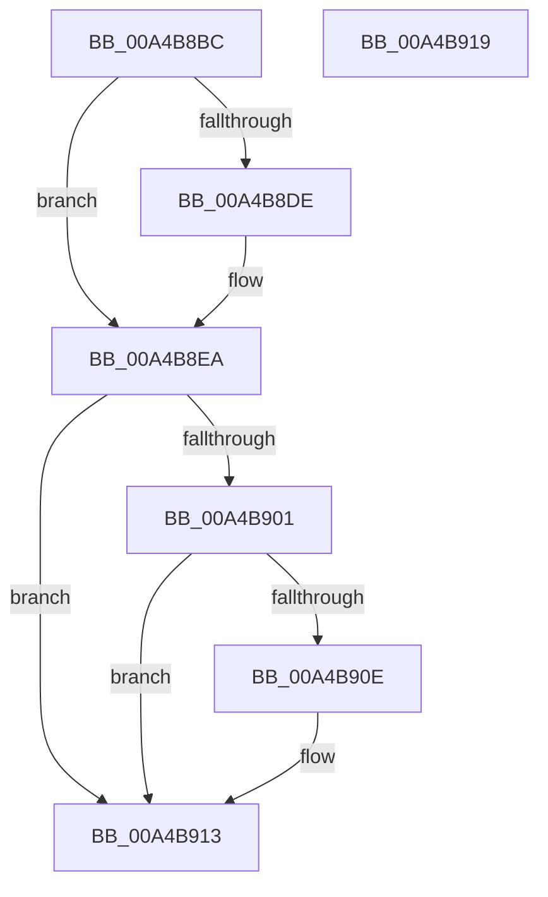

# MiReleaseKernelCfgLock

- RVA: `0x00A4B8BC`–`0x00A4B91A` (길이 `94` bytes)
- VA: `0x0000000140A4B8BC`
- 실행 섹션: `PAGE`
- PDB 이름 있음: `예`; PDB Function 태그: `아니요`
- unwind 정보 RVA: `0x0005CF00`
- 디코드: `24`개 명령, `94/94` bytes 표시
- 미해석 바이트: `0` (있으면 어셈블리에 `.byte`로 보존)

> 이 문서는 커널 이미지의 기계어와 PDB 기호를 분석해 생성했습니다. 4번과 5번은 함수 원형과 자료형을 바이너리 사용 방식에서 추정한 C 해석이며 원본 소스 복구 결과는 아닙니다.

## 1. Dependencies

- 직접 호출 지점: **3**; 고유 호출 대상: **3**
- 직접 호출자로 확인된 함수: **2**
- RIP 상대 이미지 참조: **2**

### Outgoing calls
- `0x00A4B8E5` → [ExfTryToWakePushLock](../../text/26/ExfTryToWakePushLock_function_00265DD0.md) (function, `0x00265DD0`)
- `0x00A4B8F1` → [KeAbPostRelease](../../text/2E/KeAbPostRelease_function_002E1600.md) (function, `0x002E1600`)
- `0x00A4B90E` → [KiCheckForKernelApcDelivery](../../text/2E/KiCheckForKernelApcDelivery_function_002E2C80.md) (function, `0x002E2C80`)

### Direct callers
- [MiMarkKernelImageCfgBits](MiMarkKernelImageCfgBits_function_00A4B1E0.md) at `0x00A4B21D`
- [MiAllocateKernelCfgBitmapPageTables](MiAllocateKernelCfgBitmapPageTables_function_00A4B80C.md) at `0x00A4B8AF`

### Static image references
- `0x00A4B8CF` → RVA `0x00E2D820` (`.data`; read/write)
- `0x00A4B8DE` → RVA `0x00E2D820` (`.data`; read)

## 2. Other-region calls and transfers

- 다른 실행 섹션으로 향하는 call: **3**
  - `0x00A4B8E5` → [ExfTryToWakePushLock](../../text/26/ExfTryToWakePushLock_function_00265DD0.md) (`PAGE` → `.text`)
  - `0x00A4B8F1` → [KeAbPostRelease](../../text/2E/KeAbPostRelease_function_002E1600.md) (`PAGE` → `.text`)
  - `0x00A4B90E` → [KiCheckForKernelApcDelivery](../../text/2E/KiCheckForKernelApcDelivery_function_002E2C80.md) (`PAGE` → `.text`)
- 별도 외부 분기/꼬리 이동을 확인하지 못했습니다.

## 3. Assembly (complete function range)

```asm
00A4B8BC  40 53                           push rbx
00A4B8BE  48 83 EC 20                     sub rsp, 0x20
00A4B8C2  65 48 8B 1C 25 88 01 00 00      mov rbx, qword ptr gs:[0x188]
00A4B8CB  48 83 C8 FF                     or rax, 0xffffffffffffffff
00A4B8CF  F0 48 0F C1 05 48 1F 3E 00      lock xadd qword ptr [rip + 0x3e1f48], rax
00A4B8D8  24 06                           and al, 6
00A4B8DA  3C 02                           cmp al, 2
00A4B8DC  75 0C                           jne 0x140a4b8ea
00A4B8DE  48 8D 0D 3B 1F 3E 00            lea rcx, [rip + 0x3e1f3b]
00A4B8E5  E8 E6 A4 81 FF                  call 0x140265dd0
00A4B8EA  48 8D 0D 2F 1F 3E 00            lea rcx, [rip + 0x3e1f2f]
00A4B8F1  E8 0A 5D 89 FF                  call 0x1402e1600
00A4B8F6  90                              nop
00A4B8F7  66 83 83 E6 01 00 00 01         add word ptr [rbx + 0x1e6], 1
00A4B8FF  75 12                           jne 0x140a4b913
00A4B901  48 8D 83 98 00 00 00            lea rax, [rbx + 0x98]
00A4B908  90                              nop
00A4B909  48 39 00                        cmp qword ptr [rax], rax
00A4B90C  74 05                           je 0x140a4b913
00A4B90E  E8 6D 73 89 FF                  call 0x1402e2c80
00A4B913  48 83 C4 20                     add rsp, 0x20
00A4B917  5B                              pop rbx
00A4B918  C3                              ret
00A4B919  CC                              int3
```

## 4. C-style interpretation (structured pseudocode)

```c
__int64 __fastcall MiReleaseKernelCfgLock(void)
{
    __int64 result;
    __int64 v_rsp;

    v_rsp = (v_rsp) - (32);
    result = (result) | (-1);
    result = (unsigned __int8)((result) & (6));
    if (((unsigned __int8)(result)) == 2) {
        a1 = v_rip + 4071227;
        result = ExfTryToWakePushLock(a1, a2, a3, a4);
    }
    result = KeAbPostRelease(v_rip + 4071215, a2, a3, a4);
    if (((unsigned __int8)(result)) != 2) goto loc_00A4B913;
    result = *(unsigned __int64 *)(gs_base + (0 + 392)) + 152;
    if ((*(unsigned __int64 *)(*(unsigned __int64 *)(gs_base + (0 + 392)) + 152)) != (*(unsigned __int64 *)(gs_base + (0 + 392)) + 152)) {
        result = KiCheckForKernelApcDelivery(v_rip + 4071215, a2, a3, a4);
    }
    v_rsp = (v_rsp) + (32);
    return result;
}
```

## 5. (Beta) C Style

```c
void MiReleaseKernelCfgLock(void)
{
    int64_t result;
    int64_t local_rsp;

    local_rsp = (local_rsp) - (32);
    result = (result) | (-1);
    result = (uint8_t)((result) & (6));
    if (((uint8_t)(result)) == 2) {
        a1 = v_rip + 4071227;
        result = ExfTryToWakePushLock(a1, a2, a3, a4);
    }
    result = KeAbPostRelease(v_rip + 4071215, a2, a3, a4);
    if (((uint8_t)(result)) != 2) goto loc_00A4B913;
    result = *(uint64_t *)(gs_base + (0 + 0x188)) + 152;
    if ((*(uint64_t *)(*(uint64_t *)(gs_base + (0 + 0x188)) + 0x98)) != (*(uint64_t *)(gs_base + (0 + 0x188)) + 152)) {
        result = KiCheckForKernelApcDelivery(v_rip + 4071215, a2, a3, a4);
    }
    local_rsp = (local_rsp) + (32);
    return result;
}
```

## 6. Execution-region graph

[열기: 2D/3D 그래프와 함수 탐색 컨트롤 패널](../../../control-panel.html?section=page&rva=0x00A4B8BC&view=graph)

- 2D 그래프는 위에서 아래로 흐르고, 3D 그래프는 빈 공간을 드래그해 회전합니다. Shift+드래그는 이동, 휠은 확대·축소, 함수 노드 선택은 대상 보고서 이동입니다.

### Static fallback


