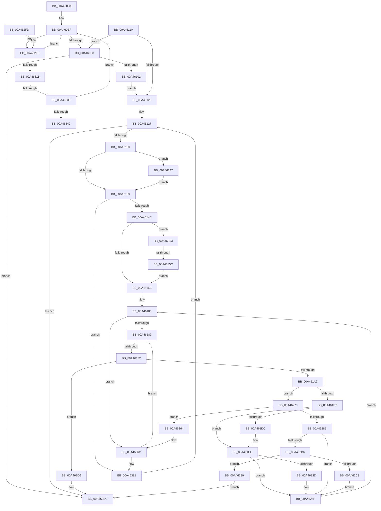

# MiScrubNode

- RVA: `0x00A46098`–`0x00A463B0` (길이 `792` bytes)
- VA: `0x0000000140A46098`
- 실행 섹션: `PAGE`
- PDB 이름 있음: `예`; PDB Function 태그: `예`
- unwind 정보 RVA: `0x000AF6EC`
- 디코드: `192`개 명령, `792/792` bytes 표시
- 미해석 바이트: `0` (있으면 어셈블리에 `.byte`로 보존)

> 이 문서는 커널 이미지의 기계어와 PDB 기호를 분석해 생성했습니다. 4번과 5번은 함수 원형과 자료형을 바이너리 사용 방식에서 추정한 C 해석이며 원본 소스 복구 결과는 아닙니다.

## 1. Dependencies

- 직접 호출 지점: **8**; 고유 호출 대상: **7**
- 직접 호출자로 확인된 함수: **1**
- RIP 상대 이미지 참조: **1**

### Outgoing calls
- `0x00A46195` → [MiScrubInterrupted](../../text/49/MiScrubInterrupted_function_00495894.md) (function, `0x00495894`)
- `0x00A461C1` → [MiPfnsWorthTrying](../../text/31/MiPfnsWorthTrying_function_0031B0C0.md) (function, `0x0031B0C0`)
- `0x00A461E7` → [MiAdjustCachedStacks](../../text/2D/MiAdjustCachedStacks_function_002D8AAC.md) (function, `0x002D8AAC`)
- `0x00A46233` → [MiClaimPhysicalRun](../../text/28/MiClaimPhysicalRun_function_0028CF00.md) (function, `0x0028CF00`)
- `0x00A46249` → [MiScrubPage](../../text/3F/MiScrubPage_function_003F954C.md) (function, `0x003F954C`)
- `0x00A4625A` → [MiMakePageBad](../../text/48/MiMakePageBad_function_00486F04.md) (function, `0x00486F04`)
- `0x00A462A9` → [MiScrubLargePageRegions](../70/MiScrubLargePageRegions_function_007011B4.md) (function, `0x007011B4`)
- `0x00A462BC` → [MiScrubInterrupted](../../text/49/MiScrubInterrupted_function_00495894.md) (function, `0x00495894`)

### Direct callers
- [MiScrubMemoryWorker](../80/MiScrubMemoryWorker_function_0080EE00.md) at `0x0080EE23`

### Static image references
- `0x00A461EC` → RVA `0x00E2DCE0` (`.data`; read)

## 2. Other-region calls and transfers

- 다른 실행 섹션으로 향하는 call: **7**
  - `0x00A46195` → [MiScrubInterrupted](../../text/49/MiScrubInterrupted_function_00495894.md) (`PAGE` → `.text`)
  - `0x00A461C1` → [MiPfnsWorthTrying](../../text/31/MiPfnsWorthTrying_function_0031B0C0.md) (`PAGE` → `.text`)
  - `0x00A461E7` → [MiAdjustCachedStacks](../../text/2D/MiAdjustCachedStacks_function_002D8AAC.md) (`PAGE` → `.text`)
  - `0x00A46233` → [MiClaimPhysicalRun](../../text/28/MiClaimPhysicalRun_function_0028CF00.md) (`PAGE` → `.text`)
  - `0x00A46249` → [MiScrubPage](../../text/3F/MiScrubPage_function_003F954C.md) (`PAGE` → `.text`)
  - `0x00A4625A` → [MiMakePageBad](../../text/48/MiMakePageBad_function_00486F04.md) (`PAGE` → `.text`)
  - `0x00A462BC` → [MiScrubInterrupted](../../text/49/MiScrubInterrupted_function_00495894.md) (`PAGE` → `.text`)
- call이 아닌 외부 분기/꼬리 이동: **3**
  - `0x00A46332` → [sub_00B3B162](../B3/Unknown_function_00B3B162.md) (`tail-transfer`)
  - `0x00A46342` → [sub_00B3B162](../B3/Unknown_function_00B3B162.md) (`tail-transfer`)
  - `0x00A46356` → [sub_00B3B162 + 0x1C](../B3/Unknown_function_00B3B162.md) (`tail-transfer`)

## 3. Assembly (complete function range)

```asm
00A46098  48 8B C4                        mov rax, rsp
00A4609B  53                              push rbx
00A4609C  55                              push rbp
00A4609D  56                              push rsi
00A4609E  57                              push rdi
00A4609F  41 54                           push r12
00A460A1  41 55                           push r13
00A460A3  41 56                           push r14
00A460A5  41 57                           push r15
00A460A7  48 83 EC 68                     sub rsp, 0x68
00A460AB  83 60 08 00                     and dword ptr [rax + 8], 0
00A460AF  48 8B F1                        mov rsi, rcx
00A460B2  48 8B 39                        mov rdi, qword ptr [rcx]
00A460B5  48 89 7C 24 50                  mov qword ptr [rsp + 0x50], rdi
00A460BA  4C 8B 47 50                     mov r8, qword ptr [rdi + 0x50]
00A460BE  4C 8B 5F 30                     mov r11, qword ptr [rdi + 0x30]
00A460C2  4C 89 9C 24 B8 00 00 00         mov qword ptr [rsp + 0xb8], r11
00A460CA  41 8B 18                        mov ebx, dword ptr [r8]
00A460CD  48 89 9C 24 C0 00 00 00         mov qword ptr [rsp + 0xc0], rbx
00A460D5  44 8B F3                        mov r14d, ebx
00A460D8  4C 8D 53 01                     lea r10, [rbx + 1]
00A460DC  49 C1 E2 04                     shl r10, 4
00A460E0  4D 03 D0                        add r10, r8
00A460E3  4C 89 94 24 C8 00 00 00         mov qword ptr [rsp + 0xc8], r10
00A460EB  41 83 C9 FF                     or r9d, 0xffffffff
00A460EF  45 85 F6                        test r14d, r14d
00A460F2  0F 85 06 02 00 00               jne 0x140a462fe
00A460F8  41 83 F9 FF                     cmp r9d, -1
00A460FC  0F 84 EA 01 00 00               je 0x140a462ec
00A46102  41 8B C1                        mov eax, r9d
00A46105  45 8B F1                        mov r14d, r9d
00A46108  48 03 C0                        add rax, rax
00A4610B  49 8B 6C C0 10                  mov rbp, qword ptr [r8 + rax*8 + 0x10]
00A46110  48 FF CD                        dec rbp
00A46113  49 03 6C C0 18                  add rbp, qword ptr [r8 + rax*8 + 0x18]
00A46118  EB 06                           jmp 0x140a46120
00A4611A  48 83 FD FF                     cmp rbp, -1
00A4611E  74 D8                           je 0x140a460f8
00A46120  45 8D 7E 01                     lea r15d, [r14 + 1]
00A46124  45 33 ED                        xor r13d, r13d
00A46127  44 3B EB                        cmp r13d, ebx
00A4612A  0F 83 BC 01 00 00               jae 0x140a462ec
00A46130  45 85 FF                        test r15d, r15d
00A46133  0F 84 0E 02 00 00               je 0x140a46347
00A46139  8B 46 08                        mov eax, dword ptr [rsi + 8]
00A4613C  41 FF CF                        dec r15d
00A4613F  41 8B CF                        mov ecx, r15d
00A46142  43 39 04 FA                     cmp dword ptr [r10 + r15*8], eax
00A46146  0F 85 35 02 00 00               jne 0x140a46381
00A4614C  48 8B 47 50                     mov rax, qword ptr [rdi + 0x50]
00A46150  48 03 C9                        add rcx, rcx
00A46153  4C 8B 64 C8 10                  mov r12, qword ptr [rax + rcx*8 + 0x10]
00A46158  49 8D 5C 24 FF                  lea rbx, [r12 - 1]
00A4615D  48 03 5C C8 18                  add rbx, qword ptr [rax + rcx*8 + 0x18]
00A46162  45 3B FE                        cmp r15d, r14d
00A46165  0F 84 E8 01 00 00               je 0x140a46353
00A4616B  48 8D 3C 5B                     lea rdi, [rbx + rbx*2]
00A4616F  48 C1 E7 04                     shl rdi, 4
00A46173  48 B8 00 00 00 00 00 DE FF FF   movabs rax, 0xffffde0000000000
00A4617D  48 03 F8                        add rdi, rax
00A46180  49 3B DC                        cmp rbx, r12
00A46183  0F 82 E3 01 00 00               jb 0x140a4636c
00A46189  4D 85 E4                        test r12, r12
00A4618C  0F 84 DA 01 00 00               je 0x140a4636c
00A46192  48 8B CE                        mov rcx, rsi
00A46195  E8 FA F6 A4 FF                  call 0x140495894
00A4619A  85 C0                           test eax, eax
00A4619C  0F 85 34 01 00 00               jne 0x140a462d6
00A461A2  48 8D 84 24 B0 00 00 00         lea rax, [rsp + 0xb0]
00A461AA  41 B9 00 00 00 07               mov r9d, 0x7000000
00A461B0  41 B8 01 00 00 00               mov r8d, 1
00A461B6  48 89 44 24 20                  mov qword ptr [rsp + 0x20], rax
00A461BB  48 8B D7                        mov rdx, rdi
00A461BE  49 8B CB                        mov rcx, r11
00A461C1  E8 FA 4E 8D FF                  call 0x14031b0c0
00A461C6  4C 8B C0                        mov r8, rax
00A461C9  48 85 C0                        test rax, rax
00A461CC  0F 85 A1 00 00 00               jne 0x140a46273
00A461D2  F6 84 24 B0 00 00 00 01         test byte ptr [rsp + 0xb0], 1
00A461DA  74 10                           je 0x140a461ec
00A461DC  48 8B 8C 24 B8 00 00 00         mov rcx, qword ptr [rsp + 0xb8]
00A461E4  8D 50 01                        lea edx, [rax + 1]
00A461E7  E8 C0 28 89 FF                  call 0x1402d8aac
00A461EC  4C 8B 0D ED 7A 3E 00            mov r9, qword ptr [rip + 0x3e7aed]
00A461F3  48 8D 8C 24 B0 00 00 00         lea rcx, [rsp + 0xb0]
00A461FB  48 89 4C 24 48                  mov qword ptr [rsp + 0x48], rcx
00A46200  48 8D 46 30                     lea rax, [rsi + 0x30]
00A46204  48 83 64 24 40 00               and qword ptr [rsp + 0x40], 0
00A4620A  41 B8 01 00 00 00               mov r8d, 1
00A46210  48 83 64 24 38 00               and qword ptr [rsp + 0x38], 0
00A46216  48 8B D3                        mov rdx, rbx
00A46219  83 64 24 30 00                  and dword ptr [rsp + 0x30], 0
00A4621E  48 8B 8C 24 B8 00 00 00         mov rcx, qword ptr [rsp + 0xb8]
00A46226  C7 44 24 28 00 00 00 07         mov dword ptr [rsp + 0x28], 0x7000000
00A4622E  48 89 44 24 20                  mov qword ptr [rsp + 0x20], rax
00A46233  E8 C8 6C 84 FF                  call 0x14028cf00
00A46238  48 85 C0                        test rax, rax
00A4623B  75 22                           jne 0x140a4625f
00A4623D  45 33 C9                        xor r9d, r9d
00A46240  45 33 C0                        xor r8d, r8d
00A46243  48 8B D7                        mov rdx, rdi
00A46246  48 8B CE                        mov rcx, rsi
00A46249  E8 FE 32 9B FF                  call 0x1403f954c
00A4624E  C1 F8 1F                        sar eax, 0x1f
00A46251  48 8B CB                        mov rcx, rbx
00A46254  83 E0 01                        and eax, 1
00A46257  8D 50 02                        lea edx, [rax + 2]
00A4625A  E8 A5 0C A4 FF                  call 0x140486f04
00A4625F  4C 8B 9C 24 B8 00 00 00         mov r11, qword ptr [rsp + 0xb8]
00A46267  48 FF CB                        dec rbx
00A4626A  48 83 EF 30                     sub rdi, 0x30
00A4626E  E9 0D FF FF FF                  jmp 0x140a46180
00A46273  48 8B CB                        mov rcx, rbx
00A46276  49 2B CC                        sub rcx, r12
00A46279  48 FF C1                        inc rcx
00A4627C  4C 3B C1                        cmp r8, rcx
00A4627F  0F 83 DF 00 00 00               jae 0x140a46364
00A46285  48 8D 14 40                     lea rdx, [rax + rax*2]
00A46289  B9 30 00 00 00                  mov ecx, 0x30
00A4628E  48 C1 E2 04                     shl rdx, 4
00A46292  B8 01 00 00 00                  mov eax, 1
00A46297  48 2B CA                        sub rcx, rdx
00A4629A  49 2B C0                        sub rax, r8
00A4629D  48 03 F9                        add rdi, rcx
00A462A0  48 03 D8                        add rbx, rax
00A462A3  48 8B D7                        mov rdx, rdi
00A462A6  48 8B CE                        mov rcx, rsi
00A462A9  E8 06 AF CB FF                  call 0x1407011b4
00A462AE  4C 8B C0                        mov r8, rax
00A462B1  48 85 C0                        test rax, rax
00A462B4  74 A9                           je 0x140a4625f
00A462B6  48 8B CE                        mov rcx, rsi
00A462B9  48 03 D8                        add rbx, rax
00A462BC  E8 D3 F5 A4 FF                  call 0x140495894
00A462C1  85 C0                           test eax, eax
00A462C3  0F 85 C0 00 00 00               jne 0x140a46389
00A462C9  4B 8D 04 40                     lea rax, [r8 + r8*2]
00A462CD  48 C1 E0 04                     shl rax, 4
00A462D1  48 03 F8                        add rdi, rax
00A462D4  EB 89                           jmp 0x140a4625f
00A462D6  8B 46 08                        mov eax, dword ptr [rsi + 8]
00A462D9  48 69 C8 80 DF 00 00            imul rcx, rax, 0xdf80
00A462E0  49 8B 43 10                     mov rax, qword ptr [r11 + 0x10]
00A462E4  48 89 9C 01 90 3B 00 00         mov qword ptr [rcx + rax + 0x3b90], rbx
00A462EC  48 83 C4 68                     add rsp, 0x68
00A462F0  41 5F                           pop r15
00A462F2  41 5E                           pop r14
00A462F4  41 5D                           pop r13
00A462F6  41 5C                           pop r12
00A462F8  5F                              pop rdi
00A462F9  5E                              pop rsi
00A462FA  5D                              pop rbp
00A462FB  5B                              pop rbx
00A462FC  C3                              ret
00A462FD  CC                              int3
00A462FE  8B 46 08                        mov eax, dword ptr [rsi + 8]
00A46301  41 FF CE                        dec r14d
00A46304  41 8B D6                        mov edx, r14d
00A46307  43 39 04 F2                     cmp dword ptr [r10 + r14*8], eax
00A4630B  0F 85 DE FD FF FF               jne 0x140a460ef
00A46311  48 8B AE C0 00 00 00            mov rbp, qword ptr [rsi + 0xc0]
00A46318  48 03 D2                        add rdx, rdx
00A4631B  45 8B CE                        mov r9d, r14d
00A4631E  49 8B 4C D0 10                  mov rcx, qword ptr [r8 + rdx*8 + 0x10]
00A46323  49 8B 44 D0 18                  mov rax, qword ptr [r8 + rdx*8 + 0x18]
00A46328  48 8D 51 FF                     lea rdx, [rcx - 1]
00A4632C  48 03 D0                        add rdx, rax
00A4632F  48 3B E9                        cmp rbp, rcx
00A46332  0F 83 2A 4E 0F 00               jae 0x140b3b162
00A46338  48 83 FD FF                     cmp rbp, -1
00A4633C  0F 85 AD FD FF FF               jne 0x140a460ef
00A46342  E9 1B 4E 0F 00                  jmp 0x140b3b162
00A46347  48 8B 47 50                     mov rax, qword ptr [rdi + 0x50]
00A4634B  44 8B 38                        mov r15d, dword ptr [rax]
00A4634E  E9 E6 FD FF FF                  jmp 0x140a46139
00A46353  45 85 ED                        test r13d, r13d
00A46356  0F 85 22 4E 0F 00               jne 0x140b3b17e
00A4635C  48 8B DD                        mov rbx, rbp
00A4635F  E9 07 FE FF FF                  jmp 0x140a4616b
00A46364  4C 8B 9C 24 B8 00 00 00         mov r11, qword ptr [rsp + 0xb8]
00A4636C  4C 8B 94 24 C8 00 00 00         mov r10, qword ptr [rsp + 0xc8]
00A46374  48 8B 9C 24 C0 00 00 00         mov rbx, qword ptr [rsp + 0xc0]
00A4637C  48 8B 7C 24 50                  mov rdi, qword ptr [rsp + 0x50]
00A46381  41 FF C5                        inc r13d
00A46384  E9 9E FD FF FF                  jmp 0x140a46127
00A46389  8B 46 08                        mov eax, dword ptr [rsi + 8]
00A4638C  48 8D 53 FF                     lea rdx, [rbx - 1]
00A46390  48 69 C8 80 DF 00 00            imul rcx, rax, 0xdf80
00A46397  48 8B 84 24 B8 00 00 00         mov rax, qword ptr [rsp + 0xb8]
00A4639F  48 8B 40 10                     mov rax, qword ptr [rax + 0x10]
00A463A3  48 89 94 01 90 3B 00 00         mov qword ptr [rcx + rax + 0x3b90], rdx
00A463AB  E9 3C FF FF FF                  jmp 0x140a462ec
```

## 4. C-style interpretation (structured pseudocode)

```c
__int64 __fastcall MiScrubNode(__int64 a1, __int64 a2, __int64 a3, int a4)
{
    __int64 result;
    __int64 v_r10;
    __int64 v_r13;
    __int64 v_r14;
    __int64 v_r15;
    __int64 v_rbp;
    __int64 v_rbx;
    __int64 v_rdi;
    __int64 v_rsp;
    unsigned __int64 v_stack_m58;
    unsigned __int64 v_stack_m60;
    unsigned __int64 v_stack_m68;
    unsigned __int64 v_stack_m70;
    unsigned int v_stack_m78;
    unsigned int v_stack_m80;
    unsigned __int64 v_stack_m88;
    unsigned __int64 v_stack_p10;
    unsigned __int64 v_stack_p18;
    unsigned __int64 v_stack_p20;
    unsigned __int64 v_stack_p50;
    unsigned __int64 v_stack_p8;
    unsigned __int64 v_stack_pB8;
    unsigned __int64 v_stack_pC0;
    unsigned __int64 v_stack_pC8;

    v_rsp = (v_rsp) - (104);
    v_stack_m58 = *(unsigned __int64 *)(a1);
    v_stack_p10 = *(unsigned __int64 *)(*(unsigned __int64 *)(a1) + 48);
    v_stack_p18 = (unsigned int)(*(unsigned int *)(*(unsigned __int64 *)(*(unsigned __int64 *)(a1) + 80)));
    v_r10 = ((unsigned int)(*(unsigned int *)(*(unsigned __int64 *)(*(unsigned __int64 *)(a1) + 80))) + 1) << (4);
    v_r10 = (v_r10) + (*(unsigned __int64 *)(*(unsigned __int64 *)(a1) + 80));
    v_stack_p20 = v_r10;
    a4 = (unsigned int)((a4) | (0xFFFFFFFFULL));
loc_00A460EF:
    if ((unsigned int)((unsigned int)((unsigned int)((unsigned int)(*(unsigned int *)(*(unsigned __int64 *)(*(unsigned __int64 *)(a1) + 80)))))) != 0) goto loc_00A462FE;
loc_00A460F8:
    if (a4 == -1) goto loc_00A462EC;
    result = ((unsigned int)(a4)) + ((unsigned int)(a4));
    v_rbp = (*(unsigned __int64 *)(*(unsigned __int64 *)(*(unsigned __int64 *)(a1) + 80) + result * 8 + 16)) - 1;
    v_rbp = (v_rbp) + (*(unsigned __int64 *)(*(unsigned __int64 *)(*(unsigned __int64 *)(a1) + 80) + result * 8 + 24));
    goto loc_00A46120;
loc_00A46120:
    v_r13 = 0;
loc_00A46127:
    if (0 >= ((unsigned int)((unsigned int)(*(unsigned int *)(*(unsigned __int64 *)(*(unsigned __int64 *)(a1) + 80)))))) goto loc_00A462EC;
    if ((unsigned int)((unsigned int)(a4) + 1) == 0) goto loc_00A46347;
loc_00A46139:
    v_r15 = (unsigned int)(((unsigned int)(a4) + 1) - 1);
    if ((*(unsigned int *)(v_r10 + v_r15 * 8)) != ((unsigned int)((unsigned int)(*(unsigned int *)(a1 + 8))))) goto loc_00A46381;
    a1 = ((unsigned int)((unsigned int)(v_r15))) + ((unsigned int)((unsigned int)(v_r15)));
    v_rbx = (*(unsigned __int64 *)(*(unsigned __int64 *)(*(unsigned __int64 *)(a1) + 80) + a1 * 8 + 16) - 1) + (*(unsigned __int64 *)(*(unsigned __int64 *)(*(unsigned __int64 *)(a1) + 80) + a1 * 8 + 24));
    if (((unsigned int)(v_r15)) == ((unsigned int)((unsigned int)(a4)))) goto loc_00A46353;
loc_00A4616B:
    v_rdi = (v_rbx + v_rbx * 2) << (4);
    v_rdi = (v_rdi) + (*(unsigned __int64 *)(*(unsigned __int64 *)(a1) + 80));
loc_00A46180:
    if (v_rbx < (*(unsigned __int64 *)(*(unsigned __int64 *)(*(unsigned __int64 *)(a1) + 80) + a1 * 8 + 16))) goto loc_00A4636C;
    if (*(unsigned __int64 *)(*(unsigned __int64 *)(*(unsigned __int64 *)(a1) + 80) + a1 * 8 + 16) == 0) goto loc_00A4636C;
    result = MiScrubInterrupted(a1, a2, *(unsigned __int64 *)(*(unsigned __int64 *)(a1) + 80), a4);
    if ((unsigned int)(result) != 0) goto loc_00A462D6;
    v_stack_m88 = v_stack_p8;
    result = MiPfnsWorthTrying(*(unsigned __int64 *)(*(unsigned __int64 *)(a1) + 48), v_rdi, 1, (unsigned int)(0x7000000ULL));
    if (result != 0) goto loc_00A46273;
    if (((v_stack_p8) & (1)) != 0) {
        a1 = v_stack_p10;
        a2 = result + 1;
        result = MiAdjustCachedStacks(a1, a2, result, (unsigned int)(0x7000000ULL));
    }
    v_stack_m60 = v_stack_p8;
    v_stack_m80 = 0x7000000ULL;
    v_stack_m88 = a1 + 48;
    result = MiClaimPhysicalRun(v_stack_p10, v_rbx, 1, *(unsigned __int64 *)(v_rip + 4094701));
    if (result == 0) {
        a4 = 0;
        a3 = 0;
        a2 = v_rdi;
        a1 = a1;
        result = MiScrubPage(a1, a2, a3, a4);
        result = (unsigned int)((result) >> (31));
        a1 = v_rbx;
        result = (unsigned int)((result) & (1));
        a2 = result + 2;
        result = MiMakePageBad(a1, a2, a3, a4);
    }
    v_rbx = (v_rbx) - 1;
    v_rdi = (v_rdi) - (48);
    goto loc_00A46180;
loc_00A46273:
    a1 = (v_rbx) - (*(unsigned __int64 *)(*(unsigned __int64 *)(*(unsigned __int64 *)(a1) + 80) + a1 * 8 + 16));
    a1 = (a1) + 1;
    if (0 >= a1) goto loc_00A46364;
    a2 = (result + result * 2) << (4);
    a1 = (48) - (a2);
    result = (1) - (0);
    v_rdi = (v_rdi) + (a1);
    v_rbx = (v_rbx) + (result);
    result = MiScrubLargePageRegions(a1, v_rdi, a3, a4);
    if (result == 0) goto loc_00A4625F;
    v_rbx = (v_rbx) + (result);
    result = MiScrubInterrupted(a1, v_rdi, result, a4);
    if ((unsigned int)(result) != 0) goto loc_00A46389;
    result = (result + result * 2) << (4);
    v_rdi = (v_rdi) + (result);
    goto loc_00A4625F;
loc_00A462D6:
    a1 = (a1) * ((unsigned int)(*(unsigned int *)(a1 + 8)));
    *(unsigned __int64 *)(a1 + *(unsigned __int64 *)(v_stack_p10 + 16) * 1 + 15248) = v_rbx;
loc_00A462EC:
    v_rsp = (v_rsp) + (104);
    return *(unsigned __int64 *)(v_stack_p10 + 16);
loc_00A462FE:
    v_r14 = (unsigned int)(((unsigned int)(a4)) - 1);
    if ((*(unsigned int *)(v_r10 + v_r14 * 8)) != ((unsigned int)((unsigned int)(*(unsigned int *)(a1 + 8))))) goto loc_00A460EF;
    a2 = ((unsigned int)((unsigned int)(v_r14))) + ((unsigned int)((unsigned int)(v_r14)));
    a2 = (*(unsigned __int64 *)(result + a2 * 8 + 16) - 1) + (*(unsigned __int64 *)(result + a2 * 8 + 24));
    if ((*(unsigned __int64 *)(a1 + 192)) != -1) goto loc_00A460EF;
loc_00A46347:
    goto loc_00A46139;
loc_00A46353:
    goto loc_00A4616B;
loc_00A46364:
loc_00A4636C:
loc_00A46381:
    v_r13 = (unsigned int)((v_r13) + 1);
    goto loc_00A46127;
loc_00A46389:
    a1 = (*(unsigned __int64 *)(result + a2 * 8 + 16)) * ((unsigned int)(*(unsigned int *)(a1 + 8)));
    *(unsigned __int64 *)(a1 + *(unsigned __int64 *)(v_stack_pB8 + 16) * 1 + 15248) = v_stack_pC0 - 1;
    goto loc_00A462EC;
}
```

## 5. (Beta) C Style

```c
int64_t MiScrubNode(void *Arg1, int64_t Arg2, int64_t Arg3, int32_t Arg4)
{
    uint8_t *arg1 = (uint8_t *)Arg1;

    int64_t result;
    int64_t local_r10;
    int64_t local_r13;
    int64_t local_r14;
    int64_t local_r15;
    int64_t local_rbp;
    int64_t local_rbx;
    int64_t local_rdi;
    int64_t local_rsp;
    uint64_t v_stack_m58;
    uint64_t v_stack_m60;
    uint64_t v_stack_m68;
    uint64_t v_stack_m70;
    uint32_t v_stack_m78;
    uint32_t v_stack_m80;
    uint64_t v_stack_m88;
    uint64_t v_stack_p10;
    uint64_t v_stack_p18;
    uint64_t v_stack_p20;
    uint64_t v_stack_p50;
    uint64_t v_stack_p8;
    uint64_t v_stack_pB8;
    uint64_t v_stack_pC0;
    uint64_t v_stack_pC8;

    local_rsp = (local_rsp) - (104);
    v_stack_m58 = *(uint64_t *)(arg1);
    v_stack_p10 = *(uint64_t *)(*(uint64_t *)(arg1) + 0x30);
    v_stack_p18 = (uint32_t)(*(uint32_t *)(*(uint64_t *)(*(uint64_t *)(arg1) + 0x50)));
    local_r10 = ((uint32_t)(*(uint32_t *)(*(uint64_t *)(*(uint64_t *)(arg1) + 0x50))) + 1) << (4);
    local_r10 = (local_r10) + (*(uint64_t *)(*(uint64_t *)(arg1) + 0x50));
    v_stack_p20 = local_r10;
    Arg4 = (uint32_t)((Arg4) | (0xFFFFFFFFULL));
loc_00A460EF:
    if ((uint32_t)((uint32_t)((uint32_t)((uint32_t)(*(uint32_t *)(*(uint64_t *)(*(uint64_t *)(arg1) + 0x50)))))) != 0) goto loc_00A462FE;
loc_00A460F8:
    if (Arg4 == -1) goto loc_00A462EC;
    result = ((uint32_t)(Arg4)) + ((uint32_t)(Arg4));
    local_rbp = (*(uint64_t *)(*(uint64_t *)(*(uint64_t *)(arg1) + 0x50) + result * 8 + 0x10)) - 1;
    local_rbp = (local_rbp) + (*(uint64_t *)(*(uint64_t *)(*(uint64_t *)(arg1) + 0x50) + result * 8 + 0x18));
    goto loc_00A46120;
loc_00A46120:
    local_r13 = 0;
loc_00A46127:
    if (0 >= ((uint32_t)((uint32_t)(*(uint32_t *)(*(uint64_t *)(*(uint64_t *)(arg1) + 0x50)))))) goto loc_00A462EC;
    if ((uint32_t)((uint32_t)(Arg4) + 1) == 0) goto loc_00A46347;
loc_00A46139:
    local_r15 = (uint32_t)(((uint32_t)(Arg4) + 1) - 1);
    if ((*(uint32_t *)(local_r10 + local_r15 * 8)) != ((uint32_t)((uint32_t)(*(uint32_t *)(arg1 + 0x8))))) goto loc_00A46381;
    Arg1 = ((uint32_t)((uint32_t)(local_r15))) + ((uint32_t)((uint32_t)(local_r15)));
    local_rbx = (*(uint64_t *)(*(uint64_t *)(*(uint64_t *)(arg1) + 0x50) + arg1 * 8 + 0x10) - 1) + (*(uint64_t *)(*(uint64_t *)(*(uint64_t *)(arg1) + 0x50) + arg1 * 8 + 0x18));
    if (((uint32_t)(local_r15)) == ((uint32_t)((uint32_t)(Arg4)))) goto loc_00A46353;
loc_00A4616B:
    local_rdi = (local_rbx + local_rbx * 2) << (4);
    local_rdi = (local_rdi) + (*(uint64_t *)(*(uint64_t *)(arg1) + 0x50));
loc_00A46180:
    if (local_rbx < (*(uint64_t *)(*(uint64_t *)(*(uint64_t *)(arg1) + 0x50) + arg1 * 8 + 0x10))) goto loc_00A4636C;
    if (*(uint64_t *)(*(uint64_t *)(*(uint64_t *)(arg1) + 0x50) + arg1 * 8 + 0x10) == 0) goto loc_00A4636C;
    result = MiScrubInterrupted(Arg1, Arg2, *(uint64_t *)(*(uint64_t *)(arg1) + 0x50), Arg4);
    if ((uint32_t)(result) != 0) goto loc_00A462D6;
    v_stack_m88 = v_stack_p8;
    result = MiPfnsWorthTrying(*(uint64_t *)(*(uint64_t *)(arg1) + 0x30), local_rdi, 1, (uint32_t)(0x7000000ULL));
    if (result != 0) goto loc_00A46273;
    if (((v_stack_p8) & (1)) != 0) {
        Arg1 = v_stack_p10;
        Arg2 = result + 1;
        result = MiAdjustCachedStacks(Arg1, Arg2, result, (uint32_t)(0x7000000ULL));
    }
    v_stack_m60 = v_stack_p8;
    v_stack_m80 = 0x7000000ULL;
    v_stack_m88 = Arg1 + 48;
    result = MiClaimPhysicalRun(v_stack_p10, local_rbx, 1, *(uint64_t *)(v_rip + 0x3E7AED));
    if (result == 0) {
        Arg4 = 0;
        Arg3 = 0;
        Arg2 = local_rdi;
        Arg1 = Arg1;
        result = MiScrubPage(Arg1, Arg2, Arg3, Arg4);
        result = (uint32_t)((result) >> (31));
        Arg1 = local_rbx;
        result = (uint32_t)((result) & (1));
        Arg2 = result + 2;
        result = MiMakePageBad(Arg1, Arg2, Arg3, Arg4);
    }
    local_rbx = (local_rbx) - 1;
    local_rdi = (local_rdi) - (48);
    goto loc_00A46180;
loc_00A46273:
    Arg1 = (local_rbx) - (*(uint64_t *)(*(uint64_t *)(*(uint64_t *)(arg1) + 0x50) + arg1 * 8 + 0x10));
    Arg1 = (Arg1) + 1;
    if (0 >= Arg1) goto loc_00A46364;
    Arg2 = (result + result * 2) << (4);
    Arg1 = (48) - (Arg2);
    result = (1) - (0);
    local_rdi = (local_rdi) + (Arg1);
    local_rbx = (local_rbx) + (result);
    result = MiScrubLargePageRegions(Arg1, local_rdi, Arg3, Arg4);
    if (result == 0) goto loc_00A4625F;
    local_rbx = (local_rbx) + (result);
    result = MiScrubInterrupted(Arg1, local_rdi, result, Arg4);
    if ((uint32_t)(result) != 0) goto loc_00A46389;
    result = (result + result * 2) << (4);
    local_rdi = (local_rdi) + (result);
    goto loc_00A4625F;
loc_00A462D6:
    Arg1 = (Arg1) * ((uint32_t)(*(uint32_t *)(arg1 + 0x8)));
    *(uint64_t *)(arg1 + *(uint64_t *)(v_stack_p10 + 0x10) * 1 + 0x3B90) = local_rbx;
loc_00A462EC:
    local_rsp = (local_rsp) + (104);
    return *(uint64_t *)(v_stack_p10 + 0x10);
loc_00A462FE:
    local_r14 = (uint32_t)(((uint32_t)(Arg4)) - 1);
    if ((*(uint32_t *)(local_r10 + local_r14 * 8)) != ((uint32_t)((uint32_t)(*(uint32_t *)(arg1 + 0x8))))) goto loc_00A460EF;
    Arg2 = ((uint32_t)((uint32_t)(local_r14))) + ((uint32_t)((uint32_t)(local_r14)));
    Arg2 = (*(uint64_t *)(result + Arg2 * 8 + 0x10) - 1) + (*(uint64_t *)(result + Arg2 * 8 + 0x18));
    if ((*(uint64_t *)(arg1 + 0xC0)) != -1) goto loc_00A460EF;
loc_00A46347:
    goto loc_00A46139;
loc_00A46353:
    goto loc_00A4616B;
loc_00A46364:
loc_00A4636C:
loc_00A46381:
    local_r13 = (uint32_t)((local_r13) + 1);
    goto loc_00A46127;
loc_00A46389:
    Arg1 = (*(uint64_t *)(result + Arg2 * 8 + 0x10)) * ((uint32_t)(*(uint32_t *)(arg1 + 0x8)));
    *(uint64_t *)(arg1 + *(uint64_t *)(v_stack_pB8 + 0x10) * 1 + 0x3B90) = v_stack_pC0 - 1;
    goto loc_00A462EC;
}
```

### 관측된 메모리 오프셋

구조체 형식이 확인되지 않은 접근은 인자 기준의 오프셋으로만 기록했습니다.

| 기준 인자 | 오프셋 표현 | 폭 (bit) | 접근 |
|---|---:|---:|---|
| `Arg1` | `+ 0x0` | `64` | `R` |
| `Arg1` | `+ 0x8` | `32` | `R` |
| `Arg1` | `+ 0x30` | `64` | `R` |
| `Arg1` | `+ 0xC0` | `64` | `R` |

## 6. Execution-region graph

[열기: 2D/3D 그래프와 함수 탐색 컨트롤 패널](../../../control-panel.html?section=page&rva=0x00A46098&view=graph)

- 2D 그래프는 위에서 아래로 흐르고, 3D 그래프는 빈 공간을 드래그해 회전합니다. Shift+드래그는 이동, 휠은 확대·축소, 함수 노드 선택은 대상 보고서 이동입니다.

### Static fallback


