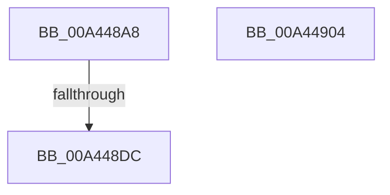

# MiSelectRelocationStartHint

- RVA: `0x00A448A8`–`0x00A44905` (길이 `93` bytes)
- VA: `0x0000000140A448A8`
- 실행 섹션: `PAGE`
- PDB 이름 있음: `예`; PDB Function 태그: `예`
- unwind 정보 RVA: `0x00075C18`
- 디코드: `29`개 명령, `93/93` bytes 표시
- 미해석 바이트: `0` (있으면 어셈블리에 `.byte`로 보존)

> 이 문서는 커널 이미지의 기계어와 PDB 기호를 분석해 생성했습니다. 4번과 5번은 함수 원형과 자료형을 바이너리 사용 방식에서 추정한 C 해석이며 원본 소스 복구 결과는 아닙니다.

## 1. Dependencies

- 직접 호출 지점: **1**; 고유 호출 대상: **1**
- 직접 호출자로 확인된 함수: **1**
- RIP 상대 이미지 참조: **0**

### Outgoing calls
- `0x00A448E2` → [RtlFindClearBitsEx](../../text/3F/RtlFindClearBitsEx_function_003FAF30.md) (function, `0x003FAF30`)

### Direct callers
- [sub_00B2B81E](../B2/Unknown_function_00B2B81E.md) at `0x00B2B831`

### Static image references
- 디코드된 RIP-relative 메모리 참조가 없습니다.

## 2. Other-region calls and transfers

- 다른 실행 섹션으로 향하는 call: **1**
  - `0x00A448E2` → [RtlFindClearBitsEx](../../text/3F/RtlFindClearBitsEx_function_003FAF30.md) (`PAGE` → `.text`)
- call이 아닌 외부 분기/꼬리 이동: **1**
  - `0x00A448D6` → [sub_00B3ADEC](../B3/Unknown_function_00B3ADEC.md) (`tail-transfer`)

## 3. Assembly (complete function range)

```asm
00A448A8  48 89 5C 24 08                  mov qword ptr [rsp + 8], rbx
00A448AD  48 89 6C 24 10                  mov qword ptr [rsp + 0x10], rbp
00A448B2  48 89 74 24 18                  mov qword ptr [rsp + 0x18], rsi
00A448B7  57                              push rdi
00A448B8  41 54                           push r12
00A448BA  41 55                           push r13
00A448BC  41 56                           push r14
00A448BE  41 57                           push r15
00A448C0  48 83 EC 20                     sub rsp, 0x20
00A448C4  48 83 79 08 00                  cmp qword ptr [rcx + 8], 0
00A448C9  45 8B E1                        mov r12d, r9d
00A448CC  49 8B E8                        mov rbp, r8
00A448CF  44 0F B7 FA                     movzx r15d, dx
00A448D3  4C 8B F1                        mov r14, rcx
00A448D6  0F 85 10 65 0F 00               jne 0x140b3adec
00A448DC  48 8B 09                        mov rcx, qword ptr [rcx]
00A448DF  41 8B D7                        mov edx, r15d
00A448E2  E8 49 66 9B FF                  call 0x1403faf30
00A448E7  48 8B 5C 24 50                  mov rbx, qword ptr [rsp + 0x50]
00A448EC  48 8B 6C 24 58                  mov rbp, qword ptr [rsp + 0x58]
00A448F1  48 8B 74 24 60                  mov rsi, qword ptr [rsp + 0x60]
00A448F6  48 83 C4 20                     add rsp, 0x20
00A448FA  41 5F                           pop r15
00A448FC  41 5E                           pop r14
00A448FE  41 5D                           pop r13
00A44900  41 5C                           pop r12
00A44902  5F                              pop rdi
00A44903  C3                              ret
00A44904  CC                              int3
```

## 4. C-style interpretation (structured pseudocode)

```c
__int64 __fastcall MiSelectRelocationStartHint(__int64 a1, unsigned __int16 a2, __int64 a3, int a4)
{
    __int64 result;
    __int64 v_rsp;
    unsigned __int64 v_stack_p10;
    unsigned __int64 v_stack_p18;
    unsigned __int64 v_stack_p8;

    v_stack_p8 = v_rbx;
    v_stack_p10 = v_rbp;
    v_stack_p18 = v_rsi;
    v_rsp = (v_rsp) - (32);
    result = RtlFindClearBitsEx(*(unsigned __int64 *)(a1), (unsigned int)(a2), a3, a4);
    v_rsp = (v_rsp) + (32);
    return result;
}
```

## 5. (Beta) C Style

```c
int64_t MiSelectRelocationStartHint(void *Arg1, uint16_t Arg2, int64_t Arg3, int32_t Arg4)
{
    uint8_t *arg1 = (uint8_t *)Arg1;

    int64_t result;
    int64_t local_rsp;
    uint64_t v_stack_p10;
    uint64_t v_stack_p18;
    uint64_t v_stack_p8;

    v_stack_p8 = local_rbx;
    v_stack_p10 = local_rbp;
    v_stack_p18 = local_rsi;
    local_rsp = (local_rsp) - (32);
    result = RtlFindClearBitsEx(*(uint64_t *)(arg1), (uint32_t)(Arg2), Arg3, Arg4);
    local_rsp = (local_rsp) + (32);
    return result;
}
```

### 관측된 메모리 오프셋

구조체 형식이 확인되지 않은 접근은 인자 기준의 오프셋으로만 기록했습니다.

| 기준 인자 | 오프셋 표현 | 폭 (bit) | 접근 |
|---|---:|---:|---|
| `Arg1` | `+ 0x0` | `64` | `R` |
| `Arg1` | `+ 0x8` | `64` | `R` |

## 6. Execution-region graph

[열기: 2D/3D 그래프와 함수 탐색 컨트롤 패널](../../../control-panel.html?section=page&rva=0x00A448A8&view=graph)

- 2D 그래프는 위에서 아래로 흐르고, 3D 그래프는 빈 공간을 드래그해 회전합니다. Shift+드래그는 이동, 휠은 확대·축소, 함수 노드 선택은 대상 보고서 이동입니다.

### Static fallback


