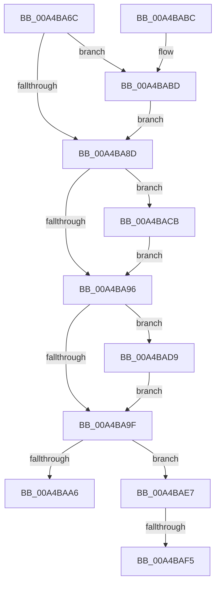

# MiUnlockDriverPages

- RVA: `0x00A4BA6C`–`0x00A4BB0F` (길이 `163` bytes)
- VA: `0x0000000140A4BA6C`
- 실행 섹션: `PAGE`
- PDB 이름 있음: `예`; PDB Function 태그: `예`
- unwind 정보 RVA: `0x000B0250`
- 디코드: `47`개 명령, `163/163` bytes 표시
- 미해석 바이트: `0` (있으면 어셈블리에 `.byte`로 보존)

> 이 문서는 커널 이미지의 기계어와 PDB 기호를 분석해 생성했습니다. 4번과 5번은 함수 원형과 자료형을 바이너리 사용 방식에서 추정한 C 해석이며 원본 소스 복구 결과는 아닙니다.

## 1. Dependencies

- 직접 호출 지점: **4**; 고유 호출 대상: **2**
- 직접 호출자로 확인된 함수: **6**
- RIP 상대 이미지 참조: **0**

### Outgoing calls
- `0x00A4BABF` → [ExFreePoolWithTag](../../poolcode/B8/ExFreePoolWithTag_function_00B82870.md) (function, `0x00B82870`)
- `0x00A4BACD` → [ExFreePoolWithTag](../../poolcode/B8/ExFreePoolWithTag_function_00B82870.md) (function, `0x00B82870`)
- `0x00A4BADB` → [ExFreePoolWithTag](../../poolcode/B8/ExFreePoolWithTag_function_00B82870.md) (function, `0x00B82870`)
- `0x00A4BB04` → [KeReservePrivilegedPages](../../text/4B/KeReservePrivilegedPages_function_004BEAE8.md) (function, `0x004BEAE8`)

### Direct callers
- [MiUnlockAndFreeDvPatchImage](../../text/68/MiUnlockAndFreeDvPatchImage_function_00682A78.md) at `0x00682AA9`
- [MmWriteSystemImageTracepoint](../../text/68/MmWriteSystemImageTracepoint_function_00684150.md) at `0x0068424A`
- [MmWriteSystemImageTracepoint](../../text/68/MmWriteSystemImageTracepoint_function_00684150.md) at `0x0068432F`
- [MiUnlockEntireDriver](../80/MiUnlockEntireDriver_function_00801780.md) at `0x008017D8`
- [MiApplyDriverHotPatch](../80/MiApplyDriverHotPatch_function_008018EC.md) at `0x00801DE4`
- [MiApplyDriverHotPatch](../80/MiApplyDriverHotPatch_function_008018EC.md) at `0x00801DED`
- [MiCompleteSecureDriverLoad](MiCompleteSecureDriverLoad_function_00A4B920.md) at `0x00A4B981`
- [MmReapplyBootPatchImports](../../init/C6/MmReapplyBootPatchImports_function_00C67768.md) at `0x00C678A8`
- [MmReapplyBootPatchImports](../../init/C6/MmReapplyBootPatchImports_function_00C67768.md) at `0x00C678B1`

### Static image references
- 디코드된 RIP-relative 메모리 참조가 없습니다.

## 2. Other-region calls and transfers

- 다른 실행 섹션으로 향하는 call: **4**
  - `0x00A4BABF` → [ExFreePoolWithTag](../../poolcode/B8/ExFreePoolWithTag_function_00B82870.md) (`PAGE` → `POOLCODE`)
  - `0x00A4BACD` → [ExFreePoolWithTag](../../poolcode/B8/ExFreePoolWithTag_function_00B82870.md) (`PAGE` → `POOLCODE`)
  - `0x00A4BADB` → [ExFreePoolWithTag](../../poolcode/B8/ExFreePoolWithTag_function_00B82870.md) (`PAGE` → `POOLCODE`)
  - `0x00A4BB04` → [KeReservePrivilegedPages](../../text/4B/KeReservePrivilegedPages_function_004BEAE8.md) (`PAGE` → `.text`)
- call이 아닌 외부 분기/꼬리 이동: **2**
  - `0x00A4BAEF` → [sub_00B3B822](../B3/Unknown_function_00B3B822.md) (`tail-transfer`)
  - `0x00A4BB0A` → [sub_00B3B822](../B3/Unknown_function_00B3B822.md) (`tail-transfer`)

## 3. Assembly (complete function range)

```asm
00A4BA6C  48 89 5C 24 08                  mov qword ptr [rsp + 8], rbx
00A4BA71  48 89 74 24 10                  mov qword ptr [rsp + 0x10], rsi
00A4BA76  48 89 7C 24 18                  mov qword ptr [rsp + 0x18], rdi
00A4BA7B  41 56                           push r14
00A4BA7D  48 83 EC 20                     sub rsp, 0x20
00A4BA81  48 8B D9                        mov rbx, rcx
00A4BA84  48 8B 49 38                     mov rcx, qword ptr [rcx + 0x38]
00A4BA88  48 85 C9                        test rcx, rcx
00A4BA8B  75 30                           jne 0x140a4babd
00A4BA8D  48 8B 4B 48                     mov rcx, qword ptr [rbx + 0x48]
00A4BA91  48 85 C9                        test rcx, rcx
00A4BA94  75 35                           jne 0x140a4bacb
00A4BA96  48 8B 4B 58                     mov rcx, qword ptr [rbx + 0x58]
00A4BA9A  48 85 C9                        test rcx, rcx
00A4BA9D  75 3A                           jne 0x140a4bad9
00A4BA9F  48 83 7B 28 00                  cmp qword ptr [rbx + 0x28], 0
00A4BAA4  75 41                           jne 0x140a4bae7
00A4BAA6  48 8B 5C 24 30                  mov rbx, qword ptr [rsp + 0x30]
00A4BAAB  48 8B 74 24 38                  mov rsi, qword ptr [rsp + 0x38]
00A4BAB0  48 8B 7C 24 40                  mov rdi, qword ptr [rsp + 0x40]
00A4BAB5  48 83 C4 20                     add rsp, 0x20
00A4BAB9  41 5E                           pop r14
00A4BABB  C3                              ret
00A4BABC  CC                              int3
00A4BABD  33 D2                           xor edx, edx
00A4BABF  E8 AC 6D 13 00                  call 0x140b82870
00A4BAC4  48 83 63 38 00                  and qword ptr [rbx + 0x38], 0
00A4BAC9  EB C2                           jmp 0x140a4ba8d
00A4BACB  33 D2                           xor edx, edx
00A4BACD  E8 9E 6D 13 00                  call 0x140b82870
00A4BAD2  48 83 63 48 00                  and qword ptr [rbx + 0x48], 0
00A4BAD7  EB BD                           jmp 0x140a4ba96
00A4BAD9  33 D2                           xor edx, edx
00A4BADB  E8 90 6D 13 00                  call 0x140b82870
00A4BAE0  48 83 63 58 00                  and qword ptr [rbx + 0x58], 0
00A4BAE5  EB B8                           jmp 0x140a4ba9f
00A4BAE7  8B 43 60                        mov eax, dword ptr [rbx + 0x60]
00A4BAEA  48 8B 3B                        mov rdi, qword ptr [rbx]
00A4BAED  A8 01                           test al, 1
00A4BAEF  0F 84 2D FD 0E 00               je 0x140b3b822
00A4BAF5  48 8B 57 30                     mov rdx, qword ptr [rdi + 0x30]
00A4BAF9  41 B9 02 00 00 00               mov r9d, 2
00A4BAFF  45 33 C0                        xor r8d, r8d
00A4BB02  33 C9                           xor ecx, ecx
00A4BB04  E8 DF 2F A7 FF                  call 0x1404beae8
00A4BB09  90                              nop
00A4BB0A  E9 13 FD 0E 00                  jmp 0x140b3b822
```

## 4. C-style interpretation (structured pseudocode)

```c
__int64 __fastcall MiUnlockDriverPages(__int64 a1, int a2, int a3)
{
    __int64 result;
    __int64 v_rsp;
    unsigned __int64 v_stack_p10;
    unsigned __int64 v_stack_p18;
    unsigned __int64 v_stack_p8;

    v_stack_p8 = v_rbx;
    v_stack_p10 = v_rsi;
    v_stack_p18 = v_rdi;
    v_rsp = (v_rsp) - (32);
    if (*(unsigned __int64 *)(a1 + 56) != 0) goto loc_00A4BABD;
loc_00A4BA8D:
    if (*(unsigned __int64 *)(a1 + 72) != 0) goto loc_00A4BACB;
loc_00A4BA96:
    if (*(unsigned __int64 *)(a1 + 88) != 0) goto loc_00A4BAD9;
loc_00A4BA9F:
    if ((*(unsigned __int64 *)(a1 + 40)) != 0) goto loc_00A4BAE7;
    v_rsp = (v_rsp) + (32);
    return result;
loc_00A4BABD:
    a2 = 0;
    result = ExFreePoolWithTag(*(unsigned __int64 *)(a1 + 88), a2, a3, a4);
    goto loc_00A4BA8D;
loc_00A4BACB:
    a2 = 0;
    result = ExFreePoolWithTag(*(unsigned __int64 *)(a1 + 88), a2, a3, a4);
    goto loc_00A4BA96;
loc_00A4BAD9:
    a2 = 0;
    result = ExFreePoolWithTag(*(unsigned __int64 *)(a1 + 88), a2, a3, a4);
    goto loc_00A4BA9F;
loc_00A4BAE7:
    a3 = 0;
    a1 = 0;
    result = KeReservePrivilegedPages(a1, *(unsigned __int64 *)(*(unsigned __int64 *)(v_stack_p8) + 48), a3, 2);
}
```

## 5. (Beta) C Style

```c
int64_t MiUnlockDriverPages(void *Arg1, int32_t Arg2, int32_t Arg3)
{
    uint8_t *arg1 = (uint8_t *)Arg1;

    int64_t result;
    int64_t local_rsp;
    uint64_t v_stack_p10;
    uint64_t v_stack_p18;
    uint64_t v_stack_p8;

    v_stack_p8 = local_rbx;
    v_stack_p10 = local_rsi;
    v_stack_p18 = local_rdi;
    local_rsp = (local_rsp) - (32);
    if (*(uint64_t *)(arg1 + 0x38) != 0) goto loc_00A4BABD;
loc_00A4BA8D:
    if (*(uint64_t *)(arg1 + 0x48) != 0) goto loc_00A4BACB;
loc_00A4BA96:
    if (*(uint64_t *)(arg1 + 0x58) != 0) goto loc_00A4BAD9;
loc_00A4BA9F:
    if ((*(uint64_t *)(arg1 + 0x28)) != 0) goto loc_00A4BAE7;
    local_rsp = (local_rsp) + (32);
    return result;
loc_00A4BABD:
    Arg2 = 0;
    result = ExFreePoolWithTag(*(uint64_t *)(arg1 + 0x58), Arg2, Arg3, a4);
    goto loc_00A4BA8D;
loc_00A4BACB:
    Arg2 = 0;
    result = ExFreePoolWithTag(*(uint64_t *)(arg1 + 0x58), Arg2, Arg3, a4);
    goto loc_00A4BA96;
loc_00A4BAD9:
    Arg2 = 0;
    result = ExFreePoolWithTag(*(uint64_t *)(arg1 + 0x58), Arg2, Arg3, a4);
    goto loc_00A4BA9F;
loc_00A4BAE7:
    Arg3 = 0;
    Arg1 = 0;
    result = KeReservePrivilegedPages(Arg1, *(uint64_t *)(*(uint64_t *)(v_stack_p8) + 0x30), Arg3, 2);
}
```

### 관측된 메모리 오프셋

구조체 형식이 확인되지 않은 접근은 인자 기준의 오프셋으로만 기록했습니다.

| 기준 인자 | 오프셋 표현 | 폭 (bit) | 접근 |
|---|---:|---:|---|
| `Arg1` | `+ 0x0` | `64` | `R` |
| `Arg1` | `+ 0x28` | `64` | `R` |
| `Arg1` | `+ 0x38` | `64` | `R` |
| `Arg1` | `+ 0x38` | `64` | `R/W` |
| `Arg1` | `+ 0x48` | `64` | `R` |
| `Arg1` | `+ 0x48` | `64` | `R/W` |
| `Arg1` | `+ 0x58` | `64` | `R` |
| `Arg1` | `+ 0x58` | `64` | `R/W` |
| `Arg1` | `+ 0x60` | `32` | `R` |

## 6. Execution-region graph

[열기: 2D/3D 그래프와 함수 탐색 컨트롤 패널](../../../control-panel.html?section=page&rva=0x00A4BA6C&view=graph)

- 2D 그래프는 위에서 아래로 흐르고, 3D 그래프는 빈 공간을 드래그해 회전합니다. Shift+드래그는 이동, 휠은 확대·축소, 함수 노드 선택은 대상 보고서 이동입니다.

### Static fallback


