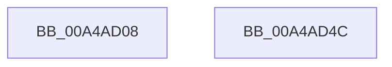

# MmFreeDriverInitialization

- RVA: `0x00A4AD08`–`0x00A4AD4D` (길이 `69` bytes)
- VA: `0x0000000140A4AD08`
- 실행 섹션: `PAGE`
- PDB 이름 있음: `예`; PDB Function 태그: `아니요`
- unwind 정보 RVA: `0x0005CAAC`
- 디코드: `21`개 명령, `69/69` bytes 표시
- 미해석 바이트: `0` (있으면 어셈블리에 `.byte`로 보존)

> 이 문서는 커널 이미지의 기계어와 PDB 기호를 분석해 생성했습니다. 4번과 5번은 함수 원형과 자료형을 바이너리 사용 방식에서 추정한 C 해석이며 원본 소스 복구 결과는 아닙니다.

## 1. Dependencies

- 직접 호출 지점: **5**; 고유 호출 대상: **5**
- 직접 호출자로 확인된 함수: **1**
- RIP 상대 이미지 참조: **0**

### Outgoing calls
- `0x00A4AD15` → [MmAcquireLoadLockShared](../../text/2A/MmAcquireLoadLockShared_function_002A389C.md) (function, `0x002A389C`)
- `0x00A4AD22` → [MiLockLoaderEntry](../../text/2A/MiLockLoaderEntry_function_002A3EE0.md) (function, `0x002A3EE0`)
- `0x00A4AD2A` → [MiFreeDriverInitialization](MiFreeDriverInitialization_function_00A4B120.md) (function, `0x00A4B120`)
- `0x00A4AD34` → [MiUnlockLoaderEntry](../../text/2A/MiUnlockLoaderEntry_function_002A3E28.md) (function, `0x002A3E28`)
- `0x00A4AD3C` → [MmReleaseLoadLockShared](../../text/2A/MmReleaseLoadLockShared_function_002A3FB0.md) (function, `0x002A3FB0`)

### Direct callers
- [IopLoadDriver](../99/IopLoadDriver_function_00997B54.md) at `0x0099836A`

### Static image references
- 디코드된 RIP-relative 메모리 참조가 없습니다.

## 2. Other-region calls and transfers

- 다른 실행 섹션으로 향하는 call: **4**
  - `0x00A4AD15` → [MmAcquireLoadLockShared](../../text/2A/MmAcquireLoadLockShared_function_002A389C.md) (`PAGE` → `.text`)
  - `0x00A4AD22` → [MiLockLoaderEntry](../../text/2A/MiLockLoaderEntry_function_002A3EE0.md) (`PAGE` → `.text`)
  - `0x00A4AD34` → [MiUnlockLoaderEntry](../../text/2A/MiUnlockLoaderEntry_function_002A3E28.md) (`PAGE` → `.text`)
  - `0x00A4AD3C` → [MmReleaseLoadLockShared](../../text/2A/MmReleaseLoadLockShared_function_002A3FB0.md) (`PAGE` → `.text`)
- 별도 외부 분기/꼬리 이동을 확인하지 못했습니다.

## 3. Assembly (complete function range)

```asm
00A4AD08  48 89 5C 24 08                  mov qword ptr [rsp + 8], rbx
00A4AD0D  57                              push rdi
00A4AD0E  48 83 EC 20                     sub rsp, 0x20
00A4AD12  48 8B F9                        mov rdi, rcx
00A4AD15  E8 82 8B 85 FF                  call 0x1402a389c
00A4AD1A  33 D2                           xor edx, edx
00A4AD1C  48 8B CF                        mov rcx, rdi
00A4AD1F  48 8B D8                        mov rbx, rax
00A4AD22  E8 B9 91 85 FF                  call 0x1402a3ee0
00A4AD27  48 8B CF                        mov rcx, rdi
00A4AD2A  E8 F1 03 00 00                  call 0x140a4b120
00A4AD2F  33 D2                           xor edx, edx
00A4AD31  48 8B CF                        mov rcx, rdi
00A4AD34  E8 EF 90 85 FF                  call 0x1402a3e28
00A4AD39  48 8B CB                        mov rcx, rbx
00A4AD3C  E8 6F 92 85 FF                  call 0x1402a3fb0
00A4AD41  48 8B 5C 24 30                  mov rbx, qword ptr [rsp + 0x30]
00A4AD46  48 83 C4 20                     add rsp, 0x20
00A4AD4A  5F                              pop rdi
00A4AD4B  C3                              ret
00A4AD4C  CC                              int3
```

## 4. C-style interpretation (structured pseudocode)

```c
__int64 __fastcall MmFreeDriverInitialization(__int64 a1, int a2)
{
    __int64 result;
    __int64 v_rsp;
    unsigned __int64 v_stack_p8;

    v_stack_p8 = v_rbx;
    v_rsp = (v_rsp) - (32);
    result = MmAcquireLoadLockShared(a1, a2, a3, a4);
    a2 = 0;
    result = MiLockLoaderEntry(a1, a2, a3, a4);
    result = MiFreeDriverInitialization(a1, a2, a3, a4);
    a2 = 0;
    result = MiUnlockLoaderEntry(a1, a2, a3, a4);
    result = MmReleaseLoadLockShared(result, a2, a3, a4);
    v_rsp = (v_rsp) + (32);
    return result;
}
```

## 5. (Beta) C Style

```c
int64_t MmFreeDriverInitialization(int64_t Arg1, int32_t Arg2)
{
    int64_t result;
    int64_t local_rsp;
    uint64_t v_stack_p8;

    v_stack_p8 = local_rbx;
    local_rsp = (local_rsp) - (32);
    result = MmAcquireLoadLockShared(Arg1, Arg2, a3, a4);
    Arg2 = 0;
    result = MiLockLoaderEntry(Arg1, Arg2, a3, a4);
    result = MiFreeDriverInitialization(Arg1, Arg2, a3, a4);
    Arg2 = 0;
    result = MiUnlockLoaderEntry(Arg1, Arg2, a3, a4);
    result = MmReleaseLoadLockShared(result, Arg2, a3, a4);
    local_rsp = (local_rsp) + (32);
    return result;
}
```

## 6. Execution-region graph

[열기: 2D/3D 그래프와 함수 탐색 컨트롤 패널](../../../control-panel.html?section=page&rva=0x00A4AD08&view=graph)

- 2D 그래프는 위에서 아래로 흐르고, 3D 그래프는 빈 공간을 드래그해 회전합니다. Shift+드래그는 이동, 휠은 확대·축소, 함수 노드 선택은 대상 보고서 이동입니다.

### Static fallback


