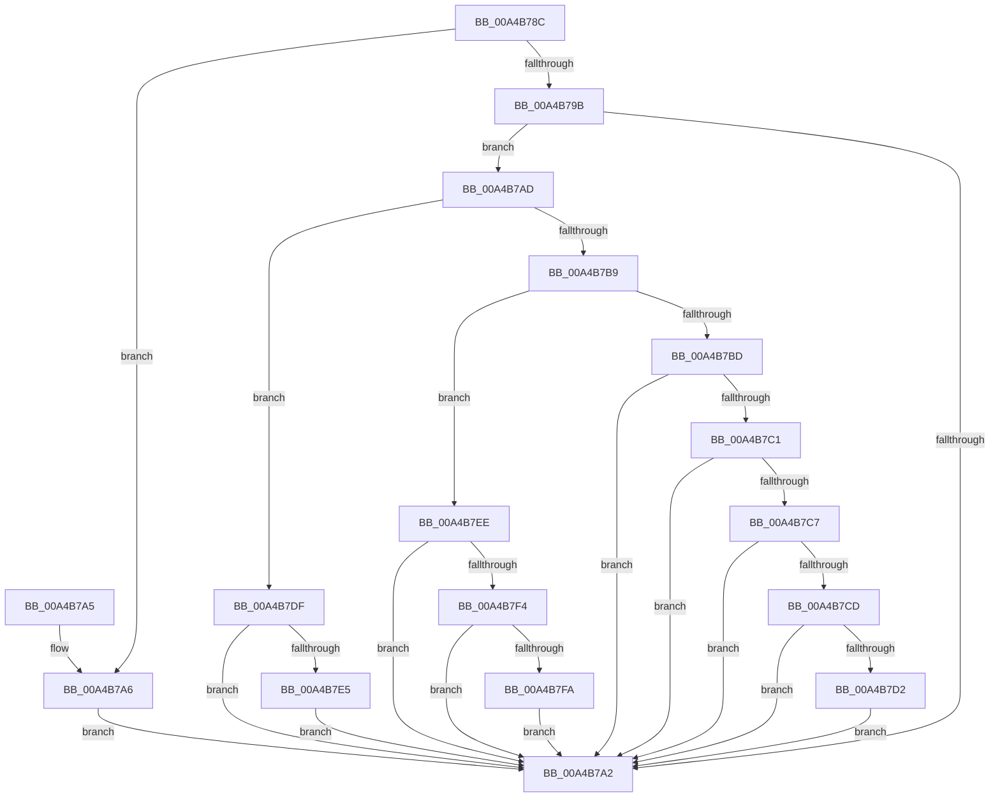

# MmImageSectionPagable

- RVA: `0x00A4B78C`–`0x00A4B806` (길이 `122` bytes)
- VA: `0x0000000140A4B78C`
- 실행 섹션: `PAGE`
- PDB 이름 있음: `예`; PDB Function 태그: `아니요`
- unwind 정보 RVA: `0x000DB714`
- 디코드: `41`개 명령, `122/122` bytes 표시
- 미해석 바이트: `0` (있으면 어셈블리에 `.byte`로 보존)

> 이 문서는 커널 이미지의 기계어와 PDB 기호를 분석해 생성했습니다. 4번과 5번은 함수 원형과 자료형을 바이너리 사용 방식에서 추정한 C 해석이며 원본 소스 복구 결과는 아닙니다.

## 1. Dependencies

- 직접 호출 지점: **0**; 고유 호출 대상: **0**
- 직접 호출자로 확인된 함수: **5**
- RIP 상대 이미지 참조: **3**

### Outgoing calls
- 직접 디코드된 call 명령이 없습니다.

### Direct callers
- [MmResetDriverPaging](MmResetDriverPaging_function_00A4ADB0.md) at `0x00A4AE5C`
- [MiSnapDriverRange](MiSnapDriverRange_function_00A4B328.md) at `0x00A4B50E`
- [MiSnapDriverRange](MiSnapDriverRange_function_00A4B328.md) at `0x00A4B6C7`
- [sub_00BEFF8C](../../init/BE/Unknown_function_00BEFF8C.md) at `0x00BF0505`
- [sub_00BEFF8C](../../init/BE/Unknown_function_00BEFF8C.md) at `0x00BF075C`
- [sub_00BF16D0](../../init/BF/Unknown_function_00BF16D0.md) at `0x00BF812D`
- [MiLockPagableSections](../../init/C6/MiLockPagableSections_function_00C6C35C.md) at `0x00C6C3BB`

### Static image references
- `0x00A4B7D2` → RVA `0x00EEFB58` (`.data`; read)
- `0x00A4B7E5` → RVA `0x00F55CA2` (`.data`; read)
- `0x00A4B7FA` → RVA `0x00FC6A88` (`ALMOSTRO`; read)

## 2. Other-region calls and transfers

- 다른 실행 섹션으로 향하는 call: **0**
- 별도 외부 분기/꼬리 이동을 확인하지 못했습니다.

## 3. Assembly (complete function range)

```asm
00A4B78C  8B 01                           mov eax, dword ptr [rcx]
00A4B78E  45 33 C0                        xor r8d, r8d
00A4B791  41 8B D0                        mov edx, r8d
00A4B794  3D 2E 65 64 61                  cmp eax, 0x6164652e
00A4B799  74 0B                           je 0x140a4b7a6
00A4B79B  3D 50 41 47 45                  cmp eax, 0x45474150
00A4B7A0  74 0B                           je 0x140a4b7ad
00A4B7A2  8B C2                           mov eax, edx
00A4B7A4  C3                              ret
00A4B7A5  CC                              int3
00A4B7A6  BA 01 00 00 00                  mov edx, 1
00A4B7AB  EB F5                           jmp 0x140a4b7a2
00A4B7AD  8A 41 04                        mov al, byte ptr [rcx + 4]
00A4B7B0  BA 01 00 00 00                  mov edx, 1
00A4B7B5  3C 4B                           cmp al, 0x4b
00A4B7B7  74 26                           je 0x140a4b7df
00A4B7B9  3C 56                           cmp al, 0x56
00A4B7BB  74 31                           je 0x140a4b7ee
00A4B7BD  3C 43                           cmp al, 0x43
00A4B7BF  75 E1                           jne 0x140a4b7a2
00A4B7C1  80 79 05 4D                     cmp byte ptr [rcx + 5], 0x4d
00A4B7C5  75 DB                           jne 0x140a4b7a2
00A4B7C7  80 79 06 52                     cmp byte ptr [rcx + 6], 0x52
00A4B7CB  75 D5                           jne 0x140a4b7a2
00A4B7CD  38 41 07                        cmp byte ptr [rcx + 7], al
00A4B7D0  75 D0                           jne 0x140a4b7a2
00A4B7D2  44 39 05 7F 43 4A 00            cmp dword ptr [rip + 0x4a437f], r8d
00A4B7D9  41 0F 45 D0                     cmovne edx, r8d
00A4B7DD  EB C3                           jmp 0x140a4b7a2
00A4B7DF  80 79 05 44                     cmp byte ptr [rcx + 5], 0x44
00A4B7E3  75 BD                           jne 0x140a4b7a2
00A4B7E5  0F B6 15 B6 A4 50 00            movzx edx, byte ptr [rip + 0x50a4b6]
00A4B7EC  EB B4                           jmp 0x140a4b7a2
00A4B7EE  80 79 05 52                     cmp byte ptr [rcx + 5], 0x52
00A4B7F2  75 AE                           jne 0x140a4b7a2
00A4B7F4  80 79 06 46                     cmp byte ptr [rcx + 6], 0x46
00A4B7F8  75 A8                           jne 0x140a4b7a2
00A4B7FA  8B 05 88 B2 57 00               mov eax, dword ptr [rip + 0x57b288]
00A4B800  F7 D0                           not eax
00A4B802  23 D0                           and edx, eax
00A4B804  EB 9C                           jmp 0x140a4b7a2
```

## 4. C-style interpretation (structured pseudocode)

```c
__int64 __fastcall MmImageSectionPagable(__int64 a1, __int64 a2, int a3)
{
    __int64 result;

    a3 = 0;
    if (((unsigned int)((unsigned int)(*(unsigned int *)(a1)))) == 0x6164652EULL) goto loc_00A4B7A6;
    if (((unsigned int)((unsigned int)(*(unsigned int *)(a1)))) == 0x45474150ULL) goto loc_00A4B7AD;
loc_00A4B7A2:
    return 0;
loc_00A4B7A6:
    goto loc_00A4B7A2;
loc_00A4B7AD:
    if (((unsigned __int8)(*(unsigned __int8 *)(a1 + 4))) == 75) goto loc_00A4B7DF;
    if (((unsigned __int8)(*(unsigned __int8 *)(a1 + 4))) == 86) goto loc_00A4B7EE;
    if (((unsigned __int8)(*(unsigned __int8 *)(a1 + 4))) != 67) goto loc_00A4B7A2;
    if ((*(unsigned __int8 *)(a1 + 5)) != 77) goto loc_00A4B7A2;
    if ((*(unsigned __int8 *)(a1 + 6)) != 82) goto loc_00A4B7A2;
    if ((*(unsigned __int8 *)(a1 + 7)) != ((unsigned __int8)(*(unsigned __int8 *)(a1 + 4)))) goto loc_00A4B7A2;
    a2 = 1;
    if ((*(unsigned int *)(v_rip + 4866943)) != 0) { a2 = 0; }
    goto loc_00A4B7A2;
loc_00A4B7DF:
    if ((*(unsigned __int8 *)(a1 + 5)) != 68) goto loc_00A4B7A2;
    goto loc_00A4B7A2;
loc_00A4B7EE:
    if ((*(unsigned __int8 *)(a1 + 5)) != 82) goto loc_00A4B7A2;
    if ((*(unsigned __int8 *)(a1 + 6)) != 70) goto loc_00A4B7A2;
    result = (unsigned int)(~((unsigned int)(*(unsigned int *)(v_rip + 5747336))));
    a2 = (unsigned int)((*(unsigned __int8 *)(v_rip + 5285046)) & ((unsigned int)(result)));
    goto loc_00A4B7A2;
}
```

## 5. (Beta) C Style

```c
int64_t MmImageSectionPagable(void *Arg1, int64_t Arg2, int32_t Arg3)
{
    uint8_t *arg1 = (uint8_t *)Arg1;

    int64_t result;

    Arg3 = 0;
    if (((uint32_t)((uint32_t)(*(uint32_t *)(arg1)))) == 0x6164652EULL) goto loc_00A4B7A6;
    if (((uint32_t)((uint32_t)(*(uint32_t *)(arg1)))) == 0x45474150ULL) goto loc_00A4B7AD;
loc_00A4B7A2:
    return 0;
loc_00A4B7A6:
    goto loc_00A4B7A2;
loc_00A4B7AD:
    if (((uint8_t)(*(uint8_t *)(arg1 + 0x4))) == 75) goto loc_00A4B7DF;
    if (((uint8_t)(*(uint8_t *)(arg1 + 0x4))) == 86) goto loc_00A4B7EE;
    if (((uint8_t)(*(uint8_t *)(arg1 + 0x4))) != 67) goto loc_00A4B7A2;
    if ((*(uint8_t *)(arg1 + 0x5)) != 77) goto loc_00A4B7A2;
    if ((*(uint8_t *)(arg1 + 0x6)) != 82) goto loc_00A4B7A2;
    if ((*(uint8_t *)(arg1 + 0x7)) != ((uint8_t)(*(uint8_t *)(arg1 + 0x4)))) goto loc_00A4B7A2;
    Arg2 = 1;
    if ((*(uint32_t *)(v_rip + 0x4A437F)) != 0) { Arg2 = 0; }
    goto loc_00A4B7A2;
loc_00A4B7DF:
    if ((*(uint8_t *)(arg1 + 0x5)) != 68) goto loc_00A4B7A2;
    goto loc_00A4B7A2;
loc_00A4B7EE:
    if ((*(uint8_t *)(arg1 + 0x5)) != 82) goto loc_00A4B7A2;
    if ((*(uint8_t *)(arg1 + 0x6)) != 70) goto loc_00A4B7A2;
    result = (uint32_t)(~((uint32_t)(*(uint32_t *)(v_rip + 0x57B288))));
    Arg2 = (uint32_t)((*(uint8_t *)(v_rip + 0x50A4B6)) & ((uint32_t)(result)));
    goto loc_00A4B7A2;
}
```

### 관측된 메모리 오프셋

구조체 형식이 확인되지 않은 접근은 인자 기준의 오프셋으로만 기록했습니다.

| 기준 인자 | 오프셋 표현 | 폭 (bit) | 접근 |
|---|---:|---:|---|
| `Arg1` | `+ 0x0` | `32` | `R` |
| `Arg1` | `+ 0x4` | `8` | `R` |
| `Arg1` | `+ 0x5` | `8` | `R` |
| `Arg1` | `+ 0x6` | `8` | `R` |
| `Arg1` | `+ 0x7` | `8` | `R` |

## 6. Execution-region graph

[열기: 2D/3D 그래프와 함수 탐색 컨트롤 패널](../../../control-panel.html?section=page&rva=0x00A4B78C&view=graph)

- 2D 그래프는 위에서 아래로 흐르고, 3D 그래프는 빈 공간을 드래그해 회전합니다. Shift+드래그는 이동, 휠은 확대·축소, 함수 노드 선택은 대상 보고서 이동입니다.

### Static fallback


