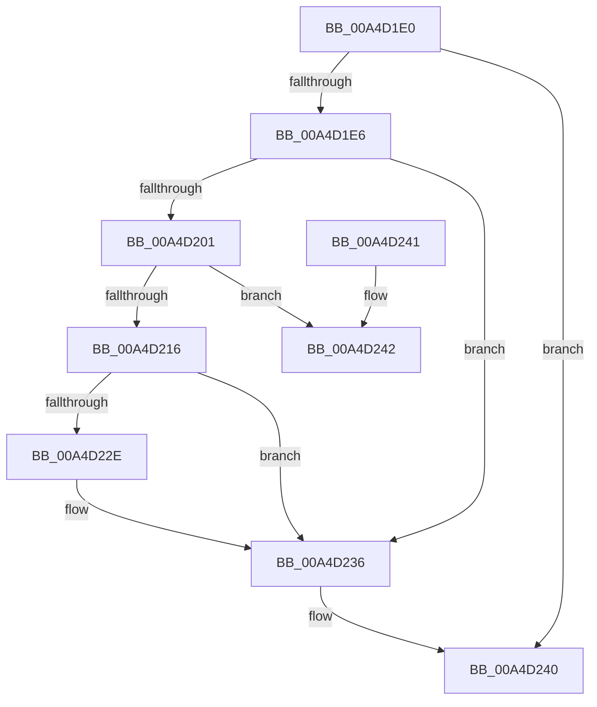

# MmLockPagableSectionByHandle

- RVA: `0x00A4D1E0`–`0x00A4D260` (길이 `128` bytes)
- VA: `0x0000000140A4D1E0`
- 실행 섹션: `PAGE`
- PDB 이름 있음: `예`; PDB Function 태그: `아니요`
- unwind 정보 RVA: `0x000B054C`
- 디코드: `36`개 명령, `128/128` bytes 표시
- 미해석 바이트: `0` (있으면 어셈블리에 `.byte`로 보존)

> 이 문서는 커널 이미지의 기계어와 PDB 기호를 분석해 생성했습니다. 4번과 5번은 함수 원형과 자료형을 바이너리 사용 방식에서 추정한 C 해석이며 원본 소스 복구 결과는 아닙니다.

## 1. Dependencies

- 직접 호출 지점: **5**; 고유 호출 대상: **5**
- 직접 호출자로 확인된 함수: **16**
- RIP 상대 이미지 참조: **0**

### Outgoing calls
- `0x00A4D1F8` → [MI_IS_PHYSICAL_ADDRESS](../../text/23/MI_IS_PHYSICAL_ADDRESS_function_0023B3A0.md) (function, `0x0023B3A0`)
- `0x00A4D209` → [MiLockLoadedDataTableEntryIfNecessary](../../text/2A/MiLockLoadedDataTableEntryIfNecessary_function_002A38B4.md) (function, `0x002A38B4`)
- `0x00A4D222` → [MiLockPagableImageSection](../../text/2A/MiLockPagableImageSection_function_002A3A60.md) (function, `0x002A3A60`)
- `0x00A4D231` → [MmUnlockLoadedDataTableEntry](../../text/2A/MmUnlockLoadedDataTableEntry_function_002A3C98.md) (function, `0x002A3C98`)
- `0x00A4D25A` → [KeBugCheckEx](../../text/4F/KeBugCheckEx_function_004FD660.md) (function, `0x004FD660`)

### Direct callers
- [PoRunDownDeviceObject](../../text/26/PoRunDownDeviceObject_function_0026FFFC.md) at `0x00270040`
- [HalpPowerStateCallback](../../text/4B/HalpPowerStateCallback_function_004B8150.md) at `0x004B81C0`
- [HalStartDynamicProcessor](../../text/54/HalStartDynamicProcessor_function_00543300.md) at `0x00543377`
- [IopLiveDumpCapture](../../text/59/IopLiveDumpCapture_function_0059AF88.md) at `0x0059AFFF`
- [DifMmLockPagableSectionByHandleWrapper](../../text/63/DifMmLockPagableSectionByHandleWrapper_function_00635900.md) at `0x006359C6`
- [PnprLockPagesForReplace](../73/PnprLockPagesForReplace_function_0073A150.md) at `0x0073A15B`
- [KiStartDynamicProcessor](../74/KiStartDynamicProcessor_function_007456C8.md) at `0x00745A5A`
- [PopDirectedDripsNotifyAppsAndServices](../75/PopDirectedDripsNotifyAppsAndServices_function_0075792C.md) at `0x00757964`
- [MiApplyImageHotPatch](../80/MiApplyImageHotPatch_function_00802330.md) at `0x00802461`
- [ExpSystemErrorHandler2](../../pagelk/B7/ExpSystemErrorHandler2_function_00B72C30.md) at `0x00B7307F`
- [MiShutdownSystem](../../pagelk/B7/MiShutdownSystem_function_00B73934.md) at `0x00B73A2E`
- [MmDuplicateMemory](../../pagelk/B7/MmDuplicateMemory_function_00B74158.md) at `0x00B74267`
- [ExQuerySystemLockInformation](../../pagelk/B7/ExQuerySystemLockInformation_function_00B793DC.md) at `0x00B79426`
- [IoUnregisterShutdownNotification](../../pagelk/B7/IoUnregisterShutdownNotification_function_00B7CCC0.md) at `0x00B7CCE3`
- [PopTransitionSystemPowerStateEx](../../pagelk/B7/PopTransitionSystemPowerStateEx_function_00B7E8C0.md) at `0x00B7E9E1`
- [KiInitializeMTRR](../../init/C3/KiInitializeMTRR_function_00C39A1C.md) at `0x00C39D3C`

### Static image references
- 디코드된 RIP-relative 메모리 참조가 없습니다.

## 2. Other-region calls and transfers

- 다른 실행 섹션으로 향하는 call: **5**
  - `0x00A4D1F8` → [MI_IS_PHYSICAL_ADDRESS](../../text/23/MI_IS_PHYSICAL_ADDRESS_function_0023B3A0.md) (`PAGE` → `.text`)
  - `0x00A4D209` → [MiLockLoadedDataTableEntryIfNecessary](../../text/2A/MiLockLoadedDataTableEntryIfNecessary_function_002A38B4.md) (`PAGE` → `.text`)
  - `0x00A4D222` → [MiLockPagableImageSection](../../text/2A/MiLockPagableImageSection_function_002A3A60.md) (`PAGE` → `.text`)
  - `0x00A4D231` → [MmUnlockLoadedDataTableEntry](../../text/2A/MmUnlockLoadedDataTableEntry_function_002A3C98.md) (`PAGE` → `.text`)
  - `0x00A4D25A` → [KeBugCheckEx](../../text/4F/KeBugCheckEx_function_004FD660.md) (`PAGE` → `.text`)
- 별도 외부 분기/꼬리 이동을 확인하지 못했습니다.

## 3. Assembly (complete function range)

```asm
00A4D1E0  48 83 F9 01                     cmp rcx, 1
00A4D1E4  74 5A                           je 0x140a4d240
00A4D1E6  48 89 5C 24 10                  mov qword ptr [rsp + 0x10], rbx
00A4D1EB  57                              push rdi
00A4D1EC  48 83 EC 30                     sub rsp, 0x30
00A4D1F0  83 64 24 40 00                  and dword ptr [rsp + 0x40], 0
00A4D1F5  48 8B D9                        mov rbx, rcx
00A4D1F8  E8 A3 E1 7E FF                  call 0x14023b3a0
00A4D1FD  85 C0                           test eax, eax
00A4D1FF  75 35                           jne 0x140a4d236
00A4D201  48 8D 54 24 40                  lea rdx, [rsp + 0x40]
00A4D206  48 8B CB                        mov rcx, rbx
00A4D209  E8 A6 66 85 FF                  call 0x1402a38b4
00A4D20E  48 8B F8                        mov rdi, rax
00A4D211  48 85 C0                        test rax, rax
00A4D214  74 2C                           je 0x140a4d242
00A4D216  41 B8 01 00 00 00               mov r8d, 1
00A4D21C  48 8B D3                        mov rdx, rbx
00A4D21F  48 8B C8                        mov rcx, rax
00A4D222  E8 39 68 85 FF                  call 0x1402a3a60
00A4D227  83 7C 24 40 00                  cmp dword ptr [rsp + 0x40], 0
00A4D22C  74 08                           je 0x140a4d236
00A4D22E  48 8B CF                        mov rcx, rdi
00A4D231  E8 62 6A 85 FF                  call 0x1402a3c98
00A4D236  48 8B 5C 24 48                  mov rbx, qword ptr [rsp + 0x48]
00A4D23B  48 83 C4 30                     add rsp, 0x30
00A4D23F  5F                              pop rdi
00A4D240  C3                              ret
00A4D241  CC                              int3
00A4D242  48 83 64 24 20 00               and qword ptr [rsp + 0x20], 0
00A4D248  41 B9 01 00 00 00               mov r9d, 1
00A4D24E  4C 8B C3                        mov r8, rbx
00A4D251  BA 12 10 00 00                  mov edx, 0x1012
00A4D256  41 8D 49 19                     lea ecx, [r9 + 0x19]
00A4D25A  E8 01 04 AB FF                  call 0x1404fd660
00A4D25F  CC                              int3
```

## 4. C-style interpretation (structured pseudocode)

```c
__int64 __fastcall MmLockPagableSectionByHandle(__int64 a1)
{
    __int64 result;
    __int64 v_rsp;
    unsigned __int64 v_stack_p10;
    unsigned __int64 v_stack_p20;
    unsigned int v_stack_p8;

    if (a1 == 1) goto loc_00A4D240;
    v_stack_p10 = v_rbx;
    v_rsp = (v_rsp) - (48);
    result = MI_IS_PHYSICAL_ADDRESS(a1, a2, a3, a4);
    if ((unsigned int)(result) != 0) goto loc_00A4D236;
    result = MiLockLoadedDataTableEntryIfNecessary(a1, v_stack_p8, a3, a4);
    if (result == 0) goto loc_00A4D242;
    result = MiLockPagableImageSection(result, a1, 1, a4);
    if (v_stack_p8 != 0) {
        a1 = result;
        result = MmUnlockLoadedDataTableEntry(a1, a1, 1, a4);
    }
    v_rsp = (v_rsp) + (48);
loc_00A4D240:
    return result;
loc_00A4D242:
    result = KeBugCheckEx(1 + 25, (unsigned int)(0x1012ULL), v_stack_p10, 1);
    return result;
}
```

## 5. (Beta) C Style

```c
int64_t MmLockPagableSectionByHandle(int64_t Arg1)
{
    int64_t result;
    int64_t local_rsp;
    uint64_t v_stack_p10;
    uint64_t v_stack_p20;
    uint32_t v_stack_p8;

    if (Arg1 == 1) goto loc_00A4D240;
    v_stack_p10 = local_rbx;
    local_rsp = (local_rsp) - (48);
    result = MI_IS_PHYSICAL_ADDRESS(Arg1, a2, a3, a4);
    if ((uint32_t)(result) != 0) goto loc_00A4D236;
    result = MiLockLoadedDataTableEntryIfNecessary(Arg1, v_stack_p8, a3, a4);
    if (result == 0) goto loc_00A4D242;
    result = MiLockPagableImageSection(result, Arg1, 1, a4);
    if (v_stack_p8 != 0) {
        Arg1 = result;
        result = MmUnlockLoadedDataTableEntry(Arg1, Arg1, 1, a4);
    }
    local_rsp = (local_rsp) + (48);
loc_00A4D240:
    return result;
loc_00A4D242:
    result = KeBugCheckEx(1 + 25, (uint32_t)(0x1012ULL), v_stack_p10, 1);
    return result;
}
```

## 6. Execution-region graph

[열기: 2D/3D 그래프와 함수 탐색 컨트롤 패널](../../../control-panel.html?section=page&rva=0x00A4D1E0&view=graph)

- 2D 그래프는 위에서 아래로 흐르고, 3D 그래프는 빈 공간을 드래그해 회전합니다. Shift+드래그는 이동, 휠은 확대·축소, 함수 노드 선택은 대상 보고서 이동입니다.

### Static fallback


