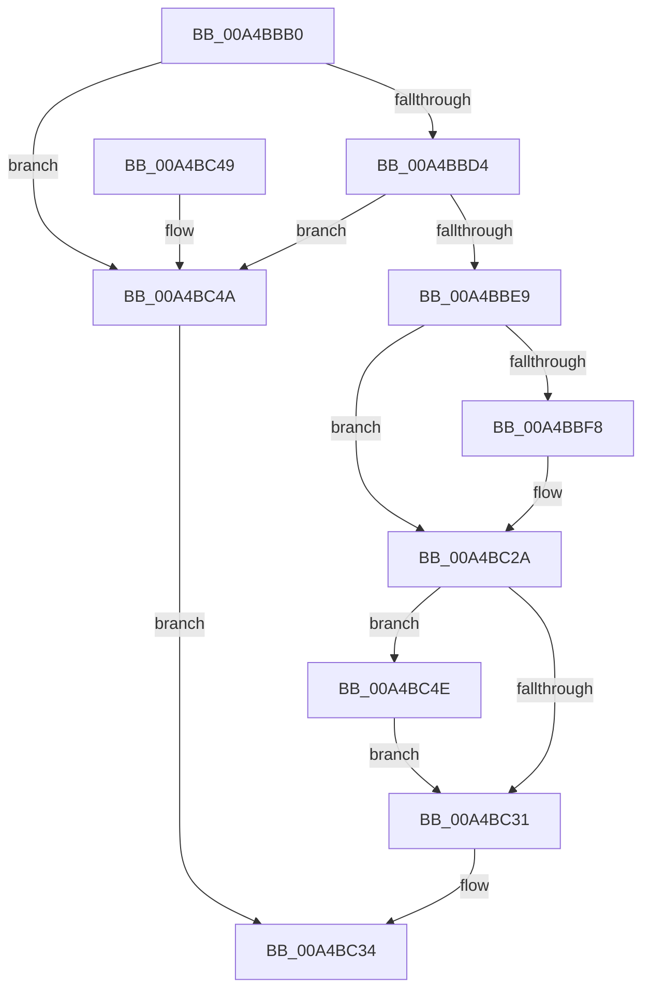

# MmPageEntireDriver

- RVA: `0x00A4BBB0`–`0x00A4BC58` (길이 `168` bytes)
- VA: `0x0000000140A4BBB0`
- 실행 섹션: `PAGE`
- PDB 이름 있음: `예`; PDB Function 태그: `아니요`
- unwind 정보 RVA: `0x000B0278`
- 디코드: `49`개 명령, `168/168` bytes 표시
- 미해석 바이트: `0` (있으면 어셈블리에 `.byte`로 보존)

> 이 문서는 커널 이미지의 기계어와 PDB 기호를 분석해 생성했습니다. 4번과 5번은 함수 원형과 자료형을 바이너리 사용 방식에서 추정한 C 해석이며 원본 소스 복구 결과는 아닙니다.

## 1. Dependencies

- 직접 호출 지점: **7**; 고유 호출 대상: **7**
- 직접 호출자로 확인된 함수: **1**
- RIP 상대 이미지 참조: **1**

### Outgoing calls
- `0x00A4BBCB` → [MI_IS_PHYSICAL_ADDRESS](../../text/23/MI_IS_PHYSICAL_ADDRESS_function_0023B3A0.md) (function, `0x0023B3A0`)
- `0x00A4BBDC` → [MiLockLoadedDataTableEntryIfNecessary](../../text/2A/MiLockLoadedDataTableEntryIfNecessary_function_002A38B4.md) (function, `0x002A38B4`)
- `0x00A4BBF8` → [KeFlushQueuedDpcs](../../text/3C/KeFlushQueuedDpcs_function_003C0300.md) (function, `0x003C0300`)
- `0x00A4BC00` → [MiGetPteAddress](../../text/43/MiGetPteAddress_function_0043E130.md) (function, `0x0043E130`)
- `0x00A4BC16` → [MiCancelPhase0Locking](MiCancelPhase0Locking_function_00A4BC60.md) (function, `0x00A4BC60`)
- `0x00A4BC25` → [MiSetPagingOfDriver](../../text/4A/MiSetPagingOfDriver_function_004A76C4.md) (function, `0x004A76C4`)
- `0x00A4BC51` → [MmUnlockLoadedDataTableEntry](../../text/2A/MmUnlockLoadedDataTableEntry_function_002A3C98.md) (function, `0x002A3C98`)

### Direct callers
- [DifMmPageEntireDriverWrapper](../../text/63/DifMmPageEntireDriverWrapper_function_00636290.md) at `0x0063635D`

### Static image references
- `0x00A4BBE9` → RVA `0x00FC51F4` (`ALMOSTRO`; read)

## 2. Other-region calls and transfers

- 다른 실행 섹션으로 향하는 call: **6**
  - `0x00A4BBCB` → [MI_IS_PHYSICAL_ADDRESS](../../text/23/MI_IS_PHYSICAL_ADDRESS_function_0023B3A0.md) (`PAGE` → `.text`)
  - `0x00A4BBDC` → [MiLockLoadedDataTableEntryIfNecessary](../../text/2A/MiLockLoadedDataTableEntryIfNecessary_function_002A38B4.md) (`PAGE` → `.text`)
  - `0x00A4BBF8` → [KeFlushQueuedDpcs](../../text/3C/KeFlushQueuedDpcs_function_003C0300.md) (`PAGE` → `.text`)
  - `0x00A4BC00` → [MiGetPteAddress](../../text/43/MiGetPteAddress_function_0043E130.md) (`PAGE` → `.text`)
  - `0x00A4BC25` → [MiSetPagingOfDriver](../../text/4A/MiSetPagingOfDriver_function_004A76C4.md) (`PAGE` → `.text`)
  - `0x00A4BC51` → [MmUnlockLoadedDataTableEntry](../../text/2A/MmUnlockLoadedDataTableEntry_function_002A3C98.md) (`PAGE` → `.text`)
- 별도 외부 분기/꼬리 이동을 확인하지 못했습니다.

## 3. Assembly (complete function range)

```asm
00A4BBB0  48 8B C4                        mov rax, rsp
00A4BBB3  48 89 58 08                     mov qword ptr [rax + 8], rbx
00A4BBB7  48 89 68 18                     mov qword ptr [rax + 0x18], rbp
00A4BBBB  48 89 70 20                     mov qword ptr [rax + 0x20], rsi
00A4BBBF  57                              push rdi
00A4BBC0  48 83 EC 20                     sub rsp, 0x20
00A4BBC4  83 60 10 00                     and dword ptr [rax + 0x10], 0
00A4BBC8  48 8B D9                        mov rbx, rcx
00A4BBCB  E8 D0 F7 7E FF                  call 0x14023b3a0
00A4BBD0  85 C0                           test eax, eax
00A4BBD2  75 76                           jne 0x140a4bc4a
00A4BBD4  48 8D 54 24 38                  lea rdx, [rsp + 0x38]
00A4BBD9  48 8B CB                        mov rcx, rbx
00A4BBDC  E8 D3 7C 85 FF                  call 0x1402a38b4
00A4BBE1  48 8B F0                        mov rsi, rax
00A4BBE4  48 85 C0                        test rax, rax
00A4BBE7  74 61                           je 0x140a4bc4a
00A4BBE9  8B 0D 05 96 57 00               mov ecx, dword ptr [rip + 0x579605]
00A4BBEF  48 8B 68 30                     mov rbp, qword ptr [rax + 0x30]
00A4BBF3  F6 C1 01                        test cl, 1
00A4BBF6  75 32                           jne 0x140a4bc2a
00A4BBF8  E8 03 47 97 FF                  call 0x1403c0300
00A4BBFD  48 8B CD                        mov rcx, rbp
00A4BC00  E8 2B 25 9F FF                  call 0x14043e130
00A4BC05  8B 4E 40                        mov ecx, dword ptr [rsi + 0x40]
00A4BC08  48 8B F8                        mov rdi, rax
00A4BC0B  48 C1 E9 0C                     shr rcx, 0xc
00A4BC0F  48 8D 1C C8                     lea rbx, [rax + rcx*8]
00A4BC13  48 8B CE                        mov rcx, rsi
00A4BC16  E8 45 00 00 00                  call 0x140a4bc60
00A4BC1B  4C 8D 43 F8                     lea r8, [rbx - 8]
00A4BC1F  48 8B D7                        mov rdx, rdi
00A4BC22  48 8B CE                        mov rcx, rsi
00A4BC25  E8 9A BA A5 FF                  call 0x1404a76c4
00A4BC2A  83 7C 24 38 00                  cmp dword ptr [rsp + 0x38], 0
00A4BC2F  75 1D                           jne 0x140a4bc4e
00A4BC31  48 8B C5                        mov rax, rbp
00A4BC34  48 8B 5C 24 30                  mov rbx, qword ptr [rsp + 0x30]
00A4BC39  48 8B 6C 24 40                  mov rbp, qword ptr [rsp + 0x40]
00A4BC3E  48 8B 74 24 48                  mov rsi, qword ptr [rsp + 0x48]
00A4BC43  48 83 C4 20                     add rsp, 0x20
00A4BC47  5F                              pop rdi
00A4BC48  C3                              ret
00A4BC49  CC                              int3
00A4BC4A  33 C0                           xor eax, eax
00A4BC4C  EB E6                           jmp 0x140a4bc34
00A4BC4E  48 8B CE                        mov rcx, rsi
00A4BC51  E8 42 80 85 FF                  call 0x1402a3c98
00A4BC56  EB D9                           jmp 0x140a4bc31
```

## 4. C-style interpretation (structured pseudocode)

```c
__int64 __fastcall MmPageEntireDriver(__int64 a1)
{
    __int64 result;
    __int64 v_rbx;
    __int64 v_rdi;
    __int64 v_rsp;
    unsigned __int64 v_stack_p10;
    unsigned __int64 v_stack_p18;
    unsigned __int64 v_stack_p20;
    unsigned __int64 v_stack_p8;

    *(unsigned __int64 *)(v_rsp + 8) = v_rbx;
    *(unsigned __int64 *)(v_rsp + 24) = v_rbp;
    *(unsigned __int64 *)(v_rsp + 32) = v_rsi;
    v_rsp = (v_rsp) - (32);
    result = MI_IS_PHYSICAL_ADDRESS(a1, a2, a3, a4);
    if ((unsigned int)(result) != 0) goto loc_00A4BC4A;
    result = MiLockLoadedDataTableEntryIfNecessary(a1, v_stack_p10, a3, a4);
    if (result == 0) goto loc_00A4BC4A;
    v_rbx = a1;
    if ((((unsigned __int8)((unsigned int)(*(unsigned int *)(v_rip + 5740037)))) & (1)) == 0) {
        result = KeFlushQueuedDpcs((unsigned int)(*(unsigned int *)(v_rip + 5740037)), v_stack_p10, a3, a4);
        a1 = *(unsigned __int64 *)(result + 48);
        result = MiGetPteAddress(a1, v_stack_p10, a3, a4);
        a1 = *(unsigned int *)(result + 64);
        v_rdi = result;
        a1 = (a1) >> (12);
        v_rbx = result + a1 * 8;
        a1 = result;
        result = MiCancelPhase0Locking(a1, v_stack_p10, a3, a4);
        a3 = v_rbx - 8;
        a2 = v_rdi;
        a1 = result;
        result = MiSetPagingOfDriver(a1, a2, a3, a4);
    }
    if (v_stack_p10 != 0) goto loc_00A4BC4E;
loc_00A4BC31:
loc_00A4BC34:
    v_rsp = (v_rsp) + (32);
    return *(unsigned __int64 *)(result + 48);
loc_00A4BC4A:
    result = 0;
    goto loc_00A4BC34;
loc_00A4BC4E:
    result = MmUnlockLoadedDataTableEntry(v_stack_p20, a2, a3, a4);
    goto loc_00A4BC31;
}
```

## 5. (Beta) C Style

```c
int64_t MmPageEntireDriver(int64_t Arg1)
{
    int64_t result;
    int64_t local_rbx;
    int64_t local_rdi;
    int64_t local_rsp;
    uint64_t v_stack_p10;
    uint64_t v_stack_p18;
    uint64_t v_stack_p20;
    uint64_t v_stack_p8;

    *(uint64_t *)(local_rsp + 0x8) = local_rbx;
    *(uint64_t *)(local_rsp + 0x18) = local_rbp;
    *(uint64_t *)(local_rsp + 0x20) = local_rsi;
    local_rsp = (local_rsp) - (32);
    result = MI_IS_PHYSICAL_ADDRESS(Arg1, a2, a3, a4);
    if ((uint32_t)(result) != 0) goto loc_00A4BC4A;
    result = MiLockLoadedDataTableEntryIfNecessary(Arg1, v_stack_p10, a3, a4);
    if (result == 0) goto loc_00A4BC4A;
    local_rbx = Arg1;
    if ((((uint8_t)((uint32_t)(*(uint32_t *)(v_rip + 0x579605)))) & (1)) == 0) {
        result = KeFlushQueuedDpcs((uint32_t)(*(uint32_t *)(v_rip + 0x579605)), v_stack_p10, a3, a4);
        Arg1 = *(uint64_t *)(result + 0x30);
        result = MiGetPteAddress(Arg1, v_stack_p10, a3, a4);
        Arg1 = *(uint32_t *)(result + 0x40);
        local_rdi = result;
        Arg1 = (Arg1) >> (12);
        local_rbx = result + Arg1 * 8;
        Arg1 = result;
        result = MiCancelPhase0Locking(Arg1, v_stack_p10, a3, a4);
        a3 = local_rbx - 8;
        a2 = local_rdi;
        Arg1 = result;
        result = MiSetPagingOfDriver(Arg1, a2, a3, a4);
    }
    if (v_stack_p10 != 0) goto loc_00A4BC4E;
loc_00A4BC31:
loc_00A4BC34:
    local_rsp = (local_rsp) + (32);
    return *(uint64_t *)(result + 0x30);
loc_00A4BC4A:
    result = 0;
    goto loc_00A4BC34;
loc_00A4BC4E:
    result = MmUnlockLoadedDataTableEntry(v_stack_p20, a2, a3, a4);
    goto loc_00A4BC31;
}
```

## 6. Execution-region graph

[열기: 2D/3D 그래프와 함수 탐색 컨트롤 패널](../../../control-panel.html?section=page&rva=0x00A4BBB0&view=graph)

- 2D 그래프는 위에서 아래로 흐르고, 3D 그래프는 빈 공간을 드래그해 회전합니다. Shift+드래그는 이동, 휠은 확대·축소, 함수 노드 선택은 대상 보고서 이동입니다.

### Static fallback


