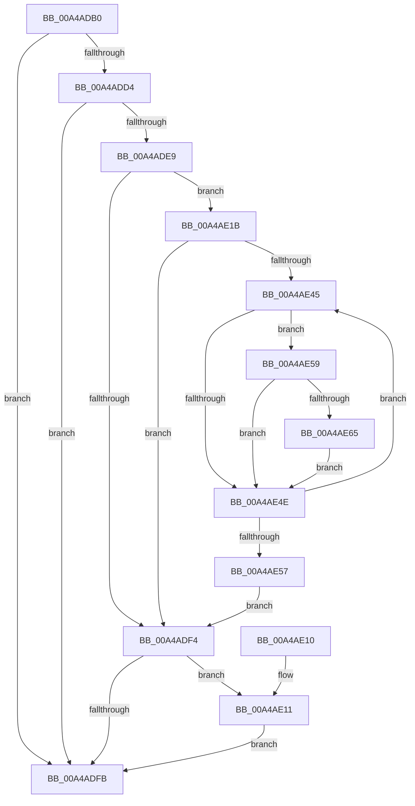

# MmResetDriverPaging

- RVA: `0x00A4ADB0`–`0x00A4AEA1` (길이 `241` bytes)
- VA: `0x0000000140A4ADB0`
- 실행 섹션: `PAGE`
- PDB 이름 있음: `예`; PDB Function 태그: `아니요`
- unwind 정보 RVA: `0x000B018C`
- 디코드: `71`개 명령, `241/241` bytes 표시
- 미해석 바이트: `0` (있으면 어셈블리에 `.byte`로 보존)

> 이 문서는 커널 이미지의 기계어와 PDB 기호를 분석해 생성했습니다. 4번과 5번은 함수 원형과 자료형을 바이너리 사용 방식에서 추정한 C 해석이며 원본 소스 복구 결과는 아닙니다.

## 1. Dependencies

- 직접 호출 지점: **9**; 고유 호출 대상: **8**
- 직접 호출자로 확인된 함수: **1**
- RIP 상대 이미지 참조: **1**

### Outgoing calls
- `0x00A4ADCB` → [MI_IS_PHYSICAL_ADDRESS](../../text/23/MI_IS_PHYSICAL_ADDRESS_function_0023B3A0.md) (function, `0x0023B3A0`)
- `0x00A4ADDC` → [MiLockLoadedDataTableEntryIfNecessary](../../text/2A/MiLockLoadedDataTableEntryIfNecessary_function_002A38B4.md) (function, `0x002A38B4`)
- `0x00A4AE14` → [MmUnlockLoadedDataTableEntry](../../text/2A/MmUnlockLoadedDataTableEntry_function_002A3C98.md) (function, `0x002A3C98`)
- `0x00A4AE22` → [RtlImageNtHeader](../../text/44/RtlImageNtHeader_function_00443B60.md) (function, `0x00443B60`)
- `0x00A4AE2D` → [MiCancelPhase0Locking](MiCancelPhase0Locking_function_00A4BC60.md) (function, `0x00A4BC60`)
- `0x00A4AE5C` → [MmImageSectionPagable](MmImageSectionPagable_function_00A4B78C.md) (function, `0x00A4B78C`)
- `0x00A4AE7D` → [MiGetPteAddress](../../text/43/MiGetPteAddress_function_0043E130.md) (function, `0x0043E130`)
- `0x00A4AE89` → [MiGetPteAddress](../../text/43/MiGetPteAddress_function_0043E130.md) (function, `0x0043E130`)
- `0x00A4AE9A` → [MiLockCode](../../text/36/MiLockCode_function_0036F91C.md) (function, `0x0036F91C`)

### Direct callers
- [DifMmResetDriverPagingWrapper](../../text/63/DifMmResetDriverPagingWrapper_function_00636880.md) at `0x00636946`

### Static image references
- `0x00A4ADE9` → RVA `0x00FC51F4` (`ALMOSTRO`; read)

## 2. Other-region calls and transfers

- 다른 실행 섹션으로 향하는 call: **7**
  - `0x00A4ADCB` → [MI_IS_PHYSICAL_ADDRESS](../../text/23/MI_IS_PHYSICAL_ADDRESS_function_0023B3A0.md) (`PAGE` → `.text`)
  - `0x00A4ADDC` → [MiLockLoadedDataTableEntryIfNecessary](../../text/2A/MiLockLoadedDataTableEntryIfNecessary_function_002A38B4.md) (`PAGE` → `.text`)
  - `0x00A4AE14` → [MmUnlockLoadedDataTableEntry](../../text/2A/MmUnlockLoadedDataTableEntry_function_002A3C98.md) (`PAGE` → `.text`)
  - `0x00A4AE22` → [RtlImageNtHeader](../../text/44/RtlImageNtHeader_function_00443B60.md) (`PAGE` → `.text`)
  - `0x00A4AE7D` → [MiGetPteAddress](../../text/43/MiGetPteAddress_function_0043E130.md) (`PAGE` → `.text`)
  - `0x00A4AE89` → [MiGetPteAddress](../../text/43/MiGetPteAddress_function_0043E130.md) (`PAGE` → `.text`)
  - `0x00A4AE9A` → [MiLockCode](../../text/36/MiLockCode_function_0036F91C.md) (`PAGE` → `.text`)
- 별도 외부 분기/꼬리 이동을 확인하지 못했습니다.

## 3. Assembly (complete function range)

```asm
00A4ADB0  48 8B C4                        mov rax, rsp
00A4ADB3  48 89 58 08                     mov qword ptr [rax + 8], rbx
00A4ADB7  48 89 68 18                     mov qword ptr [rax + 0x18], rbp
00A4ADBB  48 89 70 20                     mov qword ptr [rax + 0x20], rsi
00A4ADBF  57                              push rdi
00A4ADC0  48 83 EC 20                     sub rsp, 0x20
00A4ADC4  83 60 10 00                     and dword ptr [rax + 0x10], 0
00A4ADC8  48 8B D9                        mov rbx, rcx
00A4ADCB  E8 D0 05 7F FF                  call 0x14023b3a0
00A4ADD0  85 C0                           test eax, eax
00A4ADD2  75 27                           jne 0x140a4adfb
00A4ADD4  48 8D 54 24 38                  lea rdx, [rsp + 0x38]
00A4ADD9  48 8B CB                        mov rcx, rbx
00A4ADDC  E8 D3 8A 85 FF                  call 0x1402a38b4
00A4ADE1  48 8B F0                        mov rsi, rax
00A4ADE4  48 85 C0                        test rax, rax
00A4ADE7  74 12                           je 0x140a4adfb
00A4ADE9  8B 0D 05 A4 57 00               mov ecx, dword ptr [rip + 0x57a405]
00A4ADEF  F6 C1 01                        test cl, 1
00A4ADF2  74 27                           je 0x140a4ae1b
00A4ADF4  83 7C 24 38 00                  cmp dword ptr [rsp + 0x38], 0
00A4ADF9  75 16                           jne 0x140a4ae11
00A4ADFB  48 8B 5C 24 30                  mov rbx, qword ptr [rsp + 0x30]
00A4AE00  48 8B 6C 24 40                  mov rbp, qword ptr [rsp + 0x40]
00A4AE05  48 8B 74 24 48                  mov rsi, qword ptr [rsp + 0x48]
00A4AE0A  48 83 C4 20                     add rsp, 0x20
00A4AE0E  5F                              pop rdi
00A4AE0F  C3                              ret
00A4AE10  CC                              int3
00A4AE11  48 8B CE                        mov rcx, rsi
00A4AE14  E8 7F 8E 85 FF                  call 0x1402a3c98
00A4AE19  EB E0                           jmp 0x140a4adfb
00A4AE1B  48 8B 68 30                     mov rbp, qword ptr [rax + 0x30]
00A4AE1F  48 8B CD                        mov rcx, rbp
00A4AE22  E8 39 8D 9F FF                  call 0x140443b60
00A4AE27  48 8B CE                        mov rcx, rsi
00A4AE2A  48 8B D8                        mov rbx, rax
00A4AE2D  E8 2E 0E 00 00                  call 0x140a4bc60
00A4AE32  0F B7 4B 14                     movzx ecx, word ptr [rbx + 0x14]
00A4AE36  48 8D 7B 18                     lea rdi, [rbx + 0x18]
00A4AE3A  0F B7 5B 06                     movzx ebx, word ptr [rbx + 6]
00A4AE3E  48 03 F9                        add rdi, rcx
00A4AE41  85 DB                           test ebx, ebx
00A4AE43  74 AF                           je 0x140a4adf4
00A4AE45  F7 47 24 00 00 00 02            test dword ptr [rdi + 0x24], 0x2000000
00A4AE4C  74 0B                           je 0x140a4ae59
00A4AE4E  48 83 C7 28                     add rdi, 0x28
00A4AE52  83 C3 FF                        add ebx, -1
00A4AE55  75 EE                           jne 0x140a4ae45
00A4AE57  EB 9B                           jmp 0x140a4adf4
00A4AE59  48 8B CF                        mov rcx, rdi
00A4AE5C  E8 2B 09 00 00                  call 0x140a4b78c
00A4AE61  85 C0                           test eax, eax
00A4AE63  75 E9                           jne 0x140a4ae4e
00A4AE65  8B 47 08                        mov eax, dword ptr [rdi + 8]
00A4AE68  8B 57 10                        mov edx, dword ptr [rdi + 0x10]
00A4AE6B  3B D0                           cmp edx, eax
00A4AE6D  44 8B 4F 0C                     mov r9d, dword ptr [rdi + 0xc]
00A4AE71  0F 42 D0                        cmovb edx, eax
00A4AE74  8D 4A FF                        lea ecx, [rdx - 1]
00A4AE77  41 03 C9                        add ecx, r9d
00A4AE7A  48 03 CD                        add rcx, rbp
00A4AE7D  E8 AE 32 9F FF                  call 0x14043e130
00A4AE82  49 8D 0C 29                     lea rcx, [r9 + rbp]
00A4AE86  4C 8B C0                        mov r8, rax
00A4AE89  E8 A2 32 9F FF                  call 0x14043e130
00A4AE8E  48 8B D0                        mov rdx, rax
00A4AE91  48 8B CE                        mov rcx, rsi
00A4AE94  41 B9 02 00 00 00               mov r9d, 2
00A4AE9A  E8 7D 4A 92 FF                  call 0x14036f91c
00A4AE9F  EB AD                           jmp 0x140a4ae4e
```

## 4. C-style interpretation (structured pseudocode)

```c
__int64 __fastcall MmResetDriverPaging(__int64 a1)
{
    __int64 result;
    __int64 v_rbx;
    __int64 v_rdi;
    __int64 v_rsp;
    unsigned __int64 v_stack_p10;
    unsigned __int64 v_stack_p18;
    unsigned __int64 v_stack_p20;
    unsigned __int64 v_stack_p8;

    *(unsigned __int64 *)(v_rsp + 8) = v_rbx;
    *(unsigned __int64 *)(v_rsp + 24) = v_rbp;
    *(unsigned __int64 *)(v_rsp + 32) = v_rsi;
    v_rsp = (v_rsp) - (32);
    result = MI_IS_PHYSICAL_ADDRESS(a1, a2, a3, a4);
    if ((unsigned int)(result) != 0) goto loc_00A4ADFB;
    result = MiLockLoadedDataTableEntryIfNecessary(a1, v_stack_p10, a3, a4);
    if (result == 0) goto loc_00A4ADFB;
    if ((((unsigned __int8)((unsigned int)(*(unsigned int *)(v_rip + 5743621)))) & (1)) == 0) goto loc_00A4AE1B;
loc_00A4ADF4:
    if (v_stack_p10 != 0) goto loc_00A4AE11;
loc_00A4ADFB:
    v_rsp = (v_rsp) + (32);
    return result;
loc_00A4AE11:
    result = MmUnlockLoadedDataTableEntry(v_stack_p20, v_stack_p10, a3, a4);
    goto loc_00A4ADFB;
loc_00A4AE1B:
    result = RtlImageNtHeader(*(unsigned __int64 *)(result + 48), v_stack_p10, a3, a4);
    result = MiCancelPhase0Locking(v_stack_p20, v_stack_p10, a3, a4);
    v_rdi = (result + 24) + (*(unsigned __int16 *)(result + 20));
    if ((unsigned int)(*(unsigned __int16 *)(result + 6)) == 0) goto loc_00A4ADF4;
loc_00A4AE45:
    if (((*(unsigned int *)(v_rdi + 36)) & (0x2000000ULL)) == 0) goto loc_00A4AE59;
loc_00A4AE4E:
    v_rdi = (v_rdi) + (40);
    v_rbx = (unsigned int)((*(unsigned __int16 *)(result + 6)) + (-1));
    if (condition_is_not_equal) goto loc_00A4AE45;
    goto loc_00A4ADF4;
loc_00A4AE59:
    result = MmImageSectionPagable(v_rdi, v_stack_p10, a3, a4);
    if ((unsigned int)(result) != 0) goto loc_00A4AE4E;
    a2 = (unsigned int)(*(unsigned int *)(v_rdi + 16));
    if (((unsigned int)((unsigned int)(*(unsigned int *)(v_rdi + 16)))) < ((unsigned int)((unsigned int)(*(unsigned int *)(v_rdi + 8))))) { a2 = (unsigned int)((unsigned int)(*(unsigned int *)(v_rdi + 8))); }
    a1 = (unsigned int)((a2 - 1) + ((unsigned int)((unsigned int)(*(unsigned int *)(v_rdi + 12)))));
    a1 = (a1) + (*(unsigned __int64 *)(result + 48));
    result = MiGetPteAddress(a1, a2, a3, (unsigned int)(*(unsigned int *)(v_rdi + 12)));
    result = MiGetPteAddress((unsigned int)(*(unsigned int *)(v_rdi + 12)) + *(unsigned __int64 *)(result + 48) * 1, a2, result, (unsigned int)(*(unsigned int *)(v_rdi + 12)));
    result = MiLockCode(v_stack_p20, result, result, 2);
    goto loc_00A4AE4E;
}
```

## 5. (Beta) C Style

```c
int64_t MmResetDriverPaging(int64_t Arg1)
{
    int64_t result;
    int64_t local_rbx;
    int64_t local_rdi;
    int64_t local_rsp;
    uint64_t v_stack_p10;
    uint64_t v_stack_p18;
    uint64_t v_stack_p20;
    uint64_t v_stack_p8;

    *(uint64_t *)(local_rsp + 0x8) = local_rbx;
    *(uint64_t *)(local_rsp + 0x18) = local_rbp;
    *(uint64_t *)(local_rsp + 0x20) = local_rsi;
    local_rsp = (local_rsp) - (32);
    result = MI_IS_PHYSICAL_ADDRESS(Arg1, a2, a3, a4);
    if ((uint32_t)(result) != 0) goto loc_00A4ADFB;
    result = MiLockLoadedDataTableEntryIfNecessary(Arg1, v_stack_p10, a3, a4);
    if (result == 0) goto loc_00A4ADFB;
    if ((((uint8_t)((uint32_t)(*(uint32_t *)(v_rip + 0x57A405)))) & (1)) == 0) goto loc_00A4AE1B;
loc_00A4ADF4:
    if (v_stack_p10 != 0) goto loc_00A4AE11;
loc_00A4ADFB:
    local_rsp = (local_rsp) + (32);
    return result;
loc_00A4AE11:
    result = MmUnlockLoadedDataTableEntry(v_stack_p20, v_stack_p10, a3, a4);
    goto loc_00A4ADFB;
loc_00A4AE1B:
    result = RtlImageNtHeader(*(uint64_t *)(result + 0x30), v_stack_p10, a3, a4);
    result = MiCancelPhase0Locking(v_stack_p20, v_stack_p10, a3, a4);
    local_rdi = (result + 24) + (*(uint16_t *)(result + 0x14));
    if ((uint32_t)(*(uint16_t *)(result + 0x6)) == 0) goto loc_00A4ADF4;
loc_00A4AE45:
    if (((*(uint32_t *)(local_rdi + 0x24)) & (0x2000000ULL)) == 0) goto loc_00A4AE59;
loc_00A4AE4E:
    local_rdi = (local_rdi) + (40);
    local_rbx = (uint32_t)((*(uint16_t *)(result + 0x6)) + (-1));
    if (condition_is_not_equal) goto loc_00A4AE45;
    goto loc_00A4ADF4;
loc_00A4AE59:
    result = MmImageSectionPagable(local_rdi, v_stack_p10, a3, a4);
    if ((uint32_t)(result) != 0) goto loc_00A4AE4E;
    a2 = (uint32_t)(*(uint32_t *)(local_rdi + 0x10));
    if (((uint32_t)((uint32_t)(*(uint32_t *)(local_rdi + 0x10)))) < ((uint32_t)((uint32_t)(*(uint32_t *)(local_rdi + 0x8))))) { a2 = (uint32_t)((uint32_t)(*(uint32_t *)(local_rdi + 0x8))); }
    Arg1 = (uint32_t)((a2 - 1) + ((uint32_t)((uint32_t)(*(uint32_t *)(local_rdi + 0xC)))));
    Arg1 = (Arg1) + (*(uint64_t *)(result + 0x30));
    result = MiGetPteAddress(Arg1, a2, a3, (uint32_t)(*(uint32_t *)(local_rdi + 0xC)));
    result = MiGetPteAddress((uint32_t)(*(uint32_t *)(local_rdi + 0xC)) + *(uint64_t *)(result + 0x30) * 1, a2, result, (uint32_t)(*(uint32_t *)(local_rdi + 0xC)));
    result = MiLockCode(v_stack_p20, result, result, 2);
    goto loc_00A4AE4E;
}
```

## 6. Execution-region graph

[열기: 2D/3D 그래프와 함수 탐색 컨트롤 패널](../../../control-panel.html?section=page&rva=0x00A4ADB0&view=graph)

- 2D 그래프는 위에서 아래로 흐르고, 3D 그래프는 빈 공간을 드래그해 회전합니다. Shift+드래그는 이동, 휠은 확대·축소, 함수 노드 선택은 대상 보고서 이동입니다.

### Static fallback


