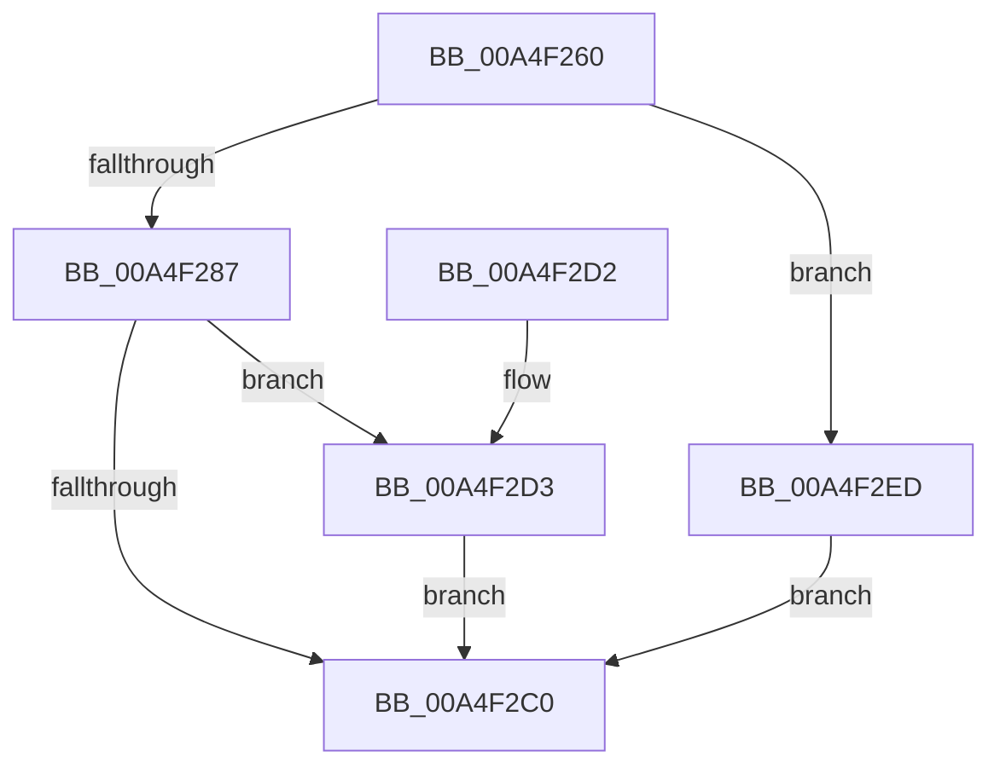

# NtAlpcDisconnectPort

- RVA: `0x00A4F260`–`0x00A4F2F4` (길이 `148` bytes)
- VA: `0x0000000140A4F260`
- 실행 섹션: `PAGE`
- PDB 이름 있음: `예`; PDB Function 태그: `아니요`
- unwind 정보 RVA: `0x000B0774`
- 디코드: `38`개 명령, `148/148` bytes 표시
- 미해석 바이트: `0` (있으면 어셈블리에 `.byte`로 보존)

> 이 문서는 커널 이미지의 기계어와 PDB 기호를 분석해 생성했습니다. 4번과 5번은 함수 원형과 자료형을 바이너리 사용 방식에서 추정한 C 해석이며 원본 소스 복구 결과는 아닙니다.

## 1. Dependencies

- 직접 호출 지점: **4**; 고유 호출 대상: **4**
- 직접 호출자로 확인된 함수: **0**
- RIP 상대 이미지 참조: **1**

### Outgoing calls
- `0x00A4F2B5` → [ObReferenceObjectByHandle](../86/ObReferenceObjectByHandle_function_00868DB0.md) (function, `0x00868DB0`)
- `0x00A4F2C0` → [KeLeaveCriticalRegion](../../text/25/KeLeaveCriticalRegion_function_0025D8B0.md) (function, `0x0025D8B0`)
- `0x00A4F2DA` → [AlpcpDisconnectPort](../92/AlpcpDisconnectPort_function_00924A68.md) (function, `0x00924A68`)
- `0x00A4F2E6` → [ObfDereferenceObject](../../text/2F/ObfDereferenceObject_function_002F9350.md) (function, `0x002F9350`)

### Direct callers
- 이 함수 시작 RVA로 연결되는 직접 call은 확인되지 않았습니다. 간접 호출은 완전히 역산할 수 없습니다.

### Static image references
- `0x00A4F29A` → RVA `0x00FC6C18` (`ALMOSTRO`; read)

## 2. Other-region calls and transfers

- 다른 실행 섹션으로 향하는 call: **2**
  - `0x00A4F2C0` → [KeLeaveCriticalRegion](../../text/25/KeLeaveCriticalRegion_function_0025D8B0.md) (`PAGE` → `.text`)
  - `0x00A4F2E6` → [ObfDereferenceObject](../../text/2F/ObfDereferenceObject_function_002F9350.md) (`PAGE` → `.text`)
- 별도 외부 분기/꼬리 이동을 확인하지 못했습니다.

## 3. Assembly (complete function range)

```asm
00A4F260  4C 8B DC                        mov r11, rsp
00A4F263  49 89 5B 08                     mov qword ptr [r11 + 8], rbx
00A4F267  57                              push rdi
00A4F268  48 83 EC 30                     sub rsp, 0x30
00A4F26C  65 48 8B 04 25 88 01 00 00      mov rax, qword ptr gs:[0x188]
00A4F275  8B FA                           mov edi, edx
00A4F277  66 FF 88 E4 01 00 00            dec word ptr [rax + 0x1e4]
00A4F27E  90                              nop
00A4F27F  F7 C2 FE FF FF FF               test edx, 0xfffffffe
00A4F285  75 66                           jne 0x140a4f2ed
00A4F287  65 48 8B 04 25 88 01 00 00      mov rax, qword ptr gs:[0x188]
00A4F290  BA 01 00 00 00                  mov edx, 1
00A4F295  49 83 63 F0 00                  and qword ptr [r11 - 0x10], 0
00A4F29A  4C 8B 05 77 79 57 00            mov r8, qword ptr [rip + 0x577977]
00A4F2A1  49 83 63 18 00                  and qword ptr [r11 + 0x18], 0
00A4F2A6  44 8A 88 32 02 00 00            mov r9b, byte ptr [rax + 0x232]
00A4F2AD  49 8D 43 18                     lea rax, [r11 + 0x18]
00A4F2B1  49 89 43 E8                     mov qword ptr [r11 - 0x18], rax
00A4F2B5  E8 F6 9A E1 FF                  call 0x140868db0
00A4F2BA  8B D8                           mov ebx, eax
00A4F2BC  85 C0                           test eax, eax
00A4F2BE  79 13                           jns 0x140a4f2d3
00A4F2C0  E8 EB E5 80 FF                  call 0x14025d8b0
00A4F2C5  8B C3                           mov eax, ebx
00A4F2C7  48 8B 5C 24 40                  mov rbx, qword ptr [rsp + 0x40]
00A4F2CC  48 83 C4 30                     add rsp, 0x30
00A4F2D0  5F                              pop rdi
00A4F2D1  C3                              ret
00A4F2D2  CC                              int3
00A4F2D3  48 8B 4C 24 50                  mov rcx, qword ptr [rsp + 0x50]
00A4F2D8  8B D7                           mov edx, edi
00A4F2DA  E8 89 57 ED FF                  call 0x140924a68
00A4F2DF  48 8B 4C 24 50                  mov rcx, qword ptr [rsp + 0x50]
00A4F2E4  8B D8                           mov ebx, eax
00A4F2E6  E8 65 A0 8A FF                  call 0x1402f9350
00A4F2EB  EB D3                           jmp 0x140a4f2c0
00A4F2ED  BB 0D 00 00 C0                  mov ebx, 0xc000000d
00A4F2F2  EB CC                           jmp 0x140a4f2c0
```

## 4. C-style interpretation (structured pseudocode)

```c
__int64 __fastcall NtAlpcDisconnectPort(__int64 a1, int a2)
{
    __int64 result;
    __int64 v_rsp;
    unsigned __int64 v_stack_p50;
    unsigned __int64 v_stack_p8;

    *(unsigned __int64 *)(v_rsp + 8) = v_rbx;
    v_rsp = (v_rsp) - (48);
    if (((a2) & (0xFFFFFFFEULL)) != 0) goto loc_00A4F2ED;
    *(unsigned __int64 *)(v_rsp - 24) = v_rsp + 24;
    result = ObReferenceObjectByHandle(a1, 1, *(unsigned __int64 *)(v_rip + 5732727), *(unsigned __int8 *)(*(unsigned __int64 *)(gs_base + (0 + 392)) + 562));
    if (!sign_flag) goto loc_00A4F2D3;
loc_00A4F2C0:
    result = KeLeaveCriticalRegion(a1, 1, *(unsigned __int64 *)(v_rip + 5732727), *(unsigned __int8 *)(*(unsigned __int64 *)(gs_base + (0 + 392)) + 562));
    v_rsp = (v_rsp) + (48);
    return (unsigned int)((unsigned int)((unsigned int)((unsigned int)(result))));
loc_00A4F2D3:
    result = AlpcpDisconnectPort(v_stack_p50, (unsigned int)((unsigned int)((unsigned int)(a2))), *(unsigned __int64 *)(v_rip + 5732727), *(unsigned __int8 *)(*(unsigned __int64 *)(gs_base + (0 + 392)) + 562));
    result = ObfDereferenceObject(v_stack_p50, (unsigned int)((unsigned int)((unsigned int)(a2))), *(unsigned __int64 *)(v_rip + 5732727), *(unsigned __int8 *)(*(unsigned __int64 *)(gs_base + (0 + 392)) + 562));
    goto loc_00A4F2C0;
loc_00A4F2ED:
    goto loc_00A4F2C0;
}
```

## 5. (Beta) C Style

```c
int64_t NtAlpcDisconnectPort(int64_t Arg1, int32_t Arg2)
{
    int64_t result;
    int64_t local_rsp;
    uint64_t v_stack_p50;
    uint64_t v_stack_p8;

    *(uint64_t *)(local_rsp + 0x8) = local_rbx;
    local_rsp = (local_rsp) - (48);
    if (((Arg2) & (0xFFFFFFFEULL)) != 0) goto loc_00A4F2ED;
    *(uint64_t *)(local_rsp - 0x18) = local_rsp + 24;
    result = ObReferenceObjectByHandle(Arg1, 1, *(uint64_t *)(v_rip + 0x577977), *(uint8_t *)(*(uint64_t *)(gs_base + (0 + 0x188)) + 0x232));
    if (!sign_flag) goto loc_00A4F2D3;
loc_00A4F2C0:
    result = KeLeaveCriticalRegion(Arg1, 1, *(uint64_t *)(v_rip + 0x577977), *(uint8_t *)(*(uint64_t *)(gs_base + (0 + 0x188)) + 0x232));
    local_rsp = (local_rsp) + (48);
    return (uint32_t)((uint32_t)((uint32_t)((uint32_t)(result))));
loc_00A4F2D3:
    result = AlpcpDisconnectPort(v_stack_p50, (uint32_t)((uint32_t)((uint32_t)(Arg2))), *(uint64_t *)(v_rip + 0x577977), *(uint8_t *)(*(uint64_t *)(gs_base + (0 + 0x188)) + 0x232));
    result = ObfDereferenceObject(v_stack_p50, (uint32_t)((uint32_t)((uint32_t)(Arg2))), *(uint64_t *)(v_rip + 0x577977), *(uint8_t *)(*(uint64_t *)(gs_base + (0 + 0x188)) + 0x232));
    goto loc_00A4F2C0;
loc_00A4F2ED:
    goto loc_00A4F2C0;
}
```

## 6. Execution-region graph

[열기: 2D/3D 그래프와 함수 탐색 컨트롤 패널](../../../control-panel.html?section=page&rva=0x00A4F260&view=graph)

- 2D 그래프는 위에서 아래로 흐르고, 3D 그래프는 빈 공간을 드래그해 회전합니다. Shift+드래그는 이동, 휠은 확대·축소, 함수 노드 선택은 대상 보고서 이동입니다.

### Static fallback


