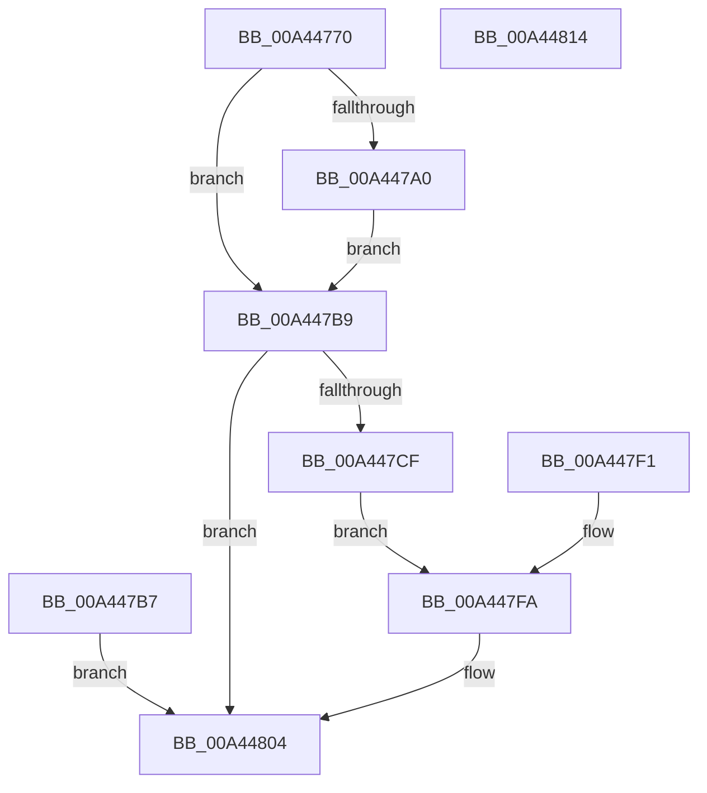

# NtCancelIoFileEx

- RVA: `0x00A44770`–`0x00A44815` (길이 `165` bytes)
- VA: `0x0000000140A44770`
- 실행 섹션: `PAGE`
- PDB 이름 있음: `예`; PDB Function 태그: `아니요`
- unwind 정보 RVA: `0x000AF178`
- 디코드: `44`개 명령, `165/165` bytes 표시
- 미해석 바이트: `0` (있으면 어셈블리에 `.byte`로 보존)

> 이 문서는 커널 이미지의 기계어와 PDB 기호를 분석해 생성했습니다. 4번과 5번은 함수 원형과 자료형을 바이너리 사용 방식에서 추정한 C 해석이며 원본 소스 복구 결과는 아닙니다.

## 1. Dependencies

- 직접 호출 지점: **3**; 고유 호출 대상: **3**
- 직접 호출자로 확인된 함수: **0**
- RIP 상대 이미지 참조: **0**

### Outgoing calls
- `0x00A447C6` → [IopReferenceFileObject](../../text/29/IopReferenceFileObject_function_0029D530.md) (function, `0x0029D530`)
- `0x00A447DA` → [IopCancelIoFile](IopCancelIoFile_function_00A4481C.md) (function, `0x00A4481C`)
- `0x00A447FD` → [ObfDereferenceObject](../../text/2F/ObfDereferenceObject_function_002F9350.md) (function, `0x002F9350`)

### Direct callers
- 이 함수 시작 RVA로 연결되는 직접 call은 확인되지 않았습니다. 간접 호출은 완전히 역산할 수 없습니다.

### Static image references
- 디코드된 RIP-relative 메모리 참조가 없습니다.

## 2. Other-region calls and transfers

- 다른 실행 섹션으로 향하는 call: **2**
  - `0x00A447C6` → [IopReferenceFileObject](../../text/29/IopReferenceFileObject_function_0029D530.md) (`PAGE` → `.text`)
  - `0x00A447FD` → [ObfDereferenceObject](../../text/2F/ObfDereferenceObject_function_002F9350.md) (`PAGE` → `.text`)
- 별도 외부 분기/꼬리 이동을 확인하지 못했습니다.

## 3. Assembly (complete function range)

```asm
00A44770  48 89 5C 24 08                  mov qword ptr [rsp + 8], rbx
00A44775  48 89 74 24 10                  mov qword ptr [rsp + 0x10], rsi
00A4477A  57                              push rdi
00A4477B  48 83 EC 40                     sub rsp, 0x40
00A4477F  49 8B F0                        mov rsi, r8
00A44782  48 8B DA                        mov rbx, rdx
00A44785  48 83 64 24 30 00               and qword ptr [rsp + 0x30], 0
00A4478B  65 48 8B 04 25 88 01 00 00      mov rax, qword ptr gs:[0x188]
00A44794  44 8A 80 32 02 00 00            mov r8b, byte ptr [rax + 0x232]
00A4479B  45 84 C0                        test r8b, r8b
00A4479E  74 19                           je 0x140a447b9
00A447A0  48 BA 00 00 FF FF FF 7F 00 00   movabs rdx, 0x7fffffff0000
00A447AA  48 3B F2                        cmp rsi, rdx
00A447AD  48 0F 42 D6                     cmovb rdx, rsi
00A447B1  8B 02                           mov eax, dword ptr [rdx]
00A447B3  89 02                           mov dword ptr [rdx], eax
00A447B5  EB 02                           jmp 0x140a447b9
00A447B7  EB 4B                           jmp 0x140a44804
00A447B9  48 83 64 24 20 00               and qword ptr [rsp + 0x20], 0
00A447BF  4C 8D 4C 24 30                  lea r9, [rsp + 0x30]
00A447C4  33 D2                           xor edx, edx
00A447C6  E8 65 8D 85 FF                  call 0x14029d530
00A447CB  85 C0                           test eax, eax
00A447CD  78 35                           js 0x140a44804
00A447CF  48 8B D3                        mov rdx, rbx
00A447D2  48 8B 7C 24 30                  mov rdi, qword ptr [rsp + 0x30]
00A447D7  48 8B CF                        mov rcx, rdi
00A447DA  E8 3D 00 00 00                  call 0x140a4481c
00A447DF  8B D8                           mov ebx, eax
00A447E1  89 44 24 68                     mov dword ptr [rsp + 0x68], eax
00A447E5  89 06                           mov dword ptr [rsi], eax
00A447E7  48 C7 46 08 00 00 00 00         mov qword ptr [rsi + 8], 0
00A447EF  EB 09                           jmp 0x140a447fa
00A447F1  8B 5C 24 68                     mov ebx, dword ptr [rsp + 0x68]
00A447F5  48 8B 7C 24 30                  mov rdi, qword ptr [rsp + 0x30]
00A447FA  48 8B CF                        mov rcx, rdi
00A447FD  E8 4E 4B 8B FF                  call 0x1402f9350
00A44802  8B C3                           mov eax, ebx
00A44804  48 8B 5C 24 50                  mov rbx, qword ptr [rsp + 0x50]
00A44809  48 8B 74 24 58                  mov rsi, qword ptr [rsp + 0x58]
00A4480E  48 83 C4 40                     add rsp, 0x40
00A44812  5F                              pop rdi
00A44813  C3                              ret
00A44814  CC                              int3
```

## 4. C-style interpretation (structured pseudocode)

```c
__int64 __fastcall NtCancelIoFileEx(__int64 a1, __int64 a2, __int64 a3)
{
    __int64 result;
    __int64 v_rsp;
    unsigned __int64 v_stack_m18;
    unsigned __int64 v_stack_m28;
    unsigned __int64 v_stack_p10;
    unsigned int v_stack_p20;
    unsigned __int64 v_stack_p8;

    v_stack_p8 = v_rbx;
    v_stack_p10 = v_rsi;
    v_rsp = (v_rsp) - (64);
    if ((unsigned __int8)(*(unsigned __int8 *)(*(unsigned __int64 *)(gs_base + (0 + 392)) + 562)) == 0) goto loc_00A447B9;
    if (a3 < a2) { a2 = a3; }
    *(unsigned int *)(a2) = (unsigned int)((unsigned int)(*(unsigned int *)(a2)));
    goto loc_00A447B9;
loc_00A447B9:
    a2 = 0;
    result = IopReferenceFileObject(a1, a2, *(unsigned __int8 *)(*(unsigned __int64 *)(gs_base + (0 + 392)) + 562), v_stack_m18);
    if (sign_flag) goto loc_00A44804;
    result = IopCancelIoFile(v_stack_m18, 0, *(unsigned __int8 *)(*(unsigned __int64 *)(gs_base + (0 + 392)) + 562), v_stack_m18);
    v_stack_p20 = (unsigned int)(result);
    *(unsigned int *)(a3) = (unsigned int)(result);
    *(unsigned __int64 *)(a3 + 8) = 0;
    goto loc_00A447FA;
loc_00A447FA:
    result = ObfDereferenceObject(v_stack_m18, 0, *(unsigned __int8 *)(*(unsigned __int64 *)(gs_base + (0 + 392)) + 562), v_stack_m18);
loc_00A44804:
    v_rsp = (v_rsp) + (64);
    return (unsigned int)((unsigned int)((unsigned int)((unsigned int)(result))));
}
```

## 5. (Beta) C Style

```c
int64_t NtCancelIoFileEx(int64_t Arg1, int64_t Arg2, int64_t Arg3)
{
    int64_t result;
    int64_t local_rsp;
    uint64_t v_stack_m18;
    uint64_t v_stack_m28;
    uint64_t v_stack_p10;
    uint32_t v_stack_p20;
    uint64_t v_stack_p8;

    v_stack_p8 = local_rbx;
    v_stack_p10 = local_rsi;
    local_rsp = (local_rsp) - (64);
    if ((uint8_t)(*(uint8_t *)(*(uint64_t *)(gs_base + (0 + 0x188)) + 0x232)) == 0) goto loc_00A447B9;
    if (Arg3 < Arg2) { Arg2 = Arg3; }
    *(uint32_t *)(Arg2) = (uint32_t)((uint32_t)(*(uint32_t *)(Arg2)));
    goto loc_00A447B9;
loc_00A447B9:
    Arg2 = 0;
    result = IopReferenceFileObject(Arg1, Arg2, *(uint8_t *)(*(uint64_t *)(gs_base + (0 + 0x188)) + 0x232), v_stack_m18);
    if (sign_flag) goto loc_00A44804;
    result = IopCancelIoFile(v_stack_m18, 0, *(uint8_t *)(*(uint64_t *)(gs_base + (0 + 0x188)) + 0x232), v_stack_m18);
    v_stack_p20 = (uint32_t)(result);
    *(uint32_t *)(Arg3) = (uint32_t)(result);
    *(uint64_t *)(Arg3 + 0x8) = 0;
    goto loc_00A447FA;
loc_00A447FA:
    result = ObfDereferenceObject(v_stack_m18, 0, *(uint8_t *)(*(uint64_t *)(gs_base + (0 + 0x188)) + 0x232), v_stack_m18);
loc_00A44804:
    local_rsp = (local_rsp) + (64);
    return (uint32_t)((uint32_t)((uint32_t)((uint32_t)(result))));
}
```

## 6. Execution-region graph

[열기: 2D/3D 그래프와 함수 탐색 컨트롤 패널](../../../control-panel.html?section=page&rva=0x00A44770&view=graph)

- 2D 그래프는 위에서 아래로 흐르고, 3D 그래프는 빈 공간을 드래그해 회전합니다. Shift+드래그는 이동, 휠은 확대·축소, 함수 노드 선택은 대상 보고서 이동입니다.

### Static fallback


