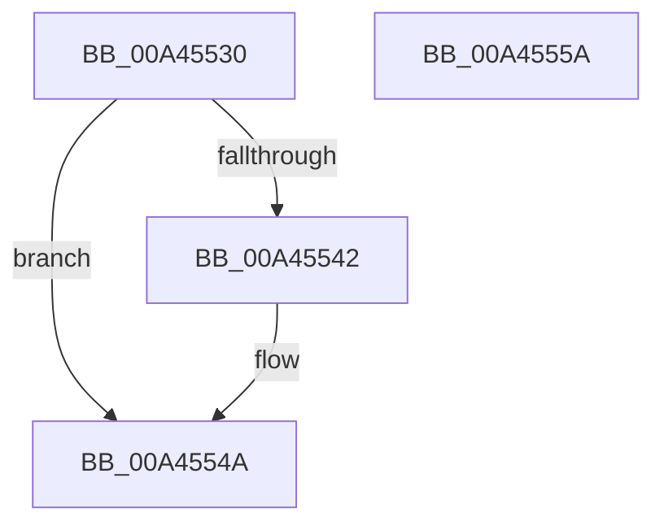

# NtCompareSigningLevels

- RVA: `0x00A45530`–`0x00A4555B` (길이 `43` bytes)
- VA: `0x0000000140A45530`
- 실행 섹션: `PAGE`
- PDB 이름 있음: `예`; PDB Function 태그: `아니요`
- unwind 정보 RVA: `0x0005C788`
- 디코드: `14`개 명령, `43/43` bytes 표시
- 미해석 바이트: `0` (있으면 어셈블리에 `.byte`로 보존)

> 이 문서는 커널 이미지의 기계어와 PDB 기호를 분석해 생성했습니다. 4번과 5번은 함수 원형과 자료형을 바이너리 사용 방식에서 추정한 C 해석이며 원본 소스 복구 결과는 아닙니다.

## 1. Dependencies

- 직접 호출 지점: **1**; 고유 호출 대상: **1**
- 직접 호출자로 확인된 함수: **0**
- RIP 상대 이미지 참조: **1**

### Outgoing calls
- `0x00A45545` → [guard_dispatch_icall](../../text/6B/guard_dispatch_icall_function_006BAAD0.md) (function, `0x006BAAD0`)

### Direct callers
- 이 함수 시작 RVA로 연결되는 직접 call은 확인되지 않았습니다. 간접 호출은 완전히 역산할 수 없습니다.

### Static image references
- `0x00A45534` → RVA `0x00F04E80` (`.data`; read)

## 2. Other-region calls and transfers

- 다른 실행 섹션으로 향하는 call: **1**
  - `0x00A45545` → [guard_dispatch_icall](../../text/6B/guard_dispatch_icall_function_006BAAD0.md) (`PAGE` → `.text`)
- 별도 외부 분기/꼬리 이동을 확인하지 못했습니다.

## 3. Assembly (complete function range)

```asm
00A45530  48 83 EC 28                     sub rsp, 0x28
00A45534  4C 8B 05 45 F9 4B 00            mov r8, qword ptr [rip + 0x4bf945]
00A4553B  33 C0                           xor eax, eax
00A4553D  4D 85 C0                        test r8, r8
00A45540  74 08                           je 0x140a4554a
00A45542  49 8B C0                        mov rax, r8
00A45545  E8 86 55 C7 FF                  call 0x1406baad0
00A4554A  F7 D8                           neg eax
00A4554C  1B C0                           sbb eax, eax
00A4554E  F7 D0                           not eax
00A45550  25 28 04 00 C0                  and eax, 0xc0000428
00A45555  48 83 C4 28                     add rsp, 0x28
00A45559  C3                              ret
00A4555A  CC                              int3
```

## 4. C-style interpretation (structured pseudocode)

```c
__int64 __fastcall NtCompareSigningLevels(void)
{
    __int64 result;
    __int64 v_rsp;

    v_rsp = (v_rsp) - (40);
    result = 0;
    if (*(unsigned __int64 *)(v_rip + 4979013) != 0) {
        result = *(unsigned __int64 *)(v_rip + 4979013);
        result = guard_dispatch_icall(a1, a2, *(unsigned __int64 *)(v_rip + 4979013), a4);
    }
    result = (unsigned int)(-(result));
    result = (unsigned int)(~(result));
    result = (unsigned int)((result) & (0xC0000428ULL));
    v_rsp = (v_rsp) + (40);
    return result;
}
```

## 5. (Beta) C Style

```c
void NtCompareSigningLevels(void)
{
    int64_t result;
    int64_t local_rsp;

    local_rsp = (local_rsp) - (40);
    result = 0;
    if (*(uint64_t *)(v_rip + 0x4BF945) != 0) {
        result = *(uint64_t *)(v_rip + 0x4BF945);
        result = guard_dispatch_icall(a1, a2, *(uint64_t *)(v_rip + 0x4BF945), a4);
    }
    result = (uint32_t)(-(result));
    result = (uint32_t)(~(result));
    result = (uint32_t)((result) & (0xC0000428ULL));
    local_rsp = (local_rsp) + (40);
    return result;
}
```

## 6. Execution-region graph

[열기: 2D/3D 그래프와 함수 탐색 컨트롤 패널](../../../control-panel.html?section=page&rva=0x00A45530&view=graph)

- 2D 그래프는 위에서 아래로 흐르고, 3D 그래프는 빈 공간을 드래그해 회전합니다. Shift+드래그는 이동, 휠은 확대·축소, 함수 노드 선택은 대상 보고서 이동입니다.

### Static fallback


