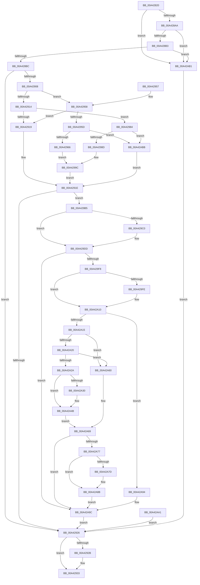

# NtGetCachedSigningLevel

- RVA: `0x00A42820`–`0x00A42AC5` (길이 `677` bytes)
- VA: `0x0000000140A42820`
- 실행 섹션: `PAGE`
- PDB 이름 있음: `예`; PDB Function 태그: `아니요`
- unwind 정보 RVA: `0x000AEE74`
- 디코드: `168`개 명령, `677/677` bytes 표시
- 미해석 바이트: `0` (있으면 어셈블리에 `.byte`로 보존)

> 이 문서는 커널 이미지의 기계어와 PDB 기호를 분석해 생성했습니다. 4번과 5번은 함수 원형과 자료형을 바이너리 사용 방식에서 추정한 C 해석이며 원본 소스 복구 결과는 아닙니다.

## 1. Dependencies

- 직접 호출 지점: **11**; 고유 호출 대상: **7**
- 직접 호출자로 확인된 함수: **0**
- RIP 상대 이미지 참조: **3**

### Outgoing calls
- `0x00A42885` → [memset](../../text/6C/memset_function_006C6C40.md) (function, `0x006C6C40`)
- `0x00A428F3` → [ObReferenceObjectByHandle](../86/ObReferenceObjectByHandle_function_00868DB0.md) (function, `0x00868DB0`)
- `0x00A4292E` → [ObfDereferenceObject](../../text/2F/ObfDereferenceObject_function_002F9350.md) (function, `0x002F9350`)
- `0x00A42940` → [_security_check_cookie](../../text/6A/_security_check_cookie_function_006AC640.md) (function, `0x006AC640`)
- `0x00A429A9` → [guard_dispatch_icall](../../text/6B/guard_dispatch_icall_function_006BAAD0.md) (function, `0x006BAAD0`)
- `0x00A429C8` → [ProbeForWrite](../8E/ProbeForWrite_function_008E91C0.md) (function, `0x008E91C0`)
- `0x00A429D8` → [ProbeForWrite](../8E/ProbeForWrite_function_008E91C0.md) (function, `0x008E91C0`)
- `0x00A42A07` → [ProbeForWrite](../8E/ProbeForWrite_function_008E91C0.md) (function, `0x008E91C0`)
- `0x00A42A3C` → [ProbeForWrite](../8E/ProbeForWrite_function_008E91C0.md) (function, `0x008E91C0`)
- `0x00A42A59` → [memcpy](../../text/6C/memcpy_function_006C6840.md) (function, `0x006C6840`)
- `0x00A42A86` → [ProbeForWrite](../8E/ProbeForWrite_function_008E91C0.md) (function, `0x008E91C0`)

### Direct callers
- 이 함수 시작 RVA로 연결되는 직접 call은 확인되지 않았습니다. 간접 호출은 완전히 역산할 수 없습니다.

### Static image references
- `0x00A42832` → RVA `0x00E0A740` (`.data`; read)
- `0x00A428CC` → RVA `0x00FC6AE0` (`ALMOSTRO`; read)
- `0x00A42908` → RVA `0x00F04E50` (`.data`; read)

## 2. Other-region calls and transfers

- 다른 실행 섹션으로 향하는 call: **5**
  - `0x00A42885` → [memset](../../text/6C/memset_function_006C6C40.md) (`PAGE` → `.text`)
  - `0x00A4292E` → [ObfDereferenceObject](../../text/2F/ObfDereferenceObject_function_002F9350.md) (`PAGE` → `.text`)
  - `0x00A42940` → [_security_check_cookie](../../text/6A/_security_check_cookie_function_006AC640.md) (`PAGE` → `.text`)
  - `0x00A429A9` → [guard_dispatch_icall](../../text/6B/guard_dispatch_icall_function_006BAAD0.md) (`PAGE` → `.text`)
  - `0x00A42A59` → [memcpy](../../text/6C/memcpy_function_006C6840.md) (`PAGE` → `.text`)
- 별도 외부 분기/꼬리 이동을 확인하지 못했습니다.

## 3. Assembly (complete function range)

```asm
00A42820  40 53                           push rbx
00A42822  56                              push rsi
00A42823  41 54                           push r12
00A42825  41 55                           push r13
00A42827  41 56                           push r14
00A42829  41 57                           push r15
00A4282B  48 81 EC D8 00 00 00            sub rsp, 0xd8
00A42832  48 8B 05 07 7F 3C 00            mov rax, qword ptr [rip + 0x3c7f07]
00A42839  48 33 C4                        xor rax, rsp
00A4283C  48 89 84 24 C0 00 00 00         mov qword ptr [rsp + 0xc0], rax
00A42844  49 8B F1                        mov rsi, r9
00A42847  4C 89 4C 24 70                  mov qword ptr [rsp + 0x70], r9
00A4284C  49 8B D8                        mov rbx, r8
00A4284F  48 89 5C 24 68                  mov qword ptr [rsp + 0x68], rbx
00A42854  4C 8B F2                        mov r14, rdx
00A42857  4C 8B E9                        mov r13, rcx
00A4285A  48 89 4C 24 58                  mov qword ptr [rsp + 0x58], rcx
00A4285F  4C 8B A4 24 30 01 00 00         mov r12, qword ptr [rsp + 0x130]
00A42867  48 8B 84 24 38 01 00 00         mov rax, qword ptr [rsp + 0x138]
00A4286F  48 89 44 24 78                  mov qword ptr [rsp + 0x78], rax
00A42874  45 33 FF                        xor r15d, r15d
00A42877  33 D2                           xor edx, edx
00A42879  45 8D 47 40                     lea r8d, [r15 + 0x40]
00A4287D  48 8D 8C 24 80 00 00 00         lea rcx, [rsp + 0x80]
00A42885  E8 B6 43 C8 FF                  call 0x1406c6c40
00A4288A  C7 44 24 48 40 00 00 00         mov dword ptr [rsp + 0x48], 0x40
00A42892  44 21 7C 24 4C                  and dword ptr [rsp + 0x4c], r15d
00A42897  44 21 7C 24 44                  and dword ptr [rsp + 0x44], r15d
00A4289C  44 88 7C 24 40                  mov byte ptr [rsp + 0x40], r15b
00A428A1  4D 85 ED                        test r13, r13
00A428A4  0F 84 07 02 00 00               je 0x140a42ab1
00A428AA  4D 85 F6                        test r14, r14
00A428AD  0F 84 FE 01 00 00               je 0x140a42ab1
00A428B3  48 85 DB                        test rbx, rbx
00A428B6  0F 84 F5 01 00 00               je 0x140a42ab1
00A428BC  65 48 8B 04 25 88 01 00 00      mov rax, qword ptr gs:[0x188]
00A428C5  44 8A A8 32 02 00 00            mov r13b, byte ptr [rax + 0x232]
00A428CC  4C 8B 05 0D 42 58 00            mov r8, qword ptr [rip + 0x58420d]
00A428D3  4C 21 7C 24 60                  and qword ptr [rsp + 0x60], r15
00A428D8  4C 21 7C 24 28                  and qword ptr [rsp + 0x28], r15
00A428DD  48 8D 44 24 60                  lea rax, [rsp + 0x60]
00A428E2  48 89 44 24 20                  mov qword ptr [rsp + 0x20], rax
00A428E7  45 8A CD                        mov r9b, r13b
00A428EA  41 8D 57 01                     lea edx, [r15 + 1]
00A428EE  48 8B 4C 24 58                  mov rcx, qword ptr [rsp + 0x58]
00A428F3  E8 B8 64 E2 FF                  call 0x140868db0
00A428F8  8B D8                           mov ebx, eax
00A428FA  4C 8B 7C 24 60                  mov r15, qword ptr [rsp + 0x60]
00A428FF  4C 89 7C 24 58                  mov qword ptr [rsp + 0x58], r15
00A42904  85 C0                           test eax, eax
00A42906  78 1E                           js 0x140a42926
00A42908  48 8B 05 41 25 4C 00            mov rax, qword ptr [rip + 0x4c2541]
00A4290F  48 85 F6                        test rsi, rsi
00A42912  75 44                           jne 0x140a42958
00A42914  48 85 C0                        test rax, rax
00A42917  75 6B                           jne 0x140a42984
00A42919  BB 01 00 00 C0                  mov ebx, 0xc0000001
00A4291E  85 DB                           test ebx, ebx
00A42920  0F 89 8F 00 00 00               jns 0x140a429b5
00A42926  4D 85 FF                        test r15, r15
00A42929  74 08                           je 0x140a42933
00A4292B  49 8B CF                        mov rcx, r15
00A4292E  E8 1D 6A 8B FF                  call 0x1402f9350
00A42933  8B C3                           mov eax, ebx
00A42935  48 8B 8C 24 C0 00 00 00         mov rcx, qword ptr [rsp + 0xc0]
00A4293D  48 33 CC                        xor rcx, rsp
00A42940  E8 FB 9C C6 FF                  call 0x1406ac640
00A42945  48 81 C4 D8 00 00 00            add rsp, 0xd8
00A4294C  41 5F                           pop r15
00A4294E  41 5E                           pop r14
00A42950  41 5D                           pop r13
00A42952  41 5C                           pop r12
00A42954  5E                              pop rsi
00A42955  5B                              pop rbx
00A42956  C3                              ret
00A42957  CC                              int3
00A42958  48 85 C0                        test rax, rax
00A4295B  74 BC                           je 0x140a42919
00A4295D  4D 85 FF                        test r15, r15
00A42960  0F 84 55 01 00 00               je 0x140a42abb
00A42966  48 8D 4C 24 4C                  lea rcx, [rsp + 0x4c]
00A4296B  48 89 4C 24 28                  mov qword ptr [rsp + 0x28], rcx
00A42970  48 8D 4C 24 48                  lea rcx, [rsp + 0x48]
00A42975  48 89 4C 24 20                  mov qword ptr [rsp + 0x20], rcx
00A4297A  4C 8D 8C 24 80 00 00 00         lea r9, [rsp + 0x80]
00A42982  EB 18                           jmp 0x140a4299c
00A42984  4D 85 FF                        test r15, r15
00A42987  0F 84 2E 01 00 00               je 0x140a42abb
00A4298D  48 83 64 24 28 00               and qword ptr [rsp + 0x28], 0
00A42993  48 83 64 24 20 00               and qword ptr [rsp + 0x20], 0
00A42999  45 33 C9                        xor r9d, r9d
00A4299C  4C 8D 44 24 44                  lea r8, [rsp + 0x44]
00A429A1  48 8D 54 24 40                  lea rdx, [rsp + 0x40]
00A429A6  49 8B CF                        mov rcx, r15
00A429A9  E8 22 81 C7 FF                  call 0x1406baad0
00A429AE  8B D8                           mov ebx, eax
00A429B0  E9 69 FF FF FF                  jmp 0x140a4291e
00A429B5  BE 04 00 00 00                  mov esi, 4
00A429BA  41 80 FD 01                     cmp r13b, 1
00A429BE  75 1D                           jne 0x140a429dd
00A429C0  44 8B C6                        mov r8d, esi
00A429C3  8B D6                           mov edx, esi
00A429C5  49 8B CE                        mov rcx, r14
00A429C8  E8 F3 67 EA FF                  call 0x1408e91c0
00A429CD  8D 56 FD                        lea edx, [rsi - 3]
00A429D0  44 8B C2                        mov r8d, edx
00A429D3  48 8B 4C 24 68                  mov rcx, qword ptr [rsp + 0x68]
00A429D8  E8 E3 67 EA FF                  call 0x1408e91c0
00A429DD  8B 4C 24 44                     mov ecx, dword ptr [rsp + 0x44]
00A429E1  41 89 0E                        mov dword ptr [r14], ecx
00A429E4  8A 44 24 40                     mov al, byte ptr [rsp + 0x40]
00A429E8  48 8B 54 24 68                  mov rdx, qword ptr [rsp + 0x68]
00A429ED  88 02                           mov byte ptr [rdx], al
00A429EF  4D 85 E4                        test r12, r12
00A429F2  0F 84 A4 00 00 00               je 0x140a42a9c
00A429F8  41 80 FD 01                     cmp r13b, 1
00A429FC  75 12                           jne 0x140a42a10
00A429FE  44 8B C6                        mov r8d, esi
00A42A01  48 8B D6                        mov rdx, rsi
00A42A04  49 8B CC                        mov rcx, r12
00A42A07  E8 B4 67 EA FF                  call 0x1408e91c0
00A42A0C  8B 4C 24 44                     mov ecx, dword ptr [rsp + 0x44]
00A42A10  F6 C1 02                        test cl, 2
00A42A13  74 7F                           je 0x140a42a94
00A42A15  44 8B 74 24 48                  mov r14d, dword ptr [rsp + 0x48]
00A42A1A  45 39 34 24                     cmp dword ptr [r12], r14d
00A42A1E  72 40                           jb 0x140a42a60
00A42A20  48 8B 44 24 70                  mov rax, qword ptr [rsp + 0x70]
00A42A25  48 85 C0                        test rax, rax
00A42A28  74 36                           je 0x140a42a60
00A42A2A  41 80 FD 01                     cmp r13b, 1
00A42A2E  75 1B                           jne 0x140a42a4b
00A42A30  41 8B D6                        mov edx, r14d
00A42A33  41 B8 01 00 00 00               mov r8d, 1
00A42A39  48 8B C8                        mov rcx, rax
00A42A3C  E8 7F 67 EA FF                  call 0x1408e91c0
00A42A41  44 8B 74 24 48                  mov r14d, dword ptr [rsp + 0x48]
00A42A46  48 8B 44 24 70                  mov rax, qword ptr [rsp + 0x70]
00A42A4B  45 8B C6                        mov r8d, r14d
00A42A4E  48 8D 94 24 80 00 00 00         lea rdx, [rsp + 0x80]
00A42A56  48 8B C8                        mov rcx, rax
00A42A59  E8 E2 3D C8 FF                  call 0x1406c6840
00A42A5E  EB 09                           jmp 0x140a42a69
00A42A60  BB 23 00 00 C0                  mov ebx, 0xc0000023
00A42A65  89 5C 24 50                     mov dword ptr [rsp + 0x50], ebx
00A42A69  45 89 34 24                     mov dword ptr [r12], r14d
00A42A6D  4C 8B 74 24 78                  mov r14, qword ptr [rsp + 0x78]
00A42A72  4D 85 F6                        test r14, r14
00A42A75  74 25                           je 0x140a42a9c
00A42A77  41 80 FD 01                     cmp r13b, 1
00A42A7B  75 0E                           jne 0x140a42a8b
00A42A7D  44 8B C6                        mov r8d, esi
00A42A80  48 8B D6                        mov rdx, rsi
00A42A83  49 8B CE                        mov rcx, r14
00A42A86  E8 35 67 EA FF                  call 0x1408e91c0
00A42A8B  8B 44 24 4C                     mov eax, dword ptr [rsp + 0x4c]
00A42A8F  41 89 06                        mov dword ptr [r14], eax
00A42A92  EB 08                           jmp 0x140a42a9c
00A42A94  41 C7 04 24 00 00 00 00         mov dword ptr [r12], 0
00A42A9C  E9 85 FE FF FF                  jmp 0x140a42926
00A42AA1  8B D8                           mov ebx, eax
00A42AA3  89 44 24 50                     mov dword ptr [rsp + 0x50], eax
00A42AA7  4C 8B 7C 24 58                  mov r15, qword ptr [rsp + 0x58]
00A42AAC  E9 75 FE FF FF                  jmp 0x140a42926
00A42AB1  BB 0D 00 00 C0                  mov ebx, 0xc000000d
00A42AB6  E9 6B FE FF FF                  jmp 0x140a42926
00A42ABB  BB 0D 00 00 C0                  mov ebx, 0xc000000d
00A42AC0  E9 59 FE FF FF                  jmp 0x140a4291e
```

## 4. C-style interpretation (structured pseudocode)

```c
__int64 __fastcall NtGetCachedSigningLevel(__int64 a1, __int64 a2, __int64 a3, __int64 a4, __int64 a5, __int64 a6)
{
    __int64 result;
    __int64 v_r14;
    __int64 v_r15;
    __int64 v_rsp;
    unsigned __int64 v_stack_m48;
    unsigned __int64 v_stack_m88;
    unsigned __int64 v_stack_m90;
    unsigned __int64 v_stack_m98;
    unsigned __int64 v_stack_mA0;
    unsigned __int64 v_stack_mA8;
    unsigned __int64 v_stack_mB0;
    unsigned int v_stack_mBC;
    unsigned int v_stack_mC0;
    unsigned int v_stack_mC4;
    unsigned __int8 v_stack_mC8;
    unsigned __int64 v_stack_mE0;
    unsigned __int64 v_stack_mE8;
    unsigned __int64 v_stack_p20;
    unsigned __int64 v_stack_p28;
    unsigned __int64 v_stack_p40;
    unsigned __int64 v_stack_p44;
    unsigned __int64 v_stack_p48;
    unsigned __int64 v_stack_p4C;
    unsigned int v_stack_p50;
    unsigned __int64 v_stack_p58;
    unsigned __int64 v_stack_p68;
    unsigned __int64 v_stack_p70;
    unsigned __int64 v_stack_p78;
    unsigned __int64 v_stack_p80;

    v_rsp = (v_rsp) - (216);
    result = (*(unsigned __int64 *)(v_rip + 3964679)) ^ (v_rsp);
    v_stack_m48 = result;
    v_stack_m98 = a4;
    v_stack_mA0 = a3;
    v_stack_mB0 = a1;
    v_stack_m90 = a6;
    v_r15 = 0;
    a2 = 0;
    result = memset(v_stack_m88, a2, v_r15 + 64, a4);
    v_stack_mC0 = 64;
    v_stack_mC8 = 0;
    if (a1 == 0) goto loc_00A42AB1;
    if (0 == 0) goto loc_00A42AB1;
    if (a3 == 0) goto loc_00A42AB1;
    v_stack_mE8 = v_stack_mA8;
    result = ObReferenceObjectByHandle(v_stack_mB0, v_r15 + 1, *(unsigned __int64 *)(v_rip + 5784077), (unsigned __int8)(*(unsigned __int8 *)(*(unsigned __int64 *)(gs_base + (0 + 392)) + 562)));
    v_stack_mB0 = v_stack_mA8;
    if (sign_flag) goto loc_00A42926;
    if (a4 != 0) goto loc_00A42958;
    if (*(unsigned __int64 *)(v_rip + 4990273) != 0) goto loc_00A42984;
loc_00A42919:
loc_00A4291E:
    if (!sign_flag) goto loc_00A429B5;
loc_00A42926:
    result = *(unsigned __int64 *)(v_rip + 4990273);
    if (v_stack_mA8 != 0) {
        a1 = v_stack_mA8;
        result = ObfDereferenceObject(a1, v_r15 + 1, *(unsigned __int64 *)(v_rip + 5784077), (unsigned __int8)(*(unsigned __int8 *)(*(unsigned __int64 *)(gs_base + (0 + 392)) + 562)));
    }
    a1 = (v_stack_m48) ^ (v_rsp);
    result = _security_check_cookie(a1, v_r15 + 1, *(unsigned __int64 *)(v_rip + 5784077), (unsigned __int8)(*(unsigned __int8 *)(*(unsigned __int64 *)(gs_base + (0 + 392)) + 562)));
    v_rsp = (v_rsp) + (216);
    return result;
loc_00A42958:
    if (result == 0) goto loc_00A42919;
    if (v_stack_mA8 == 0) goto loc_00A42ABB;
    v_stack_p28 = v_stack_p4C;
    v_stack_p20 = v_stack_p48;
    goto loc_00A4299C;
loc_00A42984:
    if (v_stack_mA8 == 0) goto loc_00A42ABB;
    a4 = 0;
loc_00A4299C:
    result = guard_dispatch_icall(v_stack_mA8, v_stack_p40, v_stack_p44, a4);
    goto loc_00A4291E;
loc_00A429B5:
    if (((unsigned __int8)(*(unsigned __int8 *)(*(unsigned __int64 *)(gs_base + (0 + 392)) + 562))) == 1) {
        a3 = 4;
        a2 = 4;
        a1 = a2;
        result = ProbeForWrite(a1, a2, a3, a4);
        a2 = 4 - 3;
        a3 = (unsigned int)(a2);
        a1 = v_stack_p68;
        result = ProbeForWrite(a1, a2, a3, a4);
    }
    *(unsigned int *)(a2) = (unsigned int)((unsigned int)(v_stack_p44));
    *(unsigned __int8 *)(v_stack_p68) = (unsigned __int8)(v_stack_p40);
    if (a5 == 0) goto loc_00A42A9C;
    result = v_stack_p40;
    if (((unsigned __int8)(*(unsigned __int8 *)(*(unsigned __int64 *)(gs_base + (0 + 392)) + 562))) == 1) {
        a3 = 4;
        a2 = 4;
        a1 = a5;
        result = ProbeForWrite(a1, a2, a3, a4);
        a1 = v_stack_p44;
    }
    if ((((unsigned __int8)(a1)) & (2)) == 0) goto loc_00A42A94;
    if ((*(unsigned int *)(a5)) < ((unsigned int)((unsigned int)(v_stack_p48)))) goto loc_00A42A60;
    if (v_stack_p70 == 0) goto loc_00A42A60;
    result = v_stack_p70;
    v_r14 = (unsigned int)(v_stack_p48);
    if (((unsigned __int8)(*(unsigned __int8 *)(*(unsigned __int64 *)(gs_base + (0 + 392)) + 562))) == 1) {
        a2 = (unsigned int)((unsigned int)(v_stack_p48));
        a3 = 1;
        a1 = v_stack_p70;
        result = ProbeForWrite(a1, a2, a3, a4);
        v_r14 = v_stack_p48;
        result = v_stack_p70;
    }
    result = memcpy(result, v_stack_p80, (unsigned int)((unsigned int)(v_r14)), a4);
    goto loc_00A42A69;
loc_00A42A60:
    v_stack_p50 = (unsigned int)((unsigned int)(0xC0000023ULL));
loc_00A42A69:
    *(unsigned int *)(a5) = (unsigned int)(v_r14);
    if (v_stack_p78 == 0) goto loc_00A42A9C;
    if (((unsigned __int8)(*(unsigned __int8 *)(*(unsigned __int64 *)(gs_base + (0 + 392)) + 562))) == 1) {
        a3 = 4;
        a2 = 4;
        a1 = v_stack_p78;
        result = ProbeForWrite(a1, a2, a3, a4);
    }
    *(unsigned int *)(v_stack_p78) = (unsigned int)((unsigned int)(v_stack_p4C));
    goto loc_00A42A9C;
loc_00A42A94:
    *(unsigned int *)(a5) = 0;
loc_00A42A9C:
    goto loc_00A42926;
loc_00A42AB1:
    goto loc_00A42926;
loc_00A42ABB:
    goto loc_00A4291E;
}
```

## 5. (Beta) C Style

```c
int64_t NtGetCachedSigningLevel(int64_t Arg1, int64_t Arg2, int64_t Arg3, int64_t Arg4, int64_t Arg5, int64_t Arg6)
{
    int64_t result;
    int64_t local_r14;
    int64_t local_r15;
    int64_t local_rsp;
    uint64_t v_stack_m48;
    uint64_t v_stack_m88;
    uint64_t v_stack_m90;
    uint64_t v_stack_m98;
    uint64_t v_stack_mA0;
    uint64_t v_stack_mA8;
    uint64_t v_stack_mB0;
    uint32_t v_stack_mBC;
    uint32_t v_stack_mC0;
    uint32_t v_stack_mC4;
    uint8_t v_stack_mC8;
    uint64_t v_stack_mE0;
    uint64_t v_stack_mE8;
    uint64_t v_stack_p20;
    uint64_t v_stack_p28;
    uint64_t v_stack_p40;
    uint64_t v_stack_p44;
    uint64_t v_stack_p48;
    uint64_t v_stack_p4C;
    uint32_t v_stack_p50;
    uint64_t v_stack_p58;
    uint64_t v_stack_p68;
    uint64_t v_stack_p70;
    uint64_t v_stack_p78;
    uint64_t v_stack_p80;

    local_rsp = (local_rsp) - (216);
    result = (*(uint64_t *)(v_rip + 0x3C7F07)) ^ (local_rsp);
    v_stack_m48 = result;
    v_stack_m98 = Arg4;
    v_stack_mA0 = Arg3;
    v_stack_mB0 = Arg1;
    v_stack_m90 = Arg6;
    local_r15 = 0;
    Arg2 = 0;
    result = memset(v_stack_m88, Arg2, local_r15 + 64, Arg4);
    v_stack_mC0 = 64;
    v_stack_mC8 = 0;
    if (Arg1 == 0) goto loc_00A42AB1;
    if (0 == 0) goto loc_00A42AB1;
    if (Arg3 == 0) goto loc_00A42AB1;
    v_stack_mE8 = v_stack_mA8;
    result = ObReferenceObjectByHandle(v_stack_mB0, local_r15 + 1, *(uint64_t *)(v_rip + 0x58420D), (uint8_t)(*(uint8_t *)(*(uint64_t *)(gs_base + (0 + 0x188)) + 0x232)));
    v_stack_mB0 = v_stack_mA8;
    if (sign_flag) goto loc_00A42926;
    if (Arg4 != 0) goto loc_00A42958;
    if (*(uint64_t *)(v_rip + 0x4C2541) != 0) goto loc_00A42984;
loc_00A42919:
loc_00A4291E:
    if (!sign_flag) goto loc_00A429B5;
loc_00A42926:
    result = *(uint64_t *)(v_rip + 0x4C2541);
    if (v_stack_mA8 != 0) {
        Arg1 = v_stack_mA8;
        result = ObfDereferenceObject(Arg1, local_r15 + 1, *(uint64_t *)(v_rip + 0x58420D), (uint8_t)(*(uint8_t *)(*(uint64_t *)(gs_base + (0 + 0x188)) + 0x232)));
    }
    Arg1 = (v_stack_m48) ^ (local_rsp);
    result = _security_check_cookie(Arg1, local_r15 + 1, *(uint64_t *)(v_rip + 0x58420D), (uint8_t)(*(uint8_t *)(*(uint64_t *)(gs_base + (0 + 0x188)) + 0x232)));
    local_rsp = (local_rsp) + (216);
    return result;
loc_00A42958:
    if (result == 0) goto loc_00A42919;
    if (v_stack_mA8 == 0) goto loc_00A42ABB;
    v_stack_p28 = v_stack_p4C;
    v_stack_p20 = v_stack_p48;
    goto loc_00A4299C;
loc_00A42984:
    if (v_stack_mA8 == 0) goto loc_00A42ABB;
    Arg4 = 0;
loc_00A4299C:
    result = guard_dispatch_icall(v_stack_mA8, v_stack_p40, v_stack_p44, Arg4);
    goto loc_00A4291E;
loc_00A429B5:
    if (((uint8_t)(*(uint8_t *)(*(uint64_t *)(gs_base + (0 + 0x188)) + 0x232))) == 1) {
        Arg3 = 4;
        Arg2 = 4;
        Arg1 = Arg2;
        result = ProbeForWrite(Arg1, Arg2, Arg3, Arg4);
        Arg2 = 4 - 3;
        Arg3 = (uint32_t)(Arg2);
        Arg1 = v_stack_p68;
        result = ProbeForWrite(Arg1, Arg2, Arg3, Arg4);
    }
    *(uint32_t *)(Arg2) = (uint32_t)((uint32_t)(v_stack_p44));
    *(uint8_t *)(v_stack_p68) = (uint8_t)(v_stack_p40);
    if (Arg5 == 0) goto loc_00A42A9C;
    result = v_stack_p40;
    if (((uint8_t)(*(uint8_t *)(*(uint64_t *)(gs_base + (0 + 0x188)) + 0x232))) == 1) {
        Arg3 = 4;
        Arg2 = 4;
        Arg1 = Arg5;
        result = ProbeForWrite(Arg1, Arg2, Arg3, Arg4);
        Arg1 = v_stack_p44;
    }
    if ((((uint8_t)(Arg1)) & (2)) == 0) goto loc_00A42A94;
    if ((*(uint32_t *)(Arg5)) < ((uint32_t)((uint32_t)(v_stack_p48)))) goto loc_00A42A60;
    if (v_stack_p70 == 0) goto loc_00A42A60;
    result = v_stack_p70;
    local_r14 = (uint32_t)(v_stack_p48);
    if (((uint8_t)(*(uint8_t *)(*(uint64_t *)(gs_base + (0 + 0x188)) + 0x232))) == 1) {
        Arg2 = (uint32_t)((uint32_t)(v_stack_p48));
        Arg3 = 1;
        Arg1 = v_stack_p70;
        result = ProbeForWrite(Arg1, Arg2, Arg3, Arg4);
        local_r14 = v_stack_p48;
        result = v_stack_p70;
    }
    result = memcpy(result, v_stack_p80, (uint32_t)((uint32_t)(local_r14)), Arg4);
    goto loc_00A42A69;
loc_00A42A60:
    v_stack_p50 = (uint32_t)((uint32_t)(0xC0000023ULL));
loc_00A42A69:
    *(uint32_t *)(Arg5) = (uint32_t)(local_r14);
    if (v_stack_p78 == 0) goto loc_00A42A9C;
    if (((uint8_t)(*(uint8_t *)(*(uint64_t *)(gs_base + (0 + 0x188)) + 0x232))) == 1) {
        Arg3 = 4;
        Arg2 = 4;
        Arg1 = v_stack_p78;
        result = ProbeForWrite(Arg1, Arg2, Arg3, Arg4);
    }
    *(uint32_t *)(v_stack_p78) = (uint32_t)((uint32_t)(v_stack_p4C));
    goto loc_00A42A9C;
loc_00A42A94:
    *(uint32_t *)(Arg5) = 0;
loc_00A42A9C:
    goto loc_00A42926;
loc_00A42AB1:
    goto loc_00A42926;
loc_00A42ABB:
    goto loc_00A4291E;
}
```

## 6. Execution-region graph

[열기: 2D/3D 그래프와 함수 탐색 컨트롤 패널](../../../control-panel.html?section=page&rva=0x00A42820&view=graph)

- 2D 그래프는 위에서 아래로 흐르고, 3D 그래프는 빈 공간을 드래그해 회전합니다. Shift+드래그는 이동, 휠은 확대·축소, 함수 노드 선택은 대상 보고서 이동입니다.

### Static fallback


