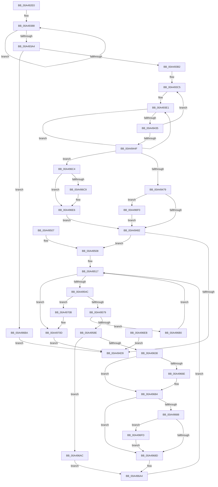

# NtLockProductActivationKeys

- RVA: `0x00A492E0`–`0x00A49724` (길이 `1,092` bytes)
- VA: `0x0000000140A492E0`
- 실행 섹션: `PAGE`
- PDB 이름 있음: `예`; PDB Function 태그: `아니요`
- unwind 정보 RVA: `0x000AFE10`
- 디코드: `234`개 명령, `1,092/1,092` bytes 표시
- 미해석 바이트: `0` (있으면 어셈블리에 `.byte`로 보존)

> 이 문서는 커널 이미지의 기계어와 PDB 기호를 분석해 생성했습니다. 4번과 5번은 함수 원형과 자료형을 바이너리 사용 방식에서 추정한 C 해석이며 원본 소스 복구 결과는 아닙니다.

## 1. Dependencies

- 직접 호출 지점: **14**; 고유 호출 대상: **11**
- 직접 호출자로 확인된 함수: **0**
- RIP 상대 이미지 참조: **10**

### Outgoing calls
- `0x00A4945F` → [RtlInitUnicodeString](../../text/42/RtlInitUnicodeString_function_0042A780.md) (function, `0x0042A780`)
- `0x00A494CE` → [ZwOpenKey](../../text/6A/ZwOpenKey_function_006AD310.md) (function, `0x006AD310`)
- `0x00A494E4` → [_security_check_cookie](../../text/6A/_security_check_cookie_function_006AC640.md) (function, `0x006AC640`)
- `0x00A4953C` → [ZwEnumerateKey](../../text/6A/ZwEnumerateKey_function_006AD710.md) (function, `0x006AD710`)
- `0x00A495A1` → [wcscpy_s](../../text/50/wcscpy_s_function_005064B0.md) (function, `0x005064B0`)
- `0x00A495C4` → [wcsncat_s](../../text/50/wcsncat_s_function_00506540.md) (function, `0x00506540`)
- `0x00A495DB` → [wcscat_s](../../text/50/wcscat_s_function_00506410.md) (function, `0x00506410`)
- `0x00A495F0` → [RtlInitUnicodeString](../../text/42/RtlInitUnicodeString_function_0042A780.md) (function, `0x0042A780`)
- `0x00A4962F` → [ZwOpenKey](../../text/6A/ZwOpenKey_function_006AD310.md) (function, `0x006AD310`)
- `0x00A49663` → [ObReferenceObjectByHandle](../86/ObReferenceObjectByHandle_function_00868DB0.md) (function, `0x00868DB0`)
- `0x00A4967F` → [ObfDereferenceObject](../../text/2F/ObfDereferenceObject_function_002F9350.md) (function, `0x002F9350`)
- `0x00A49692` → [ZwClose](../../text/6A/ZwClose_function_006AD2B0.md) (function, `0x006AD2B0`)
- `0x00A49702` → [ZwLockRegistryKey](../../text/6A/ZwLockRegistryKey_function_006AF390.md) (function, `0x006AF390`)
- `0x00A49712` → [ZwClose](../../text/6A/ZwClose_function_006AD2B0.md) (function, `0x006AD2B0`)

### Direct callers
- 이 함수 시작 RVA로 연결되는 직접 call은 확인되지 않았습니다. 간접 호출은 완전히 역산할 수 없습니다.

### Static image references
- `0x00A492FC` → RVA `0x00E0A740` (`.data`; read)
- `0x00A49335` → RVA `0x0001A5C0` (`.rdata`; read)
- `0x00A49344` → RVA `0x0001A5D0` (`.rdata`; read)
- `0x00A49353` → RVA `0x0001A5E0` (`.rdata`; read)
- `0x00A49362` → RVA `0x0001A5F0` (`.rdata`; read)
- `0x00A49373` → RVA `0x0001A5F8` (`.rdata`; read)
- `0x00A493BE` → RVA `0x0001A600` (`.rdata`; read)
- `0x00A495C9` → RVA `0x00AFC990` (` ?? ::NNGAKEGL::`string'`; read)
- `0x00A4963B` → RVA `0x00FC6AC0` (`ALMOSTRO`; read)
- `0x00A496DE` → RVA `0x00FC41C4` (`.data`; read)

## 2. Other-region calls and transfers

- 다른 실행 섹션으로 향하는 call: **13**
  - `0x00A4945F` → [RtlInitUnicodeString](../../text/42/RtlInitUnicodeString_function_0042A780.md) (`PAGE` → `.text`)
  - `0x00A494CE` → [ZwOpenKey](../../text/6A/ZwOpenKey_function_006AD310.md) (`PAGE` → `.text`)
  - `0x00A494E4` → [_security_check_cookie](../../text/6A/_security_check_cookie_function_006AC640.md) (`PAGE` → `.text`)
  - `0x00A4953C` → [ZwEnumerateKey](../../text/6A/ZwEnumerateKey_function_006AD710.md) (`PAGE` → `.text`)
  - `0x00A495A1` → [wcscpy_s](../../text/50/wcscpy_s_function_005064B0.md) (`PAGE` → `.text`)
  - `0x00A495C4` → [wcsncat_s](../../text/50/wcsncat_s_function_00506540.md) (`PAGE` → `.text`)
  - `0x00A495DB` → [wcscat_s](../../text/50/wcscat_s_function_00506410.md) (`PAGE` → `.text`)
  - `0x00A495F0` → [RtlInitUnicodeString](../../text/42/RtlInitUnicodeString_function_0042A780.md) (`PAGE` → `.text`)
  - `0x00A4962F` → [ZwOpenKey](../../text/6A/ZwOpenKey_function_006AD310.md) (`PAGE` → `.text`)
  - `0x00A4967F` → [ObfDereferenceObject](../../text/2F/ObfDereferenceObject_function_002F9350.md) (`PAGE` → `.text`)
  - `0x00A49692` → [ZwClose](../../text/6A/ZwClose_function_006AD2B0.md) (`PAGE` → `.text`)
  - `0x00A49702` → [ZwLockRegistryKey](../../text/6A/ZwLockRegistryKey_function_006AF390.md) (`PAGE` → `.text`)
  - `0x00A49712` → [ZwClose](../../text/6A/ZwClose_function_006AD2B0.md) (`PAGE` → `.text`)
- 별도 외부 분기/꼬리 이동을 확인하지 못했습니다.

## 3. Assembly (complete function range)

```asm
00A492E0  48 89 5C 24 08                  mov qword ptr [rsp + 8], rbx
00A492E5  48 89 74 24 18                  mov qword ptr [rsp + 0x18], rsi
00A492EA  48 89 7C 24 20                  mov qword ptr [rsp + 0x20], rdi
00A492EF  41 54                           push r12
00A492F1  41 56                           push r14
00A492F3  41 57                           push r15
00A492F5  48 81 EC 20 09 00 00            sub rsp, 0x920
00A492FC  48 8B 05 3D 14 3C 00            mov rax, qword ptr [rip + 0x3c143d]
00A49303  48 33 C4                        xor rax, rsp
00A49306  48 89 84 24 10 09 00 00         mov qword ptr [rsp + 0x910], rax
00A4930E  48 8B FA                        mov rdi, rdx
00A49311  0F 57 C0                        xorps xmm0, xmm0
00A49314  0F 11 84 24 80 00 00 00         movups xmmword ptr [rsp + 0x80], xmm0
00A4931C  33 DB                           xor ebx, ebx
00A4931E  89 9C 24 A4 00 00 00            mov dword ptr [rsp + 0xa4], ebx
00A49325  89 9C 24 BC 00 00 00            mov dword ptr [rsp + 0xbc], ebx
00A4932C  48 89 5C 24 40                  mov qword ptr [rsp + 0x40], rbx
00A49331  89 5C 24 38                     mov dword ptr [rsp + 0x38], ebx
00A49335  0F 10 05 84 12 5D FF            movups xmm0, xmmword ptr [rip - 0xa2ed7c]
00A4933C  0F 11 84 24 D0 00 00 00         movups xmmword ptr [rsp + 0xd0], xmm0
00A49344  0F 10 0D 85 12 5D FF            movups xmm1, xmmword ptr [rip - 0xa2ed7b]
00A4934B  0F 11 8C 24 E0 00 00 00         movups xmmword ptr [rsp + 0xe0], xmm1
00A49353  0F 10 05 86 12 5D FF            movups xmm0, xmmword ptr [rip - 0xa2ed7a]
00A4935A  0F 11 84 24 F0 00 00 00         movups xmmword ptr [rsp + 0xf0], xmm0
00A49362  F2 0F 10 05 86 12 5D FF         movsd xmm0, qword ptr [rip - 0xa2ed7a]
00A4936A  F2 0F 11 84 24 00 01 00 00      movsd qword ptr [rsp + 0x100], xmm0
00A49373  8B 05 7F 12 5D FF               mov eax, dword ptr [rip - 0xa2ed81]
00A49379  89 84 24 08 01 00 00            mov dword ptr [rsp + 0x108], eax
00A49380  41 B8 71 AB 00 00               mov r8d, 0xab71
00A49386  8B D3                           mov edx, ebx
00A49388  0F B7 84 54 D0 00 00 00         movzx eax, word ptr [rsp + rdx*2 + 0xd0]
00A49390  41 8D 0C 00                     lea ecx, [r8 + rax]
00A49394  66 33 C8                        xor cx, ax
00A49397  44 0F B7 C1                     movzx r8d, cx
00A4939B  48 FF C2                        inc rdx
00A4939E  48 83 FA 1E                     cmp rdx, 0x1e
00A493A2  72 E4                           jb 0x140a49388
00A493A4  B8 4F B9 00 00                  mov eax, 0xb94f
00A493A9  66 3B C1                        cmp ax, cx
00A493AC  0F 85 08 03 00 00               jne 0x140a496ba
00A493B2  41 B8 34 00 00 00               mov r8d, 0x34
00A493B8  41 BF 20 37 EF C6               mov r15d, 0xc6ef3720
00A493BE  4C 8D 25 3B 12 5D FF            lea r12, [rip - 0xa2edc5]
00A493C5  46 8B 8C 04 D0 00 00 00         mov r9d, dword ptr [rsp + r8 + 0xd0]
00A493CD  46 8B 94 04 D4 00 00 00         mov r10d, dword ptr [rsp + r8 + 0xd4]
00A493D5  41 8B F7                        mov esi, r15d
00A493D8  41 BE 20 00 00 00               mov r14d, 0x20
00A493DE  4D 8B DF                        mov r11, r15
00A493E1  41 8B C9                        mov ecx, r9d
00A493E4  C1 E9 05                        shr ecx, 5
00A493E7  41 8B C1                        mov eax, r9d
00A493EA  C1 E0 04                        shl eax, 4
00A493ED  33 C8                           xor ecx, eax
00A493EF  41 03 C9                        add ecx, r9d
00A493F2  49 C1 EB 0B                     shr r11, 0xb
00A493F6  41 83 E3 03                     and r11d, 3
00A493FA  43 8B 04 9C                     mov eax, dword ptr [r12 + r11*4]
00A493FE  03 C6                           add eax, esi
00A49400  33 C8                           xor ecx, eax
00A49402  44 2B D1                        sub r10d, ecx
00A49405  81 C6 47 86 C8 61               add esi, 0x61c88647
00A4940B  44 8B DE                        mov r11d, esi
00A4940E  41 8B D2                        mov edx, r10d
00A49411  C1 EA 05                        shr edx, 5
00A49414  41 8B C2                        mov eax, r10d
00A49417  C1 E0 04                        shl eax, 4
00A4941A  33 D0                           xor edx, eax
00A4941C  41 03 D2                        add edx, r10d
00A4941F  8B C6                           mov eax, esi
00A49421  83 E0 03                        and eax, 3
00A49424  41 8B 0C 84                     mov ecx, dword ptr [r12 + rax*4]
00A49428  03 CE                           add ecx, esi
00A4942A  33 D1                           xor edx, ecx
00A4942C  44 2B CA                        sub r9d, edx
00A4942F  41 83 C6 FF                     add r14d, -1
00A49433  75 AC                           jne 0x140a493e1
00A49435  46 89 8C 04 D0 00 00 00         mov dword ptr [rsp + r8 + 0xd0], r9d
00A4943D  46 89 94 04 D4 00 00 00         mov dword ptr [rsp + r8 + 0xd4], r10d
00A49445  49 83 E8 01                     sub r8, 1
00A49449  0F 89 76 FF FF FF               jns 0x140a493c5
00A4944F  48 8D 94 24 D0 00 00 00         lea rdx, [rsp + 0xd0]
00A49457  48 8D 8C 24 80 00 00 00         lea rcx, [rsp + 0x80]
00A4945F  E8 1C 13 9E FF                  call 0x14042a780
00A49464  65 48 8B 04 25 88 01 00 00      mov rax, qword ptr gs:[0x188]
00A4946D  38 98 32 02 00 00               cmp byte ptr [rax + 0x232], bl
00A49473  0F 85 4B 02 00 00               jne 0x140a496c4
00A49479  48 85 FF                        test rdi, rdi
00A4947C  0F 85 6E 02 00 00               jne 0x140a496f0
00A49482  C7 84 24 A0 00 00 00 30 00 00 00  mov dword ptr [rsp + 0xa0], 0x30
00A4948D  48 89 9C 24 A8 00 00 00         mov qword ptr [rsp + 0xa8], rbx
00A49495  C7 84 24 B8 00 00 00 40 02 00 00  mov dword ptr [rsp + 0xb8], 0x240
00A494A0  48 8D 84 24 80 00 00 00         lea rax, [rsp + 0x80]
00A494A8  48 89 84 24 B0 00 00 00         mov qword ptr [rsp + 0xb0], rax
00A494B0  0F 57 C0                        xorps xmm0, xmm0
00A494B3  F3 0F 7F 84 24 C0 00 00 00      movdqu xmmword ptr [rsp + 0xc0], xmm0
00A494BC  4C 8D 84 24 A0 00 00 00         lea r8, [rsp + 0xa0]
00A494C4  BA 19 00 02 00                  mov edx, 0x20019
00A494C9  48 8D 4C 24 40                  lea rcx, [rsp + 0x40]
00A494CE  E8 3D 3E C6 FF                  call 0x1406ad310
00A494D3  8B F8                           mov edi, eax
00A494D5  85 C0                           test eax, eax
00A494D7  79 2F                           jns 0x140a49508
00A494D9  48 8B 8C 24 10 09 00 00         mov rcx, qword ptr [rsp + 0x910]
00A494E1  48 33 CC                        xor rcx, rsp
00A494E4  E8 57 31 C6 FF                  call 0x1406ac640
00A494E9  4C 8D 9C 24 20 09 00 00         lea r11, [rsp + 0x920]
00A494F1  49 8B 5B 20                     mov rbx, qword ptr [r11 + 0x20]
00A494F5  49 8B 73 30                     mov rsi, qword ptr [r11 + 0x30]
00A494F9  49 8B 7B 38                     mov rdi, qword ptr [r11 + 0x38]
00A494FD  49 8B E3                        mov rsp, r11
00A49500  41 5F                           pop r15
00A49502  41 5E                           pop r14
00A49504  41 5C                           pop r12
00A49506  C3                              ret
00A49507  CC                              int3
00A49508  44 8B FB                        mov r15d, ebx
00A4950B  41 BC 1A 00 00 80               mov r12d, 0x8000001a
00A49511  41 BE 00 02 00 00               mov r14d, 0x200
00A49517  48 8D 44 24 38                  lea rax, [rsp + 0x38]
00A4951C  48 89 44 24 28                  mov qword ptr [rsp + 0x28], rax
00A49521  C7 44 24 20 00 04 00 00         mov dword ptr [rsp + 0x20], 0x400
00A49529  4C 8D 8C 24 10 01 00 00         lea r9, [rsp + 0x110]
00A49531  45 33 C0                        xor r8d, r8d
00A49534  41 8B D7                        mov edx, r15d
00A49537  48 8B 4C 24 40                  mov rcx, qword ptr [rsp + 0x40]
00A4953C  E8 CF 41 C6 FF                  call 0x1406ad710
00A49541  8B F0                           mov esi, eax
00A49543  41 3B C4                        cmp eax, r12d
00A49546  0F 84 C1 01 00 00               je 0x140a4970d
00A4954C  0F 57 C0                        xorps xmm0, xmm0
00A4954F  0F 11 84 24 90 00 00 00         movups xmmword ptr [rsp + 0x90], xmm0
00A49557  33 C0                           xor eax, eax
00A49559  0F 11 44 24 50                  movups xmmword ptr [rsp + 0x50], xmm0
00A4955E  0F 11 44 24 60                  movups xmmword ptr [rsp + 0x60], xmm0
00A49563  48 89 44 24 70                  mov qword ptr [rsp + 0x70], rax
00A49568  89 44 24 78                     mov dword ptr [rsp + 0x78], eax
00A4956C  48 89 5C 24 30                  mov qword ptr [rsp + 0x30], rbx
00A49571  85 F6                           test esi, esi
00A49573  0F 88 92 01 00 00               js 0x140a4970b
00A49579  8B 84 24 1C 01 00 00            mov eax, dword ptr [rsp + 0x11c]
00A49580  83 C0 40                        add eax, 0x40
00A49583  3D 00 04 00 00                  cmp eax, 0x400
00A49588  0F 87 22 01 00 00               ja 0x140a496b0
00A4958E  4C 8D 84 24 D0 00 00 00         lea r8, [rsp + 0xd0]
00A49596  49 8B D6                        mov rdx, r14
00A49599  48 8D 8C 24 10 05 00 00         lea rcx, [rsp + 0x510]
00A495A1  E8 0A CF AB FF                  call 0x1405064b0
00A495A6  44 8B 8C 24 1C 01 00 00         mov r9d, dword ptr [rsp + 0x11c]
00A495AE  49 D1 E9                        shr r9, 1
00A495B1  4C 8D 84 24 20 01 00 00         lea r8, [rsp + 0x120]
00A495B9  49 8B D6                        mov rdx, r14
00A495BC  48 8D 8C 24 10 05 00 00         lea rcx, [rsp + 0x510]
00A495C4  E8 77 CF AB FF                  call 0x140506540
00A495C9  4C 8D 05 C0 33 0B 00            lea r8, [rip + 0xb33c0]
00A495D0  49 8B D6                        mov rdx, r14
00A495D3  48 8D 8C 24 10 05 00 00         lea rcx, [rsp + 0x510]
00A495DB  E8 30 CE AB FF                  call 0x140506410
00A495E0  48 8D 94 24 10 05 00 00         lea rdx, [rsp + 0x510]
00A495E8  48 8D 8C 24 90 00 00 00         lea rcx, [rsp + 0x90]
00A495F0  E8 8B 11 9E FF                  call 0x14042a780
00A495F5  C7 44 24 50 30 00 00 00         mov dword ptr [rsp + 0x50], 0x30
00A495FD  48 89 5C 24 58                  mov qword ptr [rsp + 0x58], rbx
00A49602  C7 44 24 68 40 02 00 00         mov dword ptr [rsp + 0x68], 0x240
00A4960A  48 8D 84 24 90 00 00 00         lea rax, [rsp + 0x90]
00A49612  48 89 44 24 60                  mov qword ptr [rsp + 0x60], rax
00A49617  0F 57 C0                        xorps xmm0, xmm0
00A4961A  F3 0F 7F 44 24 70               movdqu xmmword ptr [rsp + 0x70], xmm0
00A49620  4C 8D 44 24 50                  lea r8, [rsp + 0x50]
00A49625  BA 19 00 02 00                  mov edx, 0x20019
00A4962A  48 8D 4C 24 30                  lea rcx, [rsp + 0x30]
00A4962F  E8 DC 3C C6 FF                  call 0x1406ad310
00A49634  85 C0                           test eax, eax
00A49636  78 74                           js 0x140a496ac
00A49638  44 8A F3                        mov r14b, bl
00A4963B  4C 8B 05 7E D4 57 00            mov r8, qword ptr [rip + 0x57d47e]
00A49642  48 89 5C 24 48                  mov qword ptr [rsp + 0x48], rbx
00A49647  48 89 5C 24 28                  mov qword ptr [rsp + 0x28], rbx
00A4964C  48 8D 44 24 48                  lea rax, [rsp + 0x48]
00A49651  48 89 44 24 20                  mov qword ptr [rsp + 0x20], rax
00A49656  45 33 C9                        xor r9d, r9d
00A49659  BA 19 00 02 00                  mov edx, 0x20019
00A4965E  48 8B 4C 24 30                  mov rcx, qword ptr [rsp + 0x30]
00A49663  E8 48 F7 E1 FF                  call 0x140868db0
00A49668  8B F0                           mov esi, eax
00A4966A  85 C0                           test eax, eax
00A4966C  78 16                           js 0x140a49684
00A4966E  48 8B 4C 24 48                  mov rcx, qword ptr [rsp + 0x48]
00A49673  48 8B 41 08                     mov rax, qword ptr [rcx + 8]
00A49677  44 8A 70 08                     mov r14b, byte ptr [rax + 8]
00A4967B  41 80 E6 80                     and r14b, 0x80
00A4967F  E8 CC FC 8A FF                  call 0x1402f9350
00A49684  85 F6                           test esi, esi
00A49686  78 05                           js 0x140a4968d
00A49688  45 84 F6                        test r14b, r14b
00A4968B  74 70                           je 0x140a496fd
00A4968D  48 8B 4C 24 30                  mov rcx, qword ptr [rsp + 0x30]
00A49692  E8 19 3C C6 FF                  call 0x1406ad2b0
00A49697  85 F6                           test esi, esi
00A49699  0F 49 F7                        cmovns esi, edi
00A4969C  8B FE                           mov edi, esi
00A4969E  41 BE 00 02 00 00               mov r14d, 0x200
00A496A4  41 FF C7                        inc r15d
00A496A7  E9 6B FE FF FF                  jmp 0x140a49517
00A496AC  8B F8                           mov edi, eax
00A496AE  EB F4                           jmp 0x140a496a4
00A496B0  BF 17 00 00 C0                  mov edi, 0xc0000017
00A496B5  E9 5D FE FF FF                  jmp 0x140a49517
00A496BA  B8 01 00 00 C0                  mov eax, 0xc0000001
00A496BF  E9 15 FE FF FF                  jmp 0x140a494d9
00A496C4  48 85 FF                        test rdi, rdi
00A496C7  74 1D                           je 0x140a496e6
00A496C9  48 B9 00 00 FF FF FF 7F 00 00   movabs rcx, 0x7fffffff0000
00A496D3  48 3B F9                        cmp rdi, rcx
00A496D6  48 0F 42 CF                     cmovb rcx, rdi
00A496DA  8B 01                           mov eax, dword ptr [rcx]
00A496DC  89 01                           mov dword ptr [rcx], eax
00A496DE  8B 05 E0 AA 57 00               mov eax, dword ptr [rip + 0x57aae0]
00A496E4  89 07                           mov dword ptr [rdi], eax
00A496E6  E9 97 FD FF FF                  jmp 0x140a49482
00A496EB  E9 E9 FD FF FF                  jmp 0x140a494d9
00A496F0  8B 05 CE AA 57 00               mov eax, dword ptr [rip + 0x57aace]
00A496F6  89 07                           mov dword ptr [rdi], eax
00A496F8  E9 85 FD FF FF                  jmp 0x140a49482
00A496FD  48 8B 4C 24 30                  mov rcx, qword ptr [rsp + 0x30]
00A49702  E8 89 5C C6 FF                  call 0x1406af390
00A49707  8B F0                           mov esi, eax
00A49709  EB 82                           jmp 0x140a4968d
00A4970B  8B FE                           mov edi, esi
00A4970D  48 8B 4C 24 40                  mov rcx, qword ptr [rsp + 0x40]
00A49712  E8 99 3B C6 FF                  call 0x1406ad2b0
00A49717  41 3B F4                        cmp esi, r12d
00A4971A  0F 45 DF                        cmovne ebx, edi
00A4971D  8B C3                           mov eax, ebx
00A4971F  E9 B5 FD FF FF                  jmp 0x140a494d9
```

## 4. C-style interpretation (structured pseudocode)

```c
__int64 __fastcall NtLockProductActivationKeys(__int64 a1, __int64 a2)
{
    __int64 result;
    __int64 v_r10;
    __int64 v_r11;
    __int64 v_r14;
    __int64 v_r15;
    __int64 v_rbx;
    __int64 v_rsi;
    __int64 v_rsp;
    unsigned __int64 v_stack_m18;
    unsigned __int64 v_stack_m28;
    unsigned __int64 v_stack_m410;
    unsigned __int64 v_stack_m800;
    unsigned int v_stack_m804;
    unsigned __int64 v_stack_m810;
    unsigned int v_stack_m830;
    unsigned __int64 v_stack_m838;
    unsigned __int64 v_stack_m848;
    unsigned __int64 v_stack_m850;
    unsigned __int64 v_stack_m858;
    unsigned __int64 v_stack_m868;
    unsigned __int64 v_stack_m878;
    unsigned int v_stack_m87C;
    unsigned int v_stack_m880;
    unsigned __int64 v_stack_m888;
    unsigned __int64 v_stack_m890;
    unsigned int v_stack_m894;
    unsigned int v_stack_m898;
    unsigned int v_stack_m8A8;
    unsigned __int64 v_stack_m8B0;
    unsigned __int64 v_stack_m8B8;
    unsigned __int64 v_stack_m8C0;
    unsigned __int64 v_stack_m8C8;
    unsigned __int64 v_stack_m8D0;
    unsigned __int64 v_stack_m8D8;
    unsigned __int64 v_stack_m8E0;
    unsigned __int64 v_stack_m8E8;
    unsigned __int64 v_stack_m8F0;
    unsigned __int64 v_stack_m8F8;
    unsigned int v_stack_m900;
    unsigned __int64 v_stack_p18;
    unsigned __int64 v_stack_p20;
    unsigned __int64 v_stack_p8;

    v_stack_p8 = v_rbx;
    v_stack_p18 = v_rsi;
    v_stack_p20 = v_rdi;
    v_rsp = (v_rsp) - (0x920ULL);
    result = (*(unsigned __int64 *)(v_rip + 3937341)) ^ (v_rsp);
    v_stack_m28 = result;
    v_stack_m8B8 = v_xmm0;
    v_rbx = 0;
    v_stack_m894 = 0;
    v_stack_m87C = 0;
    v_stack_m8F8 = 0;
    v_stack_m900 = 0;
    v_stack_m868 = v_xmm0;
    v_stack_m858 = v_xmm1;
    v_stack_m848 = v_xmm0;
    v_stack_m838 = v_xmm0;
    v_stack_m830 = (unsigned int)((unsigned int)(*(unsigned int *)(v_rip - 10677633)));
loc_00A49388:
    a1 = (unsigned __int16)(((unsigned int)(0xAB71ULL) + *(unsigned __int16 *)(v_rsp + 0 * 2 + 208) * 1) ^ ((unsigned __int16)(*(unsigned __int16 *)(v_rsp + 0 * 2 + 208))));
    a2 = (0) + 1;
    if (a2 < 30) goto loc_00A49388;
    if (((unsigned __int16)((unsigned int)(0xB94FULL))) != ((unsigned __int16)(a1))) goto loc_00A496BA;
loc_00A493C5:
loc_00A493E1:
    a1 = (unsigned int)(((unsigned int)((unsigned int)((unsigned int)(*(unsigned int *)(v_rsp + 52 * 1 + 208))))) >> (5));
    result = (unsigned int)(((unsigned int)((unsigned int)((unsigned int)(*(unsigned int *)(v_rsp + 52 * 1 + 208))))) << (4));
    a1 = (unsigned int)((a1) ^ ((unsigned int)(result)));
    a1 = (unsigned int)((a1) + ((unsigned int)((unsigned int)(*(unsigned int *)(v_rsp + 52 * 1 + 208)))));
    v_r11 = ((unsigned int)(0xC6EF3720ULL)) >> (11);
    v_r11 = (unsigned int)((v_r11) & (3));
    result = (unsigned int)(((unsigned int)(*(unsigned int *)(v_rip - 10677701 + v_r11 * 4))) + ((unsigned int)((unsigned int)((unsigned int)((unsigned int)(0xC6EF3720ULL))))));
    a1 = (unsigned int)((a1) ^ ((unsigned int)(result)));
    v_r10 = (unsigned int)(((unsigned int)(*(unsigned int *)(v_rsp + 52 * 1 + 212))) - ((unsigned int)(a1)));
    v_rsi = (unsigned int)(((unsigned int)((unsigned int)((unsigned int)(0xC6EF3720ULL)))) + (0x61C88647ULL));
    a2 = (unsigned int)(((unsigned int)((unsigned int)(v_r10))) >> (5));
    result = (unsigned int)(((unsigned int)((unsigned int)(v_r10))) << (4));
    a2 = (unsigned int)((a2) ^ ((unsigned int)(result)));
    a2 = (unsigned int)((a2) + ((unsigned int)(v_r10)));
    result = (unsigned int)(((unsigned int)((unsigned int)(v_rsi))) & (3));
    a1 = (unsigned int)(((unsigned int)(*(unsigned int *)(v_rip - 10677701 + result * 4))) + ((unsigned int)(v_rsi)));
    a2 = (unsigned int)((a2) ^ ((unsigned int)(a1)));
    a4 = (unsigned int)(((unsigned int)(*(unsigned int *)(v_rsp + 52 * 1 + 208))) - ((unsigned int)(a2)));
    v_r14 = (unsigned int)((32) + (-1));
    if (condition_is_not_equal) goto loc_00A493E1;
    *(unsigned int *)(v_rsp + 52 * 1 + 208) = (unsigned int)(a4);
    *(unsigned int *)(v_rsp + 52 * 1 + 212) = (unsigned int)(v_r10);
    a3 = (52) - (1);
    if (!sign_flag) goto loc_00A493C5;
    result = RtlInitUnicodeString(v_stack_m8B8, v_stack_m868, a3, a4);
    if ((*(unsigned __int8 *)(*(unsigned __int64 *)(gs_base + (0 + 392)) + 562)) != 0) goto loc_00A496C4;
    if (a2 != 0) goto loc_00A496F0;
loc_00A49482:
    v_stack_m898 = 48;
    v_stack_m890 = 0;
    v_stack_m880 = 576;
    v_stack_m888 = v_stack_m8B8;
    v_stack_m878 = v_xmm0;
    result = ZwOpenKey(v_stack_m8F8, (unsigned int)(0x20019ULL), v_stack_m898, a4);
    if (!sign_flag) goto loc_00A49508;
loc_00A494D9:
    a1 = (v_stack_m28) ^ (v_rsp);
    result = _security_check_cookie(a1, (unsigned int)(0x20019ULL), v_stack_m898, a4);
    return result;
loc_00A49508:
loc_00A49517:
    v_stack_m8F8 = v_stack_m8E8;
    v_stack_m900 = 0x400ULL;
    a3 = 0;
    result = ZwEnumerateKey(v_stack_m8E0, (unsigned int)((unsigned int)((unsigned int)((unsigned int)(*(unsigned __int64 *)(v_stack_m18 + 32))))), a3, v_stack_m810);
    if (((unsigned int)(result)) == ((unsigned int)((unsigned int)(0x8000001AULL)))) goto loc_00A4970D;
    v_stack_m890 = v_xmm0;
    result = 0;
    v_stack_m8D0 = v_xmm0;
    v_stack_m8C0 = v_xmm0;
    v_stack_m8B0 = 0;
    v_stack_m8A8 = 0;
    v_stack_m8F0 = *(unsigned __int64 *)(v_stack_m18 + 32);
    if (sign_flag) goto loc_00A4970B;
    result = (unsigned int)(((unsigned int)(v_stack_m804)) + (64));
    if (((unsigned int)(result)) > 0x400ULL) goto loc_00A496B0;
    result = wcscpy_s(v_stack_m410, 512, v_stack_m850, v_stack_m810);
    a4 = ((unsigned int)(v_stack_m804)) >> (1);
    result = wcsncat_s(v_stack_m410, 512, v_stack_m800, a4);
    result = wcscat_s(v_stack_m410, 512, v_rip + 734144, a4);
    result = RtlInitUnicodeString(v_stack_m890, v_stack_m410, v_rip + 734144, a4);
    v_stack_m8D0 = 48;
    v_stack_m8C8 = *(unsigned __int64 *)(v_stack_m18 + 32);
    v_stack_m8B8 = 576;
    v_stack_m8C0 = v_stack_m890;
    v_stack_m8B0 = v_xmm0;
    result = ZwOpenKey(v_stack_m8F0, (unsigned int)(0x20019ULL), v_stack_m8D0, a4);
    if (sign_flag) goto loc_00A496AC;
    v_stack_m8D8 = *(unsigned __int64 *)(v_stack_m18 + 32);
    v_stack_m8F8 = *(unsigned __int64 *)(v_stack_m18 + 32);
    v_stack_m900 = v_stack_m8D8;
    a4 = 0;
    result = ObReferenceObjectByHandle(v_stack_m8F0, (unsigned int)(0x20019ULL), *(unsigned __int64 *)(v_rip + 5756030), a4);
    v_r14 = (unsigned __int8)(*(unsigned __int64 *)(v_stack_m18 + 32));
    if (!(sign_flag)) {
        a1 = v_stack_m8D8;
        result = *(unsigned __int64 *)(a1 + 8);
        v_r14 = *(unsigned __int8 *)(result + 8);
        v_r14 = (unsigned __int8)((v_r14) & (128));
        result = ObfDereferenceObject(a1, (unsigned int)(0x20019ULL), *(unsigned __int64 *)(v_rip + 5756030), a4);
    }
    if (sign_flag) goto loc_00A4968D;
    if ((unsigned __int8)(v_r14) == 0) goto loc_00A496FD;
loc_00A4968D:
    result = ZwClose(v_stack_m8F0, (unsigned int)(0x20019ULL), *(unsigned __int64 *)(v_rip + 5756030), a4);
    v_rsi = (unsigned int)((unsigned int)(result));
    if (!sign_flag) { v_rsi = (unsigned int)(*(unsigned __int64 *)(v_stack_m18 + 56)); }
loc_00A496A4:
    v_r15 = (unsigned int)(((unsigned int)((unsigned int)(*(unsigned __int64 *)(v_stack_m18 + 32)))) + 1);
    goto loc_00A49517;
loc_00A496AC:
    goto loc_00A496A4;
loc_00A496B0:
    goto loc_00A49517;
loc_00A496BA:
    goto loc_00A494D9;
loc_00A496C4:
    result = (unsigned int)(0xC0000001ULL);
    if ((unsigned int)(0xC0000017ULL) != 0) {
        a1 = v_stack_m8F0;
        if (((unsigned int)(0xC0000017ULL)) < v_stack_m8F0) { a1 = (unsigned int)(0xC0000017ULL); }
        result = *(unsigned int *)(a1);
        *(unsigned int *)(a1) = (unsigned int)(result);
        result = *(unsigned int *)(v_rip + 5745376);
        *(unsigned int *)((unsigned int)(0xC0000017ULL)) = (unsigned int)(result);
    }
    goto loc_00A49482;
loc_00A496F0:
    *(unsigned int *)((unsigned int)(0xC0000017ULL)) = (unsigned int)((unsigned int)(*(unsigned int *)(v_rip + 5745358)));
    goto loc_00A49482;
loc_00A496FD:
    result = ZwLockRegistryKey(v_stack_m8F0, (unsigned int)(0x20019ULL), *(unsigned __int64 *)(v_rip + 5756030), a4);
    goto loc_00A4968D;
loc_00A4970B:
loc_00A4970D:
    result = ZwClose(v_stack_m8E0, (unsigned int)(0x20019ULL), *(unsigned __int64 *)(v_rip + 5756030), a4);
    v_rbx = *(unsigned __int64 *)(v_stack_m18 + 32);
    if (((unsigned int)((unsigned int)((unsigned int)(result)))) != ((unsigned int)((unsigned int)(0x8000001AULL)))) { v_rbx = (unsigned int)((unsigned int)((unsigned int)((unsigned int)((unsigned int)(result))))); }
    goto loc_00A494D9;
}
```

## 5. (Beta) C Style

```c
int64_t NtLockProductActivationKeys(int64_t Arg1, int64_t Arg2)
{
    int64_t result;
    int64_t local_r10;
    int64_t local_r11;
    int64_t local_r14;
    int64_t local_r15;
    int64_t local_rbx;
    int64_t local_rsi;
    int64_t local_rsp;
    uint64_t v_stack_m18;
    uint64_t v_stack_m28;
    uint64_t v_stack_m410;
    uint64_t v_stack_m800;
    uint32_t v_stack_m804;
    uint64_t v_stack_m810;
    uint32_t v_stack_m830;
    uint64_t v_stack_m838;
    uint64_t v_stack_m848;
    uint64_t v_stack_m850;
    uint64_t v_stack_m858;
    uint64_t v_stack_m868;
    uint64_t v_stack_m878;
    uint32_t v_stack_m87C;
    uint32_t v_stack_m880;
    uint64_t v_stack_m888;
    uint64_t v_stack_m890;
    uint32_t v_stack_m894;
    uint32_t v_stack_m898;
    uint32_t v_stack_m8A8;
    uint64_t v_stack_m8B0;
    uint64_t v_stack_m8B8;
    uint64_t v_stack_m8C0;
    uint64_t v_stack_m8C8;
    uint64_t v_stack_m8D0;
    uint64_t v_stack_m8D8;
    uint64_t v_stack_m8E0;
    uint64_t v_stack_m8E8;
    uint64_t v_stack_m8F0;
    uint64_t v_stack_m8F8;
    uint32_t v_stack_m900;
    uint64_t v_stack_p18;
    uint64_t v_stack_p20;
    uint64_t v_stack_p8;

    v_stack_p8 = local_rbx;
    v_stack_p18 = local_rsi;
    v_stack_p20 = local_rdi;
    local_rsp = (local_rsp) - (0x920ULL);
    result = (*(uint64_t *)(v_rip + 0x3C143D)) ^ (local_rsp);
    v_stack_m28 = result;
    v_stack_m8B8 = v_xmm0;
    local_rbx = 0;
    v_stack_m894 = 0;
    v_stack_m87C = 0;
    v_stack_m8F8 = 0;
    v_stack_m900 = 0;
    v_stack_m868 = v_xmm0;
    v_stack_m858 = v_xmm1;
    v_stack_m848 = v_xmm0;
    v_stack_m838 = v_xmm0;
    v_stack_m830 = (uint32_t)((uint32_t)(*(uint32_t *)(v_rip - 0xA2ED81)));
loc_00A49388:
    Arg1 = (uint16_t)(((uint32_t)(0xAB71ULL) + *(uint16_t *)(local_rsp + 0x0 * 2 + 0xD0) * 1) ^ ((uint16_t)(*(uint16_t *)(local_rsp + 0x0 * 2 + 0xD0))));
    Arg2 = (0) + 1;
    if (Arg2 < 30) goto loc_00A49388;
    if (((uint16_t)((uint32_t)(0xB94FULL))) != ((uint16_t)(Arg1))) goto loc_00A496BA;
loc_00A493C5:
loc_00A493E1:
    Arg1 = (uint32_t)(((uint32_t)((uint32_t)((uint32_t)(*(uint32_t *)(local_rsp + 0x34 * 1 + 0xD0))))) >> (5));
    result = (uint32_t)(((uint32_t)((uint32_t)((uint32_t)(*(uint32_t *)(local_rsp + 0x34 * 1 + 0xD0))))) << (4));
    Arg1 = (uint32_t)((Arg1) ^ ((uint32_t)(result)));
    Arg1 = (uint32_t)((Arg1) + ((uint32_t)((uint32_t)(*(uint32_t *)(local_rsp + 0x34 * 1 + 0xD0)))));
    local_r11 = ((uint32_t)(0xC6EF3720ULL)) >> (11);
    local_r11 = (uint32_t)((local_r11) & (3));
    result = (uint32_t)(((uint32_t)(*(uint32_t *)(v_rip - 0xA2EDC5 + local_r11 * 4))) + ((uint32_t)((uint32_t)((uint32_t)((uint32_t)(0xC6EF3720ULL))))));
    Arg1 = (uint32_t)((Arg1) ^ ((uint32_t)(result)));
    local_r10 = (uint32_t)(((uint32_t)(*(uint32_t *)(local_rsp + 0x34 * 1 + 0xD4))) - ((uint32_t)(Arg1)));
    local_rsi = (uint32_t)(((uint32_t)((uint32_t)((uint32_t)(0xC6EF3720ULL)))) + (0x61C88647ULL));
    Arg2 = (uint32_t)(((uint32_t)((uint32_t)(local_r10))) >> (5));
    result = (uint32_t)(((uint32_t)((uint32_t)(local_r10))) << (4));
    Arg2 = (uint32_t)((Arg2) ^ ((uint32_t)(result)));
    Arg2 = (uint32_t)((Arg2) + ((uint32_t)(local_r10)));
    result = (uint32_t)(((uint32_t)((uint32_t)(local_rsi))) & (3));
    Arg1 = (uint32_t)(((uint32_t)(*(uint32_t *)(v_rip - 0xA2EDC5 + result * 4))) + ((uint32_t)(local_rsi)));
    Arg2 = (uint32_t)((Arg2) ^ ((uint32_t)(Arg1)));
    a4 = (uint32_t)(((uint32_t)(*(uint32_t *)(local_rsp + 0x34 * 1 + 0xD0))) - ((uint32_t)(Arg2)));
    local_r14 = (uint32_t)((32) + (-1));
    if (condition_is_not_equal) goto loc_00A493E1;
    *(uint32_t *)(local_rsp + 0x34 * 1 + 0xD0) = (uint32_t)(a4);
    *(uint32_t *)(local_rsp + 0x34 * 1 + 0xD4) = (uint32_t)(local_r10);
    a3 = (52) - (1);
    if (!sign_flag) goto loc_00A493C5;
    result = RtlInitUnicodeString(v_stack_m8B8, v_stack_m868, a3, a4);
    if ((*(uint8_t *)(*(uint64_t *)(gs_base + (0 + 0x188)) + 0x232)) != 0) goto loc_00A496C4;
    if (Arg2 != 0) goto loc_00A496F0;
loc_00A49482:
    v_stack_m898 = 48;
    v_stack_m890 = 0;
    v_stack_m880 = 576;
    v_stack_m888 = v_stack_m8B8;
    v_stack_m878 = v_xmm0;
    result = ZwOpenKey(v_stack_m8F8, (uint32_t)(0x20019ULL), v_stack_m898, a4);
    if (!sign_flag) goto loc_00A49508;
loc_00A494D9:
    Arg1 = (v_stack_m28) ^ (local_rsp);
    result = _security_check_cookie(Arg1, (uint32_t)(0x20019ULL), v_stack_m898, a4);
    return result;
loc_00A49508:
loc_00A49517:
    v_stack_m8F8 = v_stack_m8E8;
    v_stack_m900 = 0x400ULL;
    a3 = 0;
    result = ZwEnumerateKey(v_stack_m8E0, (uint32_t)((uint32_t)((uint32_t)((uint32_t)(*(uint64_t *)(v_stack_m18 + 0x20))))), a3, v_stack_m810);
    if (((uint32_t)(result)) == ((uint32_t)((uint32_t)(0x8000001AULL)))) goto loc_00A4970D;
    v_stack_m890 = v_xmm0;
    result = 0;
    v_stack_m8D0 = v_xmm0;
    v_stack_m8C0 = v_xmm0;
    v_stack_m8B0 = 0;
    v_stack_m8A8 = 0;
    v_stack_m8F0 = *(uint64_t *)(v_stack_m18 + 0x20);
    if (sign_flag) goto loc_00A4970B;
    result = (uint32_t)(((uint32_t)(v_stack_m804)) + (64));
    if (((uint32_t)(result)) > 0x400ULL) goto loc_00A496B0;
    result = wcscpy_s(v_stack_m410, 512, v_stack_m850, v_stack_m810);
    a4 = ((uint32_t)(v_stack_m804)) >> (1);
    result = wcsncat_s(v_stack_m410, 512, v_stack_m800, a4);
    result = wcscat_s(v_stack_m410, 512, v_rip + 734144, a4);
    result = RtlInitUnicodeString(v_stack_m890, v_stack_m410, v_rip + 734144, a4);
    v_stack_m8D0 = 48;
    v_stack_m8C8 = *(uint64_t *)(v_stack_m18 + 0x20);
    v_stack_m8B8 = 576;
    v_stack_m8C0 = v_stack_m890;
    v_stack_m8B0 = v_xmm0;
    result = ZwOpenKey(v_stack_m8F0, (uint32_t)(0x20019ULL), v_stack_m8D0, a4);
    if (sign_flag) goto loc_00A496AC;
    v_stack_m8D8 = *(uint64_t *)(v_stack_m18 + 0x20);
    v_stack_m8F8 = *(uint64_t *)(v_stack_m18 + 0x20);
    v_stack_m900 = v_stack_m8D8;
    a4 = 0;
    result = ObReferenceObjectByHandle(v_stack_m8F0, (uint32_t)(0x20019ULL), *(uint64_t *)(v_rip + 0x57D47E), a4);
    local_r14 = (uint8_t)(*(uint64_t *)(v_stack_m18 + 0x20));
    if (!(sign_flag)) {
        Arg1 = v_stack_m8D8;
        result = *(uint64_t *)(Arg1 + 0x8);
        local_r14 = *(uint8_t *)(result + 0x8);
        local_r14 = (uint8_t)((local_r14) & (128));
        result = ObfDereferenceObject(Arg1, (uint32_t)(0x20019ULL), *(uint64_t *)(v_rip + 0x57D47E), a4);
    }
    if (sign_flag) goto loc_00A4968D;
    if ((uint8_t)(local_r14) == 0) goto loc_00A496FD;
loc_00A4968D:
    result = ZwClose(v_stack_m8F0, (uint32_t)(0x20019ULL), *(uint64_t *)(v_rip + 0x57D47E), a4);
    local_rsi = (uint32_t)((uint32_t)(result));
    if (!sign_flag) { local_rsi = (uint32_t)(*(uint64_t *)(v_stack_m18 + 0x38)); }
loc_00A496A4:
    local_r15 = (uint32_t)(((uint32_t)((uint32_t)(*(uint64_t *)(v_stack_m18 + 0x20)))) + 1);
    goto loc_00A49517;
loc_00A496AC:
    goto loc_00A496A4;
loc_00A496B0:
    goto loc_00A49517;
loc_00A496BA:
    goto loc_00A494D9;
loc_00A496C4:
    result = (uint32_t)(0xC0000001ULL);
    if ((uint32_t)(0xC0000017ULL) != 0) {
        Arg1 = v_stack_m8F0;
        if (((uint32_t)(0xC0000017ULL)) < v_stack_m8F0) { Arg1 = (uint32_t)(0xC0000017ULL); }
        result = *(uint32_t *)(Arg1);
        *(uint32_t *)(Arg1) = (uint32_t)(result);
        result = *(uint32_t *)(v_rip + 0x57AAE0);
        *(uint32_t *)((uint32_t)(0xC0000017ULL)) = (uint32_t)(result);
    }
    goto loc_00A49482;
loc_00A496F0:
    *(uint32_t *)((uint32_t)(0xC0000017ULL)) = (uint32_t)((uint32_t)(*(uint32_t *)(v_rip + 0x57AACE)));
    goto loc_00A49482;
loc_00A496FD:
    result = ZwLockRegistryKey(v_stack_m8F0, (uint32_t)(0x20019ULL), *(uint64_t *)(v_rip + 0x57D47E), a4);
    goto loc_00A4968D;
loc_00A4970B:
loc_00A4970D:
    result = ZwClose(v_stack_m8E0, (uint32_t)(0x20019ULL), *(uint64_t *)(v_rip + 0x57D47E), a4);
    local_rbx = *(uint64_t *)(v_stack_m18 + 0x20);
    if (((uint32_t)((uint32_t)((uint32_t)(result)))) != ((uint32_t)((uint32_t)(0x8000001AULL)))) { local_rbx = (uint32_t)((uint32_t)((uint32_t)((uint32_t)((uint32_t)(result))))); }
    goto loc_00A494D9;
}
```

## 6. Execution-region graph

[열기: 2D/3D 그래프와 함수 탐색 컨트롤 패널](../../../control-panel.html?section=page&rva=0x00A492E0&view=graph)

- 2D 그래프는 위에서 아래로 흐르고, 3D 그래프는 빈 공간을 드래그해 회전합니다. Shift+드래그는 이동, 휠은 확대·축소, 함수 노드 선택은 대상 보고서 이동입니다.

### Static fallback


