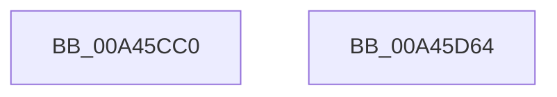

# NtOpenKeyEx

- RVA: `0x00A45CC0`–`0x00A45D65` (길이 `165` bytes)
- VA: `0x0000000140A45CC0`
- 실행 섹션: `PAGE`
- PDB 이름 있음: `예`; PDB Function 태그: `아니요`
- unwind 정보 RVA: `0x000AF604`
- 디코드: `43`개 명령, `165/165` bytes 표시
- 미해석 바이트: `0` (있으면 어셈블리에 `.byte`로 보존)

> 이 문서는 커널 이미지의 기계어와 PDB 기호를 분석해 생성했습니다. 4번과 5번은 함수 원형과 자료형을 바이너리 사용 방식에서 추정한 C 해석이며 원본 소스 복구 결과는 아닙니다.

## 1. Dependencies

- 직접 호출 지점: **3**; 고유 호출 대상: **3**
- 직접 호출자로 확인된 함수: **5**
- RIP 상대 이미지 참조: **1**

### Outgoing calls
- `0x00A45CEA` → [CmpInitializeThreadInfo](../../text/3F/CmpInitializeThreadInfo_function_003FBE70.md) (function, `0x003FBE70`)
- `0x00A45D3B` → [KeExpandKernelStackAndCallout](../../text/46/KeExpandKernelStackAndCallout_function_004675F0.md) (function, `0x004675F0`)
- `0x00A45D4E` → [CmCleanupThreadInfo](../../text/41/CmCleanupThreadInfo_function_0041FD50.md) (function, `0x0041FD50`)

### Direct callers
- [ExpWatchProductTypeWork](../6F/ExpWatchProductTypeWork_function_006FFCA0.md) at `0x006FFDAF`
- [ExpWatchProductTypeWork](../6F/ExpWatchProductTypeWork_function_006FFCA0.md) at `0x006FFDDF`
- [RtlInitFunctionalityCache](../78/RtlInitFunctionalityCache_function_0078A5F8.md) at `0x0078A671`
- [ExpWatchLicenseInfoWork](../7C/ExpWatchLicenseInfoWork_function_007C6DB0.md) at `0x007C6E6D`
- [ExpWatchLicenseInfoWork](../7C/ExpWatchLicenseInfoWork_function_007C6DB0.md) at `0x007C70BA`
- [AdtpObjsInitialize](../82/AdtpObjsInitialize_function_00822B30.md) at `0x00822C97`
- [AdtpObjsInitialize](../82/AdtpObjsInitialize_function_00822B30.md) at `0x00822DFB`
- [AdtpObjsInitialize](../82/AdtpObjsInitialize_function_00822B30.md) at `0x00822E4E`
- [NtOpenKey](NtOpenKey_function_00A45CA0.md) at `0x00A45CA7`

### Static image references
- `0x00A45D34` → RVA `0x00876310` (`CmOpenKeyCallout`; read)

## 2. Other-region calls and transfers

- 다른 실행 섹션으로 향하는 call: **3**
  - `0x00A45CEA` → [CmpInitializeThreadInfo](../../text/3F/CmpInitializeThreadInfo_function_003FBE70.md) (`PAGE` → `.text`)
  - `0x00A45D3B` → [KeExpandKernelStackAndCallout](../../text/46/KeExpandKernelStackAndCallout_function_004675F0.md) (`PAGE` → `.text`)
  - `0x00A45D4E` → [CmCleanupThreadInfo](../../text/41/CmCleanupThreadInfo_function_0041FD50.md) (`PAGE` → `.text`)
- 별도 외부 분기/꼬리 이동을 확인하지 못했습니다.

## 3. Assembly (complete function range)

```asm
00A45CC0  48 89 5C 24 08                  mov qword ptr [rsp + 8], rbx
00A45CC5  55                              push rbp
00A45CC6  48 8B EC                        mov rbp, rsp
00A45CC9  48 83 EC 70                     sub rsp, 0x70
00A45CCD  33 C0                           xor eax, eax
00A45CCF  0F 57 C0                        xorps xmm0, xmm0
00A45CD2  4C 8B D1                        mov r10, rcx
00A45CD5  48 89 45 C0                     mov qword ptr [rbp - 0x40], rax
00A45CD9  48 8D 4D B0                     lea rcx, [rbp - 0x50]
00A45CDD  89 45 CC                        mov dword ptr [rbp - 0x34], eax
00A45CE0  0F 11 45 B0                     movups xmmword ptr [rbp - 0x50], xmm0
00A45CE4  49 8B D8                        mov rbx, r8
00A45CE7  44 8B DA                        mov r11d, edx
00A45CEA  E8 81 61 9B FF                  call 0x1403fbe70
00A45CEF  0F 57 D2                        xorps xmm2, xmm2
00A45CF2  48 8D 55 C8                     lea rdx, [rbp - 0x38]
00A45CF6  0F 11 55 D8                     movups xmmword ptr [rbp - 0x28], xmm2
00A45CFA  33 C0                           xor eax, eax
00A45CFC  44 89 5D D8                     mov dword ptr [rbp - 0x28], r11d
00A45D00  0F 11 55 E8                     movups xmmword ptr [rbp - 0x18], xmm2
00A45D04  48 21 45 F0                     and qword ptr [rbp - 0x10], rax
00A45D08  41 B8 00 48 00 00               mov r8d, 0x4800
00A45D0E  0F 11 55 C8                     movups xmmword ptr [rbp - 0x38], xmm2
00A45D12  48 89 45 F8                     mov qword ptr [rbp - 8], rax
00A45D16  4C 89 55 D0                     mov qword ptr [rbp - 0x30], r10
00A45D1A  48 89 5D E0                     mov qword ptr [rbp - 0x20], rbx
00A45D1E  44 89 4D E8                     mov dword ptr [rbp - 0x18], r9d
00A45D22  65 48 8B 04 25 88 01 00 00      mov rax, qword ptr gs:[0x188]
00A45D2B  8A 88 32 02 00 00               mov cl, byte ptr [rax + 0x232]
00A45D31  88 4D F8                        mov byte ptr [rbp - 8], cl
00A45D34  48 8D 0D D5 05 E3 FF            lea rcx, [rip - 0x1cfa2b]
00A45D3B  E8 B0 18 A2 FF                  call 0x1404675f0
00A45D40  85 C0                           test eax, eax
00A45D42  44 8B C0                        mov r8d, eax
00A45D45  44 0F 49 45 C8                  cmovns r8d, dword ptr [rbp - 0x38]
00A45D4A  48 8D 4D B0                     lea rcx, [rbp - 0x50]
00A45D4E  E8 FD 9F 9D FF                  call 0x14041fd50
00A45D53  48 8B 9C 24 80 00 00 00         mov rbx, qword ptr [rsp + 0x80]
00A45D5B  41 8B C0                        mov eax, r8d
00A45D5E  48 83 C4 70                     add rsp, 0x70
00A45D62  5D                              pop rbp
00A45D63  C3                              ret
00A45D64  CC                              int3
```

## 4. C-style interpretation (structured pseudocode)

```c
__int64 __fastcall NtOpenKeyEx(__int64 a1, int a2, __int64 a3, int a4)
{
    __int64 result;
    __int64 v_rsp;
    unsigned __int64 v_stack_m10;
    unsigned __int64 v_stack_m18;
    unsigned __int64 v_stack_m20;
    unsigned __int64 v_stack_m28;
    unsigned __int64 v_stack_m30;
    unsigned __int64 v_stack_m38;
    unsigned int v_stack_m3C;
    unsigned __int64 v_stack_m40;
    unsigned __int64 v_stack_m48;
    unsigned __int64 v_stack_m58;
    unsigned __int64 v_stack_p8;

    v_stack_p8 = v_rbx;
    v_rsp = (v_rsp) - (112);
    result = 0;
    v_stack_m48 = 0;
    v_stack_m3C = 0;
    v_stack_m58 = v_xmm0;
    result = CmpInitializeThreadInfo(v_stack_m58, a2, a3, a4);
    v_stack_m30 = v_xmm2;
    result = 0;
    v_stack_m30 = (unsigned int)((unsigned int)(a2));
    v_stack_m20 = v_xmm2;
    v_stack_m40 = v_xmm2;
    v_stack_m10 = 0;
    v_stack_m38 = a1;
    v_stack_m28 = a3;
    v_stack_m20 = a4;
    v_stack_m10 = (unsigned __int8)(*(unsigned __int8 *)(*(unsigned __int64 *)(gs_base + (0 + 392)) + 562));
    result = KeExpandKernelStackAndCallout(v_rip - 1899051, v_stack_m40, (unsigned int)(0x4800ULL), a4);
    a3 = (unsigned int)((unsigned int)(result));
    if (!sign_flag) { a3 = v_stack_m40; }
    result = CmCleanupThreadInfo(v_stack_m58, v_stack_m40, a3, a4);
    v_rsp = (v_rsp) + (112);
    return (unsigned int)((unsigned int)(a3));
}
```

## 5. (Beta) C Style

```c
int64_t NtOpenKeyEx(int64_t Arg1, int32_t Arg2, int64_t Arg3, int32_t Arg4)
{
    int64_t result;
    int64_t local_rsp;
    uint64_t v_stack_m10;
    uint64_t v_stack_m18;
    uint64_t v_stack_m20;
    uint64_t v_stack_m28;
    uint64_t v_stack_m30;
    uint64_t v_stack_m38;
    uint32_t v_stack_m3C;
    uint64_t v_stack_m40;
    uint64_t v_stack_m48;
    uint64_t v_stack_m58;
    uint64_t v_stack_p8;

    v_stack_p8 = local_rbx;
    local_rsp = (local_rsp) - (112);
    result = 0;
    v_stack_m48 = 0;
    v_stack_m3C = 0;
    v_stack_m58 = v_xmm0;
    result = CmpInitializeThreadInfo(v_stack_m58, Arg2, Arg3, Arg4);
    v_stack_m30 = v_xmm2;
    result = 0;
    v_stack_m30 = (uint32_t)((uint32_t)(Arg2));
    v_stack_m20 = v_xmm2;
    v_stack_m40 = v_xmm2;
    v_stack_m10 = 0;
    v_stack_m38 = Arg1;
    v_stack_m28 = Arg3;
    v_stack_m20 = Arg4;
    v_stack_m10 = (uint8_t)(*(uint8_t *)(*(uint64_t *)(gs_base + (0 + 0x188)) + 0x232));
    result = KeExpandKernelStackAndCallout(v_rip - 1899051, v_stack_m40, (uint32_t)(0x4800ULL), Arg4);
    Arg3 = (uint32_t)((uint32_t)(result));
    if (!sign_flag) { Arg3 = v_stack_m40; }
    result = CmCleanupThreadInfo(v_stack_m58, v_stack_m40, Arg3, Arg4);
    local_rsp = (local_rsp) + (112);
    return (uint32_t)((uint32_t)(Arg3));
}
```

## 6. Execution-region graph

[열기: 2D/3D 그래프와 함수 탐색 컨트롤 패널](../../../control-panel.html?section=page&rva=0x00A45CC0&view=graph)

- 2D 그래프는 위에서 아래로 흐르고, 3D 그래프는 빈 공간을 드래그해 회전합니다. Shift+드래그는 이동, 휠은 확대·축소, 함수 노드 선택은 대상 보고서 이동입니다.

### Static fallback


