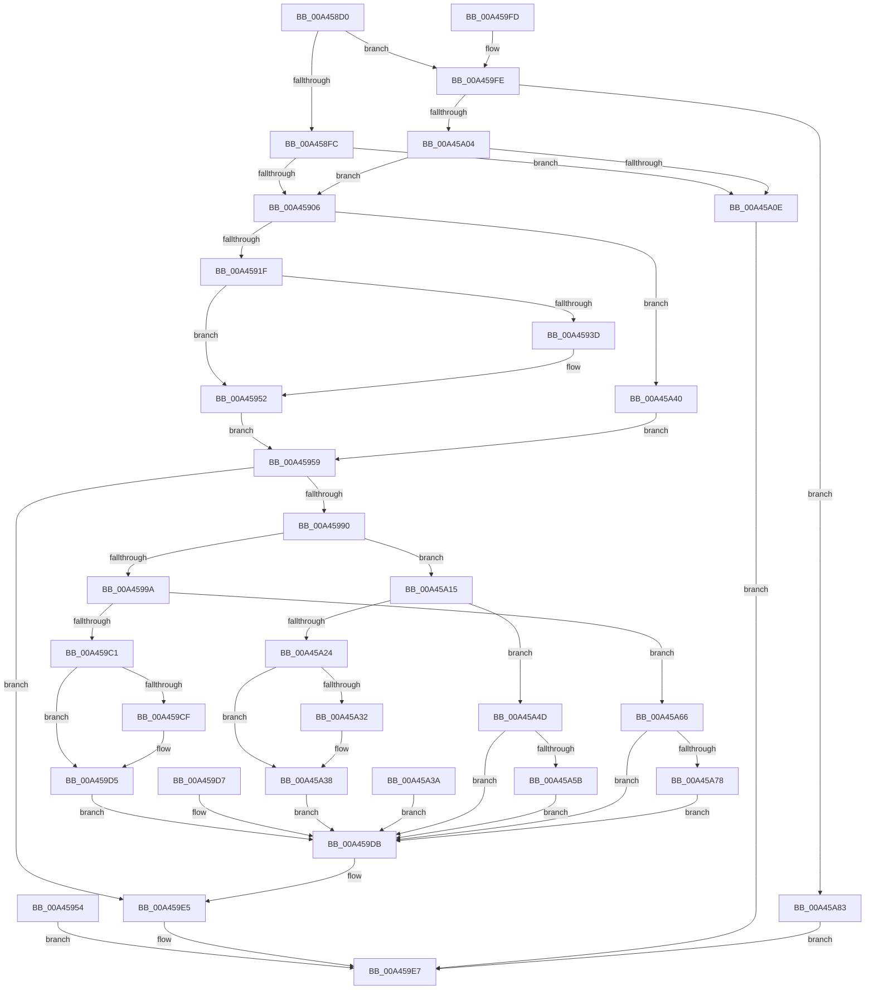

# NtQueryMutant

- RVA: `0x00A458D0`–`0x00A45A8D` (길이 `445` bytes)
- VA: `0x0000000140A458D0`
- 실행 섹션: `PAGE`
- PDB 이름 있음: `예`; PDB Function 태그: `아니요`
- unwind 정보 RVA: `0x000AF56C`
- 디코드: `113`개 명령, `445/445` bytes 표시
- 미해석 바이트: `0` (있으면 어셈블리에 `.byte`로 보존)

> 이 문서는 커널 이미지의 기계어와 PDB 기호를 분석해 생성했습니다. 4번과 5번은 함수 원형과 자료형을 바이너리 사용 방식에서 추정한 C 해석이며 원본 소스 복구 결과는 아닙니다.

## 1. Dependencies

- 직접 호출 지점: **4**; 고유 호출 대상: **4**
- 직접 호출자로 확인된 함수: **0**
- RIP 상대 이미지 참조: **1**

### Outgoing calls
- `0x00A4592B` → [ProbeForWrite](../8E/ProbeForWrite_function_008E91C0.md) (function, `0x008E91C0`)
- `0x00A45981` → [ObReferenceObjectByHandle](../86/ObReferenceObjectByHandle_function_00868DB0.md) (function, `0x00868DB0`)
- `0x00A459E0` → [ObfDereferenceObject](../../text/2F/ObfDereferenceObject_function_002F9350.md) (function, `0x002F9350`)
- `0x00A45A1A` → [KeQueryOwnerMutant](../../text/49/KeQueryOwnerMutant_function_0049A720.md) (function, `0x0049A720`)

### Direct callers
- 이 함수 시작 RVA로 연결되는 직접 call은 확인되지 않았습니다. 간접 호출은 완전히 역산할 수 없습니다.

### Static image references
- `0x00A45959` → RVA `0x00FC52B8` (`ALMOSTRO`; read)

## 2. Other-region calls and transfers

- 다른 실행 섹션으로 향하는 call: **2**
  - `0x00A459E0` → [ObfDereferenceObject](../../text/2F/ObfDereferenceObject_function_002F9350.md) (`PAGE` → `.text`)
  - `0x00A45A1A` → [KeQueryOwnerMutant](../../text/49/KeQueryOwnerMutant_function_0049A720.md) (`PAGE` → `.text`)
- 별도 외부 분기/꼬리 이동을 확인하지 못했습니다.

## 3. Assembly (complete function range)

```asm
00A458D0  48 89 5C 24 08                  mov qword ptr [rsp + 8], rbx
00A458D5  48 89 74 24 18                  mov qword ptr [rsp + 0x18], rsi
00A458DA  57                              push rdi
00A458DB  41 56                           push r14
00A458DD  41 57                           push r15
00A458DF  48 83 EC 50                     sub rsp, 0x50
00A458E3  49 8B F8                        mov rdi, r8
00A458E6  44 8B FA                        mov r15d, edx
00A458E9  48 8B F1                        mov rsi, rcx
00A458EC  0F 57 C0                        xorps xmm0, xmm0
00A458EF  0F 11 44 24 38                  movups xmmword ptr [rsp + 0x38], xmm0
00A458F4  85 D2                           test edx, edx
00A458F6  0F 85 02 01 00 00               jne 0x140a459fe
00A458FC  41 83 F9 08                     cmp r9d, 8
00A45900  0F 85 08 01 00 00               jne 0x140a45a0e
00A45906  65 48 8B 04 25 88 01 00 00      mov rax, qword ptr gs:[0x188]
00A4590F  44 8A B0 32 02 00 00            mov r14b, byte ptr [rax + 0x232]
00A45916  45 84 F6                        test r14b, r14b
00A45919  0F 84 21 01 00 00               je 0x140a45a40
00A4591F  41 8B D1                        mov edx, r9d
00A45922  41 B8 04 00 00 00               mov r8d, 4
00A45928  48 8B CF                        mov rcx, rdi
00A4592B  E8 90 38 EA FF                  call 0x1408e91c0
00A45930  48 8B 9C 24 90 00 00 00         mov rbx, qword ptr [rsp + 0x90]
00A45938  48 85 DB                        test rbx, rbx
00A4593B  74 15                           je 0x140a45952
00A4593D  48 B9 00 00 FF FF FF 7F 00 00   movabs rcx, 0x7fffffff0000
00A45947  48 3B D9                        cmp rbx, rcx
00A4594A  48 0F 42 CB                     cmovb rcx, rbx
00A4594E  8B 01                           mov eax, dword ptr [rcx]
00A45950  89 01                           mov dword ptr [rcx], eax
00A45952  EB 05                           jmp 0x140a45959
00A45954  E9 8E 00 00 00                  jmp 0x140a459e7
00A45959  4C 8B 05 58 F9 57 00            mov r8, qword ptr [rip + 0x57f958]
00A45960  48 83 64 24 30 00               and qword ptr [rsp + 0x30], 0
00A45966  48 83 64 24 28 00               and qword ptr [rsp + 0x28], 0
00A4596C  48 8D 44 24 30                  lea rax, [rsp + 0x30]
00A45971  48 89 44 24 20                  mov qword ptr [rsp + 0x20], rax
00A45976  45 8A CE                        mov r9b, r14b
00A45979  BA 01 00 00 00                  mov edx, 1
00A4597E  48 8B CE                        mov rcx, rsi
00A45981  E8 2A 34 E2 FF                  call 0x140868db0
00A45986  8B F0                           mov esi, eax
00A45988  89 44 24 78                     mov dword ptr [rsp + 0x78], eax
00A4598C  85 C0                           test eax, eax
00A4598E  78 55                           js 0x140a459e5
00A45990  48 8B 4C 24 30                  mov rcx, qword ptr [rsp + 0x30]
00A45995  45 85 FF                        test r15d, r15d
00A45998  75 7B                           jne 0x140a45a15
00A4599A  44 8B 41 04                     mov r8d, dword ptr [rcx + 4]
00A4599E  8A 41 30                        mov al, byte ptr [rcx + 0x30]
00A459A1  24 01                           and al, 1
00A459A3  65 48 8B 14 25 88 01 00 00      mov rdx, qword ptr gs:[0x188]
00A459AC  48 8B 4C 24 30                  mov rcx, qword ptr [rsp + 0x30]
00A459B1  48 39 51 28                     cmp qword ptr [rcx + 0x28], rdx
00A459B5  0F 94 C1                        sete cl
00A459B8  45 84 F6                        test r14b, r14b
00A459BB  0F 84 A5 00 00 00               je 0x140a45a66
00A459C1  44 89 07                        mov dword ptr [rdi], r8d
00A459C4  88 4F 04                        mov byte ptr [rdi + 4], cl
00A459C7  88 47 05                        mov byte ptr [rdi + 5], al
00A459CA  48 85 DB                        test rbx, rbx
00A459CD  74 06                           je 0x140a459d5
00A459CF  C7 03 08 00 00 00               mov dword ptr [rbx], 8
00A459D5  EB 04                           jmp 0x140a459db
00A459D7  8B 74 24 78                     mov esi, dword ptr [rsp + 0x78]
00A459DB  48 8B 4C 24 30                  mov rcx, qword ptr [rsp + 0x30]
00A459E0  E8 6B 39 8B FF                  call 0x1402f9350
00A459E5  8B C6                           mov eax, esi
00A459E7  4C 8D 5C 24 50                  lea r11, [rsp + 0x50]
00A459EC  49 8B 5B 20                     mov rbx, qword ptr [r11 + 0x20]
00A459F0  49 8B 73 30                     mov rsi, qword ptr [r11 + 0x30]
00A459F4  49 8B E3                        mov rsp, r11
00A459F7  41 5F                           pop r15
00A459F9  41 5E                           pop r14
00A459FB  5F                              pop rdi
00A459FC  C3                              ret
00A459FD  CC                              int3
00A459FE  41 83 FF 01                     cmp r15d, 1
00A45A02  75 7F                           jne 0x140a45a83
00A45A04  41 83 F9 10                     cmp r9d, 0x10
00A45A08  0F 84 F8 FE FF FF               je 0x140a45906
00A45A0E  B8 04 00 00 C0                  mov eax, 0xc0000004
00A45A13  EB D2                           jmp 0x140a459e7
00A45A15  48 8D 54 24 38                  lea rdx, [rsp + 0x38]
00A45A1A  E8 01 4D A5 FF                  call 0x14049a720
00A45A1F  45 84 F6                        test r14b, r14b
00A45A22  74 29                           je 0x140a45a4d
00A45A24  0F 10 44 24 38                  movups xmm0, xmmword ptr [rsp + 0x38]
00A45A29  F3 0F 7F 07                     movdqu xmmword ptr [rdi], xmm0
00A45A2D  48 85 DB                        test rbx, rbx
00A45A30  74 06                           je 0x140a45a38
00A45A32  C7 03 10 00 00 00               mov dword ptr [rbx], 0x10
00A45A38  EB A1                           jmp 0x140a459db
00A45A3A  8B 74 24 78                     mov esi, dword ptr [rsp + 0x78]
00A45A3E  EB 9B                           jmp 0x140a459db
00A45A40  48 8B 9C 24 90 00 00 00         mov rbx, qword ptr [rsp + 0x90]
00A45A48  E9 0C FF FF FF                  jmp 0x140a45959
00A45A4D  0F 10 44 24 38                  movups xmm0, xmmword ptr [rsp + 0x38]
00A45A52  F3 0F 7F 07                     movdqu xmmword ptr [rdi], xmm0
00A45A56  48 85 DB                        test rbx, rbx
00A45A59  74 80                           je 0x140a459db
00A45A5B  C7 03 10 00 00 00               mov dword ptr [rbx], 0x10
00A45A61  E9 75 FF FF FF                  jmp 0x140a459db
00A45A66  44 89 07                        mov dword ptr [rdi], r8d
00A45A69  88 4F 04                        mov byte ptr [rdi + 4], cl
00A45A6C  88 47 05                        mov byte ptr [rdi + 5], al
00A45A6F  48 85 DB                        test rbx, rbx
00A45A72  0F 84 63 FF FF FF               je 0x140a459db
00A45A78  C7 03 08 00 00 00               mov dword ptr [rbx], 8
00A45A7E  E9 58 FF FF FF                  jmp 0x140a459db
00A45A83  B8 03 00 00 C0                  mov eax, 0xc0000003
00A45A88  E9 5A FF FF FF                  jmp 0x140a459e7
```

## 4. C-style interpretation (structured pseudocode)

```c
__int64 __fastcall NtQueryMutant(__int64 a1, int a2, __int64 a3, int a4, __int64 a5)
{
    __int64 result;
    __int64 v_rsp;
    unsigned __int64 v_stack_m18;
    unsigned __int64 v_stack_m30;
    unsigned __int64 v_stack_m38;
    unsigned __int64 v_stack_m40;
    unsigned __int64 v_stack_m48;
    unsigned int v_stack_p10;
    unsigned __int64 v_stack_p18;
    unsigned int v_stack_p28;
    unsigned __int64 v_stack_p8;

    v_stack_p8 = v_rbx;
    v_stack_p18 = v_rsi;
    v_rsp = (v_rsp) - (80);
    v_stack_m30 = v_xmm0;
    if (a2 != 0) goto loc_00A459FE;
    if (a4 != 8) goto loc_00A45A0E;
loc_00A45906:
    if ((unsigned __int8)(*(unsigned __int8 *)(*(unsigned __int64 *)(gs_base + (0 + 392)) + 562)) == 0) goto loc_00A45A40;
    result = ProbeForWrite(a3, (unsigned int)(a4), 4, a4);
    if (a5 != 0) {
        if (a5 < a3) { a3 = a5; }
        result = *(unsigned int *)(a3);
        *(unsigned int *)(a3) = (unsigned int)(result);
    }
    goto loc_00A45959;
loc_00A45959:
    v_stack_m48 = v_stack_m38;
    result = ObReferenceObjectByHandle(a1, 1, *(unsigned __int64 *)(v_rip + 5765464), (unsigned __int8)(*(unsigned __int8 *)(*(unsigned __int64 *)(gs_base + (0 + 392)) + 562)));
    v_stack_p10 = (unsigned int)(result);
    if (sign_flag) goto loc_00A459E5;
    if ((unsigned int)((unsigned int)(a2)) != 0) goto loc_00A45A15;
    result = (unsigned __int8)((*(unsigned __int8 *)(v_stack_m38 + 48)) & (1));
    a1 = ((*(unsigned __int64 *)(v_stack_m38 + 40)) == (*(unsigned __int64 *)(gs_base + (0 + 392)))) ? 1 : 0;
    if ((unsigned __int8)(*(unsigned __int8 *)(*(unsigned __int64 *)(gs_base + (0 + 392)) + 562)) == 0) goto loc_00A45A66;
    *(unsigned int *)(a3) = (unsigned int)((unsigned int)(*(unsigned int *)(v_stack_m38 + 4)));
    *(unsigned __int8 *)(a3 + 4) = (unsigned __int8)(a1);
    *(unsigned __int8 *)(a3 + 5) = (unsigned __int8)(result);
    if (a5 != 0) {
        *(unsigned int *)(a5) = 8;
    }
    goto loc_00A459DB;
loc_00A459DB:
    result = ObfDereferenceObject(v_stack_m38, *(unsigned __int64 *)(gs_base + (0 + 392)), (unsigned int)(*(unsigned int *)(v_stack_m38 + 4)), (unsigned __int8)(*(unsigned __int8 *)(*(unsigned __int64 *)(gs_base + (0 + 392)) + 562)));
loc_00A459E5:
loc_00A459E7:
    return (unsigned int)((unsigned int)((unsigned int)((unsigned int)(result))));
loc_00A459FE:
    if (((unsigned int)((unsigned int)(a2))) != 1) goto loc_00A45A83;
    if (((unsigned int)((unsigned __int8)(*(unsigned __int8 *)(*(unsigned __int64 *)(gs_base + (0 + 392)) + 562)))) == 16) goto loc_00A45906;
loc_00A45A0E:
    goto loc_00A459E7;
loc_00A45A15:
    result = KeQueryOwnerMutant(v_stack_m38, v_stack_m18, (unsigned int)(*(unsigned int *)(v_stack_m38 + 4)), (unsigned __int8)(*(unsigned __int8 *)(*(unsigned __int64 *)(gs_base + (0 + 392)) + 562)));
    if ((unsigned __int8)(*(unsigned __int8 *)(*(unsigned __int64 *)(gs_base + (0 + 392)) + 562)) == 0) goto loc_00A45A4D;
    *(unsigned __int64 *)(a3) = v_xmm0;
    if (*(unsigned __int64 *)(v_stack_m18 + 32) != 0) {
        *(unsigned int *)(*(unsigned __int64 *)(v_stack_m18 + 32)) = 16;
    }
    goto loc_00A459DB;
loc_00A45A40:
    goto loc_00A45959;
loc_00A45A4D:
    *(unsigned __int64 *)(a3) = v_xmm0;
    if (a5 == 0) goto loc_00A459DB;
    *(unsigned int *)(a5) = 16;
    goto loc_00A459DB;
loc_00A45A66:
    *(unsigned int *)(a3) = (unsigned int)((unsigned int)(*(unsigned int *)(v_stack_m38 + 4)));
    *(unsigned __int8 *)(a3 + 4) = (unsigned __int8)(v_stack_m38);
    *(unsigned __int8 *)(a3 + 5) = (unsigned __int8)(result);
    if (a5 == 0) goto loc_00A459DB;
    *(unsigned int *)(a5) = 8;
    goto loc_00A459DB;
loc_00A45A83:
    goto loc_00A459E7;
}
```

## 5. (Beta) C Style

```c
int64_t NtQueryMutant(int64_t Arg1, int32_t Arg2, void *Arg3, int32_t Arg4, int64_t Arg5)
{
    uint8_t *arg3 = (uint8_t *)Arg3;

    int64_t result;
    int64_t local_rsp;
    uint64_t v_stack_m18;
    uint64_t v_stack_m30;
    uint64_t v_stack_m38;
    uint64_t v_stack_m40;
    uint64_t v_stack_m48;
    uint32_t v_stack_p10;
    uint64_t v_stack_p18;
    uint32_t v_stack_p28;
    uint64_t v_stack_p8;

    v_stack_p8 = local_rbx;
    v_stack_p18 = local_rsi;
    local_rsp = (local_rsp) - (80);
    v_stack_m30 = v_xmm0;
    if (Arg2 != 0) goto loc_00A459FE;
    if (Arg4 != 8) goto loc_00A45A0E;
loc_00A45906:
    if ((uint8_t)(*(uint8_t *)(*(uint64_t *)(gs_base + (0 + 0x188)) + 0x232)) == 0) goto loc_00A45A40;
    result = ProbeForWrite(Arg3, (uint32_t)(Arg4), 4, Arg4);
    if (Arg5 != 0) {
        if (Arg5 < Arg3) { Arg3 = Arg5; }
        result = *(uint32_t *)(arg3);
        *(uint32_t *)(arg3) = (uint32_t)(result);
    }
    goto loc_00A45959;
loc_00A45959:
    v_stack_m48 = v_stack_m38;
    result = ObReferenceObjectByHandle(Arg1, 1, *(uint64_t *)(v_rip + 0x57F958), (uint8_t)(*(uint8_t *)(*(uint64_t *)(gs_base + (0 + 0x188)) + 0x232)));
    v_stack_p10 = (uint32_t)(result);
    if (sign_flag) goto loc_00A459E5;
    if ((uint32_t)((uint32_t)(Arg2)) != 0) goto loc_00A45A15;
    result = (uint8_t)((*(uint8_t *)(v_stack_m38 + 0x30)) & (1));
    Arg1 = ((*(uint64_t *)(v_stack_m38 + 0x28)) == (*(uint64_t *)(gs_base + (0 + 0x188)))) ? 1 : 0;
    if ((uint8_t)(*(uint8_t *)(*(uint64_t *)(gs_base + (0 + 0x188)) + 0x232)) == 0) goto loc_00A45A66;
    *(uint32_t *)(arg3) = (uint32_t)((uint32_t)(*(uint32_t *)(v_stack_m38 + 0x4)));
    *(uint8_t *)(arg3 + 0x4) = (uint8_t)(Arg1);
    *(uint8_t *)(arg3 + 0x5) = (uint8_t)(result);
    if (Arg5 != 0) {
        *(uint32_t *)(Arg5) = 8;
    }
    goto loc_00A459DB;
loc_00A459DB:
    result = ObfDereferenceObject(v_stack_m38, *(uint64_t *)(gs_base + (0 + 0x188)), (uint32_t)(*(uint32_t *)(v_stack_m38 + 0x4)), (uint8_t)(*(uint8_t *)(*(uint64_t *)(gs_base + (0 + 0x188)) + 0x232)));
loc_00A459E5:
loc_00A459E7:
    return (uint32_t)((uint32_t)((uint32_t)((uint32_t)(result))));
loc_00A459FE:
    if (((uint32_t)((uint32_t)(Arg2))) != 1) goto loc_00A45A83;
    if (((uint32_t)((uint8_t)(*(uint8_t *)(*(uint64_t *)(gs_base + (0 + 0x188)) + 0x232)))) == 16) goto loc_00A45906;
loc_00A45A0E:
    goto loc_00A459E7;
loc_00A45A15:
    result = KeQueryOwnerMutant(v_stack_m38, v_stack_m18, (uint32_t)(*(uint32_t *)(v_stack_m38 + 0x4)), (uint8_t)(*(uint8_t *)(*(uint64_t *)(gs_base + (0 + 0x188)) + 0x232)));
    if ((uint8_t)(*(uint8_t *)(*(uint64_t *)(gs_base + (0 + 0x188)) + 0x232)) == 0) goto loc_00A45A4D;
    *(uint64_t *)(arg3) = v_xmm0;
    if (*(uint64_t *)(v_stack_m18 + 0x20) != 0) {
        *(uint32_t *)(*(uint64_t *)(v_stack_m18 + 0x20)) = 16;
    }
    goto loc_00A459DB;
loc_00A45A40:
    goto loc_00A45959;
loc_00A45A4D:
    *(uint64_t *)(arg3) = v_xmm0;
    if (Arg5 == 0) goto loc_00A459DB;
    *(uint32_t *)(Arg5) = 16;
    goto loc_00A459DB;
loc_00A45A66:
    *(uint32_t *)(arg3) = (uint32_t)((uint32_t)(*(uint32_t *)(v_stack_m38 + 0x4)));
    *(uint8_t *)(arg3 + 0x4) = (uint8_t)(v_stack_m38);
    *(uint8_t *)(arg3 + 0x5) = (uint8_t)(result);
    if (Arg5 == 0) goto loc_00A459DB;
    *(uint32_t *)(Arg5) = 8;
    goto loc_00A459DB;
loc_00A45A83:
    goto loc_00A459E7;
}
```

### 관측된 메모리 오프셋

구조체 형식이 확인되지 않은 접근은 인자 기준의 오프셋으로만 기록했습니다.

| 기준 인자 | 오프셋 표현 | 폭 (bit) | 접근 |
|---|---:|---:|---|
| `Arg3` | `+ 0x0` | `32` | `W` |
| `Arg3` | `+ 0x0` | `128` | `W` |
| `Arg3` | `+ 0x4` | `8` | `W` |
| `Arg3` | `+ 0x5` | `8` | `W` |

## 6. Execution-region graph

[열기: 2D/3D 그래프와 함수 탐색 컨트롤 패널](../../../control-panel.html?section=page&rva=0x00A458D0&view=graph)

- 2D 그래프는 위에서 아래로 흐르고, 3D 그래프는 빈 공간을 드래그해 회전합니다. Shift+드래그는 이동, 휠은 확대·축소, 함수 노드 선택은 대상 보고서 이동입니다.

### Static fallback


