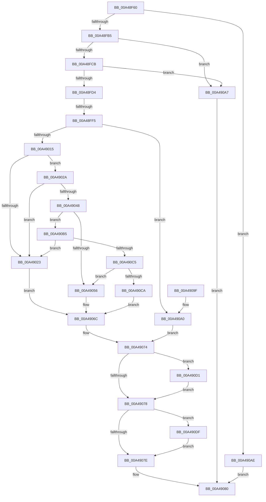

# NtResetWriteWatch

- RVA: `0x00A48F60`–`0x00A490EE` (길이 `398` bytes)
- VA: `0x0000000140A48F60`
- 실행 섹션: `PAGE`
- PDB 이름 있음: `예`; PDB Function 태그: `예`
- unwind 정보 RVA: `0x000AFCD4`
- 디코드: `110`개 명령, `398/398` bytes 표시
- 미해석 바이트: `0` (있으면 어셈블리에 `.byte`로 보존)

> 이 문서는 커널 이미지의 기계어와 PDB 기호를 분석해 생성했습니다. 4번과 5번은 함수 원형과 자료형을 바이너리 사용 방식에서 추정한 C 해석이며 원본 소스 복구 결과는 아닙니다.

## 1. Dependencies

- 직접 호출 지점: **7**; 고유 호출 대상: **7**
- 직접 호출자로 확인된 함수: **0**
- RIP 상대 이미지 참조: **1**

### Outgoing calls
- `0x00A49004` → [MiObtainReferencedVadEx](../../text/31/MiObtainReferencedVadEx_function_00316690.md) (function, `0x00316690`)
- `0x00A4904B` → [MiGetVadMandatoryPageSize](../../text/2A/MiGetVadMandatoryPageSize_function_002A85F0.md) (function, `0x002A85F0`)
- `0x00A49065` → [MiMoveDirtyBitsToPfns](../../text/2A/MiMoveDirtyBitsToPfns_function_002A8624.md) (function, `0x002A8624`)
- `0x00A4906F` → [MiUnlockAndDereferenceVad](../../text/31/MiUnlockAndDereferenceVad_function_00316E60.md) (function, `0x00316E60`)
- `0x00A49088` → [_security_check_cookie](../../text/6A/_security_check_cookie_function_006AC640.md) (function, `0x006AC640`)
- `0x00A490D8` → [KiUnstackDetachProcess](../../text/21/KiUnstackDetachProcess_function_00217D30.md) (function, `0x00217D30`)
- `0x00A490E7` → [ObfDereferenceObjectWithTag](../../text/2F/ObfDereferenceObjectWithTag_function_002F78E0.md) (function, `0x002F78E0`)

### Direct callers
- 이 함수 시작 RVA로 연결되는 직접 call은 확인되지 않았습니다. 간접 호출은 완전히 역산할 수 없습니다.

### Static image references
- `0x00A48F72` → RVA `0x00E0A740` (`.data`; read)

## 2. Other-region calls and transfers

- 다른 실행 섹션으로 향하는 call: **7**
  - `0x00A49004` → [MiObtainReferencedVadEx](../../text/31/MiObtainReferencedVadEx_function_00316690.md) (`PAGE` → `.text`)
  - `0x00A4904B` → [MiGetVadMandatoryPageSize](../../text/2A/MiGetVadMandatoryPageSize_function_002A85F0.md) (`PAGE` → `.text`)
  - `0x00A49065` → [MiMoveDirtyBitsToPfns](../../text/2A/MiMoveDirtyBitsToPfns_function_002A8624.md) (`PAGE` → `.text`)
  - `0x00A4906F` → [MiUnlockAndDereferenceVad](../../text/31/MiUnlockAndDereferenceVad_function_00316E60.md) (`PAGE` → `.text`)
  - `0x00A49088` → [_security_check_cookie](../../text/6A/_security_check_cookie_function_006AC640.md) (`PAGE` → `.text`)
  - `0x00A490D8` → [KiUnstackDetachProcess](../../text/21/KiUnstackDetachProcess_function_00217D30.md) (`PAGE` → `.text`)
  - `0x00A490E7` → [ObfDereferenceObjectWithTag](../../text/2F/ObfDereferenceObjectWithTag_function_002F78E0.md) (`PAGE` → `.text`)
- call이 아닌 외부 분기/꼬리 이동: **1**
  - `0x00A48FEF` → [sub_00B3B77E](../B3/Unknown_function_00B3B77E.md) (`tail-transfer`)

## 3. Assembly (complete function range)

```asm
00A48F60  40 53                           push rbx
00A48F62  55                              push rbp
00A48F63  56                              push rsi
00A48F64  57                              push rdi
00A48F65  41 54                           push r12
00A48F67  41 56                           push r14
00A48F69  41 57                           push r15
00A48F6B  48 81 EC 80 00 00 00            sub rsp, 0x80
00A48F72  48 8B 05 C7 17 3C 00            mov rax, qword ptr [rip + 0x3c17c7]
00A48F79  48 33 C4                        xor rax, rsp
00A48F7C  48 89 44 24 78                  mov qword ptr [rsp + 0x78], rax
00A48F81  48 83 64 24 40 00               and qword ptr [rsp + 0x40], 0
00A48F87  0F 57 C0                        xorps xmm0, xmm0
00A48F8A  48 B8 FF FF FE FF FF 7F 00 00   movabs rax, 0x7ffffffeffff
00A48F94  49 8B E8                        mov rbp, r8
00A48F97  48 8B FA                        mov rdi, rdx
00A48F9A  4C 8B F9                        mov r15, rcx
00A48F9D  0F 11 44 24 48                  movups xmmword ptr [rsp + 0x48], xmm0
00A48FA2  0F 11 44 24 58                  movups xmmword ptr [rsp + 0x58], xmm0
00A48FA7  0F 11 44 24 68                  movups xmmword ptr [rsp + 0x68], xmm0
00A48FAC  48 3B D0                        cmp rdx, rax
00A48FAF  0F 87 F9 00 00 00               ja 0x140a490ae
00A48FB5  48 B8 00 00 FF FF FF 7F 00 00   movabs rax, 0x7fffffff0000
00A48FBF  48 2B C2                        sub rax, rdx
00A48FC2  49 3B C0                        cmp rax, r8
00A48FC5  0F 82 DC 00 00 00               jb 0x140a490a7
00A48FCB  4D 85 C0                        test r8, r8
00A48FCE  0F 84 D3 00 00 00               je 0x140a490a7
00A48FD4  65 4C 8B 0C 25 88 01 00 00      mov r9, qword ptr gs:[0x188]
00A48FDD  4D 8D 60 FF                     lea r12, [r8 - 1]
00A48FE1  4C 03 E2                        add r12, rdx
00A48FE4  49 8B B1 B8 00 00 00            mov rsi, qword ptr [r9 + 0xb8]
00A48FEB  48 83 F9 FF                     cmp rcx, -1
00A48FEF  0F 85 89 27 0F 00               jne 0x140b3b77e
00A48FF5  4C 8B F6                        mov r14, rsi
00A48FF8  33 DB                           xor ebx, ebx
00A48FFA  4C 8D 44 24 40                  lea r8, [rsp + 0x40]
00A48FFF  33 D2                           xor edx, edx
00A49001  48 8B CF                        mov rcx, rdi
00A49004  E8 87 D6 8C FF                  call 0x140316690
00A49009  48 8B F0                        mov rsi, rax
00A4900C  48 85 C0                        test rax, rax
00A4900F  0F 84 8B 00 00 00               je 0x140a490a0
00A49015  8B 40 30                        mov eax, dword ptr [rax + 0x30]
00A49018  B9 00 00 60 00                  mov ecx, 0x600000
00A4901D  23 C1                           and eax, ecx
00A4901F  3B C1                           cmp eax, ecx
00A49021  74 07                           je 0x140a4902a
00A49023  BF EF 00 00 C0                  mov edi, 0xc00000ef
00A49028  EB 42                           jmp 0x140a4906c
00A4902A  0F B6 4E 21                     movzx ecx, byte ptr [rsi + 0x21]
00A4902E  8B 46 1C                        mov eax, dword ptr [rsi + 0x1c]
00A49031  48 C1 E1 20                     shl rcx, 0x20
00A49035  48 0B C8                        or rcx, rax
00A49038  48 C1 E1 0C                     shl rcx, 0xc
00A4903C  48 81 C9 FF 0F 00 00            or rcx, 0xfff
00A49043  4C 3B E1                        cmp r12, rcx
00A49046  77 DB                           ja 0x140a49023
00A49048  48 8B CE                        mov rcx, rsi
00A4904B  E8 A0 F5 85 FF                  call 0x1402a85f0
00A49050  48 83 F8 01                     cmp rax, 1
00A49054  77 5F                           ja 0x140a490b5
00A49056  41 B9 01 00 00 00               mov r9d, 1
00A4905C  4C 8B C6                        mov r8, rsi
00A4905F  49 8B D4                        mov rdx, r12
00A49062  48 8B CF                        mov rcx, rdi
00A49065  E8 BA F5 85 FF                  call 0x1402a8624
00A4906A  33 FF                           xor edi, edi
00A4906C  48 8B CE                        mov rcx, rsi
00A4906F  E8 EC DD 8C FF                  call 0x140316e60
00A49074  85 DB                           test ebx, ebx
00A49076  75 59                           jne 0x140a490d1
00A49078  49 83 FF FF                     cmp r15, -1
00A4907C  75 61                           jne 0x140a490df
00A4907E  8B C7                           mov eax, edi
00A49080  48 8B 4C 24 78                  mov rcx, qword ptr [rsp + 0x78]
00A49085  48 33 CC                        xor rcx, rsp
00A49088  E8 B3 35 C6 FF                  call 0x1406ac640
00A4908D  48 81 C4 80 00 00 00            add rsp, 0x80
00A49094  41 5F                           pop r15
00A49096  41 5E                           pop r14
00A49098  41 5C                           pop r12
00A4909A  5F                              pop rdi
00A4909B  5E                              pop rsi
00A4909C  5D                              pop rbp
00A4909D  5B                              pop rbx
00A4909E  C3                              ret
00A4909F  CC                              int3
00A490A0  BF EF 00 00 C0                  mov edi, 0xc00000ef
00A490A5  EB CD                           jmp 0x140a49074
00A490A7  B8 F1 00 00 C0                  mov eax, 0xc00000f1
00A490AC  EB D2                           jmp 0x140a49080
00A490AE  B8 F0 00 00 C0                  mov eax, 0xc00000f0
00A490B3  EB CB                           jmp 0x140a49080
00A490B5  48 C1 E0 0C                     shl rax, 0xc
00A490B9  48 FF C8                        dec rax
00A490BC  48 85 C7                        test rdi, rax
00A490BF  0F 85 5E FF FF FF               jne 0x140a49023
00A490C5  48 85 C5                        test rbp, rax
00A490C8  74 8C                           je 0x140a49056
00A490CA  BF F1 00 00 C0                  mov edi, 0xc00000f1
00A490CF  EB 9B                           jmp 0x140a4906c
00A490D1  33 D2                           xor edx, edx
00A490D3  48 8D 4C 24 48                  lea rcx, [rsp + 0x48]
00A490D8  E8 53 EC 7C FF                  call 0x140217d30
00A490DD  EB 99                           jmp 0x140a49078
00A490DF  BA 4D 6D 57 77                  mov edx, 0x77576d4d
00A490E4  49 8B CE                        mov rcx, r14
00A490E7  E8 F4 E7 8A FF                  call 0x1402f78e0
00A490EC  EB 90                           jmp 0x140a4907e
```

## 4. C-style interpretation (structured pseudocode)

```c
__int64 __fastcall NtResetWriteWatch(__int64 a1, __int64 a2, __int64 a3)
{
    __int64 result;
    __int64 v_r12;
    __int64 v_rbx;
    __int64 v_rdi;
    __int64 v_rsp;
    unsigned __int64 v_stack_m40;
    unsigned __int64 v_stack_m50;
    unsigned __int64 v_stack_m60;
    unsigned __int64 v_stack_m70;
    unsigned __int64 v_stack_m78;
    unsigned __int64 v_stack_p48;

    v_rsp = (v_rsp) - (128);
    result = (*(unsigned __int64 *)(v_rip + 3938247)) ^ (v_rsp);
    v_stack_m40 = result;
    v_stack_m70 = v_xmm0;
    v_stack_m60 = v_xmm0;
    v_stack_m50 = v_xmm0;
    if (a2 > result) goto loc_00A490AE;
    result = (result) - (a2);
    if (result < a3) goto loc_00A490A7;
    if (a3 == 0) goto loc_00A490A7;
    v_r12 = (a3 - 1) + (a2);
    v_rbx = 0;
    a2 = 0;
    result = MiObtainReferencedVadEx(0, a2, v_stack_m78, *(unsigned __int64 *)(gs_base + (0 + 392)));
    if (result == 0) goto loc_00A490A0;
    result = (unsigned int)(((unsigned int)(*(unsigned int *)(result + 48))) & ((unsigned int)((unsigned int)(0x600000ULL))));
    if (((unsigned int)(result)) == ((unsigned int)((unsigned int)(0x600000ULL)))) goto loc_00A4902A;
loc_00A49023:
    goto loc_00A4906C;
loc_00A4902A:
    a1 = (*(unsigned __int8 *)(result + 33)) << (32);
    a1 = (a1) | ((unsigned int)(*(unsigned int *)(result + 28)));
    a1 = (a1) << (12);
    a1 = (a1) | (0xFFFULL);
    if (v_r12 > a1) goto loc_00A49023;
    result = MiGetVadMandatoryPageSize(result, a2, v_stack_m78, *(unsigned __int64 *)(gs_base + (0 + 392)));
    if (result > 1) goto loc_00A490B5;
loc_00A49056:
    result = MiMoveDirtyBitsToPfns((unsigned int)(0xC00000EFULL), v_r12, result, 1);
    v_rdi = 0;
loc_00A4906C:
    result = MiUnlockAndDereferenceVad(result, v_r12, result, 1);
loc_00A49074:
    if (0 != 0) goto loc_00A490D1;
loc_00A49078:
    if (a1 != -1) goto loc_00A490DF;
loc_00A4907E:
loc_00A49080:
    a1 = (v_stack_m40) ^ (v_rsp);
    result = _security_check_cookie(a1, v_r12, result, 1);
    v_rsp = (v_rsp) + (128);
    return result;
loc_00A490A0:
    goto loc_00A49074;
loc_00A490A7:
    goto loc_00A49080;
loc_00A490AE:
    goto loc_00A49080;
loc_00A490B5:
    result = ((unsigned int)(0xC00000F0ULL)) << (12);
    result = (result) - 1;
    if ((((unsigned int)(0xC00000EFULL)) & (result)) != 0) goto loc_00A49023;
    if (((a3) & (result)) == 0) goto loc_00A49056;
    goto loc_00A4906C;
loc_00A490D1:
    a2 = 0;
    result = KiUnstackDetachProcess(v_stack_p48, a2, result, 1);
    goto loc_00A49078;
loc_00A490DF:
    result = ObfDereferenceObjectWithTag(*(unsigned __int64 *)(*(unsigned __int64 *)(gs_base + (0 + 392)) + 184), (unsigned int)(0x77576D4DULL), result, 1);
    goto loc_00A4907E;
}
```

## 5. (Beta) C Style

```c
int64_t NtResetWriteWatch(int64_t Arg1, int64_t Arg2, int64_t Arg3)
{
    int64_t result;
    int64_t local_r12;
    int64_t local_rbx;
    int64_t local_rdi;
    int64_t local_rsp;
    uint64_t v_stack_m40;
    uint64_t v_stack_m50;
    uint64_t v_stack_m60;
    uint64_t v_stack_m70;
    uint64_t v_stack_m78;
    uint64_t v_stack_p48;

    local_rsp = (local_rsp) - (128);
    result = (*(uint64_t *)(v_rip + 0x3C17C7)) ^ (local_rsp);
    v_stack_m40 = result;
    v_stack_m70 = v_xmm0;
    v_stack_m60 = v_xmm0;
    v_stack_m50 = v_xmm0;
    if (Arg2 > result) goto loc_00A490AE;
    result = (result) - (Arg2);
    if (result < Arg3) goto loc_00A490A7;
    if (Arg3 == 0) goto loc_00A490A7;
    local_r12 = (Arg3 - 1) + (Arg2);
    local_rbx = 0;
    Arg2 = 0;
    result = MiObtainReferencedVadEx(0, Arg2, v_stack_m78, *(uint64_t *)(gs_base + (0 + 0x188)));
    if (result == 0) goto loc_00A490A0;
    result = (uint32_t)(((uint32_t)(*(uint32_t *)(result + 0x30))) & ((uint32_t)((uint32_t)(0x600000ULL))));
    if (((uint32_t)(result)) == ((uint32_t)((uint32_t)(0x600000ULL)))) goto loc_00A4902A;
loc_00A49023:
    goto loc_00A4906C;
loc_00A4902A:
    Arg1 = (*(uint8_t *)(result + 0x21)) << (32);
    Arg1 = (Arg1) | ((uint32_t)(*(uint32_t *)(result + 0x1C)));
    Arg1 = (Arg1) << (12);
    Arg1 = (Arg1) | (0xFFFULL);
    if (local_r12 > Arg1) goto loc_00A49023;
    result = MiGetVadMandatoryPageSize(result, Arg2, v_stack_m78, *(uint64_t *)(gs_base + (0 + 0x188)));
    if (result > 1) goto loc_00A490B5;
loc_00A49056:
    result = MiMoveDirtyBitsToPfns((uint32_t)(0xC00000EFULL), local_r12, result, 1);
    local_rdi = 0;
loc_00A4906C:
    result = MiUnlockAndDereferenceVad(result, local_r12, result, 1);
loc_00A49074:
    if (0 != 0) goto loc_00A490D1;
loc_00A49078:
    if (Arg1 != -1) goto loc_00A490DF;
loc_00A4907E:
loc_00A49080:
    Arg1 = (v_stack_m40) ^ (local_rsp);
    result = _security_check_cookie(Arg1, local_r12, result, 1);
    local_rsp = (local_rsp) + (128);
    return result;
loc_00A490A0:
    goto loc_00A49074;
loc_00A490A7:
    goto loc_00A49080;
loc_00A490AE:
    goto loc_00A49080;
loc_00A490B5:
    result = ((uint32_t)(0xC00000F0ULL)) << (12);
    result = (result) - 1;
    if ((((uint32_t)(0xC00000EFULL)) & (result)) != 0) goto loc_00A49023;
    if (((Arg3) & (result)) == 0) goto loc_00A49056;
    goto loc_00A4906C;
loc_00A490D1:
    Arg2 = 0;
    result = KiUnstackDetachProcess(v_stack_p48, Arg2, result, 1);
    goto loc_00A49078;
loc_00A490DF:
    result = ObfDereferenceObjectWithTag(*(uint64_t *)(*(uint64_t *)(gs_base + (0 + 0x188)) + 0xB8), (uint32_t)(0x77576D4DULL), result, 1);
    goto loc_00A4907E;
}
```

## 6. Execution-region graph

[열기: 2D/3D 그래프와 함수 탐색 컨트롤 패널](../../../control-panel.html?section=page&rva=0x00A48F60&view=graph)

- 2D 그래프는 위에서 아래로 흐르고, 3D 그래프는 빈 공간을 드래그해 회전합니다. Shift+드래그는 이동, 휠은 확대·축소, 함수 노드 선택은 대상 보고서 이동입니다.

### Static fallback


