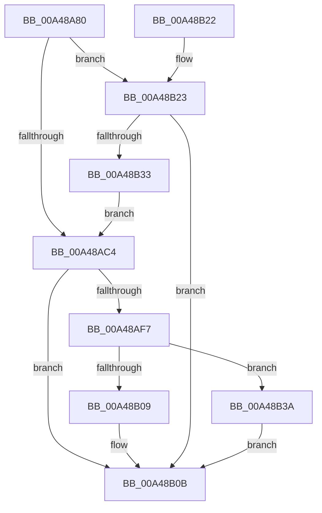

# NtSetWnfProcessNotificationEvent

- RVA: `0x00A48A80`–`0x00A48B4B` (길이 `203` bytes)
- VA: `0x0000000140A48A80`
- 실행 섹션: `PAGE`
- PDB 이름 있음: `예`; PDB Function 태그: `아니요`
- unwind 정보 RVA: `0x000AFABC`
- 디코드: `50`개 명령, `203/203` bytes 표시
- 미해석 바이트: `0` (있으면 어셈블리에 `.byte`로 보존)

> 이 문서는 커널 이미지의 기계어와 PDB 기호를 분석해 생성했습니다. 4번과 5번은 함수 원형과 자료형을 바이너리 사용 방식에서 추정한 C 해석이며 원본 소스 복구 결과는 아닙니다.

## 1. Dependencies

- 직접 호출 지점: **4**; 고유 호출 대상: **4**
- 직접 호출자로 확인된 함수: **0**
- RIP 상대 이미지 참조: **1**

### Outgoing calls
- `0x00A48AEC` → [ObReferenceObjectByHandle](../86/ObReferenceObjectByHandle_function_00868DB0.md) (function, `0x00868DB0`)
- `0x00A48B0B` → [KeLeaveCriticalRegion](../../text/25/KeLeaveCriticalRegion_function_0025D8B0.md) (function, `0x0025D8B0`)
- `0x00A48B28` → [ExpWnfCreateProcessContext](ExpWnfCreateProcessContext_function_00A48B54.md) (function, `0x00A48B54`)
- `0x00A48B3F` → [ObfDereferenceObject](../../text/2F/ObfDereferenceObject_function_002F9350.md) (function, `0x002F9350`)

### Direct callers
- 이 함수 시작 RVA로 연결되는 직접 call은 확인되지 않았습니다. 간접 호출은 완전히 역산할 수 없습니다.

### Static image references
- `0x00A48AC4` → RVA `0x00FC6B80` (`ALMOSTRO`; read)

## 2. Other-region calls and transfers

- 다른 실행 섹션으로 향하는 call: **2**
  - `0x00A48B0B` → [KeLeaveCriticalRegion](../../text/25/KeLeaveCriticalRegion_function_0025D8B0.md) (`PAGE` → `.text`)
  - `0x00A48B3F` → [ObfDereferenceObject](../../text/2F/ObfDereferenceObject_function_002F9350.md) (`PAGE` → `.text`)
- 별도 외부 분기/꼬리 이동을 확인하지 못했습니다.

## 3. Assembly (complete function range)

```asm
00A48A80  48 89 5C 24 08                  mov qword ptr [rsp + 8], rbx
00A48A85  48 89 74 24 20                  mov qword ptr [rsp + 0x20], rsi
00A48A8A  57                              push rdi
00A48A8B  48 83 EC 30                     sub rsp, 0x30
00A48A8F  65 48 8B 04 25 88 01 00 00      mov rax, qword ptr gs:[0x188]
00A48A98  48 8B F1                        mov rsi, rcx
00A48A9B  66 FF 88 E4 01 00 00            dec word ptr [rax + 0x1e4]
00A48AA2  90                              nop
00A48AA3  65 48 8B 04 25 88 01 00 00      mov rax, qword ptr gs:[0x188]
00A48AAC  48 8B 88 B8 00 00 00            mov rcx, qword ptr [rax + 0xb8]
00A48AB3  48 8B B9 E8 05 00 00            mov rdi, qword ptr [rcx + 0x5e8]
00A48ABA  48 89 7C 24 50                  mov qword ptr [rsp + 0x50], rdi
00A48ABF  48 85 FF                        test rdi, rdi
00A48AC2  74 5F                           je 0x140a48b23
00A48AC4  4C 8B 05 B5 E0 57 00            mov r8, qword ptr [rip + 0x57e0b5]
00A48ACB  48 8D 44 24 48                  lea rax, [rsp + 0x48]
00A48AD0  48 83 64 24 28 00               and qword ptr [rsp + 0x28], 0
00A48AD6  41 B1 01                        mov r9b, 1
00A48AD9  48 83 64 24 48 00               and qword ptr [rsp + 0x48], 0
00A48ADF  BA 02 00 00 00                  mov edx, 2
00A48AE4  48 8B CE                        mov rcx, rsi
00A48AE7  48 89 44 24 20                  mov qword ptr [rsp + 0x20], rax
00A48AEC  E8 BF 02 E2 FF                  call 0x140868db0
00A48AF1  8B D8                           mov ebx, eax
00A48AF3  85 C0                           test eax, eax
00A48AF5  78 14                           js 0x140a48b0b
00A48AF7  48 8B 4C 24 48                  mov rcx, qword ptr [rsp + 0x48]
00A48AFC  33 C0                           xor eax, eax
00A48AFE  F0 48 0F B1 8F 80 00 00 00      lock cmpxchg qword ptr [rdi + 0x80], rcx
00A48B07  75 31                           jne 0x140a48b3a
00A48B09  33 DB                           xor ebx, ebx
00A48B0B  E8 A0 4D 81 FF                  call 0x14025d8b0
00A48B10  48 8B 74 24 58                  mov rsi, qword ptr [rsp + 0x58]
00A48B15  8B C3                           mov eax, ebx
00A48B17  48 8B 5C 24 40                  mov rbx, qword ptr [rsp + 0x40]
00A48B1C  48 83 C4 30                     add rsp, 0x30
00A48B20  5F                              pop rdi
00A48B21  C3                              ret
00A48B22  CC                              int3
00A48B23  48 8D 54 24 50                  lea rdx, [rsp + 0x50]
00A48B28  E8 27 00 00 00                  call 0x140a48b54
00A48B2D  8B D8                           mov ebx, eax
00A48B2F  85 C0                           test eax, eax
00A48B31  78 D8                           js 0x140a48b0b
00A48B33  48 8B 7C 24 50                  mov rdi, qword ptr [rsp + 0x50]
00A48B38  EB 8A                           jmp 0x140a48ac4
00A48B3A  48 8B 4C 24 48                  mov rcx, qword ptr [rsp + 0x48]
00A48B3F  E8 0C 08 8B FF                  call 0x1402f9350
00A48B44  BB 18 07 00 C0                  mov ebx, 0xc0000718
00A48B49  EB C0                           jmp 0x140a48b0b
```

## 4. C-style interpretation (structured pseudocode)

```c
__int64 __fastcall NtSetWnfProcessNotificationEvent(__int64 a1)
{
    __int64 result;
    __int64 v_rbx;
    __int64 v_rsp;
    unsigned __int64 v_stack_m10;
    unsigned __int64 v_stack_m18;
    unsigned __int64 v_stack_p10;
    unsigned __int64 v_stack_p18;
    unsigned __int64 v_stack_p20;
    unsigned __int64 v_stack_p48;
    unsigned __int64 v_stack_p50;
    unsigned __int64 v_stack_p8;

    v_stack_p8 = v_rbx;
    v_stack_p20 = v_rsi;
    v_rsp = (v_rsp) - (48);
    v_stack_p18 = *(unsigned __int64 *)(*(unsigned __int64 *)(*(unsigned __int64 *)(gs_base + (0 + 392)) + 184) + 1512);
    if (*(unsigned __int64 *)(*(unsigned __int64 *)(*(unsigned __int64 *)(gs_base + (0 + 392)) + 184) + 1512) == 0) goto loc_00A48B23;
loc_00A48AC4:
    v_stack_m18 = v_stack_p10;
    result = ObReferenceObjectByHandle(a1, 2, *(unsigned __int64 *)(v_rip + 5759157), 1);
    if (sign_flag) goto loc_00A48B0B;
    result = 0;
    if (condition_is_not_equal) goto loc_00A48B3A;
    v_rbx = 0;
loc_00A48B0B:
    result = KeLeaveCriticalRegion(v_stack_p10, 2, *(unsigned __int64 *)(v_rip + 5759157), 1);
    v_rsp = (v_rsp) + (48);
    return 0;
loc_00A48B23:
    result = ExpWnfCreateProcessContext(v_stack_p10, v_stack_p50, *(unsigned __int64 *)(v_rip + 5759157), 1);
    if (sign_flag) goto loc_00A48B0B;
    goto loc_00A48AC4;
loc_00A48B3A:
    result = ObfDereferenceObject(v_stack_p48, v_stack_p50, *(unsigned __int64 *)(v_rip + 5759157), 1);
    goto loc_00A48B0B;
}
```

## 5. (Beta) C Style

```c
int64_t NtSetWnfProcessNotificationEvent(int64_t Arg1)
{
    int64_t result;
    int64_t local_rbx;
    int64_t local_rsp;
    uint64_t v_stack_m10;
    uint64_t v_stack_m18;
    uint64_t v_stack_p10;
    uint64_t v_stack_p18;
    uint64_t v_stack_p20;
    uint64_t v_stack_p48;
    uint64_t v_stack_p50;
    uint64_t v_stack_p8;

    v_stack_p8 = local_rbx;
    v_stack_p20 = local_rsi;
    local_rsp = (local_rsp) - (48);
    v_stack_p18 = *(uint64_t *)(*(uint64_t *)(*(uint64_t *)(gs_base + (0 + 0x188)) + 0xB8) + 0x5E8);
    if (*(uint64_t *)(*(uint64_t *)(*(uint64_t *)(gs_base + (0 + 0x188)) + 0xB8) + 0x5E8) == 0) goto loc_00A48B23;
loc_00A48AC4:
    v_stack_m18 = v_stack_p10;
    result = ObReferenceObjectByHandle(Arg1, 2, *(uint64_t *)(v_rip + 0x57E0B5), 1);
    if (sign_flag) goto loc_00A48B0B;
    result = 0;
    if (condition_is_not_equal) goto loc_00A48B3A;
    local_rbx = 0;
loc_00A48B0B:
    result = KeLeaveCriticalRegion(v_stack_p10, 2, *(uint64_t *)(v_rip + 0x57E0B5), 1);
    local_rsp = (local_rsp) + (48);
    return 0;
loc_00A48B23:
    result = ExpWnfCreateProcessContext(v_stack_p10, v_stack_p50, *(uint64_t *)(v_rip + 0x57E0B5), 1);
    if (sign_flag) goto loc_00A48B0B;
    goto loc_00A48AC4;
loc_00A48B3A:
    result = ObfDereferenceObject(v_stack_p48, v_stack_p50, *(uint64_t *)(v_rip + 0x57E0B5), 1);
    goto loc_00A48B0B;
}
```

## 6. Execution-region graph

[열기: 2D/3D 그래프와 함수 탐색 컨트롤 패널](../../../control-panel.html?section=page&rva=0x00A48A80&view=graph)

- 2D 그래프는 위에서 아래로 흐르고, 3D 그래프는 빈 공간을 드래그해 회전합니다. Shift+드래그는 이동, 휠은 확대·축소, 함수 노드 선택은 대상 보고서 이동입니다.

### Static fallback


