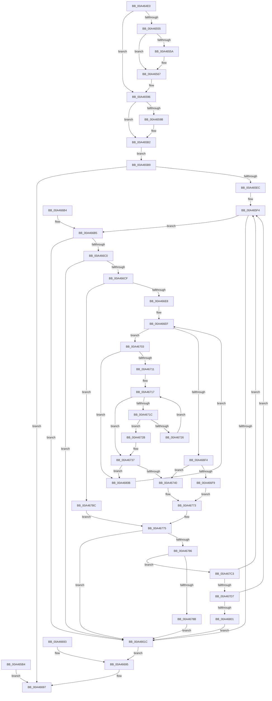

# NtWaitForDebugEvent

- RVA: `0x00A464E0`–`0x00A46813` (길이 `819` bytes)
- VA: `0x0000000140A464E0`
- 실행 섹션: `PAGE`
- PDB 이름 있음: `예`; PDB Function 태그: `아니요`
- unwind 정보 RVA: `0x000AF718`
- 디코드: `209`개 명령, `819/819` bytes 표시
- 미해석 바이트: `0` (있으면 어셈블리에 `.byte`로 보존)

> 이 문서는 커널 이미지의 기계어와 PDB 기호를 분석해 생성했습니다. 4번과 5번은 함수 원형과 자료형을 바이너리 사용 방식에서 추정한 C 해석이며 원본 소스 복구 결과는 아닙니다.

## 1. Dependencies

- 직접 호출 지점: **13**; 고유 호출 대상: **11**
- 직접 호출자로 확인된 함수: **0**
- RIP 상대 이미지 참조: **1**

### Outgoing calls
- `0x00A46538` → [memset](../../text/6C/memset_function_006C6C40.md) (function, `0x006C6C40`)
- `0x00A465DF` → [ObReferenceObjectByHandle](../86/ObReferenceObjectByHandle_function_00868DB0.md) (function, `0x00868DB0`)
- `0x00A4660C` → [KeWaitForSingleObject](../../text/20/KeWaitForSingleObject_function_0020E6B0.md) (function, `0x0020E6B0`)
- `0x00A4661F` → [ObfDereferenceObject](../../text/2F/ObfDereferenceObject_function_002F9350.md) (function, `0x002F9350`)
- `0x00A466D8` → [ExAcquireFastMutex](../../text/20/ExAcquireFastMutex_function_0020E5A0.md) (function, `0x0020E5A0`)
- `0x00A466FC` → [KeResetEvent](../../text/24/KeResetEvent_function_00248350.md) (function, `0x00248350`)
- `0x00A46750` → [ObfReferenceObjectWithTag](../../text/21/ObfReferenceObjectWithTag_function_00210710.md) (function, `0x00210710`)
- `0x00A4675D` → [ObfReferenceObjectWithTag](../../text/21/ObfReferenceObjectWithTag_function_00210710.md) (function, `0x00210710`)
- `0x00A4676A` → [DbgkpConvertKernelToUserStateChange](DbgkpConvertKernelToUserStateChange_function_00A46938.md) (function, `0x00A46938`)
- `0x00A46779` → [ExReleaseFastMutex](../../text/25/ExReleaseFastMutex_function_002519C0.md) (function, `0x002519C0`)
- `0x00A46796` → [DbgkpOpenHandles](DbgkpOpenHandles_function_00A4681C.md) (function, `0x00A4681C`)
- `0x00A467A7` → [ObfDereferenceObjectWithTag](../../text/2F/ObfDereferenceObjectWithTag_function_002F78E0.md) (function, `0x002F78E0`)
- `0x00A467B2` → [ObfDereferenceObjectWithTag](../../text/2F/ObfDereferenceObjectWithTag_function_002F78E0.md) (function, `0x002F78E0`)

### Direct callers
- 이 함수 시작 RVA로 연결되는 직접 call은 확인되지 않았습니다. 간접 호출은 완전히 역산할 수 없습니다.

### Static image references
- `0x00A465B9` → RVA `0x00FC5140` (`ALMOSTRO`; read)

## 2. Other-region calls and transfers

- 다른 실행 섹션으로 향하는 call: **10**
  - `0x00A46538` → [memset](../../text/6C/memset_function_006C6C40.md) (`PAGE` → `.text`)
  - `0x00A4660C` → [KeWaitForSingleObject](../../text/20/KeWaitForSingleObject_function_0020E6B0.md) (`PAGE` → `.text`)
  - `0x00A4661F` → [ObfDereferenceObject](../../text/2F/ObfDereferenceObject_function_002F9350.md) (`PAGE` → `.text`)
  - `0x00A466D8` → [ExAcquireFastMutex](../../text/20/ExAcquireFastMutex_function_0020E5A0.md) (`PAGE` → `.text`)
  - `0x00A466FC` → [KeResetEvent](../../text/24/KeResetEvent_function_00248350.md) (`PAGE` → `.text`)
  - `0x00A46750` → [ObfReferenceObjectWithTag](../../text/21/ObfReferenceObjectWithTag_function_00210710.md) (`PAGE` → `.text`)
  - `0x00A4675D` → [ObfReferenceObjectWithTag](../../text/21/ObfReferenceObjectWithTag_function_00210710.md) (`PAGE` → `.text`)
  - `0x00A46779` → [ExReleaseFastMutex](../../text/25/ExReleaseFastMutex_function_002519C0.md) (`PAGE` → `.text`)
  - `0x00A467A7` → [ObfDereferenceObjectWithTag](../../text/2F/ObfDereferenceObjectWithTag_function_002F78E0.md) (`PAGE` → `.text`)
  - `0x00A467B2` → [ObfDereferenceObjectWithTag](../../text/2F/ObfDereferenceObjectWithTag_function_002F78E0.md) (`PAGE` → `.text`)
- 별도 외부 분기/꼬리 이동을 확인하지 못했습니다.

## 3. Assembly (complete function range)

```asm
00A464E0  48 8B C4                        mov rax, rsp
00A464E3  48 89 58 08                     mov qword ptr [rax + 8], rbx
00A464E7  48 89 70 20                     mov qword ptr [rax + 0x20], rsi
00A464EB  4C 89 40 18                     mov qword ptr [rax + 0x18], r8
00A464EF  88 50 10                        mov byte ptr [rax + 0x10], dl
00A464F2  57                              push rdi
00A464F3  41 54                           push r12
00A464F5  41 55                           push r13
00A464F7  41 56                           push r14
00A464F9  41 57                           push r15
00A464FB  48 81 EC 20 01 00 00            sub rsp, 0x120
00A46502  49 8B F1                        mov rsi, r9
00A46505  49 8B D8                        mov rbx, r8
00A46508  44 8A F2                        mov r14b, dl
00A4650B  48 8B F9                        mov rdi, rcx
00A4650E  45 33 E4                        xor r12d, r12d
00A46511  4C 89 64 24 38                  mov qword ptr [rsp + 0x38], r12
00A46516  4C 89 64 24 48                  mov qword ptr [rsp + 0x48], r12
00A4651B  65 48 8B 04 25 88 01 00 00      mov rax, qword ptr gs:[0x188]
00A46524  44 8A A8 32 02 00 00            mov r13b, byte ptr [rax + 0x232]
00A4652B  33 D2                           xor edx, edx
00A4652D  41 B8 B8 00 00 00               mov r8d, 0xb8
00A46533  48 8D 4C 24 60                  lea rcx, [rsp + 0x60]
00A46538  E8 03 07 C8 FF                  call 0x1406c6c40
00A4653D  90                              nop
00A4653E  48 8B 8C 24 60 01 00 00         mov rcx, qword ptr [rsp + 0x160]
00A46546  48 BA 00 00 FF FF FF 7F 00 00   movabs rdx, 0x7fffffff0000
00A46550  48 85 C9                        test rcx, rcx
00A46553  74 41                           je 0x140a46596
00A46555  45 84 ED                        test r13b, r13b
00A46558  74 0D                           je 0x140a46567
00A4655A  48 8B C2                        mov rax, rdx
00A4655D  48 3B CA                        cmp rcx, rdx
00A46560  48 0F 42 C3                     cmovb rax, rbx
00A46564  90                              nop
00A46565  8A 00                           mov al, byte ptr [rax]
00A46567  48 8B 84 24 60 01 00 00         mov rax, qword ptr [rsp + 0x160]
00A4656F  48 8B 08                        mov rcx, qword ptr [rax]
00A46572  48 89 4C 24 38                  mov qword ptr [rsp + 0x38], rcx
00A46577  48 8D 44 24 38                  lea rax, [rsp + 0x38]
00A4657C  48 89 84 24 60 01 00 00         mov qword ptr [rsp + 0x160], rax
00A46584  48 B9 14 00 00 00 80 F7 FF FF   movabs rcx, 0xfffff78000000014
00A4658E  48 8B 01                        mov rax, qword ptr [rcx]
00A46591  48 89 44 24 48                  mov qword ptr [rsp + 0x48], rax
00A46596  45 84 ED                        test r13b, r13b
00A46599  74 17                           je 0x140a465b2
00A4659B  48 3B F2                        cmp rsi, rdx
00A4659E  48 0F 42 D6                     cmovb rdx, rsi
00A465A2  8A 02                           mov al, byte ptr [rdx]
00A465A4  88 02                           mov byte ptr [rdx], al
00A465A6  8A 82 B7 00 00 00               mov al, byte ptr [rdx + 0xb7]
00A465AC  88 82 B7 00 00 00               mov byte ptr [rdx + 0xb7], al
00A465B2  EB 05                           jmp 0x140a465b9
00A465B4  E9 DE 00 00 00                  jmp 0x140a46697
00A465B9  4C 8B 05 80 EB 57 00            mov r8, qword ptr [rip + 0x57eb80]
00A465C0  4C 89 64 24 40                  mov qword ptr [rsp + 0x40], r12
00A465C5  4C 89 64 24 28                  mov qword ptr [rsp + 0x28], r12
00A465CA  48 8D 44 24 40                  lea rax, [rsp + 0x40]
00A465CF  48 89 44 24 20                  mov qword ptr [rsp + 0x20], rax
00A465D4  45 8A CD                        mov r9b, r13b
00A465D7  BA 01 00 00 00                  mov edx, 1
00A465DC  48 8B CF                        mov rcx, rdi
00A465DF  E8 CC 27 E2 FF                  call 0x140868db0
00A465E4  85 C0                           test eax, eax
00A465E6  0F 88 AB 00 00 00               js 0x140a46697
00A465EC  4D 8B FC                        mov r15, r12
00A465EF  48 8B 7C 24 40                  mov rdi, qword ptr [rsp + 0x40]
00A465F4  48 8B 84 24 60 01 00 00         mov rax, qword ptr [rsp + 0x160]
00A465FC  48 89 44 24 20                  mov qword ptr [rsp + 0x20], rax
00A46601  45 8A CE                        mov r9b, r14b
00A46604  45 8A C5                        mov r8b, r13b
00A46607  33 D2                           xor edx, edx
00A46609  48 8B CF                        mov rcx, rdi
00A4660C  E8 9F 80 7C FF                  call 0x14020e6b0
00A46611  8B D8                           mov ebx, eax
00A46613  83 F8 FF                        cmp eax, -1
00A46616  0F 8F 99 00 00 00               jg 0x140a466b5
00A4661C  48 8B CF                        mov rcx, rdi
00A4661F  E8 2C 2D 8B FF                  call 0x1402f9350
00A46624  90                              nop
00A46625  48 8D 44 24 60                  lea rax, [rsp + 0x60]
00A4662A  0F 10 00                        movups xmm0, xmmword ptr [rax]
00A4662D  0F 11 06                        movups xmmword ptr [rsi], xmm0
00A46630  0F 10 48 10                     movups xmm1, xmmword ptr [rax + 0x10]
00A46634  0F 11 4E 10                     movups xmmword ptr [rsi + 0x10], xmm1
00A46638  0F 10 40 20                     movups xmm0, xmmword ptr [rax + 0x20]
00A4663C  0F 11 46 20                     movups xmmword ptr [rsi + 0x20], xmm0
00A46640  0F 10 48 30                     movups xmm1, xmmword ptr [rax + 0x30]
00A46644  0F 11 4E 30                     movups xmmword ptr [rsi + 0x30], xmm1
00A46648  0F 10 40 40                     movups xmm0, xmmword ptr [rax + 0x40]
00A4664C  0F 11 46 40                     movups xmmword ptr [rsi + 0x40], xmm0
00A46650  0F 10 48 50                     movups xmm1, xmmword ptr [rax + 0x50]
00A46654  0F 11 4E 50                     movups xmmword ptr [rsi + 0x50], xmm1
00A46658  0F 10 40 60                     movups xmm0, xmmword ptr [rax + 0x60]
00A4665C  0F 11 46 60                     movups xmmword ptr [rsi + 0x60], xmm0
00A46660  B9 80 00 00 00                  mov ecx, 0x80
00A46665  48 03 F1                        add rsi, rcx
00A46668  0F 10 40 70                     movups xmm0, xmmword ptr [rax + 0x70]
00A4666C  0F 11 46 F0                     movups xmmword ptr [rsi - 0x10], xmm0
00A46670  48 03 C1                        add rax, rcx
00A46673  0F 10 08                        movups xmm1, xmmword ptr [rax]
00A46676  0F 11 0E                        movups xmmword ptr [rsi], xmm1
00A46679  0F 10 40 10                     movups xmm0, xmmword ptr [rax + 0x10]
00A4667D  0F 11 46 10                     movups xmmword ptr [rsi + 0x10], xmm0
00A46681  0F 10 48 20                     movups xmm1, xmmword ptr [rax + 0x20]
00A46685  0F 11 4E 20                     movups xmmword ptr [rsi + 0x20], xmm1
00A46689  48 8B 40 30                     mov rax, qword ptr [rax + 0x30]
00A4668D  48 89 46 30                     mov qword ptr [rsi + 0x30], rax
00A46691  EB 02                           jmp 0x140a46695
00A46693  8B D8                           mov ebx, eax
00A46695  8B C3                           mov eax, ebx
00A46697  4C 8D 9C 24 20 01 00 00         lea r11, [rsp + 0x120]
00A4669F  49 8B 5B 30                     mov rbx, qword ptr [r11 + 0x30]
00A466A3  49 8B 73 48                     mov rsi, qword ptr [r11 + 0x48]
00A466A7  49 8B E3                        mov rsp, r11
00A466AA  41 5F                           pop r15
00A466AC  41 5E                           pop r14
00A466AE  41 5D                           pop r13
00A466B0  41 5C                           pop r12
00A466B2  5F                              pop rdi
00A466B3  C3                              ret
00A466B4  CC                              int3
00A466B5  3D C0 00 00 00                  cmp eax, 0xc0
00A466BA  0F 84 5C FF FF FF               je 0x140a4661c
00A466C0  8D 88 FF FE FF FF               lea ecx, [rax - 0x101]
00A466C6  83 F9 01                        cmp ecx, 1
00A466C9  0F 86 4D FF FF FF               jbe 0x140a4661c
00A466CF  45 32 F6                        xor r14b, r14b
00A466D2  33 DB                           xor ebx, ebx
00A466D4  48 8D 4F 18                     lea rcx, [rdi + 0x18]
00A466D8  E8 C3 7E 7C FF                  call 0x14020e5a0
00A466DD  8B 47 60                        mov eax, dword ptr [rdi + 0x60]
00A466E0  A8 01                           test al, 1
00A466E2  0F 85 D4 00 00 00               jne 0x140a467bc
00A466E8  4C 8D 47 50                     lea r8, [rdi + 0x50]
00A466EC  49 8B 08                        mov rcx, qword ptr [r8]
00A466EF  49 3B C8                        cmp rcx, r8
00A466F2  75 0F                           jne 0x140a46703
00A466F4  45 84 F6                        test r14b, r14b
00A466F7  75 47                           jne 0x140a46740
00A466F9  48 8B CF                        mov rcx, rdi
00A466FC  E8 4F 1C 80 FF                  call 0x140248350
00A46701  EB 70                           jmp 0x140a46773
00A46703  48 8B D9                        mov rbx, rcx
00A46706  8B 41 4C                        mov eax, dword ptr [rcx + 0x4c]
00A46709  A8 05                           test al, 5
00A4670B  0F 85 FA 00 00 00               jne 0x140a4680b
00A46711  41 B6 01                        mov r14b, 1
00A46714  49 8B 10                        mov rdx, qword ptr [r8]
00A46717  48 3B D1                        cmp rdx, rcx
00A4671A  74 1B                           je 0x140a46737
00A4671C  48 8B 42 28                     mov rax, qword ptr [rdx + 0x28]
00A46720  48 39 41 28                     cmp qword ptr [rcx + 0x28], rax
00A46724  74 05                           je 0x140a4672b
00A46726  48 8B 12                        mov rdx, qword ptr [rdx]
00A46729  EB EC                           jmp 0x140a46717
00A4672B  83 49 4C 04                     or dword ptr [rcx + 0x4c], 4
00A4672F  48 83 61 50 00                  and qword ptr [rcx + 0x50], 0
00A46734  45 32 F6                        xor r14b, r14b
00A46737  45 84 F6                        test r14b, r14b
00A4673A  0F 84 CB 00 00 00               je 0x140a4680b
00A46740  4C 8B 7B 38                     mov r15, qword ptr [rbx + 0x38]
00A46744  4C 8B 63 40                     mov r12, qword ptr [rbx + 0x40]
00A46748  BA 44 62 67 4F                  mov edx, 0x4f676244
00A4674D  49 8B CC                        mov rcx, r12
00A46750  E8 BB 9F 7C FF                  call 0x140210710
00A46755  BA 44 62 67 4F                  mov edx, 0x4f676244
00A4675A  49 8B CF                        mov rcx, r15
00A4675D  E8 AE 9F 7C FF                  call 0x140210710
00A46762  48 8B D3                        mov rdx, rbx
00A46765  48 8D 4C 24 60                  lea rcx, [rsp + 0x60]
00A4676A  E8 C9 01 00 00                  call 0x140a46938
00A4676F  83 4B 4C 01                     or dword ptr [rbx + 0x4c], 1
00A46773  33 DB                           xor ebx, ebx
00A46775  48 8D 4F 18                     lea rcx, [rdi + 0x18]
00A46779  E8 42 B2 80 FF                  call 0x1402519c0
00A4677E  85 DB                           test ebx, ebx
00A46780  0F 88 96 FE FF FF               js 0x140a4661c
00A46786  45 84 F6                        test r14b, r14b
00A46789  74 38                           je 0x140a467c3
00A4678B  4D 8B C4                        mov r8, r12
00A4678E  49 8B D7                        mov rdx, r15
00A46791  48 8D 4C 24 60                  lea rcx, [rsp + 0x60]
00A46796  E8 81 00 00 00                  call 0x140a4681c
00A4679B  41 BE 44 62 67 4F               mov r14d, 0x4f676244
00A467A1  41 8B D6                        mov edx, r14d
00A467A4  49 8B CC                        mov rcx, r12
00A467A7  E8 34 11 8B FF                  call 0x1402f78e0
00A467AC  41 8B D6                        mov edx, r14d
00A467AF  49 8B CF                        mov rcx, r15
00A467B2  E8 29 11 8B FF                  call 0x1402f78e0
00A467B7  E9 60 FE FF FF                  jmp 0x140a4661c
00A467BC  BB 54 03 00 C0                  mov ebx, 0xc0000354
00A467C1  EB B2                           jmp 0x140a46775
00A467C3  48 83 7C 24 38 00               cmp qword ptr [rsp + 0x38], 0
00A467C9  44 8A B4 24 58 01 00 00         mov r14b, byte ptr [rsp + 0x158]
00A467D1  0F 8D 1D FE FF FF               jge 0x140a465f4
00A467D7  48 B8 14 00 00 00 80 F7 FF FF   movabs rax, 0xfffff78000000014
00A467E1  48 8B 00                        mov rax, qword ptr [rax]
00A467E4  48 8B C8                        mov rcx, rax
00A467E7  48 2B 4C 24 48                  sub rcx, qword ptr [rsp + 0x48]
00A467EC  48 01 4C 24 38                  add qword ptr [rsp + 0x38], rcx
00A467F1  48 89 44 24 48                  mov qword ptr [rsp + 0x48], rax
00A467F6  48 8B 7C 24 40                  mov rdi, qword ptr [rsp + 0x40]
00A467FB  0F 88 F3 FD FF FF               js 0x140a465f4
00A46801  BB 02 01 00 00                  mov ebx, 0x102
00A46806  E9 11 FE FF FF                  jmp 0x140a4661c
00A4680B  48 8B 09                        mov rcx, qword ptr [rcx]
00A4680E  E9 DC FE FF FF                  jmp 0x140a466ef
```

## 4. C-style interpretation (structured pseudocode)

```c
__int64 __fastcall NtWaitForDebugEvent(__int64 a1, int a2, __int64 a3, __int64 a4)
{
    __int64 result;
    __int64 v_r12;
    __int64 v_r14;
    __int64 v_rbx;
    __int64 v_rsi;
    __int64 v_rsp;
    unsigned __int64 v_stack_m100;
    unsigned __int64 v_stack_m108;
    unsigned __int64 v_stack_m110;
    unsigned __int64 v_stack_m120;
    unsigned __int64 v_stack_m128;
    unsigned __int64 v_stack_m28;
    unsigned __int64 v_stack_mC0;
    unsigned __int64 v_stack_mD8;
    unsigned __int64 v_stack_mE0;
    unsigned __int64 v_stack_mE8;
    unsigned __int64 v_stack_p18;
    unsigned __int8 v_stack_p38;

    *(unsigned __int64 *)(v_rsp + 8) = v_rbx;
    *(unsigned __int64 *)(v_rsp + 32) = v_rsi;
    *(unsigned __int64 *)(v_rsp + 24) = a3;
    *(unsigned __int8 *)(v_rsp + 16) = (unsigned __int8)(a2);
    v_rsp = (v_rsp) - (288);
    v_r12 = 0;
    v_stack_m110 = 0;
    v_stack_m100 = 0;
    a2 = 0;
    result = memset(v_stack_mE8, a2, 184, a4);
    if (v_stack_p18 == 0) goto loc_00A46596;
    if ((unsigned __int8)(*(unsigned __int8 *)(*(unsigned __int64 *)(gs_base + (0 + 392)) + 562)) != 0) {
        result = 0;
        if (v_stack_p18 < 0) { result = a3; }
        result = *(unsigned __int8 *)(result);
    }
    v_stack_m110 = *(unsigned __int64 *)(v_stack_p18);
    v_stack_p18 = v_stack_m110;
    v_stack_m100 = *(unsigned __int64 *)(*(unsigned __int64 *)(v_stack_p18));
loc_00A46596:
    result = *(unsigned __int64 *)(*(unsigned __int64 *)(v_stack_p18));
    if ((unsigned __int8)(*(unsigned __int8 *)(*(unsigned __int64 *)(gs_base + (0 + 392)) + 562)) != 0) {
        if (a4 < 0) { a2 = a4; }
        result = *(unsigned __int8 *)(a2);
        *(unsigned __int8 *)(a2) = (unsigned __int8)(result);
        result = *(unsigned __int8 *)(a2 + 183);
        *(unsigned __int8 *)(a2 + 183) = (unsigned __int8)(result);
    }
    goto loc_00A465B9;
loc_00A465B9:
    v_stack_m108 = 0;
    v_stack_m120 = 0;
    v_stack_m128 = v_stack_m108;
    result = ObReferenceObjectByHandle(a1, 1, *(unsigned __int64 *)(v_rip + 5761920), (unsigned __int8)(*(unsigned __int8 *)(*(unsigned __int64 *)(gs_base + (0 + 392)) + 562)));
    if (sign_flag) goto loc_00A46697;
loc_00A465F4:
    v_stack_m128 = v_stack_p18;
    a2 = 0;
    result = KeWaitForSingleObject(v_stack_m108, a2, (unsigned __int8)(*(unsigned __int8 *)(*(unsigned __int64 *)(gs_base + (0 + 392)) + 562)), (unsigned __int8)((unsigned __int8)(a2)));
    if (((unsigned int)(result)) > -1) goto loc_00A466B5;
loc_00A4661C:
    result = ObfDereferenceObject(v_stack_m108, a2, (unsigned __int8)(*(unsigned __int8 *)(*(unsigned __int64 *)(gs_base + (0 + 392)) + 562)), (unsigned __int8)((unsigned __int8)(a2)));
    *(unsigned __int64 *)(a4) = v_xmm0;
    *(unsigned __int64 *)(a4 + 16) = v_xmm1;
    *(unsigned __int64 *)(a4 + 32) = v_xmm0;
    *(unsigned __int64 *)(a4 + 48) = v_xmm1;
    *(unsigned __int64 *)(a4 + 64) = v_xmm0;
    *(unsigned __int64 *)(a4 + 80) = v_xmm1;
    *(unsigned __int64 *)(a4 + 96) = v_xmm0;
    v_rsi = (a4) + (128);
    *(unsigned __int64 *)(v_rsi - 16) = v_xmm0;
    result = (v_stack_mE8) + (128);
    *(unsigned __int64 *)(v_rsi) = v_xmm1;
    *(unsigned __int64 *)(v_rsi + 16) = v_xmm0;
    *(unsigned __int64 *)(v_rsi + 32) = v_xmm1;
    *(unsigned __int64 *)(v_rsi + 48) = *(unsigned __int64 *)(result + 48);
    goto loc_00A46695;
loc_00A46695:
loc_00A46697:
    return (unsigned int)((unsigned int)((unsigned int)((unsigned int)(result))));
loc_00A466B5:
    if (((unsigned int)((unsigned int)((unsigned int)((unsigned int)((unsigned int)(result)))))) == 192) goto loc_00A4661C;
    if (((unsigned int)((unsigned int)((unsigned int)((unsigned int)((unsigned int)(result)))) - 257)) <= 1) goto loc_00A4661C;
    v_r14 = 0;
    v_rbx = 0;
    result = ExAcquireFastMutex(v_stack_m108 + 24, a2, (unsigned __int8)(*(unsigned __int8 *)(*(unsigned __int64 *)(gs_base + (0 + 392)) + 562)), (unsigned __int8)((unsigned __int8)(a2)));
    if ((((unsigned __int8)((unsigned int)(*(unsigned int *)(v_stack_m108 + 96)))) & (1)) != 0) goto loc_00A467BC;
loc_00A466EF:
    if ((*(unsigned __int64 *)(v_stack_m108 + 80)) != (v_stack_m108 + 80)) goto loc_00A46703;
    if (0 != 0) goto loc_00A46740;
    result = KeResetEvent(v_stack_m108, a2, v_stack_m108 + 80, (unsigned __int8)((unsigned __int8)(a2)));
    goto loc_00A46773;
loc_00A46703:
    if ((((unsigned __int8)((unsigned int)(*(unsigned int *)(v_stack_m108 + 76)))) & (5)) != 0) goto loc_00A4680B;
loc_00A46717:
    if ((*(unsigned __int64 *)(v_stack_m108 + 80)) == v_stack_m108) goto loc_00A46737;
    if ((*(unsigned __int64 *)(v_stack_m108 + 40)) == (*(unsigned __int64 *)(*(unsigned __int64 *)(v_stack_m108 + 80) + 40))) goto loc_00A4672B;
    goto loc_00A46717;
loc_00A4672B:
    v_r14 = 0;
loc_00A46737:
    if (0 == 0) goto loc_00A4680B;
loc_00A46740:
    result = ObfReferenceObjectWithTag(*(unsigned __int64 *)(v_stack_m108 + 64), (unsigned int)(0x4F676244ULL), v_stack_m108 + 80, (unsigned __int8)((unsigned __int8)(a2)));
    result = ObfReferenceObjectWithTag(*(unsigned __int64 *)(v_stack_m108 + 56), (unsigned int)(0x4F676244ULL), v_stack_m108 + 80, (unsigned __int8)((unsigned __int8)(a2)));
    result = DbgkpConvertKernelToUserStateChange(v_stack_mC0, v_stack_m108, v_stack_m108 + 80, (unsigned __int8)((unsigned __int8)(a2)));
loc_00A46773:
    v_rbx = 0;
loc_00A46775:
    result = ExReleaseFastMutex(v_stack_m108 + 24, v_stack_m108, v_stack_m108 + 80, (unsigned __int8)((unsigned __int8)(a2)));
    if (sign_flag) goto loc_00A4661C;
    if (0 == 0) goto loc_00A467C3;
    result = DbgkpOpenHandles(v_stack_mC0, *(unsigned __int64 *)(v_stack_m108 + 56), *(unsigned __int64 *)(v_stack_m108 + 64), (unsigned __int8)((unsigned __int8)(a2)));
    result = ObfDereferenceObjectWithTag(*(unsigned __int64 *)(v_stack_m108 + 64), (unsigned int)((unsigned int)((unsigned int)(0x4F676244ULL))), *(unsigned __int64 *)(v_stack_m108 + 64), (unsigned __int8)((unsigned __int8)(a2)));
    result = ObfDereferenceObjectWithTag(*(unsigned __int64 *)(v_stack_m108 + 56), (unsigned int)((unsigned int)((unsigned int)(0x4F676244ULL))), *(unsigned __int64 *)(v_stack_m108 + 64), (unsigned __int8)((unsigned __int8)(a2)));
    goto loc_00A4661C;
loc_00A467BC:
    goto loc_00A46775;
loc_00A467C3:
    if (v_stack_mE8 >= 0) goto loc_00A465F4;
    a1 = (*(unsigned __int64 *)(result)) - (v_stack_mD8);
    v_stack_mD8 = *(unsigned __int64 *)(result);
    if (sign_flag) goto loc_00A465F4;
    goto loc_00A4661C;
loc_00A4680B:
    goto loc_00A466EF;
}
```

## 5. (Beta) C Style

```c
int64_t NtWaitForDebugEvent(int64_t Arg1, int32_t Arg2, int64_t Arg3, int64_t Arg4)
{
    int64_t result;
    int64_t local_r12;
    int64_t local_r14;
    int64_t local_rbx;
    int64_t local_rsi;
    int64_t local_rsp;
    uint64_t v_stack_m100;
    uint64_t v_stack_m108;
    uint64_t v_stack_m110;
    uint64_t v_stack_m120;
    uint64_t v_stack_m128;
    uint64_t v_stack_m28;
    uint64_t v_stack_mC0;
    uint64_t v_stack_mD8;
    uint64_t v_stack_mE0;
    uint64_t v_stack_mE8;
    uint64_t v_stack_p18;
    uint8_t v_stack_p38;

    *(uint64_t *)(local_rsp + 0x8) = local_rbx;
    *(uint64_t *)(local_rsp + 0x20) = local_rsi;
    *(uint64_t *)(local_rsp + 0x18) = Arg3;
    *(uint8_t *)(local_rsp + 0x10) = (uint8_t)(Arg2);
    local_rsp = (local_rsp) - (288);
    local_r12 = 0;
    v_stack_m110 = 0;
    v_stack_m100 = 0;
    Arg2 = 0;
    result = memset(v_stack_mE8, Arg2, 184, Arg4);
    if (v_stack_p18 == 0) goto loc_00A46596;
    if ((uint8_t)(*(uint8_t *)(*(uint64_t *)(gs_base + (0 + 0x188)) + 0x232)) != 0) {
        result = 0;
        if (v_stack_p18 < 0) { result = Arg3; }
        result = *(uint8_t *)(result);
    }
    v_stack_m110 = *(uint64_t *)(v_stack_p18);
    v_stack_p18 = v_stack_m110;
    v_stack_m100 = *(uint64_t *)(*(uint64_t *)(v_stack_p18));
loc_00A46596:
    result = *(uint64_t *)(*(uint64_t *)(v_stack_p18));
    if ((uint8_t)(*(uint8_t *)(*(uint64_t *)(gs_base + (0 + 0x188)) + 0x232)) != 0) {
        if (Arg4 < 0) { Arg2 = Arg4; }
        result = *(uint8_t *)(Arg2);
        *(uint8_t *)(Arg2) = (uint8_t)(result);
        result = *(uint8_t *)(Arg2 + 0xB7);
        *(uint8_t *)(Arg2 + 0xB7) = (uint8_t)(result);
    }
    goto loc_00A465B9;
loc_00A465B9:
    v_stack_m108 = 0;
    v_stack_m120 = 0;
    v_stack_m128 = v_stack_m108;
    result = ObReferenceObjectByHandle(Arg1, 1, *(uint64_t *)(v_rip + 0x57EB80), (uint8_t)(*(uint8_t *)(*(uint64_t *)(gs_base + (0 + 0x188)) + 0x232)));
    if (sign_flag) goto loc_00A46697;
loc_00A465F4:
    v_stack_m128 = v_stack_p18;
    Arg2 = 0;
    result = KeWaitForSingleObject(v_stack_m108, Arg2, (uint8_t)(*(uint8_t *)(*(uint64_t *)(gs_base + (0 + 0x188)) + 0x232)), (uint8_t)((uint8_t)(Arg2)));
    if (((uint32_t)(result)) > -1) goto loc_00A466B5;
loc_00A4661C:
    result = ObfDereferenceObject(v_stack_m108, Arg2, (uint8_t)(*(uint8_t *)(*(uint64_t *)(gs_base + (0 + 0x188)) + 0x232)), (uint8_t)((uint8_t)(Arg2)));
    *(uint64_t *)(Arg4) = v_xmm0;
    *(uint64_t *)(Arg4 + 0x10) = v_xmm1;
    *(uint64_t *)(Arg4 + 0x20) = v_xmm0;
    *(uint64_t *)(Arg4 + 0x30) = v_xmm1;
    *(uint64_t *)(Arg4 + 0x40) = v_xmm0;
    *(uint64_t *)(Arg4 + 0x50) = v_xmm1;
    *(uint64_t *)(Arg4 + 0x60) = v_xmm0;
    local_rsi = (Arg4) + (128);
    *(uint64_t *)(local_rsi - 0x10) = v_xmm0;
    result = (v_stack_mE8) + (128);
    *(uint64_t *)(local_rsi) = v_xmm1;
    *(uint64_t *)(local_rsi + 0x10) = v_xmm0;
    *(uint64_t *)(local_rsi + 0x20) = v_xmm1;
    *(uint64_t *)(local_rsi + 0x30) = *(uint64_t *)(result + 0x30);
    goto loc_00A46695;
loc_00A46695:
loc_00A46697:
    return (uint32_t)((uint32_t)((uint32_t)((uint32_t)(result))));
loc_00A466B5:
    if (((uint32_t)((uint32_t)((uint32_t)((uint32_t)((uint32_t)(result)))))) == 192) goto loc_00A4661C;
    if (((uint32_t)((uint32_t)((uint32_t)((uint32_t)((uint32_t)(result)))) - 257)) <= 1) goto loc_00A4661C;
    local_r14 = 0;
    local_rbx = 0;
    result = ExAcquireFastMutex(v_stack_m108 + 24, Arg2, (uint8_t)(*(uint8_t *)(*(uint64_t *)(gs_base + (0 + 0x188)) + 0x232)), (uint8_t)((uint8_t)(Arg2)));
    if ((((uint8_t)((uint32_t)(*(uint32_t *)(v_stack_m108 + 0x60)))) & (1)) != 0) goto loc_00A467BC;
loc_00A466EF:
    if ((*(uint64_t *)(v_stack_m108 + 0x50)) != (v_stack_m108 + 80)) goto loc_00A46703;
    if (0 != 0) goto loc_00A46740;
    result = KeResetEvent(v_stack_m108, Arg2, v_stack_m108 + 80, (uint8_t)((uint8_t)(Arg2)));
    goto loc_00A46773;
loc_00A46703:
    if ((((uint8_t)((uint32_t)(*(uint32_t *)(v_stack_m108 + 0x4C)))) & (5)) != 0) goto loc_00A4680B;
loc_00A46717:
    if ((*(uint64_t *)(v_stack_m108 + 0x50)) == v_stack_m108) goto loc_00A46737;
    if ((*(uint64_t *)(v_stack_m108 + 0x28)) == (*(uint64_t *)(*(uint64_t *)(v_stack_m108 + 0x50) + 0x28))) goto loc_00A4672B;
    goto loc_00A46717;
loc_00A4672B:
    local_r14 = 0;
loc_00A46737:
    if (0 == 0) goto loc_00A4680B;
loc_00A46740:
    result = ObfReferenceObjectWithTag(*(uint64_t *)(v_stack_m108 + 0x40), (uint32_t)(0x4F676244ULL), v_stack_m108 + 80, (uint8_t)((uint8_t)(Arg2)));
    result = ObfReferenceObjectWithTag(*(uint64_t *)(v_stack_m108 + 0x38), (uint32_t)(0x4F676244ULL), v_stack_m108 + 80, (uint8_t)((uint8_t)(Arg2)));
    result = DbgkpConvertKernelToUserStateChange(v_stack_mC0, v_stack_m108, v_stack_m108 + 80, (uint8_t)((uint8_t)(Arg2)));
loc_00A46773:
    local_rbx = 0;
loc_00A46775:
    result = ExReleaseFastMutex(v_stack_m108 + 24, v_stack_m108, v_stack_m108 + 80, (uint8_t)((uint8_t)(Arg2)));
    if (sign_flag) goto loc_00A4661C;
    if (0 == 0) goto loc_00A467C3;
    result = DbgkpOpenHandles(v_stack_mC0, *(uint64_t *)(v_stack_m108 + 0x38), *(uint64_t *)(v_stack_m108 + 0x40), (uint8_t)((uint8_t)(Arg2)));
    result = ObfDereferenceObjectWithTag(*(uint64_t *)(v_stack_m108 + 0x40), (uint32_t)((uint32_t)((uint32_t)(0x4F676244ULL))), *(uint64_t *)(v_stack_m108 + 0x40), (uint8_t)((uint8_t)(Arg2)));
    result = ObfDereferenceObjectWithTag(*(uint64_t *)(v_stack_m108 + 0x38), (uint32_t)((uint32_t)((uint32_t)(0x4F676244ULL))), *(uint64_t *)(v_stack_m108 + 0x40), (uint8_t)((uint8_t)(Arg2)));
    goto loc_00A4661C;
loc_00A467BC:
    goto loc_00A46775;
loc_00A467C3:
    if (v_stack_mE8 >= 0) goto loc_00A465F4;
    Arg1 = (*(uint64_t *)(result)) - (v_stack_mD8);
    v_stack_mD8 = *(uint64_t *)(result);
    if (sign_flag) goto loc_00A465F4;
    goto loc_00A4661C;
loc_00A4680B:
    goto loc_00A466EF;
}
```

## 6. Execution-region graph

[열기: 2D/3D 그래프와 함수 탐색 컨트롤 패널](../../../control-panel.html?section=page&rva=0x00A464E0&view=graph)

- 2D 그래프는 위에서 아래로 흐르고, 3D 그래프는 빈 공간을 드래그해 회전합니다. Shift+드래그는 이동, 휠은 확대·축소, 함수 노드 선택은 대상 보고서 이동입니다.

### Static fallback


