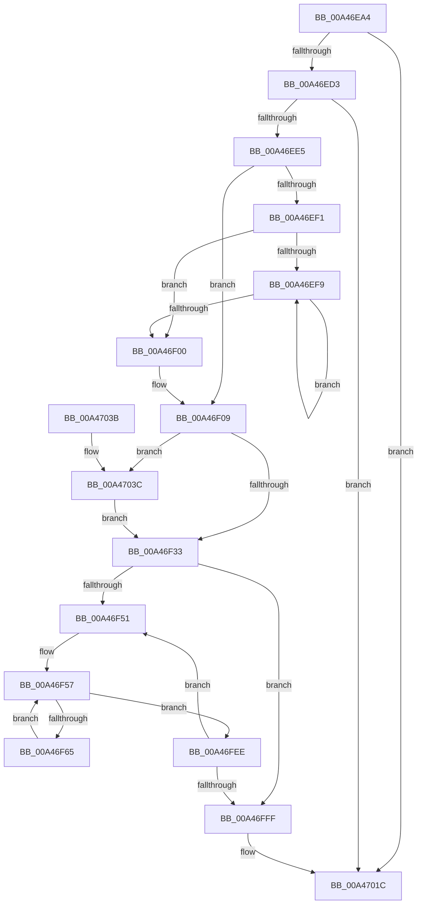

# PfpRpRehashIfNeeded

- RVA: `0x00A46EA4`–`0x00A47047` (길이 `419` bytes)
- VA: `0x0000000140A46EA4`
- 실행 섹션: `PAGE`
- PDB 이름 있음: `예`; PDB Function 태그: `아니요`
- unwind 정보 RVA: `0x000AF87C`
- 디코드: `118`개 명령, `419/419` bytes 표시
- 미해석 바이트: `0` (있으면 어셈블리에 `.byte`로 보존)

> 이 문서는 커널 이미지의 기계어와 PDB 기호를 분석해 생성했습니다. 4번과 5번은 함수 원형과 자료형을 바이너리 사용 방식에서 추정한 C 해석이며 원본 소스 복구 결과는 아닙니다.

## 1. Dependencies

- 직접 호출 지점: **0**; 고유 호출 대상: **0**
- 직접 호출자로 확인된 함수: **1**
- RIP 상대 이미지 참조: **0**

### Outgoing calls
- 직접 디코드된 call 명령이 없습니다.

### Direct callers
- [sub_0085EF90](../85/Unknown_function_0085EF90.md) at `0x0085EFB2`

### Static image references
- 디코드된 RIP-relative 메모리 참조가 없습니다.

## 2. Other-region calls and transfers

- 다른 실행 섹션으로 향하는 call: **0**
- 별도 외부 분기/꼬리 이동을 확인하지 못했습니다.

## 3. Assembly (complete function range)

```asm
00A46EA4  48 89 5C 24 10                  mov qword ptr [rsp + 0x10], rbx
00A46EA9  48 89 6C 24 18                  mov qword ptr [rsp + 0x18], rbp
00A46EAE  48 89 74 24 20                  mov qword ptr [rsp + 0x20], rsi
00A46EB3  57                              push rdi
00A46EB4  41 56                           push r14
00A46EB6  41 57                           push r15
00A46EB8  8B 79 04                        mov edi, dword ptr [rcx + 4]
00A46EBB  45 33 D2                        xor r10d, r10d
00A46EBE  8B C7                           mov eax, edi
00A46EC0  4C 8B F2                        mov r14, rdx
00A46EC3  C1 E8 05                        shr eax, 5
00A46EC6  4C 8B C9                        mov r9, rcx
00A46EC9  03 C0                           add eax, eax
00A46ECB  39 01                           cmp dword ptr [rcx], eax
00A46ECD  0F 82 49 01 00 00               jb 0x140a4701c
00A46ED3  85 C0                           test eax, eax
00A46ED5  41 8D 4A 40                     lea ecx, [r10 + 0x40]
00A46ED9  0F 44 C1                        cmove eax, ecx
00A46EDC  41 3B C0                        cmp eax, r8d
00A46EDF  0F 87 37 01 00 00               ja 0x140a4701c
00A46EE5  4C 8B 1A                        mov r11, qword ptr [rdx]
00A46EE8  41 8D 40 FF                     lea eax, [r8 - 1]
00A46EEC  41 85 C0                        test r8d, eax
00A46EEF  74 18                           je 0x140a46f09
00A46EF1  83 C9 FF                        or ecx, 0xffffffff
00A46EF4  45 85 C0                        test r8d, r8d
00A46EF7  74 07                           je 0x140a46f00
00A46EF9  FF C1                           inc ecx
00A46EFB  41 D1 E8                        shr r8d, 1
00A46EFE  75 F9                           jne 0x140a46ef9
00A46F00  41 B8 01 00 00 00               mov r8d, 1
00A46F06  41 D3 E0                        shl r8d, cl
00A46F09  B8 00 00 00 04                  mov eax, 0x4000000
00A46F0E  44 3B C0                        cmp r8d, eax
00A46F11  44 0F 47 C0                     cmova r8d, eax
00A46F15  49 8B C1                        mov rax, r9
00A46F18  48 83 C8 01                     or rax, 1
00A46F1C  41 8B C8                        mov ecx, r8d
00A46F1F  4B 8D 14 C3                     lea rdx, [r11 + r8*8]
00A46F23  4C 3B DA                        cmp r11, rdx
00A46F26  49 0F 47 CA                     cmova rcx, r10
00A46F2A  48 85 C9                        test rcx, rcx
00A46F2D  0F 85 09 01 00 00               jne 0x140a4703c
00A46F33  41 8B 41 04                     mov eax, dword ptr [r9 + 4]
00A46F37  48 83 CB FF                     or rbx, 0xffffffffffffffff
00A46F3B  8B C8                           mov ecx, eax
00A46F3D  41 8B FA                        mov edi, r10d
00A46F40  83 E1 1F                        and ecx, 0x1f
00A46F43  48 D3 E3                        shl rbx, cl
00A46F46  A9 E0 FF FF FF                  test eax, 0xffffffe0
00A46F4B  0F 86 AE 00 00 00               jbe 0x140a46fff
00A46F51  4D 8B 79 08                     mov r15, qword ptr [r9 + 8]
00A46F55  8B EF                           mov ebp, edi
00A46F57  49 8B 34 EF                     mov rsi, qword ptr [r15 + rbp*8]
00A46F5B  40 F6 C6 01                     test sil, 1
00A46F5F  0F 85 89 00 00 00               jne 0x140a46fee
00A46F65  48 8B 06                        mov rax, qword ptr [rsi]
00A46F68  49 89 04 EF                     mov qword ptr [r15 + rbp*8], rax
00A46F6C  48 8B 46 08                     mov rax, qword ptr [rsi + 8]
00A46F70  48 23 C3                        and rax, rbx
00A46F73  48 89 44 24 20                  mov qword ptr [rsp + 0x20], rax
00A46F78  0F B6 C0                        movzx eax, al
00A46F7B  48 05 CB 5D B1 00               add rax, 0xb15dcb
00A46F81  48 6B C8 25                     imul rcx, rax, 0x25
00A46F85  0F B6 44 24 21                  movzx eax, byte ptr [rsp + 0x21]
00A46F8A  48 03 C8                        add rcx, rax
00A46F8D  0F B6 44 24 22                  movzx eax, byte ptr [rsp + 0x22]
00A46F92  48 6B D1 25                     imul rdx, rcx, 0x25
00A46F96  48 03 D0                        add rdx, rax
00A46F99  0F B6 44 24 23                  movzx eax, byte ptr [rsp + 0x23]
00A46F9E  48 6B CA 25                     imul rcx, rdx, 0x25
00A46FA2  48 03 C8                        add rcx, rax
00A46FA5  0F B6 44 24 24                  movzx eax, byte ptr [rsp + 0x24]
00A46FAA  48 6B D1 25                     imul rdx, rcx, 0x25
00A46FAE  48 03 D0                        add rdx, rax
00A46FB1  0F B6 44 24 25                  movzx eax, byte ptr [rsp + 0x25]
00A46FB6  48 6B CA 25                     imul rcx, rdx, 0x25
00A46FBA  48 03 C8                        add rcx, rax
00A46FBD  0F B6 44 24 26                  movzx eax, byte ptr [rsp + 0x26]
00A46FC2  48 6B D1 25                     imul rdx, rcx, 0x25
00A46FC6  48 03 D0                        add rdx, rax
00A46FC9  0F B6 44 24 27                  movzx eax, byte ptr [rsp + 0x27]
00A46FCE  48 6B CA 25                     imul rcx, rdx, 0x25
00A46FD2  41 8D 50 FF                     lea edx, [r8 - 1]
00A46FD6  48 03 C1                        add rax, rcx
00A46FD9  8B C0                           mov eax, eax
00A46FDB  48 23 D0                        and rdx, rax
00A46FDE  49 8B 04 D3                     mov rax, qword ptr [r11 + rdx*8]
00A46FE2  48 89 06                        mov qword ptr [rsi], rax
00A46FE5  49 89 34 D3                     mov qword ptr [r11 + rdx*8], rsi
00A46FE9  E9 69 FF FF FF                  jmp 0x140a46f57
00A46FEE  41 8B 41 04                     mov eax, dword ptr [r9 + 4]
00A46FF2  FF C7                           inc edi
00A46FF4  C1 E8 05                        shr eax, 5
00A46FF7  3B F8                           cmp edi, eax
00A46FF9  0F 82 52 FF FF FF               jb 0x140a46f51
00A46FFF  41 8B 79 04                     mov edi, dword ptr [r9 + 4]
00A47003  49 8B 41 08                     mov rax, qword ptr [r9 + 8]
00A47007  83 E7 1F                        and edi, 0x1f
00A4700A  41 C1 E0 05                     shl r8d, 5
00A4700E  41 0B F8                        or edi, r8d
00A47011  4D 89 59 08                     mov qword ptr [r9 + 8], r11
00A47015  41 89 79 04                     mov dword ptr [r9 + 4], edi
00A47019  49 89 06                        mov qword ptr [r14], rax
00A4701C  48 8B 5C 24 28                  mov rbx, qword ptr [rsp + 0x28]
00A47021  83 FF 20                        cmp edi, 0x20
00A47024  48 8B 6C 24 30                  mov rbp, qword ptr [rsp + 0x30]
00A47029  48 8B 74 24 38                  mov rsi, qword ptr [rsp + 0x38]
00A4702E  41 0F 93 C2                     setae r10b
00A47032  41 8B C2                        mov eax, r10d
00A47035  41 5F                           pop r15
00A47037  41 5E                           pop r14
00A47039  5F                              pop rdi
00A4703A  C3                              ret
00A4703B  CC                              int3
00A4703C  49 8B FB                        mov rdi, r11
00A4703F  F3 48 AB                        rep stosq qword ptr [rdi], rax
00A47042  E9 EC FE FF FF                  jmp 0x140a46f33
```

## 4. C-style interpretation (structured pseudocode)

```c
__int64 __fastcall PfpRpRehashIfNeeded(__int64 a1, __int64 a2, __int64 a3)
{
    __int64 result;
    __int64 v_r10;
    __int64 v_rbx;
    __int64 v_rdi;
    unsigned __int64 v_stack_p10;
    unsigned __int64 v_stack_p18;
    unsigned __int64 v_stack_p20;
    unsigned __int64 v_stack_p8;
    unsigned __int8 v_stack_p9;
    unsigned __int8 v_stack_pA;
    unsigned __int8 v_stack_pB;
    unsigned __int8 v_stack_pC;
    unsigned __int8 v_stack_pD;
    unsigned __int8 v_stack_pE;
    unsigned __int8 v_stack_pF;

    v_stack_p10 = v_rbx;
    v_stack_p18 = v_rbp;
    v_stack_p20 = v_rsi;
    v_r10 = 0;
    result = (unsigned int)(((unsigned int)((unsigned int)((unsigned int)(*(unsigned int *)(a1 + 4))))) >> (5));
    result = (unsigned int)((result) + ((unsigned int)(result)));
    if ((*(unsigned int *)(a1)) < ((unsigned int)(result))) goto loc_00A4701C;
    if ((unsigned int)(result) == 0) { result = (unsigned int)(v_r10 + 64); }
    if (((unsigned int)(result)) > ((unsigned int)(a3))) goto loc_00A4701C;
    if ((((unsigned int)(a3)) & ((unsigned int)(a3 - 1))) == 0) goto loc_00A46F09;
    a1 = (unsigned int)((v_r10 + 64) | (0xFFFFFFFFULL));
    if ((unsigned int)(a3) == 0) goto loc_00A46F00;
loc_00A46EF9:
    a1 = (unsigned int)((a1) + 1);
    a3 = (unsigned int)((a3) >> (1));
    if (condition_is_not_equal) goto loc_00A46EF9;
loc_00A46F00:
    a3 = (unsigned int)((1) << ((unsigned __int8)(a1)));
loc_00A46F09:
    if (((unsigned int)(a3)) > ((unsigned int)((unsigned int)(0x4000000ULL)))) { a3 = (unsigned int)((unsigned int)(0x4000000ULL)); }
    result = (a1) | (1);
    a1 = (unsigned int)((unsigned int)(a3));
    if ((*(unsigned __int64 *)(a2)) > (*(unsigned __int64 *)(a2) + a3 * 8)) { a1 = 0; }
    if (a1 != 0) goto loc_00A4703C;
loc_00A46F33:
    v_rbx = (v_rbx) | (-1);
    a1 = (unsigned int)(((unsigned int)((unsigned int)((unsigned int)(*(unsigned int *)(a1 + 4))))) & (31));
    v_rbx = (v_rbx) << ((unsigned __int8)(a1));
    if (condition_is_below_or_equal) goto loc_00A46FFF;
loc_00A46F51:
loc_00A46F57:
    if ((((unsigned __int8)(*(unsigned __int64 *)(*(unsigned __int64 *)(a1 + 8) + 0 * 8))) & (1)) != 0) goto loc_00A46FEE;
    *(unsigned __int64 *)(*(unsigned __int64 *)(a1 + 8) + 0 * 8) = *(unsigned __int64 *)(*(unsigned __int64 *)(*(unsigned __int64 *)(a1 + 8) + 0 * 8));
    result = (*(unsigned __int64 *)(*(unsigned __int64 *)(*(unsigned __int64 *)(a1 + 8) + 0 * 8) + 8)) & (v_rbx);
    v_stack_p8 = result;
    result = ((unsigned __int8)(result)) + (0xB15DCBULL);
    a1 = (a1) * (result);
    a1 = (a1) + (v_stack_p9);
    a2 = (*(unsigned __int64 *)(a2) + a3 * 8) * (a1);
    a2 = (a2) + (v_stack_pA);
    a1 = (a1) * (a2);
    a1 = (a1) + (v_stack_pB);
    a2 = (a2) * (a1);
    a2 = (a2) + (v_stack_pC);
    a1 = (a1) * (a2);
    a1 = (a1) + (v_stack_pD);
    a2 = (a2) * (a1);
    a2 = (a2) + (v_stack_pE);
    a1 = (a1) * (a2);
    result = (v_stack_pF) + (a1);
    a2 = (a3 - 1) & ((unsigned int)((unsigned int)(result)));
    *(unsigned __int64 *)(*(unsigned __int64 *)(*(unsigned __int64 *)(a1 + 8) + 0 * 8)) = *(unsigned __int64 *)(*(unsigned __int64 *)(a2) + a2 * 8);
    *(unsigned __int64 *)(*(unsigned __int64 *)(a2) + a2 * 8) = *(unsigned __int64 *)(*(unsigned __int64 *)(a1 + 8) + 0 * 8);
    goto loc_00A46F57;
loc_00A46FEE:
    v_rdi = (unsigned int)((0) + 1);
    result = (unsigned int)(((unsigned int)(*(unsigned int *)(a1 + 4))) >> (5));
    if (((unsigned int)(v_rdi)) < ((unsigned int)(result))) goto loc_00A46F51;
loc_00A46FFF:
    v_rdi = (unsigned int)(((unsigned int)(*(unsigned int *)(a1 + 4))) & (31));
    a3 = (unsigned int)((a3) << (5));
    v_rdi = (unsigned int)((v_rdi) | ((unsigned int)(a3)));
    *(unsigned __int64 *)(a1 + 8) = *(unsigned __int64 *)(a2);
    *(unsigned int *)(a1 + 4) = (unsigned int)(v_rdi);
    *(unsigned __int64 *)(a2) = *(unsigned __int64 *)(a1 + 8);
loc_00A4701C:
    v_r10 = (((unsigned int)(v_rdi)) >= 32) ? 1 : 0;
    return (unsigned int)((unsigned int)(v_r10));
loc_00A4703C:
    goto loc_00A46F33;
}
```

## 5. (Beta) C Style

```c
int64_t PfpRpRehashIfNeeded(void *Arg1, void *Arg2, void *Arg3)
{
    uint8_t *arg1 = (uint8_t *)Arg1;
    uint8_t *arg2 = (uint8_t *)Arg2;
    uint8_t *arg3 = (uint8_t *)Arg3;

    int64_t result;
    int64_t local_r10;
    int64_t local_rbx;
    int64_t local_rdi;
    uint64_t v_stack_p10;
    uint64_t v_stack_p18;
    uint64_t v_stack_p20;
    uint64_t v_stack_p8;
    uint8_t v_stack_p9;
    uint8_t v_stack_pA;
    uint8_t v_stack_pB;
    uint8_t v_stack_pC;
    uint8_t v_stack_pD;
    uint8_t v_stack_pE;
    uint8_t v_stack_pF;

    v_stack_p10 = local_rbx;
    v_stack_p18 = local_rbp;
    v_stack_p20 = local_rsi;
    local_r10 = 0;
    result = (uint32_t)(((uint32_t)((uint32_t)((uint32_t)(*(uint32_t *)(arg1 + 0x4))))) >> (5));
    result = (uint32_t)((result) + ((uint32_t)(result)));
    if ((*(uint32_t *)(arg1)) < ((uint32_t)(result))) goto loc_00A4701C;
    if ((uint32_t)(result) == 0) { result = (uint32_t)(local_r10 + 64); }
    if (((uint32_t)(result)) > ((uint32_t)(Arg3))) goto loc_00A4701C;
    if ((((uint32_t)(Arg3)) & ((uint32_t)(Arg3 - 1))) == 0) goto loc_00A46F09;
    Arg1 = (uint32_t)((local_r10 + 64) | (0xFFFFFFFFULL));
    if ((uint32_t)(Arg3) == 0) goto loc_00A46F00;
loc_00A46EF9:
    Arg1 = (uint32_t)((Arg1) + 1);
    Arg3 = (uint32_t)((Arg3) >> (1));
    if (condition_is_not_equal) goto loc_00A46EF9;
loc_00A46F00:
    Arg3 = (uint32_t)((1) << ((uint8_t)(Arg1)));
loc_00A46F09:
    if (((uint32_t)(Arg3)) > ((uint32_t)((uint32_t)(0x4000000ULL)))) { Arg3 = (uint32_t)((uint32_t)(0x4000000ULL)); }
    result = (Arg1) | (1);
    Arg1 = (uint32_t)((uint32_t)(Arg3));
    if ((*(uint64_t *)(arg2)) > (*(uint64_t *)(arg2) + Arg3 * 8)) { Arg1 = 0; }
    if (Arg1 != NULL) goto loc_00A4703C;
loc_00A46F33:
    local_rbx = (local_rbx) | (-1);
    Arg1 = (uint32_t)(((uint32_t)((uint32_t)((uint32_t)(*(uint32_t *)(arg1 + 0x4))))) & (31));
    local_rbx = (local_rbx) << ((uint8_t)(Arg1));
    if (condition_is_below_or_equal) goto loc_00A46FFF;
loc_00A46F51:
loc_00A46F57:
    if ((((uint8_t)(*(uint64_t *)(*(uint64_t *)(arg1 + 0x8) + 0x0 * 8))) & (1)) != 0) goto loc_00A46FEE;
    *(uint64_t *)(*(uint64_t *)(arg1 + 0x8) + 0x0 * 8) = *(uint64_t *)(*(uint64_t *)(*(uint64_t *)(arg1 + 0x8) + 0x0 * 8));
    result = (*(uint64_t *)(*(uint64_t *)(*(uint64_t *)(arg1 + 0x8) + 0x0 * 8) + 0x8)) & (local_rbx);
    v_stack_p8 = result;
    result = ((uint8_t)(result)) + (0xB15DCBULL);
    Arg1 = (Arg1) * (result);
    Arg1 = (Arg1) + (v_stack_p9);
    Arg2 = (*(uint64_t *)(arg2) + Arg3 * 8) * (Arg1);
    Arg2 = (Arg2) + (v_stack_pA);
    Arg1 = (Arg1) * (Arg2);
    Arg1 = (Arg1) + (v_stack_pB);
    Arg2 = (Arg2) * (Arg1);
    Arg2 = (Arg2) + (v_stack_pC);
    Arg1 = (Arg1) * (Arg2);
    Arg1 = (Arg1) + (v_stack_pD);
    Arg2 = (Arg2) * (Arg1);
    Arg2 = (Arg2) + (v_stack_pE);
    Arg1 = (Arg1) * (Arg2);
    result = (v_stack_pF) + (Arg1);
    Arg2 = (Arg3 - 1) & ((uint32_t)((uint32_t)(result)));
    *(uint64_t *)(*(uint64_t *)(*(uint64_t *)(arg1 + 0x8) + 0x0 * 8)) = *(uint64_t *)(*(uint64_t *)(arg2) + arg2 * 8);
    *(uint64_t *)(*(uint64_t *)(arg2) + arg2 * 8) = *(uint64_t *)(*(uint64_t *)(arg1 + 0x8) + 0x0 * 8);
    goto loc_00A46F57;
loc_00A46FEE:
    local_rdi = (uint32_t)((0) + 1);
    result = (uint32_t)(((uint32_t)(*(uint32_t *)(arg1 + 0x4))) >> (5));
    if (((uint32_t)(local_rdi)) < ((uint32_t)(result))) goto loc_00A46F51;
loc_00A46FFF:
    local_rdi = (uint32_t)(((uint32_t)(*(uint32_t *)(arg1 + 0x4))) & (31));
    Arg3 = (uint32_t)((Arg3) << (5));
    local_rdi = (uint32_t)((local_rdi) | ((uint32_t)(Arg3)));
    *(uint64_t *)(arg1 + 0x8) = *(uint64_t *)(arg2);
    *(uint32_t *)(arg1 + 0x4) = (uint32_t)(local_rdi);
    *(uint64_t *)(arg2) = *(uint64_t *)(arg1 + 0x8);
loc_00A4701C:
    local_r10 = (((uint32_t)(local_rdi)) >= 32) ? 1 : 0;
    return (uint32_t)((uint32_t)(local_r10));
loc_00A4703C:
    goto loc_00A46F33;
}
```

### 관측된 메모리 오프셋

구조체 형식이 확인되지 않은 접근은 인자 기준의 오프셋으로만 기록했습니다.

| 기준 인자 | 오프셋 표현 | 폭 (bit) | 접근 |
|---|---:|---:|---|
| `Arg1` | `+ 0x0` | `32` | `R` |
| `Arg1` | `+ 0x4` | `32` | `R` |
| `Arg1` | `+ 0x4` | `32` | `W` |
| `Arg1` | `+ 0x8` | `64` | `R` |
| `Arg1` | `+ 0x8` | `64` | `W` |
| `Arg2` | `+ 0x0` | `64` | `R` |
| `Arg2` | `+ 0x0` | `64` | `W` |
| `Arg3` | `- 0x1` | `32` | `R` |

## 6. Execution-region graph

[열기: 2D/3D 그래프와 함수 탐색 컨트롤 패널](../../../control-panel.html?section=page&rva=0x00A46EA4&view=graph)

- 2D 그래프는 위에서 아래로 흐르고, 3D 그래프는 빈 공간을 드래그해 회전합니다. Shift+드래그는 이동, 휠은 확대·축소, 함수 노드 선택은 대상 보고서 이동입니다.

### Static fallback


