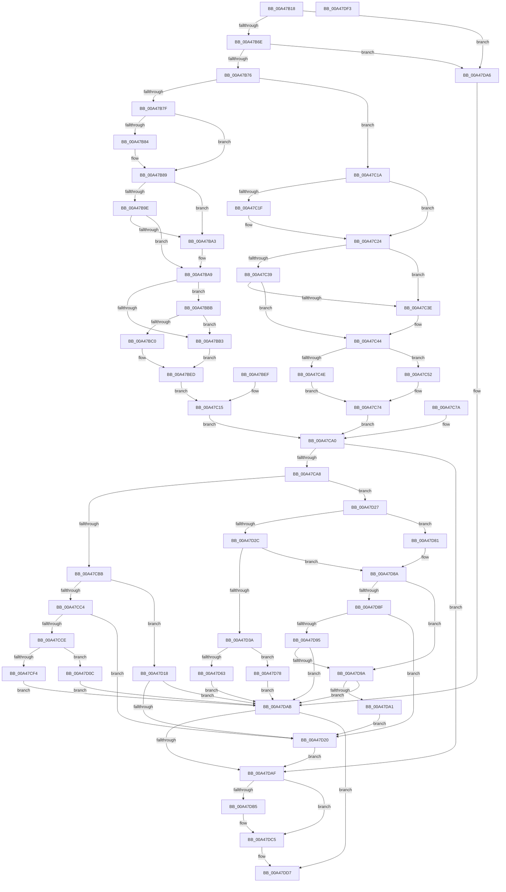

# PiCMCaptureInterfaceAliasInputData

- RVA: `0x00A47B18`–`0x00A47DF4` (길이 `732` bytes)
- VA: `0x0000000140A47B18`
- 실행 섹션: `PAGE`
- PDB 이름 있음: `예`; PDB Function 태그: `아니요`
- unwind 정보 RVA: `0x000AF96C`
- 디코드: `201`개 명령, `732/732` bytes 표시
- 미해석 바이트: `0` (있으면 어셈블리에 `.byte`로 보존)

> 이 문서는 커널 이미지의 기계어와 PDB 기호를 분석해 생성했습니다. 4번과 5번은 함수 원형과 자료형을 바이너리 사용 방식에서 추정한 C 해석이며 원본 소스 복구 결과는 아닙니다.

## 1. Dependencies

- 직접 호출 지점: **6**; 고유 호출 대상: **4**
- 직접 호출자로 확인된 함수: **1**
- RIP 상대 이미지 참조: **0**

### Outgoing calls
- `0x00A47B84` → [ExRaiseDatatypeMisalignment](../89/ExRaiseDatatypeMisalignment_function_00899FD0.md) (function, `0x00899FD0`)
- `0x00A47C1F` → [ExRaiseDatatypeMisalignment](../89/ExRaiseDatatypeMisalignment_function_00899FD0.md) (function, `0x00899FD0`)
- `0x00A47CB2` → [Feature_KernelPnP_ObjectNameUpdates__private_IsEnabledDeviceUsageNoInline](../../text/4F/Feature_KernelPnP_ObjectNameUpdates__private_IsEnabledDeviceUsageNoInline_function_004F2E10.md) (function, `0x004F2E10`)
- `0x00A47CE9` → [PiControlMakeUserModeCallersCopy](../8E/PiControlMakeUserModeCallersCopy_function_008E4630.md) (function, `0x008E4630`)
- `0x00A47D58` → [PiControlMakeUserModeCallersCopy](../8E/PiControlMakeUserModeCallersCopy_function_008E4630.md) (function, `0x008E4630`)
- `0x00A47DC0` → [PiControlFreeUserModeCallersBuffer](../../text/44/PiControlFreeUserModeCallersBuffer_function_00448990.md) (function, `0x00448990`)

### Direct callers
- [PiCMGetDeviceInterfaceAlias](PiCMGetDeviceInterfaceAlias_function_00A47904.md) at `0x00A47964`

### Static image references
- 디코드된 RIP-relative 메모리 참조가 없습니다.

## 2. Other-region calls and transfers

- 다른 실행 섹션으로 향하는 call: **2**
  - `0x00A47CB2` → [Feature_KernelPnP_ObjectNameUpdates__private_IsEnabledDeviceUsageNoInline](../../text/4F/Feature_KernelPnP_ObjectNameUpdates__private_IsEnabledDeviceUsageNoInline_function_004F2E10.md) (`PAGE` → `.text`)
  - `0x00A47DC0` → [PiControlFreeUserModeCallersBuffer](../../text/44/PiControlFreeUserModeCallersBuffer_function_00448990.md) (`PAGE` → `.text`)
- 별도 외부 분기/꼬리 이동을 확인하지 못했습니다.

## 3. Assembly (complete function range)

```asm
00A47B18  48 89 5C 24 10                  mov qword ptr [rsp + 0x10], rbx
00A47B1D  48 89 74 24 18                  mov qword ptr [rsp + 0x18], rsi
00A47B22  4C 89 4C 24 20                  mov qword ptr [rsp + 0x20], r9
00A47B27  57                              push rdi
00A47B28  41 54                           push r12
00A47B2A  41 55                           push r13
00A47B2C  41 56                           push r14
00A47B2E  41 57                           push r15
00A47B30  48 83 EC 50                     sub rsp, 0x50
00A47B34  4D 8B F1                        mov r14, r9
00A47B37  4C 89 4C 24 40                  mov qword ptr [rsp + 0x40], r9
00A47B3C  33 FF                           xor edi, edi
00A47B3E  89 7C 24 38                     mov dword ptr [rsp + 0x38], edi
00A47B42  65 48 8B 04 25 88 01 00 00      mov rax, qword ptr gs:[0x188]
00A47B4B  44 8A A0 32 02 00 00            mov r12b, byte ptr [rax + 0x232]
00A47B52  44 88 A4 24 80 00 00 00         mov byte ptr [rsp + 0x80], r12b
00A47B5A  44 88 64 24 30                  mov byte ptr [rsp + 0x30], r12b
00A47B5F  8B DF                           mov ebx, edi
00A47B61  89 5C 24 34                     mov dword ptr [rsp + 0x34], ebx
00A47B65  48 85 C9                        test rcx, rcx
00A47B68  0F 84 38 02 00 00               je 0x140a47da6
00A47B6E  85 D2                           test edx, edx
00A47B70  0F 84 30 02 00 00               je 0x140a47da6
00A47B76  45 85 C0                        test r8d, r8d
00A47B79  0F 84 9B 00 00 00               je 0x140a47c1a
00A47B7F  F6 C1 03                        test cl, 3
00A47B82  74 05                           je 0x140a47b89
00A47B84  E8 47 24 E5 FF                  call 0x140899fd0
00A47B89  44 8B C2                        mov r8d, edx
00A47B8C  4C 03 C1                        add r8, rcx
00A47B8F  48 B8 00 00 FF FF FF 7F 00 00   movabs rax, 0x7fffffff0000
00A47B99  4C 3B C0                        cmp r8, rax
00A47B9C  77 05                           ja 0x140a47ba3
00A47B9E  4C 3B C1                        cmp r8, rcx
00A47BA1  73 06                           jae 0x140a47ba9
00A47BA3  8A 00                           mov al, byte ptr [rax]
00A47BA5  8B 5C 24 34                     mov ebx, dword ptr [rsp + 0x34]
00A47BA9  BE 0D 00 00 C0                  mov esi, 0xc000000d
00A47BAE  83 FA 24                        cmp edx, 0x24
00A47BB1  73 08                           jae 0x140a47bbb
00A47BB3  8B DE                           mov ebx, esi
00A47BB5  89 5C 24 34                     mov dword ptr [rsp + 0x34], ebx
00A47BB9  EB 32                           jmp 0x140a47bed
00A47BBB  83 39 24                        cmp dword ptr [rcx], 0x24
00A47BBE  75 F3                           jne 0x140a47bb3
00A47BC0  41 C7 01 28 00 00 00            mov dword ptr [r9], 0x28
00A47BC7  8B 41 04                        mov eax, dword ptr [rcx + 4]
00A47BCA  41 89 41 04                     mov dword ptr [r9 + 4], eax
00A47BCE  0F 10 41 08                     movups xmm0, xmmword ptr [rcx + 8]
00A47BD2  F3 41 0F 7F 41 08               movdqu xmmword ptr [r9 + 8], xmm0
00A47BD8  8B 41 18                        mov eax, dword ptr [rcx + 0x18]
00A47BDB  49 89 41 18                     mov qword ptr [r9 + 0x18], rax
00A47BDF  8B 41 1C                        mov eax, dword ptr [rcx + 0x1c]
00A47BE2  41 89 41 20                     mov dword ptr [r9 + 0x20], eax
00A47BE6  8B 41 20                        mov eax, dword ptr [rcx + 0x20]
00A47BE9  41 89 41 24                     mov dword ptr [r9 + 0x24], eax
00A47BED  EB 26                           jmp 0x140a47c15
00A47BEF  8B D8                           mov ebx, eax
00A47BF1  89 44 24 34                     mov dword ptr [rsp + 0x34], eax
00A47BF5  33 FF                           xor edi, edi
00A47BF7  BE 0D 00 00 C0                  mov esi, 0xc000000d
00A47BFC  4C 8B B4 24 98 00 00 00         mov r14, qword ptr [rsp + 0x98]
00A47C04  89 7C 24 38                     mov dword ptr [rsp + 0x38], edi
00A47C08  44 8A 64 24 30                  mov r12b, byte ptr [rsp + 0x30]
00A47C0D  44 88 A4 24 80 00 00 00         mov byte ptr [rsp + 0x80], r12b
00A47C15  E9 86 00 00 00                  jmp 0x140a47ca0
00A47C1A  F6 C1 07                        test cl, 7
00A47C1D  74 05                           je 0x140a47c24
00A47C1F  E8 AC 23 E5 FF                  call 0x140899fd0
00A47C24  44 8B C2                        mov r8d, edx
00A47C27  4C 03 C1                        add r8, rcx
00A47C2A  48 B8 00 00 FF FF FF 7F 00 00   movabs rax, 0x7fffffff0000
00A47C34  4C 3B C0                        cmp r8, rax
00A47C37  77 05                           ja 0x140a47c3e
00A47C39  4C 3B C1                        cmp r8, rcx
00A47C3C  73 06                           jae 0x140a47c44
00A47C3E  8A 00                           mov al, byte ptr [rax]
00A47C40  8B 5C 24 34                     mov ebx, dword ptr [rsp + 0x34]
00A47C44  BE 0D 00 00 C0                  mov esi, 0xc000000d
00A47C49  83 FA 28                        cmp edx, 0x28
00A47C4C  73 04                           jae 0x140a47c52
00A47C4E  8B DE                           mov ebx, esi
00A47C50  EB 22                           jmp 0x140a47c74
00A47C52  0F 10 01                        movups xmm0, xmmword ptr [rcx]
00A47C55  41 0F 11 01                     movups xmmword ptr [r9], xmm0
00A47C59  0F 10 49 10                     movups xmm1, xmmword ptr [rcx + 0x10]
00A47C5D  41 0F 11 49 10                  movups xmmword ptr [r9 + 0x10], xmm1
00A47C62  F2 0F 10 41 20                  movsd xmm0, qword ptr [rcx + 0x20]
00A47C67  F2 41 0F 11 41 20               movsd qword ptr [r9 + 0x20], xmm0
00A47C6D  41 83 39 28                     cmp dword ptr [r9], 0x28
00A47C71  0F 45 DE                        cmovne ebx, esi
00A47C74  89 5C 24 34                     mov dword ptr [rsp + 0x34], ebx
00A47C78  EB 26                           jmp 0x140a47ca0
00A47C7A  8B D8                           mov ebx, eax
00A47C7C  89 44 24 34                     mov dword ptr [rsp + 0x34], eax
00A47C80  33 FF                           xor edi, edi
00A47C82  BE 0D 00 00 C0                  mov esi, 0xc000000d
00A47C87  4C 8B B4 24 98 00 00 00         mov r14, qword ptr [rsp + 0x98]
00A47C8F  89 7C 24 38                     mov dword ptr [rsp + 0x38], edi
00A47C93  44 8A 64 24 30                  mov r12b, byte ptr [rsp + 0x30]
00A47C98  44 88 A4 24 80 00 00 00         mov byte ptr [rsp + 0x80], r12b
00A47CA0  85 DB                           test ebx, ebx
00A47CA2  0F 88 07 01 00 00               js 0x140a47daf
00A47CA8  4D 8D 7E 18                     lea r15, [r14 + 0x18]
00A47CAC  4D 8B 2F                        mov r13, qword ptr [r15]
00A47CAF  49 89 3F                        mov qword ptr [r15], rdi
00A47CB2  E8 59 B1 AA FF                  call 0x1404f2e10
00A47CB7  85 C0                           test eax, eax
00A47CB9  74 6C                           je 0x140a47d27
00A47CBB  41 8B 4E 20                     mov ecx, dword ptr [r14 + 0x20]
00A47CBF  4D 85 ED                        test r13, r13
00A47CC2  74 54                           je 0x140a47d18
00A47CC4  8D 41 FE                        lea eax, [rcx - 2]
00A47CC7  3D FD FF 00 00                  cmp eax, 0xfffd
00A47CCC  77 52                           ja 0x140a47d20
00A47CCE  BE 01 00 00 00                  mov esi, 1
00A47CD3  89 74 24 28                     mov dword ptr [rsp + 0x28], esi
00A47CD7  44 88 64 24 20                  mov byte ptr [rsp + 0x20], r12b
00A47CDC  44 8D 4E 01                     lea r9d, [rsi + 1]
00A47CE0  44 8B C1                        mov r8d, ecx
00A47CE3  49 8B D5                        mov rdx, r13
00A47CE6  49 8B CF                        mov rcx, r15
00A47CE9  E8 42 C9 E9 FF                  call 0x1408e4630
00A47CEE  8B D8                           mov ebx, eax
00A47CF0  85 C0                           test eax, eax
00A47CF2  78 18                           js 0x140a47d0c
00A47CF4  89 74 24 38                     mov dword ptr [rsp + 0x38], esi
00A47CF8  41 8B 56 20                     mov edx, dword ptr [r14 + 0x20]
00A47CFC  48 D1 EA                        shr rdx, 1
00A47CFF  49 8B 0F                        mov rcx, qword ptr [r15]
00A47D02  66 89 7C 51 FE                  mov word ptr [rcx + rdx*2 - 2], di
00A47D07  E9 9F 00 00 00                  jmp 0x140a47dab
00A47D0C  49 89 3F                        mov qword ptr [r15], rdi
00A47D0F  41 89 7E 20                     mov dword ptr [r14 + 0x20], edi
00A47D13  E9 93 00 00 00                  jmp 0x140a47dab
00A47D18  85 C9                           test ecx, ecx
00A47D1A  0F 84 8B 00 00 00               je 0x140a47dab
00A47D20  8B DE                           mov ebx, esi
00A47D22  E9 88 00 00 00                  jmp 0x140a47daf
00A47D27  4D 85 ED                        test r13, r13
00A47D2A  74 55                           je 0x140a47d81
00A47D2C  4D 8D 66 20                     lea r12, [r14 + 0x20]
00A47D30  45 8B 04 24                     mov r8d, dword ptr [r12]
00A47D34  41 83 F8 02                     cmp r8d, 2
00A47D38  72 50                           jb 0x140a47d8a
00A47D3A  BE 01 00 00 00                  mov esi, 1
00A47D3F  89 74 24 28                     mov dword ptr [rsp + 0x28], esi
00A47D43  8A 84 24 80 00 00 00            mov al, byte ptr [rsp + 0x80]
00A47D4A  88 44 24 20                     mov byte ptr [rsp + 0x20], al
00A47D4E  44 8D 4E 01                     lea r9d, [rsi + 1]
00A47D52  49 8B D5                        mov rdx, r13
00A47D55  49 8B CF                        mov rcx, r15
00A47D58  E8 D3 C8 E9 FF                  call 0x1408e4630
00A47D5D  8B D8                           mov ebx, eax
00A47D5F  85 C0                           test eax, eax
00A47D61  78 15                           js 0x140a47d78
00A47D63  89 74 24 38                     mov dword ptr [rsp + 0x38], esi
00A47D67  41 8B 0C 24                     mov ecx, dword ptr [r12]
00A47D6B  48 D1 E9                        shr rcx, 1
00A47D6E  49 8B 07                        mov rax, qword ptr [r15]
00A47D71  66 89 7C 48 FE                  mov word ptr [rax + rcx*2 - 2], di
00A47D76  EB 33                           jmp 0x140a47dab
00A47D78  49 89 3F                        mov qword ptr [r15], rdi
00A47D7B  41 89 3C 24                     mov dword ptr [r12], edi
00A47D7F  EB 2A                           jmp 0x140a47dab
00A47D81  4C 8B 64 24 40                  mov r12, qword ptr [rsp + 0x40]
00A47D86  49 83 C4 20                     add r12, 0x20
00A47D8A  4D 85 ED                        test r13, r13
00A47D8D  75 0B                           jne 0x140a47d9a
00A47D8F  41 39 3C 24                     cmp dword ptr [r12], edi
00A47D93  77 8B                           ja 0x140a47d20
00A47D95  4D 85 ED                        test r13, r13
00A47D98  74 11                           je 0x140a47dab
00A47D9A  41 83 3C 24 02                  cmp dword ptr [r12], 2
00A47D9F  73 0A                           jae 0x140a47dab
00A47DA1  E9 7A FF FF FF                  jmp 0x140a47d20
00A47DA6  BB 0D 00 00 C0                  mov ebx, 0xc000000d
00A47DAB  85 DB                           test ebx, ebx
00A47DAD  79 28                           jns 0x140a47dd7
00A47DAF  39 7C 24 38                     cmp dword ptr [rsp + 0x38], edi
00A47DB3  74 10                           je 0x140a47dc5
00A47DB5  49 8B 56 18                     mov rdx, qword ptr [r14 + 0x18]
00A47DB9  8A 8C 24 80 00 00 00            mov cl, byte ptr [rsp + 0x80]
00A47DC0  E8 CB 0B A0 FF                  call 0x140448990
00A47DC5  0F 57 C0                        xorps xmm0, xmm0
00A47DC8  33 C0                           xor eax, eax
00A47DCA  41 0F 11 06                     movups xmmword ptr [r14], xmm0
00A47DCE  41 0F 11 46 10                  movups xmmword ptr [r14 + 0x10], xmm0
00A47DD3  49 89 46 20                     mov qword ptr [r14 + 0x20], rax
00A47DD7  8B C3                           mov eax, ebx
00A47DD9  4C 8D 5C 24 50                  lea r11, [rsp + 0x50]
00A47DDE  49 8B 5B 38                     mov rbx, qword ptr [r11 + 0x38]
00A47DE2  49 8B 73 40                     mov rsi, qword ptr [r11 + 0x40]
00A47DE6  49 8B E3                        mov rsp, r11
00A47DE9  41 5F                           pop r15
00A47DEB  41 5E                           pop r14
00A47DED  41 5D                           pop r13
00A47DEF  41 5C                           pop r12
00A47DF1  5F                              pop rdi
00A47DF2  C3                              ret
00A47DF3  CC                              int3
```

## 4. C-style interpretation (structured pseudocode)

```c
__int64 __fastcall PiCMCaptureInterfaceAliasInputData(__int64 a1, int a2, int a3, __int64 a4)
{
    __int64 result;
    __int64 v_r12;
    __int64 v_rbx;
    __int64 v_rdi;
    __int64 v_rsp;
    unsigned __int64 v_stack_m28;
    unsigned __int64 v_stack_m38;
    unsigned int v_stack_m40;
    unsigned int v_stack_m44;
    unsigned __int8 v_stack_m48;
    unsigned int v_stack_m50;
    unsigned __int8 v_stack_m58;
    unsigned __int64 v_stack_p10;
    unsigned __int64 v_stack_p18;
    unsigned __int64 v_stack_p20;
    unsigned __int8 v_stack_p8;

    v_stack_p10 = v_rbx;
    v_stack_p18 = v_rsi;
    v_stack_p20 = a4;
    v_rsp = (v_rsp) - (80);
    v_stack_m38 = a4;
    v_rdi = 0;
    v_stack_m40 = 0;
    v_stack_p8 = (unsigned __int8)(*(unsigned __int8 *)(*(unsigned __int64 *)(gs_base + (0 + 392)) + 562));
    v_stack_m48 = (unsigned __int8)(*(unsigned __int8 *)(*(unsigned __int64 *)(gs_base + (0 + 392)) + 562));
    v_stack_m44 = 0;
    if (a1 == 0) goto loc_00A47DA6;
    if (a2 == 0) goto loc_00A47DA6;
    if (a3 == 0) goto loc_00A47C1A;
    result = *(unsigned __int64 *)(gs_base + (0 + 392));
    if ((((unsigned __int8)(a1)) & (3)) != 0) {
        result = ExRaiseDatatypeMisalignment(a1, a2, a3, a4);
    }
    a3 = ((unsigned int)(a2)) + (a1);
    if (a3 > result) goto loc_00A47BA3;
    v_rbx = 0;
    if (a3 < a1) {
        result = *(unsigned __int8 *)(result);
        v_rbx = v_stack_m44;
    }
    if (a2 >= 36) goto loc_00A47BBB;
loc_00A47BB3:
    v_stack_m44 = (unsigned int)((unsigned int)((unsigned int)((unsigned int)(0xC000000DULL))));
    goto loc_00A47BED;
loc_00A47BBB:
    if ((*(unsigned int *)(a1)) != 36) goto loc_00A47BB3;
    *(unsigned int *)(a4) = 40;
    *(unsigned int *)(a4 + 4) = (unsigned int)((unsigned int)(*(unsigned int *)(a1 + 4)));
    *(unsigned __int64 *)(a4 + 8) = v_xmm0;
    *(unsigned __int64 *)(a4 + 24) = (unsigned int)(*(unsigned int *)(a1 + 24));
    *(unsigned int *)(a4 + 32) = (unsigned int)((unsigned int)(*(unsigned int *)(a1 + 28)));
    *(unsigned int *)(a4 + 36) = (unsigned int)((unsigned int)(*(unsigned int *)(a1 + 32)));
loc_00A47BED:
    goto loc_00A47C15;
loc_00A47C15:
    goto loc_00A47CA0;
loc_00A47C1A:
    result = (unsigned int)(*(unsigned int *)(a1 + 32));
    if ((((unsigned __int8)(a1)) & (7)) != 0) {
        result = ExRaiseDatatypeMisalignment(a1, a2, a3, a4);
    }
    a3 = ((unsigned int)(a2)) + (a1);
    if (a3 > result) goto loc_00A47C3E;
    v_rbx = (unsigned int)((unsigned int)((unsigned int)(0xC000000DULL)));
    if (a3 < a1) {
        result = *(unsigned __int8 *)(result);
        v_rbx = v_stack_m44;
    }
    if (a2 >= 40) goto loc_00A47C52;
    goto loc_00A47C74;
loc_00A47C52:
    *(unsigned __int64 *)(a4) = v_xmm0;
    *(unsigned __int64 *)(a4 + 16) = v_xmm1;
    *(unsigned __int64 *)(a4 + 32) = v_xmm0;
    v_rbx = (unsigned int)((unsigned int)((unsigned int)(0xC000000DULL)));
    if ((*(unsigned int *)(a4)) != 40) { v_rbx = (unsigned int)((unsigned int)(0xC000000DULL)); }
loc_00A47C74:
    v_stack_m44 = (unsigned int)(v_rbx);
    goto loc_00A47CA0;
loc_00A47CA0:
    if (sign_flag) goto loc_00A47DAF;
    *(unsigned __int64 *)(a4 + 24) = 0;
    result = Feature_KernelPnP_ObjectNameUpdates__private_IsEnabledDeviceUsageNoInline(a1, a2, a3, a4);
    if ((unsigned int)(result) == 0) goto loc_00A47D27;
    if (*(unsigned __int64 *)(a4 + 24) == 0) goto loc_00A47D18;
    if (((unsigned int)((unsigned int)(*(unsigned int *)(a4 + 32)) - 2)) > 0xFFFDULL) goto loc_00A47D20;
    v_stack_m50 = 1;
    v_stack_m58 = (unsigned __int8)(*(unsigned __int8 *)(*(unsigned __int64 *)(gs_base + (0 + 392)) + 562));
    result = PiControlMakeUserModeCallersCopy(a4 + 24, *(unsigned __int64 *)(a4 + 24), (unsigned int)((unsigned int)((unsigned int)(*(unsigned int *)(a4 + 32)))), 1 + 1);
    if (sign_flag) goto loc_00A47D0C;
    v_stack_m40 = 1;
    a2 = ((unsigned int)(*(unsigned int *)(a4 + 32))) >> (1);
    *(unsigned __int16 *)(*(unsigned __int64 *)(a4 + 24) + a2 * 2 - 2) = 0;
    goto loc_00A47DAB;
loc_00A47D0C:
    *(unsigned __int64 *)(a4 + 24) = 0;
    *(unsigned int *)(a4 + 32) = 0;
    goto loc_00A47DAB;
loc_00A47D18:
    if ((unsigned int)(*(unsigned __int64 *)(a4 + 24)) == 0) goto loc_00A47DAB;
loc_00A47D20:
    goto loc_00A47DAF;
loc_00A47D27:
    if (*(unsigned __int64 *)(a4 + 24) == 0) goto loc_00A47D81;
    if (((unsigned int)((unsigned int)(*(unsigned int *)(a4 + 32)))) < 2) goto loc_00A47D8A;
    v_stack_m50 = 1;
    v_stack_m58 = (unsigned __int8)(v_stack_p8);
    result = PiControlMakeUserModeCallersCopy(a4 + 24, *(unsigned __int64 *)(a4 + 24), (unsigned int)(*(unsigned int *)(a4 + 32)), 1 + 1);
    if (sign_flag) goto loc_00A47D78;
    v_stack_m40 = 1;
    a1 = ((unsigned int)(*(unsigned int *)(a4 + 32))) >> (1);
    *(unsigned __int16 *)(*(unsigned __int64 *)(a4 + 24) + a1 * 2 - 2) = 0;
    goto loc_00A47DAB;
loc_00A47D78:
    *(unsigned __int64 *)(a4 + 24) = 0;
    *(unsigned int *)(a4 + 32) = 0;
    goto loc_00A47DAB;
loc_00A47D81:
    v_r12 = (v_stack_m38) + (32);
loc_00A47D8A:
    if (*(unsigned __int64 *)(a4 + 24) != 0) goto loc_00A47D9A;
    if ((*(unsigned int *)(v_r12)) > 0) goto loc_00A47D20;
    if (*(unsigned __int64 *)(a4 + 24) == 0) goto loc_00A47DAB;
loc_00A47D9A:
    if ((*(unsigned int *)(v_r12)) >= 2) goto loc_00A47DAB;
    goto loc_00A47D20;
loc_00A47DA6:
loc_00A47DAB:
    if (!sign_flag) goto loc_00A47DD7;
loc_00A47DAF:
    result = *(unsigned __int64 *)(a4 + 24);
    if (v_stack_m40 != 0) {
        a2 = *(unsigned __int64 *)(a4 + 24);
        a1 = v_stack_p8;
        result = PiControlFreeUserModeCallersBuffer(a1, a2, (unsigned int)(*(unsigned int *)(a4 + 32)), 1 + 1);
    }
    result = 0;
    *(unsigned __int64 *)(a4) = v_xmm0;
    *(unsigned __int64 *)(a4 + 16) = v_xmm0;
    *(unsigned __int64 *)(a4 + 32) = 0;
loc_00A47DD7:
    return (unsigned int)((unsigned int)((unsigned int)(0xC000000DULL)));
}
```

## 5. (Beta) C Style

```c
int64_t PiCMCaptureInterfaceAliasInputData(int64_t Arg1, int32_t Arg2, int32_t Arg3, void *Arg4)
{
    uint8_t *arg4 = (uint8_t *)Arg4;

    int64_t result;
    int64_t local_r12;
    int64_t local_rbx;
    int64_t local_rdi;
    int64_t local_rsp;
    uint64_t v_stack_m28;
    uint64_t v_stack_m38;
    uint32_t v_stack_m40;
    uint32_t v_stack_m44;
    uint8_t v_stack_m48;
    uint32_t v_stack_m50;
    uint8_t v_stack_m58;
    uint64_t v_stack_p10;
    uint64_t v_stack_p18;
    uint64_t v_stack_p20;
    uint8_t v_stack_p8;

    v_stack_p10 = local_rbx;
    v_stack_p18 = local_rsi;
    v_stack_p20 = Arg4;
    local_rsp = (local_rsp) - (80);
    v_stack_m38 = Arg4;
    local_rdi = 0;
    v_stack_m40 = 0;
    v_stack_p8 = (uint8_t)(*(uint8_t *)(*(uint64_t *)(gs_base + (0 + 0x188)) + 0x232));
    v_stack_m48 = (uint8_t)(*(uint8_t *)(*(uint64_t *)(gs_base + (0 + 0x188)) + 0x232));
    v_stack_m44 = 0;
    if (Arg1 == 0) goto loc_00A47DA6;
    if (Arg2 == 0) goto loc_00A47DA6;
    if (Arg3 == 0) goto loc_00A47C1A;
    result = *(uint64_t *)(gs_base + (0 + 0x188));
    if ((((uint8_t)(Arg1)) & (3)) != 0) {
        result = ExRaiseDatatypeMisalignment(Arg1, Arg2, Arg3, Arg4);
    }
    Arg3 = ((uint32_t)(Arg2)) + (Arg1);
    if (Arg3 > result) goto loc_00A47BA3;
    local_rbx = 0;
    if (Arg3 < Arg1) {
        result = *(uint8_t *)(result);
        local_rbx = v_stack_m44;
    }
    if (Arg2 >= 36) goto loc_00A47BBB;
loc_00A47BB3:
    v_stack_m44 = (uint32_t)((uint32_t)((uint32_t)((uint32_t)(0xC000000DULL))));
    goto loc_00A47BED;
loc_00A47BBB:
    if ((*(uint32_t *)(Arg1)) != 36) goto loc_00A47BB3;
    *(uint32_t *)(arg4) = 40;
    *(uint32_t *)(arg4 + 0x4) = (uint32_t)((uint32_t)(*(uint32_t *)(Arg1 + 0x4)));
    *(uint64_t *)(arg4 + 0x8) = v_xmm0;
    *(uint64_t *)(arg4 + 0x18) = (uint32_t)(*(uint32_t *)(Arg1 + 0x18));
    *(uint32_t *)(arg4 + 0x20) = (uint32_t)((uint32_t)(*(uint32_t *)(Arg1 + 0x1C)));
    *(uint32_t *)(arg4 + 0x24) = (uint32_t)((uint32_t)(*(uint32_t *)(Arg1 + 0x20)));
loc_00A47BED:
    goto loc_00A47C15;
loc_00A47C15:
    goto loc_00A47CA0;
loc_00A47C1A:
    result = (uint32_t)(*(uint32_t *)(Arg1 + 0x20));
    if ((((uint8_t)(Arg1)) & (7)) != 0) {
        result = ExRaiseDatatypeMisalignment(Arg1, Arg2, Arg3, Arg4);
    }
    Arg3 = ((uint32_t)(Arg2)) + (Arg1);
    if (Arg3 > result) goto loc_00A47C3E;
    local_rbx = (uint32_t)((uint32_t)((uint32_t)(0xC000000DULL)));
    if (Arg3 < Arg1) {
        result = *(uint8_t *)(result);
        local_rbx = v_stack_m44;
    }
    if (Arg2 >= 40) goto loc_00A47C52;
    goto loc_00A47C74;
loc_00A47C52:
    *(uint64_t *)(arg4) = v_xmm0;
    *(uint64_t *)(arg4 + 0x10) = v_xmm1;
    *(uint64_t *)(arg4 + 0x20) = v_xmm0;
    local_rbx = (uint32_t)((uint32_t)((uint32_t)(0xC000000DULL)));
    if ((*(uint32_t *)(arg4)) != 40) { local_rbx = (uint32_t)((uint32_t)(0xC000000DULL)); }
loc_00A47C74:
    v_stack_m44 = (uint32_t)(local_rbx);
    goto loc_00A47CA0;
loc_00A47CA0:
    if (sign_flag) goto loc_00A47DAF;
    *(uint64_t *)(arg4 + 0x18) = 0;
    result = Feature_KernelPnP_ObjectNameUpdates__private_IsEnabledDeviceUsageNoInline(Arg1, Arg2, Arg3, Arg4);
    if ((uint32_t)(result) == 0) goto loc_00A47D27;
    if (*(uint64_t *)(arg4 + 0x18) == 0) goto loc_00A47D18;
    if (((uint32_t)((uint32_t)(*(uint32_t *)(arg4 + 0x20)) - 2)) > 0xFFFDULL) goto loc_00A47D20;
    v_stack_m50 = 1;
    v_stack_m58 = (uint8_t)(*(uint8_t *)(*(uint64_t *)(gs_base + (0 + 0x188)) + 0x232));
    result = PiControlMakeUserModeCallersCopy(Arg4 + 24, *(uint64_t *)(arg4 + 0x18), (uint32_t)((uint32_t)((uint32_t)(*(uint32_t *)(arg4 + 0x20)))), 1 + 1);
    if (sign_flag) goto loc_00A47D0C;
    v_stack_m40 = 1;
    Arg2 = ((uint32_t)(*(uint32_t *)(arg4 + 0x20))) >> (1);
    *(uint16_t *)(*(uint64_t *)(arg4 + 0x18) + Arg2 * 2 - 0x2) = 0;
    goto loc_00A47DAB;
loc_00A47D0C:
    *(uint64_t *)(arg4 + 0x18) = 0;
    *(uint32_t *)(arg4 + 0x20) = 0;
    goto loc_00A47DAB;
loc_00A47D18:
    if ((uint32_t)(*(uint64_t *)(arg4 + 0x18)) == 0) goto loc_00A47DAB;
loc_00A47D20:
    goto loc_00A47DAF;
loc_00A47D27:
    if (*(uint64_t *)(arg4 + 0x18) == 0) goto loc_00A47D81;
    if (((uint32_t)((uint32_t)(*(uint32_t *)(arg4 + 0x20)))) < 2) goto loc_00A47D8A;
    v_stack_m50 = 1;
    v_stack_m58 = (uint8_t)(v_stack_p8);
    result = PiControlMakeUserModeCallersCopy(Arg4 + 24, *(uint64_t *)(arg4 + 0x18), (uint32_t)(*(uint32_t *)(arg4 + 0x20)), 1 + 1);
    if (sign_flag) goto loc_00A47D78;
    v_stack_m40 = 1;
    Arg1 = ((uint32_t)(*(uint32_t *)(arg4 + 0x20))) >> (1);
    *(uint16_t *)(*(uint64_t *)(arg4 + 0x18) + Arg1 * 2 - 0x2) = 0;
    goto loc_00A47DAB;
loc_00A47D78:
    *(uint64_t *)(arg4 + 0x18) = 0;
    *(uint32_t *)(arg4 + 0x20) = 0;
    goto loc_00A47DAB;
loc_00A47D81:
    local_r12 = (v_stack_m38) + (32);
loc_00A47D8A:
    if (*(uint64_t *)(arg4 + 0x18) != 0) goto loc_00A47D9A;
    if ((*(uint32_t *)(local_r12)) > 0) goto loc_00A47D20;
    if (*(uint64_t *)(arg4 + 0x18) == 0) goto loc_00A47DAB;
loc_00A47D9A:
    if ((*(uint32_t *)(local_r12)) >= 2) goto loc_00A47DAB;
    goto loc_00A47D20;
loc_00A47DA6:
loc_00A47DAB:
    if (!sign_flag) goto loc_00A47DD7;
loc_00A47DAF:
    result = *(uint64_t *)(arg4 + 0x18);
    if (v_stack_m40 != 0) {
        Arg2 = *(uint64_t *)(arg4 + 0x18);
        Arg1 = v_stack_p8;
        result = PiControlFreeUserModeCallersBuffer(Arg1, Arg2, (uint32_t)(*(uint32_t *)(arg4 + 0x20)), 1 + 1);
    }
    result = 0;
    *(uint64_t *)(arg4) = v_xmm0;
    *(uint64_t *)(arg4 + 0x10) = v_xmm0;
    *(uint64_t *)(arg4 + 0x20) = 0;
loc_00A47DD7:
    return (uint32_t)((uint32_t)((uint32_t)(0xC000000DULL)));
}
```

### 관측된 메모리 오프셋

구조체 형식이 확인되지 않은 접근은 인자 기준의 오프셋으로만 기록했습니다.

| 기준 인자 | 오프셋 표현 | 폭 (bit) | 접근 |
|---|---:|---:|---|
| `Arg4` | `+ 0x0` | `32` | `R` |
| `Arg4` | `+ 0x0` | `32` | `W` |
| `Arg4` | `+ 0x0` | `64` | `R` |
| `Arg4` | `+ 0x0` | `64` | `W` |
| `Arg4` | `+ 0x0` | `128` | `R` |
| `Arg4` | `+ 0x10` | `128` | `R` |
| `Arg4` | `+ 0x18` | `64` | `R` |
| `Arg4` | `+ 0x20` | `32` | `R` |
| `Arg4` | `+ 0x20` | `32` | `W` |
| `Arg4` | `+ 0x20` | `64` | `R` |
| `Arg4` | `+ 0x20` | `64` | `W` |

## 6. Execution-region graph

[열기: 2D/3D 그래프와 함수 탐색 컨트롤 패널](../../../control-panel.html?section=page&rva=0x00A47B18&view=graph)

- 2D 그래프는 위에서 아래로 흐르고, 3D 그래프는 빈 공간을 드래그해 회전합니다. Shift+드래그는 이동, 휠은 확대·축소, 함수 노드 선택은 대상 보고서 이동입니다.

### Static fallback


