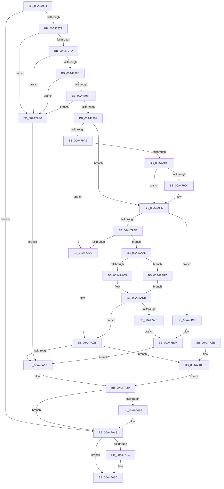

# PiCMGetDeviceInterfaceAlias

- RVA: `0x00A47904`–`0x00A47B10` (길이 `524` bytes)
- VA: `0x0000000140A47904`
- 실행 섹션: `PAGE`
- PDB 이름 있음: `예`; PDB Function 태그: `아니요`
- unwind 정보 RVA: `0x000AF948`
- 디코드: `152`개 명령, `524/524` bytes 표시
- 미해석 바이트: `0` (있으면 어셈블리에 `.byte`로 보존)

> 이 문서는 커널 이미지의 기계어와 PDB 기호를 분석해 생성했습니다. 4번과 5번은 함수 원형과 자료형을 바이너리 사용 방식에서 추정한 C 해석이며 원본 소스 복구 결과는 아닙니다.

## 1. Dependencies

- 직접 호출 지점: **10**; 고유 호출 대상: **9**
- 직접 호출자로 확인된 함수: **1**
- RIP 상대 이미지 참조: **1**

### Outgoing calls
- `0x00A47964` → [PiCMCaptureInterfaceAliasInputData](PiCMCaptureInterfaceAliasInputData_function_00A47B18.md) (function, `0x00A47B18`)
- `0x00A479B6` → [ExAllocatePool2](../../poolcode/B8/ExAllocatePool2_function_00B820F0.md) (function, `0x00B820F0`)
- `0x00A479DF` → [RtlInitUnicodeStringEx](../../text/46/RtlInitUnicodeStringEx_function_00463960.md) (function, `0x00463960`)
- `0x00A479FA` → [IoGetDeviceInterfaceAlias](../8F/IoGetDeviceInterfaceAlias_function_008F5570.md) (function, `0x008F5570`)
- `0x00A47A35` → [PiCMReturnBufferResultData](../8E/PiCMReturnBufferResultData_function_008ED6D0.md) (function, `0x008ED6D0`)
- `0x00A47A49` → [ExFreePoolWithTag](../../poolcode/B8/ExFreePoolWithTag_function_00B82870.md) (function, `0x00B82870`)
- `0x00A47A67` → [PiControlFreeUserModeCallersBuffer](../../text/44/PiControlFreeUserModeCallersBuffer_function_00448990.md) (function, `0x00448990`)
- `0x00A47A75` → [_security_check_cookie](../../text/6A/_security_check_cookie_function_006AC640.md) (function, `0x006AC640`)
- `0x00A47ACC` → [memcpy](../../text/6C/memcpy_function_006C6840.md) (function, `0x006C6840`)
- `0x00A47AE1` → [ExFreePoolWithTag](../../poolcode/B8/ExFreePoolWithTag_function_00B82870.md) (function, `0x00B82870`)

### Direct callers
- [PiCMHandleIoctl](../8E/PiCMHandleIoctl_function_008EB880.md) at `0x008EBFCF`

### Static image references
- `0x00A4791D` → RVA `0x00E0A740` (`.data`; read)

## 2. Other-region calls and transfers

- 다른 실행 섹션으로 향하는 call: **7**
  - `0x00A479B6` → [ExAllocatePool2](../../poolcode/B8/ExAllocatePool2_function_00B820F0.md) (`PAGE` → `POOLCODE`)
  - `0x00A479DF` → [RtlInitUnicodeStringEx](../../text/46/RtlInitUnicodeStringEx_function_00463960.md) (`PAGE` → `.text`)
  - `0x00A47A49` → [ExFreePoolWithTag](../../poolcode/B8/ExFreePoolWithTag_function_00B82870.md) (`PAGE` → `POOLCODE`)
  - `0x00A47A67` → [PiControlFreeUserModeCallersBuffer](../../text/44/PiControlFreeUserModeCallersBuffer_function_00448990.md) (`PAGE` → `.text`)
  - `0x00A47A75` → [_security_check_cookie](../../text/6A/_security_check_cookie_function_006AC640.md) (`PAGE` → `.text`)
  - `0x00A47ACC` → [memcpy](../../text/6C/memcpy_function_006C6840.md) (`PAGE` → `.text`)
  - `0x00A47AE1` → [ExFreePoolWithTag](../../poolcode/B8/ExFreePoolWithTag_function_00B82870.md) (`PAGE` → `POOLCODE`)
- 별도 외부 분기/꼬리 이동을 확인하지 못했습니다.

## 3. Assembly (complete function range)

```asm
00A47904  40 55                           push rbp
00A47906  53                              push rbx
00A47907  56                              push rsi
00A47908  57                              push rdi
00A47909  41 54                           push r12
00A4790B  41 55                           push r13
00A4790D  41 56                           push r14
00A4790F  41 57                           push r15
00A47911  48 8D 6C 24 F1                  lea rbp, [rsp - 0xf]
00A47916  48 81 EC A8 00 00 00            sub rsp, 0xa8
00A4791D  48 8B 05 1C 2E 3C 00            mov rax, qword ptr [rip + 0x3c2e1c]
00A47924  48 33 C4                        xor rax, rsp
00A47927  48 89 45 FF                     mov qword ptr [rbp - 1], rax
00A4792B  4C 8B 6D 7F                     mov r13, qword ptr [rbp + 0x7f]
00A4792F  0F 57 C0                        xorps xmm0, xmm0
00A47932  0F 57 C9                        xorps xmm1, xmm1
00A47935  33 F6                           xor esi, esi
00A47937  45 8B F9                        mov r15d, r9d
00A4793A  4D 8B E0                        mov r12, r8
00A4793D  44 8B 45 77                     mov r8d, dword ptr [rbp + 0x77]
00A47941  4C 8D 4D D7                     lea r9, [rbp - 0x29]
00A47945  33 C0                           xor eax, eax
00A47947  41 89 75 00                     mov dword ptr [r13], esi
00A4794B  0F 11 45 B7                     movups xmmword ptr [rbp - 0x49], xmm0
00A4794F  48 89 45 F7                     mov qword ptr [rbp - 9], rax
00A47953  8B FE                           mov edi, esi
00A47955  0F 11 4D D7                     movups xmmword ptr [rbp - 0x29], xmm1
00A47959  44 8B F6                        mov r14d, esi
00A4795C  0F 11 4D E7                     movups xmmword ptr [rbp - 0x19], xmm1
00A47960  0F 11 45 C7                     movups xmmword ptr [rbp - 0x39], xmm0
00A47964  E8 AF 01 00 00                  call 0x140a47b18
00A47969  8B D8                           mov ebx, eax
00A4796B  85 C0                           test eax, eax
00A4796D  0F 88 DB 00 00 00               js 0x140a47a4e
00A47973  48 39 75 EF                     cmp qword ptr [rbp - 0x11], rsi
00A47977  0F 84 73 01 00 00               je 0x140a47af0
00A4797D  39 75 DB                        cmp dword ptr [rbp - 0x25], esi
00A47980  0F 85 6A 01 00 00               jne 0x140a47af0
00A47986  4D 85 E4                        test r12, r12
00A47989  0F 84 61 01 00 00               je 0x140a47af0
00A4798F  41 83 FF 14                     cmp r15d, 0x14
00A47993  0F 82 57 01 00 00               jb 0x140a47af0
00A47999  41 8D 4F EC                     lea ecx, [r15 - 0x14]
00A4799D  83 F9 02                        cmp ecx, 2
00A479A0  0F 43 F1                        cmovae esi, ecx
00A479A3  33 C0                           xor eax, eax
00A479A5  85 F6                           test esi, esi
00A479A7  74 2E                           je 0x140a479d7
00A479A9  41 B8 50 6E 70 34               mov r8d, 0x34706e50
00A479AF  8B D6                           mov edx, esi
00A479B1  B9 00 01 00 00                  mov ecx, 0x100
00A479B6  E8 35 A7 13 00                  call 0x140b820f0
00A479BB  48 8B F8                        mov rdi, rax
00A479BE  33 C9                           xor ecx, ecx
00A479C0  48 85 FF                        test rdi, rdi
00A479C3  B8 9A 00 00 C0                  mov eax, 0xc000009a
00A479C8  0F 44 D8                        cmove ebx, eax
00A479CB  85 DB                           test ebx, ebx
00A479CD  78 3A                           js 0x140a47a09
00A479CF  83 FE 02                        cmp esi, 2
00A479D2  72 03                           jb 0x140a479d7
00A479D4  66 89 0F                        mov word ptr [rdi], cx
00A479D7  48 8B 55 EF                     mov rdx, qword ptr [rbp - 0x11]
00A479DB  48 8D 4D C7                     lea rcx, [rbp - 0x39]
00A479DF  E8 7C BF A1 FF                  call 0x140463960
00A479E4  8B D8                           mov ebx, eax
00A479E6  85 C0                           test eax, eax
00A479E8  0F 88 17 01 00 00               js 0x140a47b05
00A479EE  4C 8D 45 B7                     lea r8, [rbp - 0x49]
00A479F2  48 8D 55 DF                     lea rdx, [rbp - 0x21]
00A479F6  48 8D 4D C7                     lea rcx, [rbp - 0x39]
00A479FA  E8 71 DB EA FF                  call 0x1408f5570
00A479FF  8B D8                           mov ebx, eax
00A47A01  85 C0                           test eax, eax
00A47A03  0F 89 A5 00 00 00               jns 0x140a47aae
00A47A09  33 F6                           xor esi, esi
00A47A0B  43 8D 14 36                     lea edx, [r14 + r14]
00A47A0F  85 DB                           test ebx, ebx
00A47A11  79 7C                           jns 0x140a47a8f
00A47A13  8B 45 FB                        mov eax, dword ptr [rbp - 5]
00A47A16  45 33 C9                        xor r9d, r9d
00A47A19  4C 89 6C 24 40                  mov qword ptr [rsp + 0x40], r13
00A47A1E  44 89 7C 24 38                  mov dword ptr [rsp + 0x38], r15d
00A47A23  4C 89 64 24 30                  mov qword ptr [rsp + 0x30], r12
00A47A28  89 44 24 28                     mov dword ptr [rsp + 0x28], eax
00A47A2C  89 74 24 20                     mov dword ptr [rsp + 0x20], esi
00A47A30  45 33 C0                        xor r8d, r8d
00A47A33  8B CB                           mov ecx, ebx
00A47A35  E8 96 5C EA FF                  call 0x1408ed6d0
00A47A3A  8B D8                           mov ebx, eax
00A47A3C  48 85 FF                        test rdi, rdi
00A47A3F  74 0D                           je 0x140a47a4e
00A47A41  BA 50 6E 70 34                  mov edx, 0x34706e50
00A47A46  48 8B CF                        mov rcx, rdi
00A47A49  E8 22 AE 13 00                  call 0x140b82870
00A47A4E  48 39 75 EF                     cmp qword ptr [rbp - 0x11], rsi
00A47A52  74 18                           je 0x140a47a6c
00A47A54  65 48 8B 0C 25 88 01 00 00      mov rcx, qword ptr gs:[0x188]
00A47A5D  48 8B 55 EF                     mov rdx, qword ptr [rbp - 0x11]
00A47A61  8A 89 32 02 00 00               mov cl, byte ptr [rcx + 0x232]
00A47A67  E8 24 0F A0 FF                  call 0x140448990
00A47A6C  8B C3                           mov eax, ebx
00A47A6E  48 8B 4D FF                     mov rcx, qword ptr [rbp - 1]
00A47A72  48 33 CC                        xor rcx, rsp
00A47A75  E8 C6 4B C6 FF                  call 0x1406ac640
00A47A7A  48 81 C4 A8 00 00 00            add rsp, 0xa8
00A47A81  41 5F                           pop r15
00A47A83  41 5E                           pop r14
00A47A85  41 5D                           pop r13
00A47A87  41 5C                           pop r12
00A47A89  5F                              pop rdi
00A47A8A  5E                              pop rsi
00A47A8B  5B                              pop rbx
00A47A8C  5D                              pop rbp
00A47A8D  C3                              ret
00A47A8E  CC                              int3
00A47A8F  8B 45 FB                        mov eax, dword ptr [rbp - 5]
00A47A92  4C 8B CF                        mov r9, rdi
00A47A95  4C 89 6C 24 40                  mov qword ptr [rsp + 0x40], r13
00A47A9A  44 89 7C 24 38                  mov dword ptr [rsp + 0x38], r15d
00A47A9F  4C 89 64 24 30                  mov qword ptr [rsp + 0x30], r12
00A47AA4  89 44 24 28                     mov dword ptr [rsp + 0x28], eax
00A47AA8  89 54 24 20                     mov dword ptr [rsp + 0x20], edx
00A47AAC  EB 82                           jmp 0x140a47a30
00A47AAE  44 0F B7 45 B7                  movzx r8d, word ptr [rbp - 0x49]
00A47AB3  4D 8D 70 02                     lea r14, [r8 + 2]
00A47AB7  49 D1 EE                        shr r14, 1
00A47ABA  41 8B C6                        mov eax, r14d
00A47ABD  48 03 C0                        add rax, rax
00A47AC0  48 3B C6                        cmp rax, rsi
00A47AC3  77 37                           ja 0x140a47afc
00A47AC5  48 8B 55 BF                     mov rdx, qword ptr [rbp - 0x41]
00A47AC9  48 8B CF                        mov rcx, rdi
00A47ACC  E8 6F ED C7 FF                  call 0x1406c6840
00A47AD1  41 8D 46 FF                     lea eax, [r14 - 1]
00A47AD5  33 F6                           xor esi, esi
00A47AD7  66 89 34 47                     mov word ptr [rdi + rax*2], si
00A47ADB  48 8B 4D BF                     mov rcx, qword ptr [rbp - 0x41]
00A47ADF  33 D2                           xor edx, edx
00A47AE1  E8 8A AD 13 00                  call 0x140b82870
00A47AE6  85 DB                           test ebx, ebx
00A47AE8  0F 89 1D FF FF FF               jns 0x140a47a0b
00A47AEE  EB 17                           jmp 0x140a47b07
00A47AF0  8B D6                           mov edx, esi
00A47AF2  BB 0D 00 00 C0                  mov ebx, 0xc000000d
00A47AF7  E9 17 FF FF FF                  jmp 0x140a47a13
00A47AFC  BB 23 00 00 C0                  mov ebx, 0xc0000023
00A47B01  33 F6                           xor esi, esi
00A47B03  EB D6                           jmp 0x140a47adb
00A47B05  33 F6                           xor esi, esi
00A47B07  43 8D 14 36                     lea edx, [r14 + r14]
00A47B0B  E9 03 FF FF FF                  jmp 0x140a47a13
```

## 4. C-style interpretation (structured pseudocode)

```c
__int64 __fastcall PiCMGetDeviceInterfaceAlias(__int64 a1, __int64 a2, __int64 a3, int a4, unsigned int a5, __int64 a6)
{
    __int64 result;
    __int64 v_r14;
    __int64 v_rbx;
    __int64 v_rsi;
    __int64 v_rsp;
    unsigned __int64 v_stack_m4F;
    unsigned __int64 v_stack_m50;
    unsigned int v_stack_m54;
    unsigned __int64 v_stack_m58;
    unsigned __int64 v_stack_m60;
    unsigned __int64 v_stack_m68;
    unsigned __int64 v_stack_m70;
    unsigned int v_stack_m74;
    unsigned __int64 v_stack_m78;
    unsigned __int64 v_stack_m88;
    unsigned __int64 v_stack_m90;
    unsigned __int64 v_stack_m98;
    unsigned __int64 v_stack_mA8;
    unsigned int v_stack_mB0;
    unsigned __int64 v_stack_mB8;
    unsigned int v_stack_mC0;
    unsigned int v_stack_mC8;
    unsigned int v_stack_p20;
    unsigned int v_stack_p28;
    unsigned __int64 v_stack_p30;
    unsigned int v_stack_p38;
    unsigned __int64 v_stack_p40;

    v_rsp = (v_rsp) - (168);
    result = (*(unsigned __int64 *)(v_rip + 3943964)) ^ (v_rsp);
    v_stack_m50 = result;
    v_rsi = 0;
    result = 0;
    *(unsigned int *)(a6) = 0;
    v_stack_m98 = v_xmm0;
    v_stack_m58 = 0;
    v_stack_m78 = v_xmm1;
    v_stack_m68 = v_xmm1;
    v_stack_m88 = v_xmm0;
    result = PiCMCaptureInterfaceAliasInputData(a1, a2, (unsigned int)(a5), v_stack_m78);
    if (sign_flag) goto loc_00A47A4E;
    if (v_stack_m60 == 0) goto loc_00A47AF0;
    if (v_stack_m74 != 0) goto loc_00A47AF0;
    if (a3 == 0) goto loc_00A47AF0;
    if (((unsigned int)((unsigned int)(a4))) < 20) goto loc_00A47AF0;
    if (((unsigned int)((unsigned int)(a4) - 20)) >= 2) { v_rsi = (unsigned int)((unsigned int)(a4) - 20); }
    result = 0;
    if ((unsigned int)(v_rsi) == 0) goto loc_00A479D7;
    result = ExAllocatePool2(256, (unsigned int)((unsigned int)(v_rsi)), (unsigned int)(0x34706E50ULL), v_stack_m78);
    a1 = 0;
    v_rbx = (unsigned int)((unsigned int)(result));
    if (result == 0) { v_rbx = (unsigned int)((unsigned int)(0xC000009AULL)); }
    if (sign_flag) goto loc_00A47A09;
    if (((unsigned int)(v_rsi)) >= 2) {
        *(unsigned __int16 *)(result) = 0;
    }
    result = RtlInitUnicodeStringEx(v_stack_m88, v_stack_m60, (unsigned int)(0x34706E50ULL), v_stack_m78);
    if (sign_flag) goto loc_00A47B05;
    result = IoGetDeviceInterfaceAlias(v_stack_m88, v_stack_m70, v_stack_m98, v_stack_m78);
    if (!sign_flag) goto loc_00A47AAE;
loc_00A47A09:
    v_rsi = 0;
loc_00A47A0B:
    if (!sign_flag) goto loc_00A47A8F;
loc_00A47A13:
    a4 = 0;
    v_stack_mA8 = a6;
    v_stack_mB0 = (unsigned int)((unsigned int)(a4));
    v_stack_mB8 = a3;
    v_stack_mC0 = (unsigned int)((unsigned int)(v_stack_m54));
    v_stack_mC8 = 0;
loc_00A47A30:
    a3 = 0;
    result = PiCMReturnBufferResultData((unsigned int)((unsigned int)((unsigned int)((unsigned int)(result)))), 0 + 0 * 1, a3, a4);
    if (result != 0) {
        a2 = 0x34706E50ULL;
        a1 = result;
        result = ExFreePoolWithTag(a1, a2, a3, a4);
    }
    if (v_stack_m60 != 0) {
        a1 = *(unsigned __int64 *)(gs_base + (0 + 392));
        a2 = v_stack_m60;
        a1 = *(unsigned __int8 *)(a1 + 562);
        result = PiControlFreeUserModeCallersBuffer(a1, a2, a3, a4);
    }
    a1 = (v_stack_m50) ^ (v_rsp);
    result = _security_check_cookie(a1, a2, a3, a4);
    v_rsp = (v_rsp) + (168);
    return result;
loc_00A47A8F:
    v_stack_p40 = a6;
    v_stack_p38 = (unsigned int)((unsigned int)(a4));
    v_stack_p30 = 0;
    v_stack_p28 = (unsigned int)((unsigned int)(v_stack_m54));
    v_stack_p20 = (unsigned int)(a2);
    goto loc_00A47A30;
loc_00A47AAE:
    v_r14 = (v_stack_m98 + 2) >> (1);
    result = ((unsigned int)((unsigned int)(v_r14))) + ((unsigned int)((unsigned int)(v_r14)));
    if (result > 0) goto loc_00A47AFC;
    result = memcpy(result, v_stack_m90, v_stack_m98, result);
    v_rsi = 0;
    *(unsigned __int16 *)(result + v_r14 - 1 * 2) = 0;
loc_00A47ADB:
    a2 = 0;
    result = ExFreePoolWithTag(v_stack_m90, a2, v_stack_m98, result);
    if (!sign_flag) goto loc_00A47A0B;
    goto loc_00A47B07;
loc_00A47AF0:
    goto loc_00A47A13;
loc_00A47AFC:
    v_rsi = 0;
    goto loc_00A47ADB;
loc_00A47B05:
    v_rsi = 0;
loc_00A47B07:
    goto loc_00A47A13;
}
```

## 5. (Beta) C Style

```c
int64_t PiCMGetDeviceInterfaceAlias(int64_t Arg1, int64_t Arg2, int64_t Arg3, int32_t Arg4, uint32_t Arg5, void *Arg6)
{
    uint8_t *arg6 = (uint8_t *)Arg6;

    int64_t result;
    int64_t local_r14;
    int64_t local_rbx;
    int64_t local_rsi;
    int64_t local_rsp;
    uint64_t v_stack_m4F;
    uint64_t v_stack_m50;
    uint32_t v_stack_m54;
    uint64_t v_stack_m58;
    uint64_t v_stack_m60;
    uint64_t v_stack_m68;
    uint64_t v_stack_m70;
    uint32_t v_stack_m74;
    uint64_t v_stack_m78;
    uint64_t v_stack_m88;
    uint64_t v_stack_m90;
    uint64_t v_stack_m98;
    uint64_t v_stack_mA8;
    uint32_t v_stack_mB0;
    uint64_t v_stack_mB8;
    uint32_t v_stack_mC0;
    uint32_t v_stack_mC8;
    uint32_t v_stack_p20;
    uint32_t v_stack_p28;
    uint64_t v_stack_p30;
    uint32_t v_stack_p38;
    uint64_t v_stack_p40;

    local_rsp = (local_rsp) - (168);
    result = (*(uint64_t *)(v_rip + 0x3C2E1C)) ^ (local_rsp);
    v_stack_m50 = result;
    local_rsi = 0;
    result = 0;
    *(uint32_t *)(arg6) = 0;
    v_stack_m98 = v_xmm0;
    v_stack_m58 = 0;
    v_stack_m78 = v_xmm1;
    v_stack_m68 = v_xmm1;
    v_stack_m88 = v_xmm0;
    result = PiCMCaptureInterfaceAliasInputData(Arg1, Arg2, (uint32_t)(Arg5), v_stack_m78);
    if (sign_flag) goto loc_00A47A4E;
    if (v_stack_m60 == 0) goto loc_00A47AF0;
    if (v_stack_m74 != 0) goto loc_00A47AF0;
    if (Arg3 == 0) goto loc_00A47AF0;
    if (((uint32_t)((uint32_t)(Arg4))) < 20) goto loc_00A47AF0;
    if (((uint32_t)((uint32_t)(Arg4) - 20)) >= 2) { local_rsi = (uint32_t)((uint32_t)(Arg4) - 20); }
    result = 0;
    if ((uint32_t)(local_rsi) == 0) goto loc_00A479D7;
    result = ExAllocatePool2(256, (uint32_t)((uint32_t)(local_rsi)), (uint32_t)(0x34706E50ULL), v_stack_m78);
    Arg1 = 0;
    local_rbx = (uint32_t)((uint32_t)(result));
    if (result == 0) { local_rbx = (uint32_t)((uint32_t)(0xC000009AULL)); }
    if (sign_flag) goto loc_00A47A09;
    if (((uint32_t)(local_rsi)) >= 2) {
        *(uint16_t *)(result) = 0;
    }
    result = RtlInitUnicodeStringEx(v_stack_m88, v_stack_m60, (uint32_t)(0x34706E50ULL), v_stack_m78);
    if (sign_flag) goto loc_00A47B05;
    result = IoGetDeviceInterfaceAlias(v_stack_m88, v_stack_m70, v_stack_m98, v_stack_m78);
    if (!sign_flag) goto loc_00A47AAE;
loc_00A47A09:
    local_rsi = 0;
loc_00A47A0B:
    if (!sign_flag) goto loc_00A47A8F;
loc_00A47A13:
    Arg4 = 0;
    v_stack_mA8 = Arg6;
    v_stack_mB0 = (uint32_t)((uint32_t)(Arg4));
    v_stack_mB8 = Arg3;
    v_stack_mC0 = (uint32_t)((uint32_t)(v_stack_m54));
    v_stack_mC8 = 0;
loc_00A47A30:
    Arg3 = 0;
    result = PiCMReturnBufferResultData((uint32_t)((uint32_t)((uint32_t)((uint32_t)(result)))), 0 + 0 * 1, Arg3, Arg4);
    if (result != 0) {
        Arg2 = 0x34706E50ULL;
        Arg1 = result;
        result = ExFreePoolWithTag(Arg1, Arg2, Arg3, Arg4);
    }
    if (v_stack_m60 != 0) {
        Arg1 = *(uint64_t *)(gs_base + (0 + 0x188));
        Arg2 = v_stack_m60;
        Arg1 = *(uint8_t *)(Arg1 + 0x232);
        result = PiControlFreeUserModeCallersBuffer(Arg1, Arg2, Arg3, Arg4);
    }
    Arg1 = (v_stack_m50) ^ (local_rsp);
    result = _security_check_cookie(Arg1, Arg2, Arg3, Arg4);
    local_rsp = (local_rsp) + (168);
    return result;
loc_00A47A8F:
    v_stack_p40 = Arg6;
    v_stack_p38 = (uint32_t)((uint32_t)(Arg4));
    v_stack_p30 = 0;
    v_stack_p28 = (uint32_t)((uint32_t)(v_stack_m54));
    v_stack_p20 = (uint32_t)(Arg2);
    goto loc_00A47A30;
loc_00A47AAE:
    local_r14 = (v_stack_m98 + 2) >> (1);
    result = ((uint32_t)((uint32_t)(local_r14))) + ((uint32_t)((uint32_t)(local_r14)));
    if (result > 0) goto loc_00A47AFC;
    result = memcpy(result, v_stack_m90, v_stack_m98, result);
    local_rsi = 0;
    *(uint16_t *)(result + local_r14 - 0x1 * 2) = 0;
loc_00A47ADB:
    Arg2 = 0;
    result = ExFreePoolWithTag(v_stack_m90, Arg2, v_stack_m98, result);
    if (!sign_flag) goto loc_00A47A0B;
    goto loc_00A47B07;
loc_00A47AF0:
    goto loc_00A47A13;
loc_00A47AFC:
    local_rsi = 0;
    goto loc_00A47ADB;
loc_00A47B05:
    local_rsi = 0;
loc_00A47B07:
    goto loc_00A47A13;
}
```

### 관측된 메모리 오프셋

구조체 형식이 확인되지 않은 접근은 인자 기준의 오프셋으로만 기록했습니다.

| 기준 인자 | 오프셋 표현 | 폭 (bit) | 접근 |
|---|---:|---:|---|
| `Arg6` | `+ 0x0` | `32` | `W` |

## 6. Execution-region graph

[열기: 2D/3D 그래프와 함수 탐색 컨트롤 패널](../../../control-panel.html?section=page&rva=0x00A47904&view=graph)

- 2D 그래프는 위에서 아래로 흐르고, 3D 그래프는 빈 공간을 드래그해 회전합니다. Shift+드래그는 이동, 휠은 확대·축소, 함수 노드 선택은 대상 보고서 이동입니다.

### Static fallback


