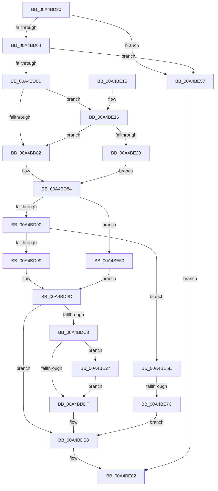

# PiControlQueryDeviceRelations

- RVA: `0x00A4BD20`–`0x00A4BE86` (길이 `358` bytes)
- VA: `0x0000000140A4BD20`
- 실행 섹션: `PAGE`
- PDB 이름 있음: `예`; PDB Function 태그: `예`
- unwind 정보 RVA: `0x000B0324`
- 디코드: `98`개 명령, `358/358` bytes 표시
- 미해석 바이트: `0` (있으면 어셈블리에 `.byte`로 보존)

> 이 문서는 커널 이미지의 기계어와 PDB 기호를 분석해 생성했습니다. 4번과 5번은 함수 원형과 자료형을 바이너리 사용 방식에서 추정한 C 해석이며 원본 소스 복구 결과는 아닙니다.

## 1. Dependencies

- 직접 호출 지점: **6**; 고유 호출 대상: **4**
- 직접 호출자로 확인된 함수: **0**
- RIP 상대 이미지 참조: **0**

### Outgoing calls
- `0x00A4BDB8` → [PiControlMakeUserModeCallersCopy](../8E/PiControlMakeUserModeCallersCopy_function_008E4630.md) (function, `0x008E4630`)
- `0x00A4BDD3` → [PiQueryDeviceRelations](PiQueryDeviceRelations_function_00A4BE8C.md) (function, `0x00A4BE8C`)
- `0x00A4BDEE` → [PiControlFreeUserModeCallersBuffer](../../text/44/PiControlFreeUserModeCallersBuffer_function_00448990.md) (function, `0x00448990`)
- `0x00A4BDFB` → [PiControlFreeUserModeCallersBuffer](../../text/44/PiControlFreeUserModeCallersBuffer_function_00448990.md) (function, `0x00448990`)
- `0x00A4BE44` → [PiControlMakeUserModeCallersCopy](../8E/PiControlMakeUserModeCallersCopy_function_008E4630.md) (function, `0x008E4630`)
- `0x00A4BE6B` → [ExAllocatePool2](../../poolcode/B8/ExAllocatePool2_function_00B820F0.md) (function, `0x00B820F0`)

### Direct callers
- 이 함수 시작 RVA로 연결되는 직접 call은 확인되지 않았습니다. 간접 호출은 완전히 역산할 수 없습니다.

### Static image references
- 디코드된 RIP-relative 메모리 참조가 없습니다.

## 2. Other-region calls and transfers

- 다른 실행 섹션으로 향하는 call: **3**
  - `0x00A4BDEE` → [PiControlFreeUserModeCallersBuffer](../../text/44/PiControlFreeUserModeCallersBuffer_function_00448990.md) (`PAGE` → `.text`)
  - `0x00A4BDFB` → [PiControlFreeUserModeCallersBuffer](../../text/44/PiControlFreeUserModeCallersBuffer_function_00448990.md) (`PAGE` → `.text`)
  - `0x00A4BE6B` → [ExAllocatePool2](../../poolcode/B8/ExAllocatePool2_function_00B820F0.md) (`PAGE` → `POOLCODE`)
- call이 아닌 외부 분기/꼬리 이동: **1**
  - `0x00A4BE76` → [sub_00B3B9EA](../B3/Unknown_function_00B3B9EA.md) (`tail-transfer`)

## 3. Assembly (complete function range)

```asm
00A4BD20  48 8B C4                        mov rax, rsp
00A4BD23  48 89 58 08                     mov qword ptr [rax + 8], rbx
00A4BD27  48 89 68 18                     mov qword ptr [rax + 0x18], rbp
00A4BD2B  56                              push rsi
00A4BD2C  57                              push rdi
00A4BD2D  41 56                           push r14
00A4BD2F  48 83 EC 40                     sub rsp, 0x40
00A4BD33  0F B7 0A                        movzx ecx, word ptr [rdx]
00A4BD36  0F 57 C0                        xorps xmm0, xmm0
00A4BD39  0F 11 40 D8                     movups xmmword ptr [rax - 0x28], xmm0
00A4BD3D  66 89 48 DA                     mov word ptr [rax - 0x26], cx
00A4BD41  BD 01 00 00 00                  mov ebp, 1
00A4BD46  66 89 48 D8                     mov word ptr [rax - 0x28], cx
00A4BD4A  48 8B DA                        mov rbx, rdx
00A4BD4D  0F B7 C1                        movzx eax, cx
00A4BD50  BA 8F 01 00 00                  mov edx, 0x18f
00A4BD55  66 2B C5                        sub ax, bp
00A4BD58  45 8A F1                        mov r14b, r9b
00A4BD5B  66 3B C2                        cmp ax, dx
00A4BD5E  0F 87 F3 00 00 00               ja 0x140a4be57
00A4BD64  40 84 CD                        test bpl, cl
00A4BD67  0F 85 EA 00 00 00               jne 0x140a4be57
00A4BD6D  48 83 64 24 38 00               and qword ptr [rsp + 0x38], 0
00A4BD73  48 8D 73 18                     lea rsi, [rbx + 0x18]
00A4BD77  8B 43 14                        mov eax, dword ptr [rbx + 0x14]
00A4BD7A  85 C0                           test eax, eax
00A4BD7C  0F 85 94 00 00 00               jne 0x140a4be16
00A4BD82  33 C0                           xor eax, eax
00A4BD84  89 44 24 68                     mov dword ptr [rsp + 0x68], eax
00A4BD88  85 C0                           test eax, eax
00A4BD8A  0F 84 C0 00 00 00               je 0x140a4be50
00A4BD90  45 84 F6                        test r14b, r14b
00A4BD93  0F 85 C5 00 00 00               jne 0x140a4be5e
00A4BD99  48 8B 3E                        mov rdi, qword ptr [rsi]
00A4BD9C  48 8B 53 08                     mov rdx, qword ptr [rbx + 8]
00A4BDA0  41 B9 02 00 00 00               mov r9d, 2
00A4BDA6  44 0F B7 C1                     movzx r8d, cx
00A4BDAA  48 8D 4C 24 38                  lea rcx, [rsp + 0x38]
00A4BDAF  89 6C 24 28                     mov dword ptr [rsp + 0x28], ebp
00A4BDB3  44 88 74 24 20                  mov byte ptr [rsp + 0x20], r14b
00A4BDB8  E8 73 88 E9 FF                  call 0x1408e4630
00A4BDBD  8B E8                           mov ebp, eax
00A4BDBF  85 C0                           test eax, eax
00A4BDC1  78 25                           js 0x140a4bde8
00A4BDC3  8B 53 10                        mov edx, dword ptr [rbx + 0x10]
00A4BDC6  4C 8D 44 24 68                  lea r8, [rsp + 0x68]
00A4BDCB  4C 8B CF                        mov r9, rdi
00A4BDCE  48 8D 4C 24 30                  lea rcx, [rsp + 0x30]
00A4BDD3  E8 B4 00 00 00                  call 0x140a4be8c
00A4BDD8  8B E8                           mov ebp, eax
00A4BDDA  48 85 FF                        test rdi, rdi
00A4BDDD  75 48                           jne 0x140a4be27
00A4BDDF  8B 44 24 68                     mov eax, dword ptr [rsp + 0x68]
00A4BDE3  D1 E8                           shr eax, 1
00A4BDE5  89 43 14                        mov dword ptr [rbx + 0x14], eax
00A4BDE8  48 8B D7                        mov rdx, rdi
00A4BDEB  41 8A CE                        mov cl, r14b
00A4BDEE  E8 9D CB 9F FF                  call 0x140448990
00A4BDF3  48 8B 54 24 38                  mov rdx, qword ptr [rsp + 0x38]
00A4BDF8  41 8A CE                        mov cl, r14b
00A4BDFB  E8 90 CB 9F FF                  call 0x140448990
00A4BE00  8B C5                           mov eax, ebp
00A4BE02  48 8B 5C 24 60                  mov rbx, qword ptr [rsp + 0x60]
00A4BE07  48 8B 6C 24 70                  mov rbp, qword ptr [rsp + 0x70]
00A4BE0C  48 83 C4 40                     add rsp, 0x40
00A4BE10  41 5E                           pop r14
00A4BE12  5F                              pop rdi
00A4BE13  5E                              pop rsi
00A4BE14  C3                              ret
00A4BE15  CC                              int3
00A4BE16  48 83 3E 00                     cmp qword ptr [rsi], 0
00A4BE1A  0F 84 62 FF FF FF               je 0x140a4bd82
00A4BE20  03 C0                           add eax, eax
00A4BE22  E9 5D FF FF FF                  jmp 0x140a4bd84
00A4BE27  44 8B 43 14                     mov r8d, dword ptr [rbx + 0x14]
00A4BE2B  41 B9 02 00 00 00               mov r9d, 2
00A4BE31  83 64 24 28 00                  and dword ptr [rsp + 0x28], 0
00A4BE36  45 03 C0                        add r8d, r8d
00A4BE39  48 8B D7                        mov rdx, rdi
00A4BE3C  44 88 74 24 20                  mov byte ptr [rsp + 0x20], r14b
00A4BE41  48 8B CE                        mov rcx, rsi
00A4BE44  E8 E7 87 E9 FF                  call 0x1408e4630
00A4BE49  85 C0                           test eax, eax
00A4BE4B  0F 48 E8                        cmovs ebp, eax
00A4BE4E  EB 8F                           jmp 0x140a4bddf
00A4BE50  33 FF                           xor edi, edi
00A4BE52  E9 45 FF FF FF                  jmp 0x140a4bd9c
00A4BE57  B8 0D 00 00 C0                  mov eax, 0xc000000d
00A4BE5C  EB A4                           jmp 0x140a4be02
00A4BE5E  8B D0                           mov edx, eax
00A4BE60  B9 01 01 00 00                  mov ecx, 0x101
00A4BE65  41 B8 50 70 20 20               mov r8d, 0x20207050
00A4BE6B  E8 80 62 13 00                  call 0x140b820f0
00A4BE70  48 8B F8                        mov rdi, rax
00A4BE73  48 85 C0                        test rax, rax
00A4BE76  0F 85 6E FB 0E 00               jne 0x140b3b9ea
00A4BE7C  BD 9A 00 00 C0                  mov ebp, 0xc000009a
00A4BE81  E9 62 FF FF FF                  jmp 0x140a4bde8
```

## 4. C-style interpretation (structured pseudocode)

```c
__int64 __fastcall PiControlQueryDeviceRelations(__int64 a1, __int64 a2, __int64 a3, unsigned __int8 a4)
{
    __int64 result;
    __int64 v_rbp;
    __int64 v_rdi;
    __int64 v_rsp;
    unsigned __int64 v_stack_m20;
    unsigned __int64 v_stack_m28;
    unsigned int v_stack_m30;
    unsigned __int8 v_stack_m38;
    unsigned int v_stack_p10;
    unsigned __int64 v_stack_p18;
    unsigned __int8 v_stack_p20;
    unsigned int v_stack_p28;
    unsigned __int64 v_stack_p8;

    *(unsigned __int64 *)(v_rsp + 8) = v_rbx;
    *(unsigned __int64 *)(v_rsp + 24) = v_rbp;
    v_rsp = (v_rsp) - (64);
    *(unsigned __int64 *)(v_rsp - 40) = v_xmm0;
    *(unsigned __int16 *)(v_rsp - 38) = (unsigned __int16)(*(unsigned __int16 *)(a2));
    *(unsigned __int16 *)(v_rsp - 40) = (unsigned __int16)(*(unsigned __int16 *)(a2));
    result = (unsigned __int16)(((unsigned __int16)(*(unsigned __int16 *)(a2))) - (1));
    if (((unsigned __int16)(result)) > 399) goto loc_00A4BE57;
    if (((1) & ((unsigned __int8)(*(unsigned __int16 *)(a2)))) != 0) goto loc_00A4BE57;
    if ((unsigned int)((unsigned int)(*(unsigned int *)(a2 + 20))) != 0) goto loc_00A4BE16;
loc_00A4BD82:
    result = 0;
loc_00A4BD84:
    v_stack_p10 = 0;
    if (0 == 0) goto loc_00A4BE50;
    if (a4 != 0) goto loc_00A4BE5E;
loc_00A4BD9C:
    v_stack_m30 = 1;
    v_stack_m38 = a4;
    result = PiControlMakeUserModeCallersCopy(v_stack_m20, *(unsigned __int64 *)(a2 + 8), (unsigned __int16)(*(unsigned __int16 *)(a2)), 2);
    if (sign_flag) goto loc_00A4BDE8;
    result = PiQueryDeviceRelations(v_stack_m28, (unsigned int)(*(unsigned int *)(a2 + 16)), v_stack_p10, *(unsigned __int64 *)(a2 + 24));
    if (*(unsigned __int64 *)(a2 + 24) != 0) goto loc_00A4BE27;
loc_00A4BDDF:
    result = (unsigned int)(((unsigned int)(v_stack_p10)) >> (1));
    *(unsigned int *)(a2 + 20) = (unsigned int)(result);
loc_00A4BDE8:
    result = PiControlFreeUserModeCallersBuffer(a4, *(unsigned __int64 *)(a2 + 24), v_stack_p10, *(unsigned __int64 *)(a2 + 24));
    result = PiControlFreeUserModeCallersBuffer(a4, v_stack_m20, v_stack_p10, *(unsigned __int64 *)(a2 + 24));
loc_00A4BE02:
    v_rsp = (v_rsp) + (64);
    return (unsigned int)((unsigned int)((unsigned int)((unsigned int)(result))));
loc_00A4BE16:
    if ((*(unsigned __int64 *)(a2 + 24)) == 0) goto loc_00A4BD82;
    result = (unsigned int)(((unsigned int)((unsigned int)((unsigned int)((unsigned int)(result))))) + ((unsigned int)((unsigned int)((unsigned int)((unsigned int)((unsigned int)(result)))))));
    goto loc_00A4BD84;
loc_00A4BE27:
    a3 = (unsigned int)(((unsigned int)(*(unsigned int *)(v_stack_p8 + 20))) + ((unsigned int)((unsigned int)(*(unsigned int *)(v_stack_p8 + 20)))));
    v_stack_p20 = a4;
    result = PiControlMakeUserModeCallersCopy(a2 + 24, *(unsigned __int64 *)(a2 + 24), a3, 2);
    v_rbp = v_stack_p18;
    if (sign_flag) { v_rbp = (unsigned int)(result); }
    goto loc_00A4BDDF;
loc_00A4BE50:
    v_rdi = 0;
    goto loc_00A4BD9C;
loc_00A4BE57:
    goto loc_00A4BE02;
loc_00A4BE5E:
    result = ExAllocatePool2(257, (unsigned int)((unsigned int)((unsigned int)(0xC000000DULL))), (unsigned int)(0x20207050ULL), 2);
    goto loc_00A4BDE8;
}
```

## 5. (Beta) C Style

```c
int64_t PiControlQueryDeviceRelations(int64_t Arg1, void *Arg2, int64_t Arg3, uint8_t Arg4)
{
    uint8_t *arg2 = (uint8_t *)Arg2;

    int64_t result;
    int64_t local_rbp;
    int64_t local_rdi;
    int64_t local_rsp;
    uint64_t v_stack_m20;
    uint64_t v_stack_m28;
    uint32_t v_stack_m30;
    uint8_t v_stack_m38;
    uint32_t v_stack_p10;
    uint64_t v_stack_p18;
    uint8_t v_stack_p20;
    uint32_t v_stack_p28;
    uint64_t v_stack_p8;

    *(uint64_t *)(local_rsp + 0x8) = local_rbx;
    *(uint64_t *)(local_rsp + 0x18) = local_rbp;
    local_rsp = (local_rsp) - (64);
    *(uint64_t *)(local_rsp - 0x28) = v_xmm0;
    *(uint16_t *)(local_rsp - 0x26) = (uint16_t)(*(uint16_t *)(arg2));
    *(uint16_t *)(local_rsp - 0x28) = (uint16_t)(*(uint16_t *)(arg2));
    result = (uint16_t)(((uint16_t)(*(uint16_t *)(arg2))) - (1));
    if (((uint16_t)(result)) > 399) goto loc_00A4BE57;
    if (((1) & ((uint8_t)(*(uint16_t *)(arg2)))) != 0) goto loc_00A4BE57;
    if ((uint32_t)((uint32_t)(*(uint32_t *)(arg2 + 0x14))) != 0) goto loc_00A4BE16;
loc_00A4BD82:
    result = 0;
loc_00A4BD84:
    v_stack_p10 = 0;
    if (0 == 0) goto loc_00A4BE50;
    if (Arg4 != 0) goto loc_00A4BE5E;
loc_00A4BD9C:
    v_stack_m30 = 1;
    v_stack_m38 = Arg4;
    result = PiControlMakeUserModeCallersCopy(v_stack_m20, *(uint64_t *)(arg2 + 0x8), (uint16_t)(*(uint16_t *)(arg2)), 2);
    if (sign_flag) goto loc_00A4BDE8;
    result = PiQueryDeviceRelations(v_stack_m28, (uint32_t)(*(uint32_t *)(arg2 + 0x10)), v_stack_p10, *(uint64_t *)(arg2 + 0x18));
    if (*(uint64_t *)(arg2 + 0x18) != 0) goto loc_00A4BE27;
loc_00A4BDDF:
    result = (uint32_t)(((uint32_t)(v_stack_p10)) >> (1));
    *(uint32_t *)(arg2 + 0x14) = (uint32_t)(result);
loc_00A4BDE8:
    result = PiControlFreeUserModeCallersBuffer(Arg4, *(uint64_t *)(arg2 + 0x18), v_stack_p10, *(uint64_t *)(arg2 + 0x18));
    result = PiControlFreeUserModeCallersBuffer(Arg4, v_stack_m20, v_stack_p10, *(uint64_t *)(arg2 + 0x18));
loc_00A4BE02:
    local_rsp = (local_rsp) + (64);
    return (uint32_t)((uint32_t)((uint32_t)((uint32_t)(result))));
loc_00A4BE16:
    if ((*(uint64_t *)(arg2 + 0x18)) == 0) goto loc_00A4BD82;
    result = (uint32_t)(((uint32_t)((uint32_t)((uint32_t)((uint32_t)(result))))) + ((uint32_t)((uint32_t)((uint32_t)((uint32_t)((uint32_t)(result)))))));
    goto loc_00A4BD84;
loc_00A4BE27:
    Arg3 = (uint32_t)(((uint32_t)(*(uint32_t *)(v_stack_p8 + 0x14))) + ((uint32_t)((uint32_t)(*(uint32_t *)(v_stack_p8 + 0x14)))));
    v_stack_p20 = Arg4;
    result = PiControlMakeUserModeCallersCopy(Arg2 + 24, *(uint64_t *)(arg2 + 0x18), Arg3, 2);
    local_rbp = v_stack_p18;
    if (sign_flag) { local_rbp = (uint32_t)(result); }
    goto loc_00A4BDDF;
loc_00A4BE50:
    local_rdi = 0;
    goto loc_00A4BD9C;
loc_00A4BE57:
    goto loc_00A4BE02;
loc_00A4BE5E:
    result = ExAllocatePool2(257, (uint32_t)((uint32_t)((uint32_t)(0xC000000DULL))), (uint32_t)(0x20207050ULL), 2);
    goto loc_00A4BDE8;
}
```

### 관측된 메모리 오프셋

구조체 형식이 확인되지 않은 접근은 인자 기준의 오프셋으로만 기록했습니다.

| 기준 인자 | 오프셋 표현 | 폭 (bit) | 접근 |
|---|---:|---:|---|
| `Arg2` | `+ 0x0` | `16` | `R` |
| `Arg2` | `+ 0x0` | `64` | `R` |
| `Arg2` | `+ 0x8` | `64` | `R` |
| `Arg2` | `+ 0x10` | `32` | `R` |
| `Arg2` | `+ 0x14` | `32` | `R` |
| `Arg2` | `+ 0x14` | `32` | `W` |
| `Arg2` | `+ 0x18` | `64` | `R` |

## 6. Execution-region graph

[열기: 2D/3D 그래프와 함수 탐색 컨트롤 패널](../../../control-panel.html?section=page&rva=0x00A4BD20&view=graph)

- 2D 그래프는 위에서 아래로 흐르고, 3D 그래프는 빈 공간을 드래그해 회전합니다. Shift+드래그는 이동, 휠은 확대·축소, 함수 노드 선택은 대상 보고서 이동입니다.

### Static fallback


