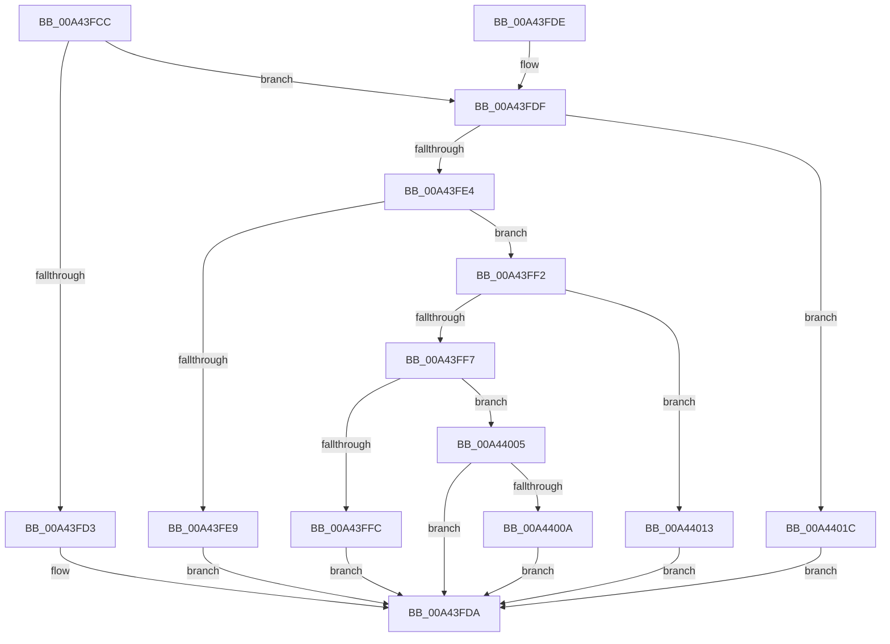

# PiDqGetObjectManagerForPnpObjectType

- RVA: `0x00A43FCC`–`0x00A44025` (길이 `89` bytes)
- VA: `0x0000000140A43FCC`
- 실행 섹션: `PAGE`
- PDB 이름 있음: `예`; PDB Function 태그: `아니요`
- unwind 정보 RVA: `0x000DB714`
- 디코드: `27`개 명령, `89/89` bytes 표시
- 미해석 바이트: `0` (있으면 어셈블리에 `.byte`로 보존)

> 이 문서는 커널 이미지의 기계어와 PDB 기호를 분석해 생성했습니다. 4번과 5번은 함수 원형과 자료형을 바이너리 사용 방식에서 추정한 C 해석이며 원본 소스 복구 결과는 아닙니다.

## 1. Dependencies

- 직접 호출 지점: **0**; 고유 호출 대상: **0**
- 직접 호출자로 확인된 함수: **2**
- RIP 상대 이미지 참조: **6**

### Outgoing calls
- 직접 디코드된 call 명령이 없습니다.

### Direct callers
- [PiPnpRtlObjectEventDispatch](../8E/PiPnpRtlObjectEventDispatch_function_008E0D5C.md) at `0x008E0D85`
- [PiPnpRtlObjectEventWorker](../8F/PiPnpRtlObjectEventWorker_function_008F8630.md) at `0x008F8A26`

### Static image references
- `0x00A43FD3` → RVA `0x00F8AEA0` (`.data`; read)
- `0x00A43FE9` → RVA `0x00F8ADA0` (`.data`; read)
- `0x00A43FFC` → RVA `0x00F8B1A0` (`.data`; read)
- `0x00A4400A` → RVA `0x00F8AFA0` (`.data`; read)
- `0x00A44013` → RVA `0x00F8B2A0` (`.data`; read)
- `0x00A4401C` → RVA `0x00F8B0A0` (`.data`; read)

## 2. Other-region calls and transfers

- 다른 실행 섹션으로 향하는 call: **0**
- 별도 외부 분기/꼬리 이동을 확인하지 못했습니다.

## 3. Assembly (complete function range)

```asm
00A43FCC  33 D2                           xor edx, edx
00A43FCE  83 E9 01                        sub ecx, 1
00A43FD1  75 0C                           jne 0x140a43fdf
00A43FD3  48 8D 15 C6 6E 54 00            lea rdx, [rip + 0x546ec6]
00A43FDA  48 8B C2                        mov rax, rdx
00A43FDD  C3                              ret
00A43FDE  CC                              int3
00A43FDF  83 E9 01                        sub ecx, 1
00A43FE2  74 38                           je 0x140a4401c
00A43FE4  83 E9 01                        sub ecx, 1
00A43FE7  75 09                           jne 0x140a43ff2
00A43FE9  48 8D 15 B0 6D 54 00            lea rdx, [rip + 0x546db0]
00A43FF0  EB E8                           jmp 0x140a43fda
00A43FF2  83 E9 01                        sub ecx, 1
00A43FF5  74 1C                           je 0x140a44013
00A43FF7  83 E9 01                        sub ecx, 1
00A43FFA  75 09                           jne 0x140a44005
00A43FFC  48 8D 15 9D 71 54 00            lea rdx, [rip + 0x54719d]
00A44003  EB D5                           jmp 0x140a43fda
00A44005  83 F9 01                        cmp ecx, 1
00A44008  75 D0                           jne 0x140a43fda
00A4400A  48 8D 15 8F 6F 54 00            lea rdx, [rip + 0x546f8f]
00A44011  EB C7                           jmp 0x140a43fda
00A44013  48 8D 15 86 72 54 00            lea rdx, [rip + 0x547286]
00A4401A  EB BE                           jmp 0x140a43fda
00A4401C  48 8D 15 7D 70 54 00            lea rdx, [rip + 0x54707d]
00A44023  EB B5                           jmp 0x140a43fda
```

## 4. C-style interpretation (structured pseudocode)

```c
__int64 __fastcall PiDqGetObjectManagerForPnpObjectType(int a1, int a2)
{
    a2 = 0;
    a1 = (unsigned int)((a1) - (1));
    if (condition_is_not_equal) goto loc_00A43FDF;
loc_00A43FDA:
    return v_rip + 5533382;
loc_00A43FDF:
    a1 = (unsigned int)((a1) - (1));
    if (condition_is_equal) goto loc_00A4401C;
    a1 = (unsigned int)((a1) - (1));
    if (condition_is_not_equal) goto loc_00A43FF2;
    goto loc_00A43FDA;
loc_00A43FF2:
    a1 = (unsigned int)((a1) - (1));
    if (condition_is_equal) goto loc_00A44013;
    a1 = (unsigned int)((a1) - (1));
    if (condition_is_not_equal) goto loc_00A44005;
    goto loc_00A43FDA;
loc_00A44005:
    if (a1 != 1) goto loc_00A43FDA;
    goto loc_00A43FDA;
loc_00A44013:
    goto loc_00A43FDA;
loc_00A4401C:
    goto loc_00A43FDA;
}
```

## 5. (Beta) C Style

```c
int64_t PiDqGetObjectManagerForPnpObjectType(int32_t Arg1, int32_t Arg2)
{
    Arg2 = 0;
    Arg1 = (uint32_t)((Arg1) - (1));
    if (condition_is_not_equal) goto loc_00A43FDF;
loc_00A43FDA:
    return v_rip + 5533382;
loc_00A43FDF:
    Arg1 = (uint32_t)((Arg1) - (1));
    if (condition_is_equal) goto loc_00A4401C;
    Arg1 = (uint32_t)((Arg1) - (1));
    if (condition_is_not_equal) goto loc_00A43FF2;
    goto loc_00A43FDA;
loc_00A43FF2:
    Arg1 = (uint32_t)((Arg1) - (1));
    if (condition_is_equal) goto loc_00A44013;
    Arg1 = (uint32_t)((Arg1) - (1));
    if (condition_is_not_equal) goto loc_00A44005;
    goto loc_00A43FDA;
loc_00A44005:
    if (Arg1 != 1) goto loc_00A43FDA;
    goto loc_00A43FDA;
loc_00A44013:
    goto loc_00A43FDA;
loc_00A4401C:
    goto loc_00A43FDA;
}
```

## 6. Execution-region graph

[열기: 2D/3D 그래프와 함수 탐색 컨트롤 패널](../../../control-panel.html?section=page&rva=0x00A43FCC&view=graph)

- 2D 그래프는 위에서 아래로 흐르고, 3D 그래프는 빈 공간을 드래그해 회전합니다. Shift+드래그는 이동, 휠은 확대·축소, 함수 노드 선택은 대상 보고서 이동입니다.

### Static fallback


