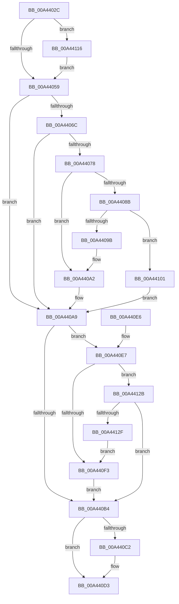

# PiDqObjectManagerHandleObjectEvent

- RVA: `0x00A4402C`–`0x00A44131` (길이 `261` bytes)
- VA: `0x0000000140A4402C`
- 실행 섹션: `PAGE`
- PDB 이름 있음: `예`; PDB Function 태그: `아니요`
- unwind 정보 RVA: `0x000AF098`
- 디코드: `74`개 명령, `261/261` bytes 표시
- 미해석 바이트: `0` (있으면 어셈블리에 `.byte`로 보존)

> 이 문서는 커널 이미지의 기계어와 PDB 기호를 분석해 생성했습니다. 4번과 5번은 함수 원형과 자료형을 바이너리 사용 방식에서 추정한 C 해석이며 원본 소스 복구 결과는 아닙니다.

## 1. Dependencies

- 직접 호출 지점: **5**; 고유 호출 대상: **5**
- 직접 호출자로 확인된 함수: **1**
- RIP 상대 이미지 참조: **0**

### Outgoing calls
- `0x00A4405D` → [ExAcquireFastMutex](../../text/20/ExAcquireFastMutex_function_0020E5A0.md) (function, `0x0020E5A0`)
- `0x00A44080` → [PiDqObjectActionQueueEntryCreate](PiDqObjectActionQueueEntryCreate_function_00A44138.md) (function, `0x00A44138`)
- `0x00A440B8` → [ExReleaseFastMutex](../../text/25/ExReleaseFastMutex_function_002519C0.md) (function, `0x002519C0`)
- `0x00A440CE` → [ExQueueWorkItem](../../text/2F/ExQueueWorkItem_function_002F9520.md) (function, `0x002F9520`)
- `0x00A44121` → [PiDqDeleteUserObjectFromLoadedHives](../AB/PiDqDeleteUserObjectFromLoadedHives_function_00AB957C.md) (function, `0x00AB957C`)

### Direct callers
- [PiPnpRtlObjectEventDispatch](../8E/PiPnpRtlObjectEventDispatch_function_008E0D5C.md) at `0x008E0D95`

### Static image references
- 디코드된 RIP-relative 메모리 참조가 없습니다.

## 2. Other-region calls and transfers

- 다른 실행 섹션으로 향하는 call: **3**
  - `0x00A4405D` → [ExAcquireFastMutex](../../text/20/ExAcquireFastMutex_function_0020E5A0.md) (`PAGE` → `.text`)
  - `0x00A440B8` → [ExReleaseFastMutex](../../text/25/ExReleaseFastMutex_function_002519C0.md) (`PAGE` → `.text`)
  - `0x00A440CE` → [ExQueueWorkItem](../../text/2F/ExQueueWorkItem_function_002F9520.md) (`PAGE` → `.text`)
- 별도 외부 분기/꼬리 이동을 확인하지 못했습니다.

## 3. Assembly (complete function range)

```asm
00A4402C  48 89 5C 24 10                  mov qword ptr [rsp + 0x10], rbx
00A44031  48 89 6C 24 18                  mov qword ptr [rsp + 0x18], rbp
00A44036  56                              push rsi
00A44037  57                              push rdi
00A44038  41 56                           push r14
00A4403A  48 83 EC 20                     sub rsp, 0x20
00A4403E  8B 42 04                        mov eax, dword ptr [rdx + 4]
00A44041  33 F6                           xor esi, esi
00A44043  48 21 74 24 40                  and qword ptr [rsp + 0x40], rsi
00A44048  40 32 ED                        xor bpl, bpl
00A4404B  48 8B FA                        mov rdi, rdx
00A4404E  48 8B D9                        mov rbx, rcx
00A44051  A8 02                           test al, 2
00A44053  0F 85 BD 00 00 00               jne 0x140a44116
00A44059  48 8D 4B 68                     lea rcx, [rbx + 0x68]
00A4405D  E8 3E A5 7C FF                  call 0x14020e5a0
00A44062  8B 83 E4 00 00 00               mov eax, dword ptr [rbx + 0xe4]
00A44068  A8 02                           test al, 2
00A4406A  75 3D                           jne 0x140a440a9
00A4406C  48 8D 83 C0 00 00 00            lea rax, [rbx + 0xc0]
00A44073  48 39 00                        cmp qword ptr [rax], rax
00A44076  74 31                           je 0x140a440a9
00A44078  48 8D 54 24 40                  lea rdx, [rsp + 0x40]
00A4407D  48 8B CF                        mov rcx, rdi
00A44080  E8 B3 00 00 00                  call 0x140a44138
00A44085  8B F0                           mov esi, eax
00A44087  85 C0                           test eax, eax
00A44089  78 17                           js 0x140a440a2
00A4408B  48 8D 8B D0 00 00 00            lea rcx, [rbx + 0xd0]
00A44092  48 8B 51 08                     mov rdx, qword ptr [rcx + 8]
00A44096  48 39 0A                        cmp qword ptr [rdx], rcx
00A44099  74 66                           je 0x140a44101
00A4409B  B9 03 00 00 00                  mov ecx, 3
00A440A0  CD 29                           int 0x29
00A440A2  83 8B E4 00 00 00 02            or dword ptr [rbx + 0xe4], 2
00A440A9  8B 93 E4 00 00 00               mov edx, dword ptr [rbx + 0xe4]
00A440AF  F6 C2 01                        test dl, 1
00A440B2  74 33                           je 0x140a440e7
00A440B4  48 8D 4B 68                     lea rcx, [rbx + 0x68]
00A440B8  E8 03 D9 80 FF                  call 0x1402519c0
00A440BD  40 84 ED                        test bpl, bpl
00A440C0  74 11                           je 0x140a440d3
00A440C2  48 8D 8B A0 00 00 00            lea rcx, [rbx + 0xa0]
00A440C9  BA 03 00 00 00                  mov edx, 3
00A440CE  E8 4D 54 8B FF                  call 0x1402f9520
00A440D3  48 8B 5C 24 48                  mov rbx, qword ptr [rsp + 0x48]
00A440D8  48 8B 6C 24 50                  mov rbp, qword ptr [rsp + 0x50]
00A440DD  48 83 C4 20                     add rsp, 0x20
00A440E1  41 5E                           pop r14
00A440E3  5F                              pop rdi
00A440E4  5E                              pop rsi
00A440E5  C3                              ret
00A440E6  CC                              int3
00A440E7  48 8D 83 D0 00 00 00            lea rax, [rbx + 0xd0]
00A440EE  48 39 00                        cmp qword ptr [rax], rax
00A440F1  74 38                           je 0x140a4412b
00A440F3  83 CA 01                        or edx, 1
00A440F6  40 B5 01                        mov bpl, 1
00A440F9  89 93 E4 00 00 00               mov dword ptr [rbx + 0xe4], edx
00A440FF  EB B3                           jmp 0x140a440b4
00A44101  48 8B 44 24 40                  mov rax, qword ptr [rsp + 0x40]
00A44106  48 89 08                        mov qword ptr [rax], rcx
00A44109  48 89 50 08                     mov qword ptr [rax + 8], rdx
00A4410D  48 89 02                        mov qword ptr [rdx], rax
00A44110  48 89 41 08                     mov qword ptr [rcx + 8], rax
00A44114  EB 93                           jmp 0x140a440a9
00A44116  48 8B 4A 08                     mov rcx, qword ptr [rdx + 8]
00A4411A  8B 51 1C                        mov edx, dword ptr [rcx + 0x1c]
00A4411D  48 8B 49 10                     mov rcx, qword ptr [rcx + 0x10]
00A44121  E8 56 54 07 00                  call 0x140ab957c
00A44126  E9 2E FF FF FF                  jmp 0x140a44059
00A4412B  85 F6                           test esi, esi
00A4412D  79 85                           jns 0x140a440b4
00A4412F  EB C2                           jmp 0x140a440f3
```

## 4. C-style interpretation (structured pseudocode)

```c
__int64 __fastcall PiDqObjectManagerHandleObjectEvent(__int64 a1, __int64 a2)
{
    __int64 result;
    __int64 v_rbp;
    __int64 v_rsi;
    __int64 v_rsp;
    unsigned __int64 v_stack_p10;
    unsigned __int64 v_stack_p18;
    unsigned __int64 v_stack_p40;
    unsigned __int64 v_stack_p8;

    v_stack_p10 = v_rbx;
    v_stack_p18 = v_rbp;
    v_rsp = (v_rsp) - (32);
    v_rsi = 0;
    v_rbp = 0;
    if ((((unsigned __int8)((unsigned int)(*(unsigned int *)(a2 + 4)))) & (2)) != 0) goto loc_00A44116;
loc_00A44059:
    result = ExAcquireFastMutex(a1 + 104, a2, a3, a4);
    if ((((unsigned __int8)((unsigned int)(*(unsigned int *)(a1 + 228)))) & (2)) != 0) goto loc_00A440A9;
    if ((*(unsigned __int64 *)(a1 + 192)) == (a1 + 192)) goto loc_00A440A9;
    result = PiDqObjectActionQueueEntryCreate(a2, v_stack_p8, a3, a4);
    if (sign_flag) goto loc_00A440A2;
    if ((*(unsigned __int64 *)(*(unsigned __int64 *)(a1 + 208 + 8))) == (a1 + 208)) goto loc_00A44101;
loc_00A440A2:
loc_00A440A9:
    if ((((unsigned __int8)((unsigned int)(*(unsigned int *)(a1 + 228)))) & (1)) == 0) goto loc_00A440E7;
loc_00A440B4:
    result = ExReleaseFastMutex(a1 + 104, (unsigned int)(*(unsigned int *)(a1 + 228)), a3, a4);
    if (0 != 0) {
        a1 = a1 + 160;
        a2 = 3;
        result = ExQueueWorkItem(a1, a2, a3, a4);
    }
    v_rsp = (v_rsp) + (32);
    return result;
loc_00A440E7:
    if ((*(unsigned __int64 *)(v_stack_p10 + 208)) == (v_stack_p10 + 208)) goto loc_00A4412B;
loc_00A440F3:
    a2 = (unsigned int)((a2) | (1));
    *(unsigned int *)(v_stack_p10 + 228) = (unsigned int)(a2);
    goto loc_00A440B4;
loc_00A44101:
    *(unsigned __int64 *)(v_stack_p40) = a1;
    *(unsigned __int64 *)(v_stack_p40 + 8) = a2;
    *(unsigned __int64 *)(a2) = v_stack_p40;
    *(unsigned __int64 *)(a1 + 8) = v_stack_p40;
    goto loc_00A440A9;
loc_00A44116:
    result = PiDqDeleteUserObjectFromLoadedHives(*(unsigned __int64 *)(*(unsigned __int64 *)(a2 + 8) + 16), (unsigned int)(*(unsigned int *)(*(unsigned __int64 *)(a2 + 8) + 28)), a3, a4);
    goto loc_00A44059;
loc_00A4412B:
    if (!sign_flag) goto loc_00A440B4;
    goto loc_00A440F3;
}
```

## 5. (Beta) C Style

```c
int64_t PiDqObjectManagerHandleObjectEvent(void *Arg1, void *Arg2)
{
    uint8_t *arg1 = (uint8_t *)Arg1;
    uint8_t *arg2 = (uint8_t *)Arg2;

    int64_t result;
    int64_t local_rbp;
    int64_t local_rsi;
    int64_t local_rsp;
    uint64_t v_stack_p10;
    uint64_t v_stack_p18;
    uint64_t v_stack_p40;
    uint64_t v_stack_p8;

    v_stack_p10 = local_rbx;
    v_stack_p18 = local_rbp;
    local_rsp = (local_rsp) - (32);
    local_rsi = 0;
    local_rbp = 0;
    if ((((uint8_t)((uint32_t)(*(uint32_t *)(arg2 + 0x4)))) & (2)) != 0) goto loc_00A44116;
loc_00A44059:
    result = ExAcquireFastMutex(Arg1 + 104, Arg2, a3, a4);
    if ((((uint8_t)((uint32_t)(*(uint32_t *)(arg1 + 0xE4)))) & (2)) != 0) goto loc_00A440A9;
    if ((*(uint64_t *)(arg1 + 0xC0)) == (Arg1 + 192)) goto loc_00A440A9;
    result = PiDqObjectActionQueueEntryCreate(Arg2, v_stack_p8, a3, a4);
    if (sign_flag) goto loc_00A440A2;
    if ((*(uint64_t *)(*(uint64_t *)(arg1 + 0xD0 + 0x8))) == (Arg1 + 208)) goto loc_00A44101;
loc_00A440A2:
loc_00A440A9:
    if ((((uint8_t)((uint32_t)(*(uint32_t *)(arg1 + 0xE4)))) & (1)) == 0) goto loc_00A440E7;
loc_00A440B4:
    result = ExReleaseFastMutex(Arg1 + 104, (uint32_t)(*(uint32_t *)(arg1 + 0xE4)), a3, a4);
    if (0 != 0) {
        Arg1 = Arg1 + 160;
        Arg2 = 3;
        result = ExQueueWorkItem(Arg1, Arg2, a3, a4);
    }
    local_rsp = (local_rsp) + (32);
    return result;
loc_00A440E7:
    if ((*(uint64_t *)(v_stack_p10 + 0xD0)) == (v_stack_p10 + 208)) goto loc_00A4412B;
loc_00A440F3:
    Arg2 = (uint32_t)((Arg2) | (1));
    *(uint32_t *)(v_stack_p10 + 0xE4) = (uint32_t)(Arg2);
    goto loc_00A440B4;
loc_00A44101:
    *(void **)(v_stack_p40) = Arg1;
    *(void **)(v_stack_p40 + 0x8) = Arg2;
    *(uint64_t *)(arg2) = v_stack_p40;
    *(uint64_t *)(arg1 + 0x8) = v_stack_p40;
    goto loc_00A440A9;
loc_00A44116:
    result = PiDqDeleteUserObjectFromLoadedHives(*(uint64_t *)(*(uint64_t *)(arg2 + 0x8) + 0x10), (uint32_t)(*(uint32_t *)(*(uint64_t *)(arg2 + 0x8) + 0x1C)), a3, a4);
    goto loc_00A44059;
loc_00A4412B:
    if (!sign_flag) goto loc_00A440B4;
    goto loc_00A440F3;
}
```

### 관측된 메모리 오프셋

구조체 형식이 확인되지 않은 접근은 인자 기준의 오프셋으로만 기록했습니다.

| 기준 인자 | 오프셋 표현 | 폭 (bit) | 접근 |
|---|---:|---:|---|
| `Arg1` | `+ 0x0` | `64` | `R` |
| `Arg1` | `+ 0x8` | `64` | `R` |
| `Arg1` | `+ 0x8` | `64` | `W` |
| `Arg1` | `+ 0x68` | `64` | `R` |
| `Arg1` | `+ 0xA0` | `64` | `R` |
| `Arg1` | `+ 0xC0` | `64` | `R` |
| `Arg1` | `+ 0xD0` | `64` | `R` |
| `Arg1` | `+ 0xE4` | `32` | `R` |
| `Arg1` | `+ 0xE4` | `32` | `R/W` |
| `Arg1` | `+ 0xE4` | `32` | `W` |
| `Arg2` | `+ 0x4` | `32` | `R` |
| `Arg2` | `+ 0x8` | `64` | `R` |

## 6. Execution-region graph

[열기: 2D/3D 그래프와 함수 탐색 컨트롤 패널](../../../control-panel.html?section=page&rva=0x00A4402C&view=graph)

- 2D 그래프는 위에서 아래로 흐르고, 3D 그래프는 빈 공간을 드래그해 회전합니다. Shift+드래그는 이동, 휠은 확대·축소, 함수 노드 선택은 대상 보고서 이동입니다.

### Static fallback


