# PiQueryDeviceRelations

- RVA: `0x00A4BE8C`–`0x00A4C18C` (길이 `768` bytes)
- VA: `0x0000000140A4BE8C`
- 실행 섹션: `PAGE`
- PDB 이름 있음: `예`; PDB Function 태그: `아니요`
- unwind 정보 RVA: `0x000B034C`
- 디코드: `208`개 명령, `768/768` bytes 표시
- 미해석 바이트: `0` (있으면 어셈블리에 `.byte`로 보존)

> 이 문서는 커널 이미지의 기계어와 PDB 기호를 분석해 생성했습니다. 4번과 5번은 함수 원형과 자료형을 바이너리 사용 방식에서 추정한 C 해석이며 원본 소스 복구 결과는 아닙니다.

## 1. Dependencies

- 직접 호출 지점: **11**; 고유 호출 대상: **10**
- 직접 호출자로 확인된 함수: **1**
- RIP 상대 이미지 참조: **1**

### Outgoing calls
- `0x00A4BF01` → [ExAcquireResourceSharedLite](../../text/21/ExAcquireResourceSharedLite_function_00211BC0.md) (function, `0x00211BC0`)
- `0x00A4BF0E` → [PnpDeviceObjectFromDeviceInstanceWithTag](../8E/PnpDeviceObjectFromDeviceInstanceWithTag_function_008E7490.md) (function, `0x008E7490`)
- `0x00A4BF75` → [ExAllocatePool2](../../poolcode/B8/ExAllocatePool2_function_00B820F0.md) (function, `0x00B820F0`)
- `0x00A4BFA3` → [ObfReferenceObjectWithTag](../../text/21/ObfReferenceObjectWithTag_function_00210710.md) (function, `0x00210710`)
- `0x00A4BFD5` → [ExReleaseResourceLite](../../text/25/ExReleaseResourceLite_function_0025FA10.md) (function, `0x0025FA10`)
- `0x00A4BFDA` → [KeLeaveCriticalRegion](../../text/25/KeLeaveCriticalRegion_function_0025D8B0.md) (function, `0x0025D8B0`)
- `0x00A4BFFB` → [ExFreePoolWithTag](../../poolcode/B8/ExFreePoolWithTag_function_00B82870.md) (function, `0x00B82870`)
- `0x00A4C00D` → [ObfDereferenceObjectWithTag](../../text/2F/ObfDereferenceObjectWithTag_function_002F78E0.md) (function, `0x002F78E0`)
- `0x00A4C08E` → [ObfDereferenceObjectWithTag](../../text/2F/ObfDereferenceObjectWithTag_function_002F78E0.md) (function, `0x002F78E0`)
- `0x00A4C0E1` → [memcpy](../../text/6C/memcpy_function_006C6840.md) (function, `0x006C6840`)
- `0x00A4C115` → [PnpQueryDeviceRelations](../8F/PnpQueryDeviceRelations_function_008F9FE0.md) (function, `0x008F9FE0`)

### Direct callers
- [PiControlQueryDeviceRelations](PiControlQueryDeviceRelations_function_00A4BD20.md) at `0x00A4BDD3`

### Static image references
- `0x00A4BEF0` → RVA `0x00F8C560` (`.data`; read)

## 2. Other-region calls and transfers

- 다른 실행 섹션으로 향하는 call: **9**
  - `0x00A4BF01` → [ExAcquireResourceSharedLite](../../text/21/ExAcquireResourceSharedLite_function_00211BC0.md) (`PAGE` → `.text`)
  - `0x00A4BF75` → [ExAllocatePool2](../../poolcode/B8/ExAllocatePool2_function_00B820F0.md) (`PAGE` → `POOLCODE`)
  - `0x00A4BFA3` → [ObfReferenceObjectWithTag](../../text/21/ObfReferenceObjectWithTag_function_00210710.md) (`PAGE` → `.text`)
  - `0x00A4BFD5` → [ExReleaseResourceLite](../../text/25/ExReleaseResourceLite_function_0025FA10.md) (`PAGE` → `.text`)
  - `0x00A4BFDA` → [KeLeaveCriticalRegion](../../text/25/KeLeaveCriticalRegion_function_0025D8B0.md) (`PAGE` → `.text`)
  - `0x00A4BFFB` → [ExFreePoolWithTag](../../poolcode/B8/ExFreePoolWithTag_function_00B82870.md) (`PAGE` → `POOLCODE`)
  - `0x00A4C00D` → [ObfDereferenceObjectWithTag](../../text/2F/ObfDereferenceObjectWithTag_function_002F78E0.md) (`PAGE` → `.text`)
  - `0x00A4C08E` → [ObfDereferenceObjectWithTag](../../text/2F/ObfDereferenceObjectWithTag_function_002F78E0.md) (`PAGE` → `.text`)
  - `0x00A4C0E1` → [memcpy](../../text/6C/memcpy_function_006C6840.md) (`PAGE` → `.text`)
- 별도 외부 분기/꼬리 이동을 확인하지 못했습니다.

## 3. Assembly (complete function range)

```asm
00A4BE8C  48 8B C4                        mov rax, rsp
00A4BE8F  48 89 58 08                     mov qword ptr [rax + 8], rbx
00A4BE93  48 89 68 18                     mov qword ptr [rax + 0x18], rbp
00A4BE97  48 89 70 20                     mov qword ptr [rax + 0x20], rsi
00A4BE9B  57                              push rdi
00A4BE9C  41 54                           push r12
00A4BE9E  41 55                           push r13
00A4BEA0  41 56                           push r14
00A4BEA2  41 57                           push r15
00A4BEA4  48 83 EC 30                     sub rsp, 0x30
00A4BEA8  48 8B E9                        mov rbp, rcx
00A4BEAB  4D 8B F9                        mov r15, r9
00A4BEAE  33 C9                           xor ecx, ecx
00A4BEB0  4D 8B E0                        mov r12, r8
00A4BEB3  48 89 48 C8                     mov qword ptr [rax - 0x38], rcx
00A4BEB7  8B D9                           mov ebx, ecx
00A4BEB9  89 4C 24 68                     mov dword ptr [rsp + 0x68], ecx
00A4BEBD  8B F1                           mov esi, ecx
00A4BEBF  8D 41 02                        lea eax, [rcx + 2]
00A4BEC2  85 D2                           test edx, edx
00A4BEC4  0F 84 79 02 00 00               je 0x140a4c143
00A4BECA  83 EA 01                        sub edx, 1
00A4BECD  0F 84 7A 02 00 00               je 0x140a4c14d
00A4BED3  83 EA 01                        sub edx, 1
00A4BED6  0F 84 25 02 00 00               je 0x140a4c101
00A4BEDC  83 EA 01                        sub edx, 1
00A4BEDF  0F 85 86 02 00 00               jne 0x140a4c16b
00A4BEE5  8B F9                           mov edi, ecx
00A4BEE7  65 48 8B 04 25 88 01 00 00      mov rax, qword ptr gs:[0x188]
00A4BEF0  48 8D 0D 69 06 54 00            lea rcx, [rip + 0x540669]
00A4BEF7  B2 01                           mov dl, 1
00A4BEF9  66 FF 88 E4 01 00 00            dec word ptr [rax + 0x1e4]
00A4BF00  90                              nop
00A4BF01  E8 BA 5C 7C FF                  call 0x140211bc0
00A4BF06  BA 50 6E 70 43                  mov edx, 0x43706e50
00A4BF0B  48 8B CD                        mov rcx, rbp
00A4BF0E  E8 7D B5 E9 FF                  call 0x1408e7490
00A4BF13  33 ED                           xor ebp, ebp
00A4BF15  48 89 44 24 28                  mov qword ptr [rsp + 0x28], rax
00A4BF1A  4C 8B E8                        mov r13, rax
00A4BF1D  48 85 C0                        test rax, rax
00A4BF20  0F 84 52 02 00 00               je 0x140a4c178
00A4BF26  48 8B 80 38 01 00 00            mov rax, qword ptr [rax + 0x138]
00A4BF2D  4C 8B 70 28                     mov r14, qword ptr [rax + 0x28]
00A4BF31  41 8B 86 2C 01 00 00            mov eax, dword ptr [r14 + 0x12c]
00A4BF38  2D 15 03 00 00                  sub eax, 0x315
00A4BF3D  83 F8 01                        cmp eax, 1
00A4BF40  0F 86 32 02 00 00               jbe 0x140a4c178
00A4BF46  85 FF                           test edi, edi
00A4BF48  0F 85 BA 01 00 00               jne 0x140a4c108
00A4BF4E  49 8B 46 08                     mov rax, qword ptr [r14 + 8]
00A4BF52  8B FD                           mov edi, ebp
00A4BF54  EB 05                           jmp 0x140a4bf5b
00A4BF56  48 8B 00                        mov rax, qword ptr [rax]
00A4BF59  FF C7                           inc edi
00A4BF5B  48 85 C0                        test rax, rax
00A4BF5E  75 F6                           jne 0x140a4bf56
00A4BF60  8B D7                           mov edx, edi
00A4BF62  B9 00 01 00 00                  mov ecx, 0x100
00A4BF67  41 B8 50 70 20 20               mov r8d, 0x20207050
00A4BF6D  48 8D 14 D5 10 00 00 00         lea rdx, [rdx*8 + 0x10]
00A4BF75  E8 76 61 13 00                  call 0x140b820f0
00A4BF7A  48 89 44 24 20                  mov qword ptr [rsp + 0x20], rax
00A4BF7F  4C 8B C0                        mov r8, rax
00A4BF82  48 85 C0                        test rax, rax
00A4BF85  0F 84 AA 01 00 00               je 0x140a4c135
00A4BF8B  89 38                           mov dword ptr [rax], edi
00A4BF8D  4D 8B 76 08                     mov r14, qword ptr [r14 + 8]
00A4BF91  4D 85 F6                        test r14, r14
00A4BF94  74 2E                           je 0x140a4bfc4
00A4BF96  3B EF                           cmp ebp, edi
00A4BF98  73 28                           jae 0x140a4bfc2
00A4BF9A  49 8B 4E 20                     mov rcx, qword ptr [r14 + 0x20]
00A4BF9E  BA 50 6E 70 43                  mov edx, 0x43706e50
00A4BFA3  E8 68 47 7C FF                  call 0x140210710
00A4BFA8  49 8B 4E 20                     mov rcx, qword ptr [r14 + 0x20]
00A4BFAC  48 8B 44 24 20                  mov rax, qword ptr [rsp + 0x20]
00A4BFB1  8B D5                           mov edx, ebp
00A4BFB3  FF C5                           inc ebp
00A4BFB5  48 89 4C D0 08                  mov qword ptr [rax + rdx*8 + 8], rcx
00A4BFBA  4D 8B 36                        mov r14, qword ptr [r14]
00A4BFBD  4D 85 F6                        test r14, r14
00A4BFC0  75 D4                           jne 0x140a4bf96
00A4BFC2  33 ED                           xor ebp, ebp
00A4BFC4  4C 8B 44 24 20                  mov r8, qword ptr [rsp + 0x20]
00A4BFC9  4D 85 C0                        test r8, r8
00A4BFCC  75 70                           jne 0x140a4c03e
00A4BFCE  48 8D 0D 8B 05 54 00            lea rcx, [rip + 0x54058b]
00A4BFD5  E8 36 3A 81 FF                  call 0x14025fa10
00A4BFDA  E8 D1 18 81 FF                  call 0x14025d8b0
00A4BFDF  B9 00 00 00 80                  mov ecx, 0x80000000
00A4BFE4  8D 04 0B                        lea eax, [rbx + rcx]
00A4BFE7  85 C1                           test ecx, eax
00A4BFE9  74 47                           je 0x140a4c032
00A4BFEB  41 89 34 24                     mov dword ptr [r12], esi
00A4BFEF  48 8B 4C 24 20                  mov rcx, qword ptr [rsp + 0x20]
00A4BFF4  48 85 C9                        test rcx, rcx
00A4BFF7  74 07                           je 0x140a4c000
00A4BFF9  33 D2                           xor edx, edx
00A4BFFB  E8 70 68 13 00                  call 0x140b82870
00A4C000  4D 85 ED                        test r13, r13
00A4C003  74 0D                           je 0x140a4c012
00A4C005  BA 50 6E 70 43                  mov edx, 0x43706e50
00A4C00A  49 8B CD                        mov rcx, r13
00A4C00D  E8 CE B8 8A FF                  call 0x1402f78e0
00A4C012  8B C3                           mov eax, ebx
00A4C014  48 8B 5C 24 60                  mov rbx, qword ptr [rsp + 0x60]
00A4C019  48 8B 6C 24 70                  mov rbp, qword ptr [rsp + 0x70]
00A4C01E  48 8B 74 24 78                  mov rsi, qword ptr [rsp + 0x78]
00A4C023  48 83 C4 30                     add rsp, 0x30
00A4C027  41 5F                           pop r15
00A4C029  41 5E                           pop r14
00A4C02B  41 5D                           pop r13
00A4C02D  41 5C                           pop r12
00A4C02F  5F                              pop rdi
00A4C030  C3                              ret
00A4C031  CC                              int3
00A4C032  81 FB 23 00 00 C0               cmp ebx, 0xc0000023
00A4C038  74 B1                           je 0x140a4bfeb
00A4C03A  8B F5                           mov esi, ebp
00A4C03C  EB AD                           jmp 0x140a4bfeb
00A4C03E  41 39 28                        cmp dword ptr [r8], ebp
00A4C041  76 8B                           jbe 0x140a4bfce
00A4C043  BB 02 00 00 00                  mov ebx, 2
00A4C048  45 33 ED                        xor r13d, r13d
00A4C04B  8B F3                           mov esi, ebx
00A4C04D  44 8B F5                        mov r14d, ebp
00A4C050  4B 8B 44 F0 08                  mov rax, qword ptr [r8 + r14*8 + 8]
00A4C055  48 8B 88 38 01 00 00            mov rcx, qword ptr [rax + 0x138]
00A4C05C  48 8B 51 28                     mov rdx, qword ptr [rcx + 0x28]
00A4C060  48 85 D2                        test rdx, rdx
00A4C063  74 1F                           je 0x140a4c084
00A4C065  48 8D 7A 28                     lea rdi, [rdx + 0x28]
00A4C069  48 85 FF                        test rdi, rdi
00A4C06C  74 16                           je 0x140a4c084
00A4C06E  44 0F B7 0F                     movzx r9d, word ptr [rdi]
00A4C072  66 44 3B CB                     cmp r9w, bx
00A4C076  72 0C                           jb 0x140a4c084
00A4C078  4D 85 FF                        test r15, r15
00A4C07B  75 4A                           jne 0x140a4c0c7
00A4C07D  0F B7 07                        movzx eax, word ptr [rdi]
00A4C080  03 F3                           add esi, ebx
00A4C082  03 F0                           add esi, eax
00A4C084  4B 8B 4C F0 08                  mov rcx, qword ptr [r8 + r14*8 + 8]
00A4C089  BA 50 6E 70 43                  mov edx, 0x43706e50
00A4C08E  E8 4D B8 8A FF                  call 0x1402f78e0
00A4C093  4C 8B 44 24 20                  mov r8, qword ptr [rsp + 0x20]
00A4C098  FF C5                           inc ebp
00A4C09A  41 3B 28                        cmp ebp, dword ptr [r8]
00A4C09D  72 AE                           jb 0x140a4c04d
00A4C09F  8B 5C 24 68                     mov ebx, dword ptr [rsp + 0x68]
00A4C0A3  33 ED                           xor ebp, ebp
00A4C0A5  4C 8B 6C 24 28                  mov r13, qword ptr [rsp + 0x28]
00A4C0AA  4D 85 FF                        test r15, r15
00A4C0AD  0F 85 A4 00 00 00               jne 0x140a4c157
00A4C0B3  41 39 34 24                     cmp dword ptr [r12], esi
00A4C0B7  0F 83 11 FF FF FF               jae 0x140a4bfce
00A4C0BD  BB 23 00 00 C0                  mov ebx, 0xc0000023
00A4C0C2  E9 07 FF FF FF                  jmp 0x140a4bfce
00A4C0C7  41 8B 04 24                     mov eax, dword ptr [r12]
00A4C0CB  42 8D 0C 0E                     lea ecx, [rsi + r9]
00A4C0CF  48 03 CB                        add rcx, rbx
00A4C0D2  48 3B C1                        cmp rax, rcx
00A4C0D5  72 A6                           jb 0x140a4c07d
00A4C0D7  48 8B 52 30                     mov rdx, qword ptr [rdx + 0x30]
00A4C0DB  4D 8B C1                        mov r8, r9
00A4C0DE  49 8B CF                        mov rcx, r15
00A4C0E1  E8 5A A7 C7 FF                  call 0x1406c6840
00A4C0E6  0F B7 07                        movzx eax, word ptr [rdi]
00A4C0E9  48 D1 E8                        shr rax, 1
00A4C0EC  4D 8D 3C 47                     lea r15, [r15 + rax*2]
00A4C0F0  66 45 89 2F                     mov word ptr [r15], r13w
00A4C0F4  4C 03 FB                        add r15, rbx
00A4C0F7  4C 8B 44 24 20                  mov r8, qword ptr [rsp + 0x20]
00A4C0FC  E9 7C FF FF FF                  jmp 0x140a4c07d
00A4C101  8B F8                           mov edi, eax
00A4C103  E9 DF FD FF FF                  jmp 0x140a4bee7
00A4C108  4C 8D 4C 24 20                  lea r9, [rsp + 0x20]
00A4C10D  45 33 C0                        xor r8d, r8d
00A4C110  8B D7                           mov edx, edi
00A4C112  49 8B CD                        mov rcx, r13
00A4C115  E8 C6 DE EA FF                  call 0x1408f9fe0
00A4C11A  89 44 24 68                     mov dword ptr [rsp + 0x68], eax
00A4C11E  8B D8                           mov ebx, eax
00A4C120  85 C0                           test eax, eax
00A4C122  0F 89 9C FE FF FF               jns 0x140a4bfc4
00A4C128  4C 8B C5                        mov r8, rbp
00A4C12B  48 89 6C 24 20                  mov qword ptr [rsp + 0x20], rbp
00A4C130  E9 94 FE FF FF                  jmp 0x140a4bfc9
00A4C135  BB 9A 00 00 C0                  mov ebx, 0xc000009a
00A4C13A  89 5C 24 68                     mov dword ptr [rsp + 0x68], ebx
00A4C13E  E9 86 FE FF FF                  jmp 0x140a4bfc9
00A4C143  BF 01 00 00 00                  mov edi, 1
00A4C148  E9 9A FD FF FF                  jmp 0x140a4bee7
00A4C14D  BF 03 00 00 00                  mov edi, 3
00A4C152  E9 90 FD FF FF                  jmp 0x140a4bee7
00A4C157  41 83 3C 24 02                  cmp dword ptr [r12], 2
00A4C15C  0F 82 51 FF FF FF               jb 0x140a4c0b3
00A4C162  66 41 89 2F                     mov word ptr [r15], bp
00A4C166  E9 48 FF FF FF                  jmp 0x140a4c0b3
00A4C16B  83 FA 01                        cmp edx, 1
00A4C16E  75 12                           jne 0x140a4c182
00A4C170  8D 7A 05                        lea edi, [rdx + 5]
00A4C173  E9 6F FD FF FF                  jmp 0x140a4bee7
00A4C178  BB 0E 00 00 C0                  mov ebx, 0xc000000e
00A4C17D  E9 4C FE FF FF                  jmp 0x140a4bfce
00A4C182  B8 0D 00 00 C0                  mov eax, 0xc000000d
00A4C187  E9 88 FE FF FF                  jmp 0x140a4c014
```

## 4. C-style interpretation (structured pseudocode)

```c
__int64 __fastcall PiQueryDeviceRelations(__int64 a1, int a2, __int64 a3, __int64 a4)
{
    __int64 result;
    __int64 v_r13;
    __int64 v_r15;
    __int64 v_rbp;
    __int64 v_rdi;
    __int64 v_rsi;
    __int64 v_rsp;
    unsigned __int64 v_stack_m30;
    unsigned __int64 v_stack_m38;
    unsigned int v_stack_p10;
    unsigned __int64 v_stack_p18;
    unsigned __int64 v_stack_p20;
    unsigned __int64 v_stack_p28;
    unsigned int v_stack_p68;
    unsigned __int64 v_stack_p8;

    *(unsigned __int64 *)(v_rsp + 8) = v_rbx;
    *(unsigned __int64 *)(v_rsp + 24) = v_rbp;
    *(unsigned __int64 *)(v_rsp + 32) = v_rsi;
    v_rsp = (v_rsp) - (48);
    a1 = 0;
    *(unsigned __int64 *)(v_rsp - 56) = 0;
    v_stack_p10 = 0;
    if (a2 == 0) goto loc_00A4C143;
    a2 = (unsigned int)((a2) - (1));
    if (condition_is_equal) goto loc_00A4C14D;
    a2 = (unsigned int)((a2) - (1));
    if (condition_is_equal) goto loc_00A4C101;
    a2 = (unsigned int)((a2) - (1));
    if (condition_is_not_equal) goto loc_00A4C16B;
loc_00A4BEE7:
    result = ExAcquireResourceSharedLite(v_rip + 5506665, 1, a3, a4);
    result = PnpDeviceObjectFromDeviceInstanceWithTag(0, (unsigned int)(0x43706E50ULL), a3, a4);
    v_rbp = 0;
    v_stack_m30 = result;
    if (result == 0) goto loc_00A4C178;
    result = (unsigned int)(((unsigned int)(*(unsigned int *)(*(unsigned __int64 *)(*(unsigned __int64 *)(result + 312) + 40) + 300))) - (789));
    if (((unsigned int)(result)) <= 1) goto loc_00A4C178;
    if (0 != 0) goto loc_00A4C108;
    goto loc_00A4BF5B;
loc_00A4BF56:
    v_rdi = (unsigned int)((0) + 1);
loc_00A4BF5B:
    if (*(unsigned __int64 *)(*(unsigned __int64 *)(*(unsigned __int64 *)(*(unsigned __int64 *)(result + 312) + 40) + 8)) != 0) goto loc_00A4BF56;
    result = ExAllocatePool2(256, (unsigned int)((unsigned int)(v_rdi)) * 8 + 16, (unsigned int)(0x20207050ULL), a4);
    v_stack_m38 = result;
    if (result == 0) goto loc_00A4C135;
    *(unsigned int *)(result) = (unsigned int)(v_rdi);
    if (*(unsigned __int64 *)(*(unsigned __int64 *)(*(unsigned __int64 *)(result + 312) + 40) + 8) == 0) goto loc_00A4BFC4;
loc_00A4BF96:
    if (0 >= ((unsigned int)(v_rdi))) goto loc_00A4BFC2;
    result = ObfReferenceObjectWithTag(*(unsigned __int64 *)(*(unsigned __int64 *)(*(unsigned __int64 *)(*(unsigned __int64 *)(result + 312) + 40) + 8) + 32), (unsigned int)(0x43706E50ULL), result, a4);
    v_rbp = (unsigned int)((v_rbp) + 1);
    *(unsigned __int64 *)(v_stack_m38 + 0 * 8 + 8) = *(unsigned __int64 *)(*(unsigned __int64 *)(*(unsigned __int64 *)(*(unsigned __int64 *)(result + 312) + 40) + 8) + 32);
    if (*(unsigned __int64 *)(*(unsigned __int64 *)(*(unsigned __int64 *)(*(unsigned __int64 *)(result + 312) + 40) + 8)) != 0) goto loc_00A4BF96;
loc_00A4BFC2:
    v_rbp = 0;
loc_00A4BFC4:
loc_00A4BFC9:
    if (v_stack_m38 != 0) goto loc_00A4C03E;
loc_00A4BFCE:
    result = ExReleaseResourceLite(v_rip + 5506443, 0, v_stack_m38, a4);
    result = KeLeaveCriticalRegion(v_rip + 5506443, 0, v_stack_m38, a4);
    if ((((unsigned int)((unsigned int)(0x80000000ULL))) & ((unsigned int)(0 + (unsigned int)(0x80000000ULL) * 1))) == 0) goto loc_00A4C032;
loc_00A4BFEB:
    *(unsigned int *)(a3) = 0;
    result = 0 + (unsigned int)(0x80000000ULL) * 1;
    if (v_stack_m38 != 0) {
        a2 = 0;
        result = ExFreePoolWithTag(v_stack_m38, a2, v_stack_m38, a4);
    }
    if (result != 0) {
        a2 = 0x43706E50ULL;
        a1 = result;
        result = ObfDereferenceObjectWithTag(a1, a2, v_stack_m38, a4);
    }
loc_00A4C014:
    v_rsp = (v_rsp) + (48);
    return 0;
loc_00A4C032:
    if (((unsigned int)(v_stack_p8)) == 0xC0000023ULL) goto loc_00A4BFEB;
    goto loc_00A4BFEB;
loc_00A4C03E:
    if ((*(unsigned int *)(v_stack_m38)) <= ((unsigned int)(v_stack_p18))) goto loc_00A4BFCE;
    v_r13 = 0;
loc_00A4C04D:
    if (*(unsigned __int64 *)(*(unsigned __int64 *)(*(unsigned __int64 *)(v_stack_m38 + (unsigned int)((unsigned int)(v_stack_p18)) * 8 + 8) + 312) + 40) == 0) goto loc_00A4C084;
    if (*(unsigned __int64 *)(*(unsigned __int64 *)(*(unsigned __int64 *)(v_stack_m38 + (unsigned int)((unsigned int)(v_stack_p18)) * 8 + 8) + 312) + 40) + 40 == 0) goto loc_00A4C084;
    if (((unsigned __int16)(*(unsigned __int16 *)(*(unsigned __int64 *)(*(unsigned __int64 *)(*(unsigned __int64 *)(v_stack_m38 + (unsigned int)((unsigned int)(v_stack_p18)) * 8 + 8) + 312) + 40) + 40))) < 2) goto loc_00A4C084;
    if (a4 != 0) goto loc_00A4C0C7;
loc_00A4C07D:
    v_rsi = (unsigned int)((2) + (2));
    v_rsi = (unsigned int)((v_rsi) + ((unsigned int)(*(unsigned __int16 *)(*(unsigned __int64 *)(*(unsigned __int64 *)(*(unsigned __int64 *)(v_stack_m38 + (unsigned int)((unsigned int)(v_stack_p18)) * 8 + 8) + 312) + 40) + 40))));
loc_00A4C084:
    result = ObfDereferenceObjectWithTag(*(unsigned __int64 *)(v_stack_m38 + (unsigned int)((unsigned int)(v_stack_p18)) * 8 + 8), (unsigned int)(0x43706E50ULL), v_stack_m38, *(unsigned __int16 *)(*(unsigned __int64 *)(*(unsigned __int64 *)(*(unsigned __int64 *)(v_stack_m38 + (unsigned int)((unsigned int)(v_stack_p18)) * 8 + 8) + 312) + 40) + 40));
    v_rbp = (unsigned int)((v_stack_p18) + 1);
    if (((unsigned int)(v_rbp)) < (*(unsigned int *)(v_stack_p20))) goto loc_00A4C04D;
    v_rbp = 0;
    if (a4 != 0) goto loc_00A4C157;
loc_00A4C0B3:
    if ((*(unsigned int *)(a3)) >= ((unsigned int)(v_rsi))) goto loc_00A4BFCE;
    goto loc_00A4BFCE;
loc_00A4C0C7:
    a1 = (v_rsi + *(unsigned __int16 *)(*(unsigned __int64 *)(*(unsigned __int64 *)(*(unsigned __int64 *)(v_stack_m38 + (unsigned int)((unsigned int)(v_stack_p18)) * 8 + 8) + 312) + 40) + 40) * 1) + ((unsigned int)(0xC0000023ULL));
    if (((unsigned int)(*(unsigned int *)(a3))) < a1) goto loc_00A4C07D;
    result = memcpy(a4, *(unsigned __int64 *)((unsigned int)(0x43706E50ULL) + 48), *(unsigned __int16 *)(*(unsigned __int64 *)(*(unsigned __int64 *)(*(unsigned __int64 *)(v_stack_m38 + (unsigned int)((unsigned int)(v_stack_p18)) * 8 + 8) + 312) + 40) + 40), *(unsigned __int16 *)(*(unsigned __int64 *)(*(unsigned __int64 *)(*(unsigned __int64 *)(v_stack_m38 + (unsigned int)((unsigned int)(v_stack_p18)) * 8 + 8) + 312) + 40) + 40));
    result = (*(unsigned __int16 *)(*(unsigned __int64 *)(*(unsigned __int64 *)(*(unsigned __int64 *)(v_stack_m38 + (unsigned int)((unsigned int)(v_stack_p18)) * 8 + 8) + 312) + 40) + 40)) >> (1);
    *(unsigned __int16 *)(a4 + result * 2) = (unsigned __int16)(v_stack_p28);
    v_r15 = (a4 + result * 2) + ((unsigned int)(0xC0000023ULL));
    goto loc_00A4C07D;
loc_00A4C101:
    goto loc_00A4BEE7;
loc_00A4C108:
    a3 = 0;
    result = PnpQueryDeviceRelations(v_stack_p28, (unsigned int)((unsigned int)((unsigned int)((unsigned int)(result)))), a3, v_stack_p20);
    v_stack_p68 = (unsigned int)(result);
    if (!sign_flag) goto loc_00A4BFC4;
    v_stack_p20 = 0;
    goto loc_00A4BFC9;
loc_00A4C135:
    v_stack_p68 = (unsigned int)((unsigned int)(0xC000009AULL));
    goto loc_00A4BFC9;
loc_00A4C143:
    goto loc_00A4BEE7;
loc_00A4C14D:
    goto loc_00A4BEE7;
loc_00A4C157:
    if ((*(unsigned int *)(a3)) < 2) goto loc_00A4C0B3;
    *(unsigned __int16 *)(v_r15) = 0;
    goto loc_00A4C0B3;
loc_00A4C16B:
    if (((unsigned int)((unsigned int)((unsigned int)((unsigned int)((unsigned int)(result)))))) != 1) goto loc_00A4C182;
    goto loc_00A4BEE7;
loc_00A4C178:
    goto loc_00A4BFCE;
loc_00A4C182:
    goto loc_00A4C014;
}
```

## 5. (Beta) C Style

```c
int64_t PiQueryDeviceRelations(int64_t Arg1, int32_t Arg2, void *Arg3, int64_t Arg4)
{
    uint8_t *arg3 = (uint8_t *)Arg3;

    int64_t result;
    int64_t local_r13;
    int64_t local_r15;
    int64_t local_rbp;
    int64_t local_rdi;
    int64_t local_rsi;
    int64_t local_rsp;
    uint64_t v_stack_m30;
    uint64_t v_stack_m38;
    uint32_t v_stack_p10;
    uint64_t v_stack_p18;
    uint64_t v_stack_p20;
    uint64_t v_stack_p28;
    uint32_t v_stack_p68;
    uint64_t v_stack_p8;

    *(uint64_t *)(local_rsp + 0x8) = local_rbx;
    *(uint64_t *)(local_rsp + 0x18) = local_rbp;
    *(uint64_t *)(local_rsp + 0x20) = local_rsi;
    local_rsp = (local_rsp) - (48);
    Arg1 = 0;
    *(uint64_t *)(local_rsp - 0x38) = 0;
    v_stack_p10 = 0;
    if (Arg2 == 0) goto loc_00A4C143;
    Arg2 = (uint32_t)((Arg2) - (1));
    if (condition_is_equal) goto loc_00A4C14D;
    Arg2 = (uint32_t)((Arg2) - (1));
    if (condition_is_equal) goto loc_00A4C101;
    Arg2 = (uint32_t)((Arg2) - (1));
    if (condition_is_not_equal) goto loc_00A4C16B;
loc_00A4BEE7:
    result = ExAcquireResourceSharedLite(v_rip + 5506665, 1, Arg3, Arg4);
    result = PnpDeviceObjectFromDeviceInstanceWithTag(0, (uint32_t)(0x43706E50ULL), Arg3, Arg4);
    local_rbp = 0;
    v_stack_m30 = result;
    if (result == 0) goto loc_00A4C178;
    result = (uint32_t)(((uint32_t)(*(uint32_t *)(*(uint64_t *)(*(uint64_t *)(result + 0x138) + 0x28) + 0x12C))) - (789));
    if (((uint32_t)(result)) <= 1) goto loc_00A4C178;
    if (0 != 0) goto loc_00A4C108;
    goto loc_00A4BF5B;
loc_00A4BF56:
    local_rdi = (uint32_t)((0) + 1);
loc_00A4BF5B:
    if (*(uint64_t *)(*(uint64_t *)(*(uint64_t *)(*(uint64_t *)(result + 0x138) + 0x28) + 0x8)) != 0) goto loc_00A4BF56;
    result = ExAllocatePool2(256, (uint32_t)((uint32_t)(local_rdi)) * 8 + 16, (uint32_t)(0x20207050ULL), Arg4);
    v_stack_m38 = result;
    if (result == 0) goto loc_00A4C135;
    *(uint32_t *)(result) = (uint32_t)(local_rdi);
    if (*(uint64_t *)(*(uint64_t *)(*(uint64_t *)(result + 0x138) + 0x28) + 0x8) == 0) goto loc_00A4BFC4;
loc_00A4BF96:
    if (0 >= ((uint32_t)(local_rdi))) goto loc_00A4BFC2;
    result = ObfReferenceObjectWithTag(*(uint64_t *)(*(uint64_t *)(*(uint64_t *)(*(uint64_t *)(result + 0x138) + 0x28) + 0x8) + 0x20), (uint32_t)(0x43706E50ULL), result, Arg4);
    local_rbp = (uint32_t)((local_rbp) + 1);
    *(uint64_t *)(v_stack_m38 + 0x0 * 8 + 0x8) = *(uint64_t *)(*(uint64_t *)(*(uint64_t *)(*(uint64_t *)(result + 0x138) + 0x28) + 0x8) + 0x20);
    if (*(uint64_t *)(*(uint64_t *)(*(uint64_t *)(*(uint64_t *)(result + 0x138) + 0x28) + 0x8)) != 0) goto loc_00A4BF96;
loc_00A4BFC2:
    local_rbp = 0;
loc_00A4BFC4:
loc_00A4BFC9:
    if (v_stack_m38 != 0) goto loc_00A4C03E;
loc_00A4BFCE:
    result = ExReleaseResourceLite(v_rip + 5506443, 0, v_stack_m38, Arg4);
    result = KeLeaveCriticalRegion(v_rip + 5506443, 0, v_stack_m38, Arg4);
    if ((((uint32_t)((uint32_t)(0x80000000ULL))) & ((uint32_t)(0 + (uint32_t)(0x80000000ULL) * 1))) == 0) goto loc_00A4C032;
loc_00A4BFEB:
    *(uint32_t *)(arg3) = 0;
    result = 0 + (uint32_t)(0x80000000ULL) * 1;
    if (v_stack_m38 != 0) {
        Arg2 = 0;
        result = ExFreePoolWithTag(v_stack_m38, Arg2, v_stack_m38, Arg4);
    }
    if (result != 0) {
        Arg2 = 0x43706E50ULL;
        Arg1 = result;
        result = ObfDereferenceObjectWithTag(Arg1, Arg2, v_stack_m38, Arg4);
    }
loc_00A4C014:
    local_rsp = (local_rsp) + (48);
    return 0;
loc_00A4C032:
    if (((uint32_t)(v_stack_p8)) == 0xC0000023ULL) goto loc_00A4BFEB;
    goto loc_00A4BFEB;
loc_00A4C03E:
    if ((*(uint32_t *)(v_stack_m38)) <= ((uint32_t)(v_stack_p18))) goto loc_00A4BFCE;
    local_r13 = 0;
loc_00A4C04D:
    if (*(uint64_t *)(*(uint64_t *)(*(uint64_t *)(v_stack_m38 + (uint32_t)((uint32_t)(v_stack_p18)) * 8 + 0x8) + 0x138) + 0x28) == 0) goto loc_00A4C084;
    if (*(uint64_t *)(*(uint64_t *)(*(uint64_t *)(v_stack_m38 + (uint32_t)((uint32_t)(v_stack_p18)) * 8 + 0x8) + 0x138) + 0x28) + 40 == 0) goto loc_00A4C084;
    if (((uint16_t)(*(uint16_t *)(*(uint64_t *)(*(uint64_t *)(*(uint64_t *)(v_stack_m38 + (uint32_t)((uint32_t)(v_stack_p18)) * 8 + 0x8) + 0x138) + 0x28) + 0x28))) < 2) goto loc_00A4C084;
    if (Arg4 != 0) goto loc_00A4C0C7;
loc_00A4C07D:
    local_rsi = (uint32_t)((2) + (2));
    local_rsi = (uint32_t)((local_rsi) + ((uint32_t)(*(uint16_t *)(*(uint64_t *)(*(uint64_t *)(*(uint64_t *)(v_stack_m38 + (uint32_t)((uint32_t)(v_stack_p18)) * 8 + 0x8) + 0x138) + 0x28) + 0x28))));
loc_00A4C084:
    result = ObfDereferenceObjectWithTag(*(uint64_t *)(v_stack_m38 + (uint32_t)((uint32_t)(v_stack_p18)) * 8 + 0x8), (uint32_t)(0x43706E50ULL), v_stack_m38, *(uint16_t *)(*(uint64_t *)(*(uint64_t *)(*(uint64_t *)(v_stack_m38 + (uint32_t)((uint32_t)(v_stack_p18)) * 8 + 0x8) + 0x138) + 0x28) + 0x28));
    local_rbp = (uint32_t)((v_stack_p18) + 1);
    if (((uint32_t)(local_rbp)) < (*(uint32_t *)(v_stack_p20))) goto loc_00A4C04D;
    local_rbp = 0;
    if (Arg4 != 0) goto loc_00A4C157;
loc_00A4C0B3:
    if ((*(uint32_t *)(arg3)) >= ((uint32_t)(local_rsi))) goto loc_00A4BFCE;
    goto loc_00A4BFCE;
loc_00A4C0C7:
    Arg1 = (local_rsi + *(uint16_t *)(*(uint64_t *)(*(uint64_t *)(*(uint64_t *)(v_stack_m38 + (uint32_t)((uint32_t)(v_stack_p18)) * 8 + 0x8) + 0x138) + 0x28) + 0x28) * 1) + ((uint32_t)(0xC0000023ULL));
    if (((uint32_t)(*(uint32_t *)(arg3))) < Arg1) goto loc_00A4C07D;
    result = memcpy(Arg4, *(uint64_t *)((uint32_t)(0x43706E50ULL) + 0x30), *(uint16_t *)(*(uint64_t *)(*(uint64_t *)(*(uint64_t *)(v_stack_m38 + (uint32_t)((uint32_t)(v_stack_p18)) * 8 + 0x8) + 0x138) + 0x28) + 0x28), *(uint16_t *)(*(uint64_t *)(*(uint64_t *)(*(uint64_t *)(v_stack_m38 + (uint32_t)((uint32_t)(v_stack_p18)) * 8 + 0x8) + 0x138) + 0x28) + 0x28));
    result = (*(uint16_t *)(*(uint64_t *)(*(uint64_t *)(*(uint64_t *)(v_stack_m38 + (uint32_t)((uint32_t)(v_stack_p18)) * 8 + 0x8) + 0x138) + 0x28) + 0x28)) >> (1);
    *(uint16_t *)(Arg4 + result * 2) = (uint16_t)(v_stack_p28);
    local_r15 = (Arg4 + result * 2) + ((uint32_t)(0xC0000023ULL));
    goto loc_00A4C07D;
loc_00A4C101:
    goto loc_00A4BEE7;
loc_00A4C108:
    Arg3 = 0;
    result = PnpQueryDeviceRelations(v_stack_p28, (uint32_t)((uint32_t)((uint32_t)((uint32_t)(result)))), Arg3, v_stack_p20);
    v_stack_p68 = (uint32_t)(result);
    if (!sign_flag) goto loc_00A4BFC4;
    v_stack_p20 = 0;
    goto loc_00A4BFC9;
loc_00A4C135:
    v_stack_p68 = (uint32_t)((uint32_t)(0xC000009AULL));
    goto loc_00A4BFC9;
loc_00A4C143:
    goto loc_00A4BEE7;
loc_00A4C14D:
    goto loc_00A4BEE7;
loc_00A4C157:
    if ((*(uint32_t *)(arg3)) < 2) goto loc_00A4C0B3;
    *(uint16_t *)(local_r15) = 0;
    goto loc_00A4C0B3;
loc_00A4C16B:
    if (((uint32_t)((uint32_t)((uint32_t)((uint32_t)((uint32_t)(result)))))) != 1) goto loc_00A4C182;
    goto loc_00A4BEE7;
loc_00A4C178:
    goto loc_00A4BFCE;
loc_00A4C182:
    goto loc_00A4C014;
}
```

### 관측된 메모리 오프셋

구조체 형식이 확인되지 않은 접근은 인자 기준의 오프셋으로만 기록했습니다.

| 기준 인자 | 오프셋 표현 | 폭 (bit) | 접근 |
|---|---:|---:|---|
| `Arg3` | `+ 0x0` | `32` | `R` |
| `Arg3` | `+ 0x0` | `32` | `W` |

## 6. Execution-region graph

[열기: 2D/3D 그래프와 함수 탐색 컨트롤 패널](../../../control-panel.html?section=page&rva=0x00A4BE8C&view=graph)

- 2D 그래프는 위에서 아래로 흐르고, 3D 그래프는 빈 공간을 드래그해 회전합니다. Shift+드래그는 이동, 휠은 확대·축소, 함수 노드 선택은 대상 보고서 이동입니다.

### Static fallback

```mermaid
flowchart TD
  bb_00A4BE8C[BB_00A4BE8C]
  bb_00A4BECA[BB_00A4BECA]
  bb_00A4BED3[BB_00A4BED3]
  bb_00A4BEDC[BB_00A4BEDC]
  bb_00A4BEE5[BB_00A4BEE5]
  bb_00A4BEE7[BB_00A4BEE7]
  bb_00A4BF26[BB_00A4BF26]
  bb_00A4BF46[BB_00A4BF46]
  bb_00A4BF4E[BB_00A4BF4E]
  bb_00A4BF56[BB_00A4BF56]
  bb_00A4BF5B[BB_00A4BF5B]
  bb_00A4BF60[BB_00A4BF60]
  bb_00A4BF8B[BB_00A4BF8B]
  bb_00A4BF96[BB_00A4BF96]
  bb_00A4BF9A[BB_00A4BF9A]
  bb_00A4BFC2[BB_00A4BFC2]
  bb_00A4BFC4[BB_00A4BFC4]
  bb_00A4BFC9[BB_00A4BFC9]
  bb_00A4BFCE[BB_00A4BFCE]
  bb_00A4BFEB[BB_00A4BFEB]
  bb_00A4BFF9[BB_00A4BFF9]
  bb_00A4C000[BB_00A4C000]
  bb_00A4C005[BB_00A4C005]
  bb_00A4C012[BB_00A4C012]
  bb_00A4C014[BB_00A4C014]
  bb_00A4C031[BB_00A4C031]
  bb_00A4C032[BB_00A4C032]
  bb_00A4C03A[BB_00A4C03A]
  bb_00A4C03E[BB_00A4C03E]
  bb_00A4C043[BB_00A4C043]
  bb_00A4C04D[BB_00A4C04D]
  bb_00A4C065[BB_00A4C065]
  bb_00A4C06E[BB_00A4C06E]
  bb_00A4C078[BB_00A4C078]
  bb_00A4C07D[BB_00A4C07D]
  bb_00A4C084[BB_00A4C084]
  bb_00A4C09F[BB_00A4C09F]
  bb_00A4C0B3[BB_00A4C0B3]
  bb_00A4C0BD[BB_00A4C0BD]
  bb_00A4C0C7[BB_00A4C0C7]
  bb_00A4C0D7[BB_00A4C0D7]
  bb_00A4C101[BB_00A4C101]
  bb_00A4C108[BB_00A4C108]
  bb_00A4C128[BB_00A4C128]
  bb_00A4C135[BB_00A4C135]
  bb_00A4C143[BB_00A4C143]
  bb_00A4C14D[BB_00A4C14D]
  bb_00A4C157[BB_00A4C157]
  bb_00A4C162[BB_00A4C162]
  bb_00A4C16B[BB_00A4C16B]
  bb_00A4C170[BB_00A4C170]
  bb_00A4C178[BB_00A4C178]
  bb_00A4C182[BB_00A4C182]
  bb_00A4BE8C -->|branch| bb_00A4C143
  bb_00A4BE8C -->|fallthrough| bb_00A4BECA
  bb_00A4BECA -->|branch| bb_00A4C14D
  bb_00A4BECA -->|fallthrough| bb_00A4BED3
  bb_00A4BED3 -->|branch| bb_00A4C101
  bb_00A4BED3 -->|fallthrough| bb_00A4BEDC
  bb_00A4BEDC -->|branch| bb_00A4C16B
  bb_00A4BEDC -->|fallthrough| bb_00A4BEE5
  bb_00A4BEE5 -->|flow| bb_00A4BEE7
  bb_00A4BEE7 -->|branch| bb_00A4C178
  bb_00A4BEE7 -->|fallthrough| bb_00A4BF26
  bb_00A4BF26 -->|branch| bb_00A4C178
  bb_00A4BF26 -->|fallthrough| bb_00A4BF46
  bb_00A4BF46 -->|branch| bb_00A4C108
  bb_00A4BF46 -->|fallthrough| bb_00A4BF4E
  bb_00A4BF4E -->|branch| bb_00A4BF5B
  bb_00A4BF56 -->|flow| bb_00A4BF5B
  bb_00A4BF5B -->|branch| bb_00A4BF56
  bb_00A4BF5B -->|fallthrough| bb_00A4BF60
  bb_00A4BF60 -->|branch| bb_00A4C135
  bb_00A4BF60 -->|fallthrough| bb_00A4BF8B
  bb_00A4BF8B -->|branch| bb_00A4BFC4
  bb_00A4BF8B -->|fallthrough| bb_00A4BF96
  bb_00A4BF96 -->|branch| bb_00A4BFC2
  bb_00A4BF96 -->|fallthrough| bb_00A4BF9A
  bb_00A4BF9A -->|branch| bb_00A4BF96
  bb_00A4BF9A -->|fallthrough| bb_00A4BFC2
  bb_00A4BFC2 -->|flow| bb_00A4BFC4
  bb_00A4BFC4 -->|flow| bb_00A4BFC9
  bb_00A4BFC9 -->|branch| bb_00A4C03E
  bb_00A4BFC9 -->|fallthrough| bb_00A4BFCE
  bb_00A4BFCE -->|branch| bb_00A4C032
  bb_00A4BFCE -->|fallthrough| bb_00A4BFEB
  bb_00A4BFEB -->|branch| bb_00A4C000
  bb_00A4BFEB -->|fallthrough| bb_00A4BFF9
  bb_00A4BFF9 -->|flow| bb_00A4C000
  bb_00A4C000 -->|branch| bb_00A4C012
  bb_00A4C000 -->|fallthrough| bb_00A4C005
  bb_00A4C005 -->|flow| bb_00A4C012
  bb_00A4C012 -->|flow| bb_00A4C014
  bb_00A4C031 -->|flow| bb_00A4C032
  bb_00A4C032 -->|branch| bb_00A4BFEB
  bb_00A4C032 -->|fallthrough| bb_00A4C03A
  bb_00A4C03A -->|branch| bb_00A4BFEB
  bb_00A4C03E -->|branch| bb_00A4BFCE
  bb_00A4C03E -->|fallthrough| bb_00A4C043
  bb_00A4C043 -->|flow| bb_00A4C04D
  bb_00A4C04D -->|branch| bb_00A4C084
  bb_00A4C04D -->|fallthrough| bb_00A4C065
  bb_00A4C065 -->|branch| bb_00A4C084
  bb_00A4C065 -->|fallthrough| bb_00A4C06E
  bb_00A4C06E -->|branch| bb_00A4C084
  bb_00A4C06E -->|fallthrough| bb_00A4C078
  bb_00A4C078 -->|branch| bb_00A4C0C7
  bb_00A4C078 -->|fallthrough| bb_00A4C07D
  bb_00A4C07D -->|flow| bb_00A4C084
  bb_00A4C084 -->|branch| bb_00A4C04D
  bb_00A4C084 -->|fallthrough| bb_00A4C09F
  bb_00A4C09F -->|branch| bb_00A4C157
  bb_00A4C09F -->|fallthrough| bb_00A4C0B3
  bb_00A4C0B3 -->|branch| bb_00A4BFCE
  bb_00A4C0B3 -->|fallthrough| bb_00A4C0BD
  bb_00A4C0BD -->|branch| bb_00A4BFCE
  bb_00A4C0C7 -->|branch| bb_00A4C07D
  bb_00A4C0C7 -->|fallthrough| bb_00A4C0D7
  bb_00A4C0D7 -->|branch| bb_00A4C07D
  bb_00A4C101 -->|branch| bb_00A4BEE7
  bb_00A4C108 -->|branch| bb_00A4BFC4
  bb_00A4C108 -->|fallthrough| bb_00A4C128
  bb_00A4C128 -->|branch| bb_00A4BFC9
  bb_00A4C135 -->|branch| bb_00A4BFC9
  bb_00A4C143 -->|branch| bb_00A4BEE7
  bb_00A4C14D -->|branch| bb_00A4BEE7
  bb_00A4C157 -->|branch| bb_00A4C0B3
  bb_00A4C157 -->|fallthrough| bb_00A4C162
  bb_00A4C162 -->|branch| bb_00A4C0B3
  bb_00A4C16B -->|branch| bb_00A4C182
  bb_00A4C16B -->|fallthrough| bb_00A4C170
  bb_00A4C170 -->|branch| bb_00A4BEE7
  bb_00A4C178 -->|branch| bb_00A4BFCE
  bb_00A4C182 -->|branch| bb_00A4C014
```


