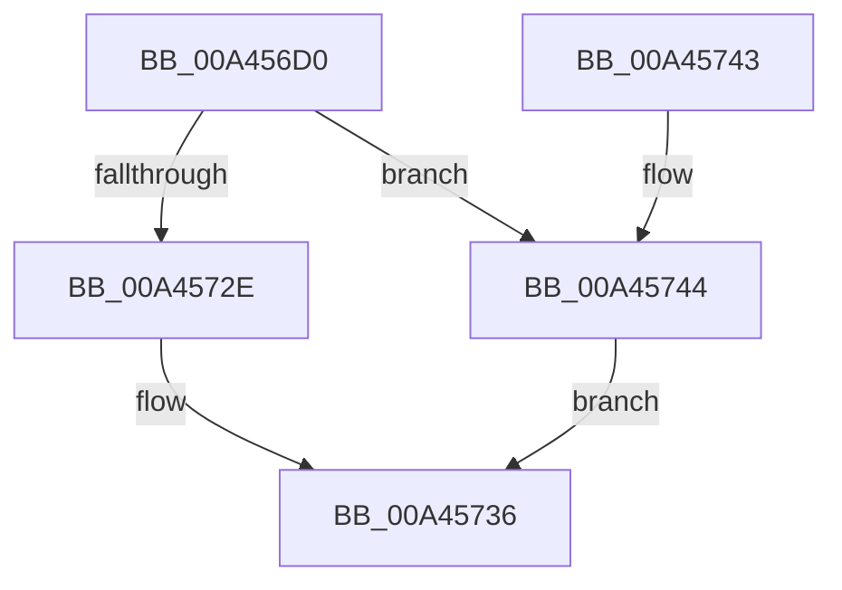

# PnpInitializeNotifyEntry

- RVA: `0x00A456D0`–`0x00A4574B` (길이 `123` bytes)
- VA: `0x0000000140A456D0`
- 실행 섹션: `PAGE`
- PDB 이름 있음: `예`; PDB Function 태그: `아니요`
- unwind 정보 RVA: `0x0006CF28`
- 디코드: `35`개 명령, `123/123` bytes 표시
- 미해석 바이트: `0` (있으면 어셈블리에 `.byte`로 보존)

> 이 문서는 커널 이미지의 기계어와 PDB 기호를 분석해 생성했습니다. 4번과 5번은 함수 원형과 자료형을 바이너리 사용 방식에서 추정한 C 해석이며 원본 소스 복구 결과는 아닙니다.

## 1. Dependencies

- 직접 호출 지점: **2**; 고유 호출 대상: **2**
- 직접 호출자로 확인된 함수: **3**
- RIP 상대 이미지 참조: **0**

### Outgoing calls
- `0x00A45720` → [ExAllocatePool2](../../poolcode/B8/ExAllocatePool2_function_00B820F0.md) (function, `0x00B820F0`)
- `0x00A45731` → [ExInitializeResourceLite](../../text/41/ExInitializeResourceLite_function_0041F9A0.md) (function, `0x0041F9A0`)

### Direct callers
- [PiRegisterKernelSoftRestartNotification](../73/PiRegisterKernelSoftRestartNotification_function_0073E28C.md) at `0x0073E325`
- [IoRegisterPlugPlayNotification](../95/IoRegisterPlugPlayNotification_function_009535A0.md) at `0x00953685`
- [IoRegisterPlugPlayNotification](../95/IoRegisterPlugPlayNotification_function_009535A0.md) at `0x00953782`
- [sub_00B26446](../B2/Unknown_function_00B26446.md) at `0x00B26488`

### Static image references
- 디코드된 RIP-relative 메모리 참조가 없습니다.

## 2. Other-region calls and transfers

- 다른 실행 섹션으로 향하는 call: **2**
  - `0x00A45720` → [ExAllocatePool2](../../poolcode/B8/ExAllocatePool2_function_00B820F0.md) (`PAGE` → `POOLCODE`)
  - `0x00A45731` → [ExInitializeResourceLite](../../text/41/ExInitializeResourceLite_function_0041F9A0.md) (`PAGE` → `.text`)
- 별도 외부 분기/꼬리 이동을 확인하지 못했습니다.

## 3. Assembly (complete function range)

```asm
00A456D0  48 89 5C 24 08                  mov qword ptr [rsp + 8], rbx
00A456D5  57                              push rdi
00A456D6  48 83 EC 20                     sub rsp, 0x20
00A456DA  48 8B 44 24 50                  mov rax, qword ptr [rsp + 0x50]
00A456DF  33 FF                           xor edi, edi
00A456E1  48 89 49 08                     mov qword ptr [rcx + 8], rcx
00A456E5  48 8B D9                        mov rbx, rcx
00A456E8  48 89 09                        mov qword ptr [rcx], rcx
00A456EB  48 89 41 30                     mov qword ptr [rcx + 0x30], rax
00A456EF  48 8B 44 24 58                  mov rax, qword ptr [rsp + 0x58]
00A456F4  89 51 10                        mov dword ptr [rcx + 0x10], edx
00A456F7  8D 57 68                        lea edx, [rdi + 0x68]
00A456FA  4C 89 41 20                     mov qword ptr [rcx + 0x20], r8
00A456FE  41 B8 50 6E 70 56               mov r8d, 0x56706e50
00A45704  48 89 41 40                     mov qword ptr [rcx + 0x40], rax
00A45708  89 79 14                        mov dword ptr [rcx + 0x14], edi
00A4570B  48 89 79 18                     mov qword ptr [rcx + 0x18], rdi
00A4570F  4C 89 49 28                     mov qword ptr [rcx + 0x28], r9
00A45713  66 C7 41 38 01 00               mov word ptr [rcx + 0x38], 1
00A45719  40 88 79 3A                     mov byte ptr [rcx + 0x3a], dil
00A4571D  8D 4F 40                        lea ecx, [rdi + 0x40]
00A45720  E8 CB C9 13 00                  call 0x140b820f0
00A45725  48 89 43 48                     mov qword ptr [rbx + 0x48], rax
00A45729  48 85 C0                        test rax, rax
00A4572C  74 16                           je 0x140a45744
00A4572E  48 8B C8                        mov rcx, rax
00A45731  E8 6A A2 9D FF                  call 0x14041f9a0
00A45736  48 8B 5C 24 30                  mov rbx, qword ptr [rsp + 0x30]
00A4573B  8B C7                           mov eax, edi
00A4573D  48 83 C4 20                     add rsp, 0x20
00A45741  5F                              pop rdi
00A45742  C3                              ret
00A45743  CC                              int3
00A45744  BF 9A 00 00 C0                  mov edi, 0xc000009a
00A45749  EB EB                           jmp 0x140a45736
```

## 4. C-style interpretation (structured pseudocode)

```c
__int64 __fastcall PnpInitializeNotifyEntry(__int64 a1, int a2, __int64 a3, __int64 a4, __int64 a5, __int64 a6)
{
    __int64 result;
    __int64 v_rdi;
    __int64 v_rsp;
    unsigned __int64 v_stack_p8;

    v_stack_p8 = v_rbx;
    v_rsp = (v_rsp) - (32);
    v_rdi = 0;
    *(unsigned __int64 *)(a1 + 8) = a1;
    *(unsigned __int64 *)(a1) = a1;
    *(unsigned __int64 *)(a1 + 48) = a5;
    *(unsigned int *)(a1 + 16) = a2;
    *(unsigned __int64 *)(a1 + 32) = a3;
    *(unsigned __int64 *)(a1 + 64) = a6;
    *(unsigned int *)(a1 + 20) = 0;
    *(unsigned __int64 *)(a1 + 24) = 0;
    *(unsigned __int64 *)(a1 + 40) = a4;
    *(unsigned __int16 *)(a1 + 56) = 1;
    *(unsigned __int8 *)(a1 + 58) = 0;
    result = ExAllocatePool2(v_rdi + 64, v_rdi + 104, (unsigned int)(0x56706E50ULL), a4);
    *(unsigned __int64 *)(a1 + 72) = result;
    if (result == 0) goto loc_00A45744;
    result = ExInitializeResourceLite(result, v_rdi + 104, (unsigned int)(0x56706E50ULL), a4);
loc_00A45736:
    v_rsp = (v_rsp) + (32);
    return 0;
loc_00A45744:
    goto loc_00A45736;
}
```

## 5. (Beta) C Style

```c
int64_t PnpInitializeNotifyEntry(void *Arg1, int32_t Arg2, int64_t Arg3, int64_t Arg4, int64_t Arg5, int64_t Arg6)
{
    uint8_t *arg1 = (uint8_t *)Arg1;

    int64_t result;
    int64_t local_rdi;
    int64_t local_rsp;
    uint64_t v_stack_p8;

    v_stack_p8 = local_rbx;
    local_rsp = (local_rsp) - (32);
    local_rdi = 0;
    *(void **)(arg1 + 0x8) = Arg1;
    *(void **)(arg1) = Arg1;
    *(uint64_t *)(arg1 + 0x30) = Arg5;
    *(uint32_t *)(arg1 + 0x10) = Arg2;
    *(uint64_t *)(arg1 + 0x20) = Arg3;
    *(uint64_t *)(arg1 + 0x40) = Arg6;
    *(uint32_t *)(arg1 + 0x14) = 0;
    *(uint64_t *)(arg1 + 0x18) = 0;
    *(uint64_t *)(arg1 + 0x28) = Arg4;
    *(uint16_t *)(arg1 + 0x38) = 1;
    *(uint8_t *)(arg1 + 0x3A) = 0;
    result = ExAllocatePool2(local_rdi + 64, local_rdi + 104, (uint32_t)(0x56706E50ULL), Arg4);
    *(uint64_t *)(arg1 + 0x48) = result;
    if (result == 0) goto loc_00A45744;
    result = ExInitializeResourceLite(result, local_rdi + 104, (uint32_t)(0x56706E50ULL), Arg4);
loc_00A45736:
    local_rsp = (local_rsp) + (32);
    return 0;
loc_00A45744:
    goto loc_00A45736;
}
```

### 관측된 메모리 오프셋

구조체 형식이 확인되지 않은 접근은 인자 기준의 오프셋으로만 기록했습니다.

| 기준 인자 | 오프셋 표현 | 폭 (bit) | 접근 |
|---|---:|---:|---|
| `Arg1` | `+ 0x0` | `64` | `W` |
| `Arg1` | `+ 0x8` | `64` | `W` |
| `Arg1` | `+ 0x10` | `32` | `W` |
| `Arg1` | `+ 0x14` | `32` | `W` |
| `Arg1` | `+ 0x18` | `64` | `W` |
| `Arg1` | `+ 0x20` | `64` | `W` |
| `Arg1` | `+ 0x28` | `64` | `W` |
| `Arg1` | `+ 0x30` | `64` | `W` |
| `Arg1` | `+ 0x38` | `16` | `W` |
| `Arg1` | `+ 0x3A` | `8` | `W` |
| `Arg1` | `+ 0x40` | `64` | `W` |
| `Arg1` | `+ 0x48` | `64` | `W` |

## 6. Execution-region graph

[열기: 2D/3D 그래프와 함수 탐색 컨트롤 패널](../../../control-panel.html?section=page&rva=0x00A456D0&view=graph)

- 2D 그래프는 위에서 아래로 흐르고, 3D 그래프는 빈 공간을 드래그해 회전합니다. Shift+드래그는 이동, 휠은 확대·축소, 함수 노드 선택은 대상 보고서 이동입니다.

### Static fallback


