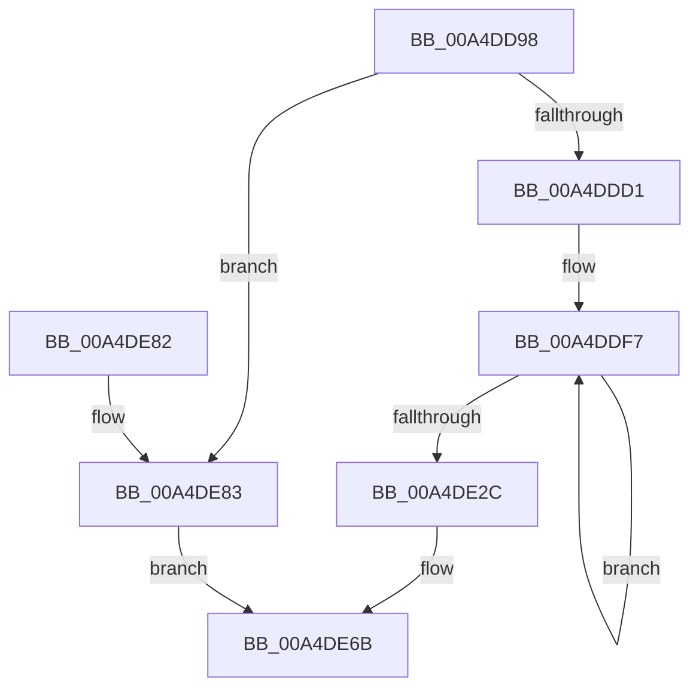

# PoInitializeBroadcast

- RVA: `0x00A4DD98`–`0x00A4DE8A` (길이 `242` bytes)
- VA: `0x0000000140A4DD98`
- 실행 섹션: `PAGE`
- PDB 이름 있음: `예`; PDB Function 태그: `아니요`
- unwind 정보 RVA: `0x00069AD0`
- 디코드: `63`개 명령, `242/242` bytes 표시
- 미해석 바이트: `0` (있으면 어셈블리에 `.byte`로 보존)

> 이 문서는 커널 이미지의 기계어와 PDB 기호를 분석해 생성했습니다. 4번과 5번은 함수 원형과 자료형을 바이너리 사용 방식에서 추정한 C 해석이며 원본 소스 복구 결과는 아닙니다.

## 1. Dependencies

- 직접 호출 지점: **4**; 고유 호출 대상: **4**
- 직접 호출자로 확인된 함수: **3**
- RIP 상대 이미지 참조: **3**

### Outgoing calls
- `0x00A4DDBE` → [ExAllocatePool2](../../poolcode/B8/ExAllocatePool2_function_00B820F0.md) (function, `0x00B820F0`)
- `0x00A4DE37` → [PpmBeginHighPerfRequest](../../text/47/PpmBeginHighPerfRequest_function_004774FC.md) (function, `0x004774FC`)
- `0x00A4DE61` → [PopBuildDeviceNotifyList](../../pagelk/B7/PopBuildDeviceNotifyList_function_00B789E8.md) (function, `0x00B789E8`)
- `0x00A4DE66` → [PopHaltDeviceIdle](../../text/4D/PopHaltDeviceIdle_function_004DFFAC.md) (function, `0x004DFFAC`)

### Direct callers
- [PopDirectedDripsInitializeBroadcast](PopDirectedDripsInitializeBroadcast_function_00A4D634.md) at `0x00A4D77D`
- [PnprQuiesceDevices](../../pagelk/B6/PnprQuiesceDevices_function_00B649E4.md) at `0x00B64ABC`
- [PopTransitionSystemPowerStateEx](../../pagelk/B7/PopTransitionSystemPowerStateEx_function_00B7E8C0.md) at `0x00B7EA2C`

### Static image references
- `0x00A4DE3E` → RVA `0x00F0BCC0` (`.data`; write)
- `0x00A4DE48` → RVA `0x00F0BCC8` (`.data`; write)
- `0x00A4DE53` → RVA `0x00F0BCD0` (`.data`; write)

## 2. Other-region calls and transfers

- 다른 실행 섹션으로 향하는 call: **4**
  - `0x00A4DDBE` → [ExAllocatePool2](../../poolcode/B8/ExAllocatePool2_function_00B820F0.md) (`PAGE` → `POOLCODE`)
  - `0x00A4DE37` → [PpmBeginHighPerfRequest](../../text/47/PpmBeginHighPerfRequest_function_004774FC.md) (`PAGE` → `.text`)
  - `0x00A4DE61` → [PopBuildDeviceNotifyList](../../pagelk/B7/PopBuildDeviceNotifyList_function_00B789E8.md) (`PAGE` → `PAGELK`)
  - `0x00A4DE66` → [PopHaltDeviceIdle](../../text/4D/PopHaltDeviceIdle_function_004DFFAC.md) (`PAGE` → `.text`)
- 별도 외부 분기/꼬리 이동을 확인하지 못했습니다.

## 3. Assembly (complete function range)

```asm
00A4DD98  48 89 5C 24 08                  mov qword ptr [rsp + 8], rbx
00A4DD9D  48 89 6C 24 10                  mov qword ptr [rsp + 0x10], rbp
00A4DDA2  48 89 74 24 18                  mov qword ptr [rsp + 0x18], rsi
00A4DDA7  57                              push rdi
00A4DDA8  48 83 EC 20                     sub rsp, 0x20
00A4DDAC  8B E9                           mov ebp, ecx
00A4DDAE  BA D8 01 00 00                  mov edx, 0x1d8
00A4DDB3  B9 40 00 00 00                  mov ecx, 0x40
00A4DDB8  41 B8 50 44 73 73               mov r8d, 0x73734450
00A4DDBE  E8 2D 43 13 00                  call 0x140b820f0
00A4DDC3  33 FF                           xor edi, edi
00A4DDC5  48 8B F0                        mov rsi, rax
00A4DDC8  48 85 C0                        test rax, rax
00A4DDCB  0F 84 B2 00 00 00               je 0x140a4de83
00A4DDD1  65 48 8B 04 25 88 01 00 00      mov rax, qword ptr gs:[0x188]
00A4DDDA  48 8D 4E 60                     lea rcx, [rsi + 0x60]
00A4DDDE  48 89 46 10                     mov qword ptr [rsi + 0x10], rax
00A4DDE2  8D 57 05                        lea edx, [rdi + 5]
00A4DDE5  48 8D 86 B0 01 00 00            lea rax, [rsi + 0x1b0]
00A4DDEC  48 89 7E 08                     mov qword ptr [rsi + 8], rdi
00A4DDF0  48 89 40 08                     mov qword ptr [rax + 8], rax
00A4DDF4  48 89 00                        mov qword ptr [rax], rax
00A4DDF7  48 8D 41 E8                     lea rax, [rcx - 0x18]
00A4DDFB  48 89 41 F0                     mov qword ptr [rcx - 0x10], rax
00A4DDFF  48 89 00                        mov qword ptr [rax], rax
00A4DE02  48 8D 41 F8                     lea rax, [rcx - 8]
00A4DE06  48 89 01                        mov qword ptr [rcx], rax
00A4DE09  48 89 00                        mov qword ptr [rax], rax
00A4DE0C  48 8D 41 08                     lea rax, [rcx + 8]
00A4DE10  48 89 41 10                     mov qword ptr [rcx + 0x10], rax
00A4DE14  48 89 00                        mov qword ptr [rax], rax
00A4DE17  48 8D 41 18                     lea rax, [rcx + 0x18]
00A4DE1B  48 89 41 20                     mov qword ptr [rcx + 0x20], rax
00A4DE1F  48 8D 49 48                     lea rcx, [rcx + 0x48]
00A4DE23  48 89 00                        mov qword ptr [rax], rax
00A4DE26  48 83 EA 01                     sub rdx, 1
00A4DE2A  75 CB                           jne 0x140a4ddf7
00A4DE2C  8B C5                           mov eax, ebp
00A4DE2E  24 01                           and al, 1
00A4DE30  F6 D8                           neg al
00A4DE32  1B DB                           sbb ebx, ebx
00A4DE34  83 E3 03                        and ebx, 3
00A4DE37  E8 C0 96 A2 FF                  call 0x1404774fc
00A4DE3C  8B D3                           mov edx, ebx
00A4DE3E  48 89 3D 7B DE 4B 00            mov qword ptr [rip + 0x4bde7b], rdi
00A4DE45  83 CA 04                        or edx, 4
00A4DE48  48 89 3D 79 DE 4B 00            mov qword ptr [rip + 0x4bde79], rdi
00A4DE4F  40 80 E5 02                     and bpl, 2
00A4DE53  48 89 35 76 DE 4B 00            mov qword ptr [rip + 0x4bde76], rsi
00A4DE5A  48 8D 4E 30                     lea rcx, [rsi + 0x30]
00A4DE5E  0F 44 D3                        cmove edx, ebx
00A4DE61  E8 82 AB 12 00                  call 0x140b789e8
00A4DE66  E8 41 21 A9 FF                  call 0x1404dffac
00A4DE6B  48 8B 5C 24 30                  mov rbx, qword ptr [rsp + 0x30]
00A4DE70  8B C7                           mov eax, edi
00A4DE72  48 8B 6C 24 38                  mov rbp, qword ptr [rsp + 0x38]
00A4DE77  48 8B 74 24 40                  mov rsi, qword ptr [rsp + 0x40]
00A4DE7C  48 83 C4 20                     add rsp, 0x20
00A4DE80  5F                              pop rdi
00A4DE81  C3                              ret
00A4DE82  CC                              int3
00A4DE83  BF 9A 00 00 C0                  mov edi, 0xc000009a
00A4DE88  EB E1                           jmp 0x140a4de6b
```

## 4. C-style interpretation (structured pseudocode)

```c
__int64 __fastcall PoInitializeBroadcast(int a1)
{
    __int64 result;
    __int64 v_rbp;
    __int64 v_rbx;
    __int64 v_rdi;
    __int64 v_rsp;
    unsigned __int64 v_stack_p10;
    unsigned __int64 v_stack_p18;
    unsigned __int64 v_stack_p8;

    v_stack_p8 = v_rbx;
    v_stack_p10 = v_rbp;
    v_stack_p18 = v_rsi;
    v_rsp = (v_rsp) - (32);
    result = ExAllocatePool2(64, 472, (unsigned int)(0x73734450ULL), a4);
    v_rdi = 0;
    if (result == 0) goto loc_00A4DE83;
    *(unsigned __int64 *)(result + 16) = *(unsigned __int64 *)(gs_base + (0 + 392));
    *(unsigned __int64 *)(result + 8) = 0;
    *(unsigned __int64 *)(result + 432 + 8) = result + 432;
    *(unsigned __int64 *)(result + 432) = result + 432;
loc_00A4DDF7:
    *(unsigned __int64 *)(result + 96 - 16) = result + 96 - 24;
    *(unsigned __int64 *)(result + 96 - 24) = result + 96 - 24;
    *(unsigned __int64 *)(result + 96) = result + 96 - 8;
    *(unsigned __int64 *)(result + 96 - 8) = result + 96 - 8;
    *(unsigned __int64 *)(result + 96 + 16) = result + 96 + 8;
    *(unsigned __int64 *)(result + 96 + 8) = result + 96 + 8;
    *(unsigned __int64 *)(result + 96 + 32) = result + 96 + 24;
    *(unsigned __int64 *)(result + 96 + 24) = result + 96 + 24;
    a2 = (v_rdi + 5) - (1);
    if (condition_is_not_equal) goto loc_00A4DDF7;
    result = (unsigned __int8)(((unsigned int)((unsigned int)((unsigned int)(a1)))) & (1));
    result = (unsigned __int8)(-(result));
    v_rbx = (unsigned int)((v_rbx) & (3));
    result = PpmBeginHighPerfRequest(result + 96 + 72, a2, (unsigned int)(0x73734450ULL), a4);
    *(unsigned __int64 *)(v_rip + 4972155) = 0;
    a2 = (unsigned int)(((unsigned int)((unsigned int)(v_rbx))) | (4));
    *(unsigned __int64 *)(v_rip + 4972153) = 0;
    v_rbp = (unsigned __int8)(((unsigned int)(a1)) & (2));
    *(unsigned __int64 *)(v_rip + 4972150) = result;
    if (condition_is_equal) { a2 = (unsigned int)(v_rbx); }
    result = PopBuildDeviceNotifyList(result + 48, a2, (unsigned int)(0x73734450ULL), a4);
    result = PopHaltDeviceIdle(result + 48, a2, (unsigned int)(0x73734450ULL), a4);
loc_00A4DE6B:
    v_rsp = (v_rsp) + (32);
    return 0;
loc_00A4DE83:
    goto loc_00A4DE6B;
}
```

## 5. (Beta) C Style

```c
int64_t PoInitializeBroadcast(int32_t Arg1)
{
    int64_t result;
    int64_t local_rbp;
    int64_t local_rbx;
    int64_t local_rdi;
    int64_t local_rsp;
    uint64_t v_stack_p10;
    uint64_t v_stack_p18;
    uint64_t v_stack_p8;

    v_stack_p8 = local_rbx;
    v_stack_p10 = local_rbp;
    v_stack_p18 = local_rsi;
    local_rsp = (local_rsp) - (32);
    result = ExAllocatePool2(64, 472, (uint32_t)(0x73734450ULL), a4);
    local_rdi = 0;
    if (result == 0) goto loc_00A4DE83;
    *(uint64_t *)(result + 0x10) = *(uint64_t *)(gs_base + (0 + 0x188));
    *(uint64_t *)(result + 0x8) = 0;
    *(uint64_t *)(result + 0x1B0 + 0x8) = result + 432;
    *(uint64_t *)(result + 0x1B0) = result + 432;
loc_00A4DDF7:
    *(uint64_t *)(result + 0x60 - 0x10) = result + 96 - 24;
    *(uint64_t *)(result + 0x60 - 0x18) = result + 96 - 24;
    *(uint64_t *)(result + 0x60) = result + 96 - 8;
    *(uint64_t *)(result + 0x60 - 0x8) = result + 96 - 8;
    *(uint64_t *)(result + 0x60 + 0x10) = result + 96 + 8;
    *(uint64_t *)(result + 0x60 + 0x8) = result + 96 + 8;
    *(uint64_t *)(result + 0x60 + 0x20) = result + 96 + 24;
    *(uint64_t *)(result + 0x60 + 0x18) = result + 96 + 24;
    a2 = (local_rdi + 5) - (1);
    if (condition_is_not_equal) goto loc_00A4DDF7;
    result = (uint8_t)(((uint32_t)((uint32_t)((uint32_t)(Arg1)))) & (1));
    result = (uint8_t)(-(result));
    local_rbx = (uint32_t)((local_rbx) & (3));
    result = PpmBeginHighPerfRequest(result + 96 + 72, a2, (uint32_t)(0x73734450ULL), a4);
    *(uint64_t *)(v_rip + 0x4BDE7B) = 0;
    a2 = (uint32_t)(((uint32_t)((uint32_t)(local_rbx))) | (4));
    *(uint64_t *)(v_rip + 0x4BDE79) = 0;
    local_rbp = (uint8_t)(((uint32_t)(Arg1)) & (2));
    *(uint64_t *)(v_rip + 0x4BDE76) = result;
    if (condition_is_equal) { a2 = (uint32_t)(local_rbx); }
    result = PopBuildDeviceNotifyList(result + 48, a2, (uint32_t)(0x73734450ULL), a4);
    result = PopHaltDeviceIdle(result + 48, a2, (uint32_t)(0x73734450ULL), a4);
loc_00A4DE6B:
    local_rsp = (local_rsp) + (32);
    return 0;
loc_00A4DE83:
    goto loc_00A4DE6B;
}
```

## 6. Execution-region graph

[열기: 2D/3D 그래프와 함수 탐색 컨트롤 패널](../../../control-panel.html?section=page&rva=0x00A4DD98&view=graph)

- 2D 그래프는 위에서 아래로 흐르고, 3D 그래프는 빈 공간을 드래그해 회전합니다. Shift+드래그는 이동, 휠은 확대·축소, 함수 노드 선택은 대상 보고서 이동입니다.

### Static fallback


