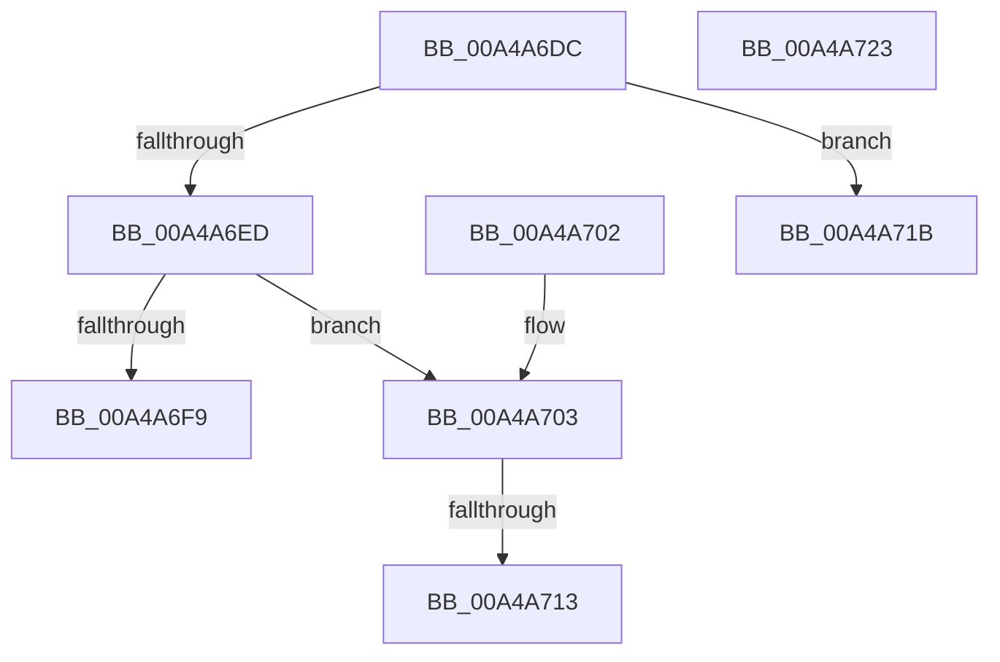

# PopAudioAccountingCallback

- RVA: `0x00A4A6DC`–`0x00A4A724` (길이 `72` bytes)
- VA: `0x0000000140A4A6DC`
- 실행 섹션: `PAGE`
- PDB 이름 있음: `예`; PDB Function 태그: `예`
- unwind 정보 RVA: `0x000DB714`
- 디코드: `18`개 명령, `72/72` bytes 표시
- 미해석 바이트: `0` (있으면 어셈블리에 `.byte`로 보존)

> 이 문서는 커널 이미지의 기계어와 PDB 기호를 분석해 생성했습니다. 4번과 5번은 함수 원형과 자료형을 바이너리 사용 방식에서 추정한 C 해석이며 원본 소스 복구 결과는 아닙니다.

## 1. Dependencies

- 직접 호출 지점: **0**; 고유 호출 대상: **0**
- 직접 호출자로 확인된 함수: **1**
- RIP 상대 이미지 참조: **4**

### Outgoing calls
- 직접 디코드된 call 명령이 없습니다.

### Direct callers
- [PopWnfAudioCallback](PopWnfAudioCallback_function_00A4A0E0.md) at `0x00A4A183`
- [PopWnfAudioCallback](PopWnfAudioCallback_function_00A4A0E0.md) at `0x00A4A1FB`

### Static image references
- `0x00A4A6ED` → RVA `0x00E27D08` (`.data`; read)
- `0x00A4A6F9` → RVA `0x00E27D50` (`.data`; read/write)
- `0x00A4A703` → RVA `0x00E27D50` (`.data`; read)
- `0x00A4A71B` → RVA `0x00E27D50` (`.data`; write)

## 2. Other-region calls and transfers

- 다른 실행 섹션으로 향하는 call: **0**
- call이 아닌 외부 분기/꼬리 이동: **2**
  - `0x00A4A70D` → `0x00B3B7E6` (`tail-transfer`)
  - `0x00A4A716` → `0x00B3B7E9` (`tail-transfer`)

## 3. Assembly (complete function range)

```asm
00A4A6DC  48 B8 08 00 00 00 80 F7 FF FF   movabs rax, 0xfffff78000000008
00A4A6E6  48 8B 00                        mov rax, qword ptr [rax]
00A4A6E9  84 C9                           test cl, cl
00A4A6EB  75 2E                           jne 0x140a4a71b
00A4A6ED  48 8B 0D 14 D6 3D 00            mov rcx, qword ptr [rip + 0x3dd614]
00A4A6F4  48 85 C9                        test rcx, rcx
00A4A6F7  75 0A                           jne 0x140a4a703
00A4A6F9  48 83 25 4F D6 3D 00 00         and qword ptr [rip + 0x3dd64f], 0
00A4A701  C3                              ret
00A4A702  CC                              int3
00A4A703  48 8B 15 46 D6 3D 00            mov rdx, qword ptr [rip + 0x3dd646]
00A4A70A  48 3B CA                        cmp rcx, rdx
00A4A70D  0F 86 D3 10 0F 00               jbe 0x140b3b7e6
00A4A713  48 2B C1                        sub rax, rcx
00A4A716  E9 CE 10 0F 00                  jmp 0x140b3b7e9
00A4A71B  48 89 05 2E D6 3D 00            mov qword ptr [rip + 0x3dd62e], rax
00A4A722  C3                              ret
00A4A723  CC                              int3
```

## 4. C-style interpretation (structured pseudocode)

```c
__int64 __fastcall PopAudioAccountingCallback(unsigned __int8 a1)
{
    __int64 result;

    if (a1 != 0) goto loc_00A4A71B;
    if (*(unsigned __int64 *)(v_rip + 4052500) != 0) goto loc_00A4A703;
    return *(unsigned __int64 *)(result);
loc_00A4A703:
    result = (*(unsigned __int64 *)(result)) - (*(unsigned __int64 *)(v_rip + 4052500));
loc_00A4A71B:
    *(unsigned __int64 *)(v_rip + 4052526) = result;
    return result;
}
```

## 5. (Beta) C Style

```c
int64_t PopAudioAccountingCallback(uint8_t Arg1)
{
    int64_t result;

    if (Arg1 != 0) goto loc_00A4A71B;
    if (*(uint64_t *)(v_rip + 0x3DD614) != 0) goto loc_00A4A703;
    return *(uint64_t *)(result);
loc_00A4A703:
    result = (*(uint64_t *)(result)) - (*(uint64_t *)(v_rip + 0x3DD614));
loc_00A4A71B:
    *(uint64_t *)(v_rip + 0x3DD62E) = result;
    return result;
}
```

## 6. Execution-region graph

[열기: 2D/3D 그래프와 함수 탐색 컨트롤 패널](../../../control-panel.html?section=page&rva=0x00A4A6DC&view=graph)

- 2D 그래프는 위에서 아래로 흐르고, 3D 그래프는 빈 공간을 드래그해 회전합니다. Shift+드래그는 이동, 휠은 확대·축소, 함수 노드 선택은 대상 보고서 이동입니다.

### Static fallback


